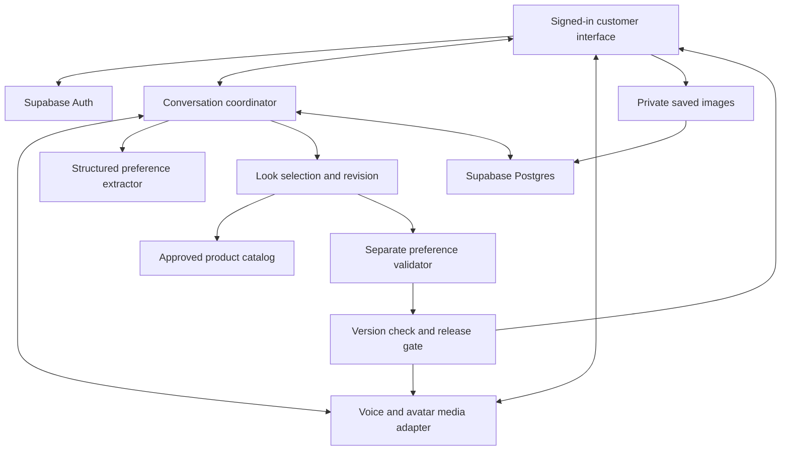

# AI Stylist: Technical decisions, system patterns and architecture

Status: Draft for Sabine's review, v0.11  
Created: 9 October 2026  
Approval: Phone website delivery, email/password plus Google and Apple sign-in, one simultaneous consultation for first launch, and Supabase for accounts, saved preferences, wardrobe photos and saved looks approved by Sabine on 9 October 2026; ElevenLabs excluded by Sabine on 9 October 2026; initial $25 experiment spending limit approved by Sabine on 9 October 2026; Supabase + Render approved for MVP hosting by Sabine on 9 October 2026; React + TypeScript website and Node.js + TypeScript service approved on 9 October 2026; volatile unsaved notes accepted for the private prototype only; remaining architecture and operational choices are pending  
Baselines: [Product specification v1.0](product-spec.md), approved 8 October 2026; [Design specification v1.0](design.md), approved 9 October 2026  
Evidence: Official provider and testing documentation reviewed on 9 October 2026  
Canonical file: tech-spec.md  
Build plan and current status: [docs/progress.md](../docs/progress.md)

## Current technical memory checkpoint, 11 October 2026

- **Authority:** Autonomous routine implementation and documented engineering decisions are authorized. Earlier task-group approval wording in historical records is superseded by root AGENTS.md. Business, credentials, financial, security-sensitive and irreversible decisions still require intervention.
- **Working code:** The prepared notebook owns bounded transcription/extraction, revision-bound edits and final-turn settlement. The server owns the authoritative notebook and look gate. Starting input, editing, ending or cleanup uncertainty revokes display and queued-speech authorization. The internally checked immutable synthetic candidate generates the same description used for display/speech; callers cannot supply a passed result. Exclusions now come from a separately injected simulated server profile. Candidate-supplied exclusions are rejected. Local profile persistence/revision protections are prepared; authenticated hosted profile access and the live independent validation agent remain unverified.
- **Persistence/accounts:** Task 2b and Task 2c are authorized for local preparation only. Owner-scoped schema, mixed saved looks, staged images, deletion/retired-ID retention and single-consultation slot are prepared. Disconnected account security now composes current-session SQL, generated-token verification, bounded JWKS, cookies, request and callback gates, plus callback exchange/late-session cleanup. Real provider, refresh, recovery and hosted route activation remain open. New migrations and transports remain disabled remotely.
- **Verification:** All 346 foundation tests across 39 files, type checking and build pass. Previously recorded local PostgreSQL, sixteen-migration actual Storage upgrade and six decoder-resource scenarios pass; their synthetic Auth limits remain explicit. The last recorded prototype run passed 1,273 checks and was not rerun for this account checkpoint. Local generated tokens and simulated provider ports do not establish real sign-in or remote cleanup.
- **Publication:** Verified source through ef17952 is pushed to GitHub and copied with byte verification. The owner-only private Memory refresh succeeded with source 08ddbfd (287-test account exchange checkpoint), deployment appgdep_6acc3e3ad5d481918c1fce4b5db66104. The earlier protected voice/device preview remains on Render Free. No customer deployment or account activation is claimed.
- **Decoder containment:** Six isolated Linux scenarios pass with the actual sanitizer and pinned Sharp, 384 MiB/no swap, half a CPU, 64 processes, non-root identity and read-only source. Native-buffer OOM is confirmed inside the container. See [resource rehearsal](../docs/image-decoder-resource-rehearsal.md). These are local-only limits; customer upload activation still requires actual hosted enforcement and recovery, and no Docker daemon is assumed on Render.
- **Remaining gates:** Tavus recovery clarification, live validation of the dedicated transcription startup and remote cleanup contract, a new paid-trial allowance, permitted retailer/feed imagery and affiliate access, customer-provider privacy terms, and customer restart recovery remain open. All nine approved provider attempts are closed and the reserve is zero. No new spend is authorized; do not reset or reuse legacy reservations. Sabine asked to skip latest spending checks. OpenAI questions were authorized and an AI-assisted reply was received; the reviewed disposition below governs current status.
- **Exact next action:** Continue authorized local Task 2c scoped recovery and sign-out interfaces using the shared verified-session/cleanup contract. Publish/copy verified work and refresh private Memory. Sabine accepted the eight-step local account preview; independent local work continues. Task 2a is accepted; Phase 1 stays open. No real sign-ins, hosted changes or paid calls are authorized by this preparation.

Historical dated sections below preserve what was known at each checkpoint. Use this checkpoint, DEVELOPMENT_PROGRESS.md and docs/progress.md for current status. Product/design remain approved v1.0; technical proposal v0.11 is not promoted to a fully approved architecture by this review.

## 1. Summary in plain words

The app needs five parts: the customer interface, a realistic speaking stylist, live notebook memory, a service that finds real products, and a separate service that checks each proposed look. Sabine approved Supabase for accounts, saved preferences, wardrobe photos and saved looks on 9 October 2026. Use Supabase Auth for account access, Postgres for saved records and private Storage for saved images. Optional Edge Function uses and remaining deployment details are still proposed. Sabine approved Supabase + Render for the MVP on 9 October 2026: Render hosts the customer website and conversation service. A static website and a separate small web service remain the proposed deployment arrangement; React + TypeScript and Node.js + TypeScript are now approved separately in D12; instance sizes, regions, deployment arrangement and account settings still need review.

Sabine approved starting with a website designed for phones on 9 October 2026. Customers will open it in their phone browser. Sabine subsequently approved React + TypeScript for the website and Node.js + TypeScript for the conversation service on 9 October 2026, recorded in D12. Hosting approval is recorded in D11. An App Store or Google Play app would require a later separate decision. The approved notebook appearance, collage, navigation, and accessibility requirements apply to either approach.

The hardest dependency is connecting OpenAI's voice conversation to Tavus's photorealistic avatar while preserving interruptions, lip synchronization, live notes, and preference checking. That connection must be demonstrated before choosing the final media architecture. Real US product data and approved affiliate access are a second launch dependency.

This document proposes how to meet the agreed requirements and records limited prototype evidence below. It does not approve unresolved architecture choices or close launch risks. Phone website delivery, email/password plus Google and Apple sign-in, a first launch with one simultaneous consultation, and Supabase for accounts, saved preferences, wardrobe photos and saved looks are approved. Supabase + Render is also approved for MVP hosting. Unresolved business, financial, privacy, security-sensitive and customer-recovery decisions remain proposals for Sabine. Routine implementation details may be selected and documented autonomously under AGENTS.md.

Sabine confirmed one simultaneous consultation for first launch. Keep provider, catalog and state adapters extensible so capacity can increase later without changing notebook or validation rules. Sabine approved the $25 total initial-experiment limit on 9 October 2026. Task 1a has prepared its dated cost worksheet, with a separate expanded option requiring later approval. See the discovery plan below.

### Critical risks to prove early

- **Voice/avatar compatibility and live notes:** the proposed connection must work with interruptions and notes during continuous speech, not just a recorded demo.
- **Preference checking before presentation:** stale or conflicting looks must not be displayed or recommended aloud.
- **Customer privacy and isolation:** private images, account access and external-provider retention need verified controls.
- **Real shopping sources:** data access, image rights, required product evidence and affiliate approval are launch dependencies.
- **Cost:** the initial $25 experiment cap is approved; actual account charges and production unit costs remain unverified. Sabine has Supabase Pro and separately approved the AI Stylist project at the displayed additional $10/month. No additional paid trial or upgrade is authorized; actual charges are not inferred from reserved amounts.

See risks R01–R11 in Section 15 and their blocking checkpoints in docs/progress.md. These risks remain open; written mitigations are not completed validation.

## 2. What is fixed and what needs approval

**Approved provider constraint, 9 October 2026:** Do not use ElevenLabs for this project. Exclude its voice generation, agent services, project SDK/API dependencies, credentials and configured fallbacks, including a voice-provider selection inside Tavus. OpenAI Realtime and Tavus remain candidates, subject to a compatible prototype; their integration is not newly approved by this exclusion.


### Approved requirements carried forward

- Both women and men, USA first, USD, account required before styling. Sabine also approved email/password with recovery, Google sign-in and Apple sign-in for the first version on 9 October 2026.
- One consistent photorealistic female stylist; natural conversation with captions and touch/text alternatives.
- Preferences collected during the first conversation, with separate explicit profile saving.
- Progressive notebook updates during continuous speech, corrections, visible uncertainty, and actual item photos.
- Live camera, customer-confirmed still references, and optional digital wardrobe saving in the first version.
- One look at a time, repeated feedback, kept items, comparison, and undo.
- A separate background preference check before each recommendation, revision, restore, and shopping list addition.
- Real retailer product pages, source-backed estimates, external checkout, affiliate commission revenue and disclosures.
- Saved looks contain the look only. Notebook notes, feedback, conversation, and session revision history stay within the session.
- Supabase as the platform foundation; approved design v1.0, including the notebook starting collapsed.

### Technical decision log

| ID | Status/date | Decision and reason | Owner and verification |
| --- | --- | --- | --- |
| D01 | Platform approved 8 October 2026; core roles approved 9 October 2026 | Supabase handles accounts, saved preferences, wardrobe photos and saved looks. Auth, Postgres and private Storage support these roles on the chosen platform. Optional Edge Function uses and operational settings remain proposed; MVP hosting is approved separately in D11. | Sabine; implementation and isolation evidence in Phase 2. |
| D02 | Approved, 9 October 2026 | First delivery is a website designed for phones, accessible in a browser. Native app distribution is a later decision. | Sabine; physical-phone checks in Phases 1 and 8. |
| D03 | Approved, 9 October 2026 | Email/password with recovery, Google sign-in and Apple sign-in in the first version. | Sabine; P2-01/P2-04/P2-06 and real-provider manual checks. |
| D04 | Approved capacity target, 9 October 2026 | One simultaneous consultation for first launch. Infrastructure should have seams to increase capacity later. | Sabine; atomic-slot test in Phase 2 and load checks in Phase 8. |
| D05 | Approved product constraint, 8 October 2026 | Save look stores the look, not notebook notes, feedback, transcripts or revision history. Profile/wardrobe saves are separate. | Sabine; P7-01/P7-02/P7-04. |
| D06 | Approved design constraint, 9 October 2026 | Notebook starts collapsed; actual item thumbnail and progressive summary remain visible. | Sabine; notebook/component and manual phone checks. |
| D07 | Requirement to propose, 9 October 2026; not architecture approval | Technical memory must record decisions/patterns, propose an extensible secure architecture and flag critical risks. progress.md must track phases with automated and manual checks. | Sabine's task instruction; documents created, implementation remains pending. |
| D08 | Initial cap approved, 9 October 2026 | Sabine approved $25 total for the first private experiment: up to $10 OpenAI, $7 hosting and $8 reserve, with available free Tavus minutes. This is not approval of the $100 expanded illustration, a production budget or unreviewed technology choices. | Approved in direct reply to the spending-limit question; worksheet and stopping controls in docs/task-1a-discovery-plan.md. |
| D09 | Approved exclusion, 9 October 2026 | ElevenLabs is excluded from the project, including voice, agents, API/SDK integration and configured provider fallbacks. Check the selected Tavus voice path before accepting it. | Sabine; provider-policy fixture and actual configuration review in 1b/8a. |
| D10 | Task scope authorized, 9 October 2026 | Sabine instructed the team to proceed with 1a. Prepare research, recommendations and reviewable documents. This does not approve the proposed technologies, a dollar cap, paid setup or group 1b. | Implementer prepares; Sabine reviews remaining decisions. |
| D11 | MVP hosting approved, 9 October 2026 | Supabase + Render for the MVP. Supabase keeps accounts, saved preferences, wardrobe photos and saved looks; Render hosts the website and conversation service. This uses two hosting platforms while retaining Supabase account/data tools. The earlier Cloudflare Pages proposal is superseded. | Sabine explicitly selected this setup. Runtime/framework subsequently approved in D12; service sizing, production budget, security configuration and deployment evidence remain pending. |
| D12 | Tools approved, 9 October 2026 | React + TypeScript for the website and Node.js + TypeScript for the conversation service. React supports interactive notebook/look screens; shared TypeScript contracts help catch data-shape mistakes across client and server. | Sabine replied "1a and 2a" to the numbered approval choices. Specific versions, libraries and deployment configuration remain to be selected and checked in the relevant build groups. |
| D13 | Private prototype tradeoff approved, 9 October 2026 | Keep unsaved session notes in volatile memory for the private prototype only. A coordinator restart loses active notes, feedback and unsaved reference images; saved Supabase records remain. A brief disconnect can resume only while the same owned server session still exists. | Sabine selected 2a. Explain restart loss, stop stale visual/audio recommendations and offer a new consultation from saved data. Verify behavior in the prototype. Customer MVP recovery requires a separate review before launch; no persistent recovery store is approved. |
| D14 | Task 1b authorized, 9 October 2026 | Sabine said "proceed with 1b." Build the isolated voice/avatar experiment and its checks under the existing provider exclusion, privacy preflight and $25 cap. | Local simulation and a scripted provider probe are implemented; continuous conversation and physical-phone acceptance remain pending. This does not approve Task 1c, a different media architecture or expanded spending. |

Sabine reported Supabase Pro and subsequently approved and created the additional AI Stylist project at the displayed $10/month. The existing private-test ledger was verified there. Actual charges and unused compute credit are not inferred from that approval; latest spending checks are skipped at Sabine's request.

For proposed technologies T01–T09, record accepted/rejected choices here after review, with rationale and evidence. A framework, host, provider connection or retention setting described below is not an approved decision simply because it appears in the architecture diagram.

### Decision status and proposed choices to review

| ID | Proposal | Reason or unresolved dependency |
| --- | --- | --- |
| T01 | Phone website first: approved by Sabine on 9 October 2026. React + TypeScript: approved on 9 October 2026. | Phone delivery and the later Supabase + Render host selection are approved; React + TypeScript is approved separately in D12. Actual phone media behavior needs a prototype. Native distribution is outside the initial delivery plan. |
| T02 | Approved: Supabase for accounts, saved preferences, wardrobe photos and saved looks, using Auth, Postgres and private Storage. | Approved by Sabine on 9 October 2026. Schema, security configuration, optional Edge Functions and other data-service uses remain implementation proposals to review. |
| T03 | Approved: Supabase + Render for MVP hosting. Render hosts the website and conversation service; Supabase retains its approved account/data/image roles. | Sabine approved on 9 October 2026. Propose a Render static site plus a small web service. Node.js + TypeScript is approved in D12; instance sizes, regions, authentication deployment and account configuration remain implementation proposals. Cloudflare Pages is superseded. |
| T04 | Prototype OpenAI Realtime with Tavus external playback first; ElevenLabs excluded. | Preserve the intended candidates; streaming audio, synchronization, interruption and live transcription support remain unproven. Check selected voice providers and fallbacks against D09. |
| T05 | Email/password with recovery, Google sign-in and Apple sign-in: approved by Sabine on 9 October 2026. | Supabase Auth is approved for account access; callback/session implementation and email-verification settings remain proposed. Provider setup, callback security and account identity handling need implementation review and tests. |
| T06 | Approved for the private prototype only: volatile session memory, with explicit expiry | Sabine accepted restart loss on 9 October 2026 (D13). Saved Supabase records remain. Before customer launch, review restart recovery and any expiring shared storage/privacy implications; exact timeouts remain proposed. |
| T07 | Hard constraint rules plus a separate AI compatibility evaluator | Numeric and categorical rules are reproducible; subjective style interpretation still needs careful evaluation and uncertainty handling. |
| T08 | Licensed retailer/affiliate feeds or approved APIs | Real sources and imagery rights are required. Specific programs and coverage are not yet agreed or available. |
| T09 | Retention, attempt limits, cost caps and operational targets in this draft | Proposed settings must be agreed and measured. The product's existing latency requirements remain fixed. |
| T10 | One simultaneous consultation for first launch: approved by Sabine on 9 October 2026. | Enforce a single consultation slot initially; later capacity increases need measured costs and a reviewed session-state design. |

### Task 1a review completed; prototype evidence remains pending

The [Task 1a discovery plan and cost worksheet](../docs/task-1a-discovery-plan.md), dated 9 October 2026, provides the concrete review proposal. It records source-backed prices, assumptions, account actions, data boundaries and privacy preflight requirements. Authorizing 1a started this planning work; the separate budget and MVP hosting approvals are recorded below. Framework/runtime and the private-prototype memory tradeoff are now approved. Other implementation proposals remain pending in their designated groups.

| Decision | Recommendation ready for Sabine | Current status |
| --- | --- | --- |
| T01 | React + TypeScript for the approved phone website | Approved on 9 October 2026 in D12; versions and build dependencies remain to be pinned. |
| T03 | Supabase + Render; propose a Render static site and small Node.js coordinator | Hosting providers and roles approved on 9 October 2026. Node.js + TypeScript runtime approved in D12; service sizing, regions and actual account pricing/capacity remain unverified. |
| T02 optional uses | Defer Edge Functions initially; use coordinator for session/token handling and assess bounded independent jobs later | Proposed deferral, not an added Supabase responsibility. |
| T04 | Try OpenAI Realtime audio through Tavus Echo with one licensed stock female face | Experiment candidate only; compatibility and provider-policy evidence required in 1b. |
| T06 | Volatile session memory for the experiment, with clear loss of unsaved notes on restart | Accepted on 9 October 2026 for the private prototype only (D13). Customer MVP recovery remains unresolved and must be reviewed before launch. |
| T07 | Deterministic hard constraints, independent model check and one version-bound visual/audio release gate | Recommended experiment direction, not proof of effectiveness. |
| D08 / T09 | $25 total initial allowance: $10 OpenAI, $7 hosting, $8 reserve; free avatar/static allowances and existing Supabase Pro only where eligible, with incremental costs checked; maximum 20 connected avatar minutes including setup/retries | Initial dollar cap approved by Sabine on 9 October 2026. Technology choices and other operational settings remain pending. Separate expanded-trial illustration requires separate approval. |
| T05, T08 and production T09 settings | Review detailed authentication configuration, specific catalog programs, retention periods, final model IDs and launch operating budget in their designated groups | Explicitly deferred proposals; existing product requirements remain fixed. |

Provider documentation review found that Tavus Echo does not include the normal perception/speech-recognition layers, so external transcription and camera processing must be proved. Stored transcripts and recording controls require account-specific confirmation; turning off recordings alone is insufficient. OpenAI's Realtime endpoint lists no application-state retention, but default abuse monitoring can retain content for up to 30 days, subject to exceptions. These findings keep R01/R02/R07/R11 open. Actual account settings have not been inspected. [Tavus pipeline modes](https://docs.tavus.io/sections/conversational-video-interface/quickstart/pipeline-modes), [Tavus pricing/transcript features](https://www.tavus.io/pricing), [OpenAI data controls](https://developers.openai.com/api/docs/guides/your-data).

Use synthetic media until the preflight record identifies the selected providers, remaining retention, recording/tracing configuration and consent explanation. Sabine's microphone/camera use is real-person media and needs this preflight too. No paid account setup or prototype code was created in 1a.

### Task 1b implementation findings, 9 October 2026

The isolated harness has a silent simulation and an explicit scripted provider mode. In the repeat, OpenAI Realtime gpt-realtime-2.1 / marin generated a fixed clip, then closed its WebSocket. Buffered PCM16 at 24 kHz was paced to Tavus Audio Echo using pipecat0 and Anna - Casual. Sabine confirmed hearing the sentence and seeing mouth movement. This supports the desktop scripted connection only; continuous streaming, natural latency, precise lip-sync and phone quality remain unverified. [Detailed evidence](../docs/task-1b-voice-avatar.md).

Implementation patterns: separate generation completion from playback acknowledgment; mark only the last Echo chunk done; keep JSON below Daily's 4 KB limit; pace 20 ms chunks and invalidate timers on cancellation. Trust only the expected remote participant and conversation for observed events. Provider speaking duration and sent bytes are not exact customer-heard position. The simulation holds unknown playback position and requires a fresh context; continuous-conversation reset/truncation still needs a working check.

The server owns credentials, fixed-script generation, private-room creation and cleanup. Browser microphone/camera remain disabled. Each attempt reserves $2 and five avatar minutes in an ignored owner-only durable ledger; unresolved creation/cleanup, missing/corrupt records and exhausted allowance block further attempts. Two closed reservations total $4 and ten minutes, not actual billed usage. Private rooms disable recording and expire at 90 seconds, with an earlier server deadline and heartbeat cleanup. End success can have an empty body: verify room status separately before closing its reservation. A first-run false cleanup hold exposed and corrected that parsing assumption.

68 focused mocked tests, type checking and build pass. No switch to the full Tavus pipeline, text Echo, GPT-Live or ElevenLabs is approved. The inspected Echo PAL has no TTS/LLM/STT layer and microphone disabled; no PAL was changed. Actual provider retention/training/deletion, human-media consent, exact playback evidence, real-phone behavior and actual cost reconciliation remain open. R01/R07/R09/R10/R11 remain open. Exact dependencies are experiment choices in the lockfile, not production architecture approval.

## 3. Proposed architecture and hosting



The diagram shows logical responsibilities, not a proven media connection. The release gate controls both the visible recommendation and the stylist's description of recommended products. The media adapter is selected only after the integration prototype.

| Service | Proposed responsibility | Important boundary |
| --- | --- | --- |
| Customer interface on Render | Account screens, avatar stage, captions, notebook, camera preview, collage, feedback, wardrobe, saved looks, profile and shopping list | Never contains provider secret keys or decides that an unchecked look can be released. |
| Supabase Auth | Account identity and access recovery | Signing in does not grant camera, microphone or permanent-save consent. |
| Supabase Postgres | Explicitly saved profiles, wardrobe entries, saved looks, lists, catalog records and minimal operational records | Do not store notebook notes, transcripts, feedback or session revision history by default. |
| Supabase private Storage | Explicitly saved wardrobe images and selected saved-look visual assets | Owner-scoped access; session-only images remain temporary. |
| Supabase Edge Functions | Bounded account/export/deletion jobs, token issuance or catalog operations where execution fits | Long conversations and repeated model orchestration live outside the function request lifecycle. |
| Conversation coordinator on Render | Authenticated session ownership, ordered edits, transient notes, media events, extraction, candidate generation and validation, cancellation and cleanup | Initially one service instance with bounded concurrent sessions; scale design requires further review. |
| OpenAI adapters | Conversation candidate, continuous transcription where required, structured extraction, garment analysis, selection and independent compatibility evaluation | Model IDs and SDK versions are chosen and pinned after capability, quality, latency and cost checks. |
| Tavus adapter | The approved realistic stylist presentation and tested speech/video path | No assumed plug-and-play Realtime connection. |
| Catalog importer | Normalize approved US products and source facts, track feed health and freshness | No fabricated URLs, unlicensed imagery, or assumed retailer access. |

Supabase documents Edge Function wall time limits of 150 seconds on free plans and 400 seconds on paid plans, with other resource limits. This supports proposing a separate coordinator for sessions that can last much longer, rather than assuming a function request can carry the entire consultation. [Supabase function limits](https://supabase.com/docs/guides/functions/limits)

Supabase + Render is the approved MVP hosting setup. Propose a Render static site for the interface and a separate web service for conversation coordination. Static sites use the workspace bandwidth/build allowances. Render supports WebSockets; interrupted connections may reconnect to another instance. Include keepalives, reconnect handling and graceful shutdown. The single-instance arrangement remains proposed; volatile-state restart loss is accepted only for the private prototype in D13. Customer MVP recovery still needs review. The protected private prototype is deployed on Render Free. This does not establish the proposed customer static-site/coordinator arrangement or production authentication, recovery and operational readiness. [Render static sites](https://render.com/docs/static-sites), [Render WebSockets](https://render.com/docs/websocket)

### Architecture boundaries and system patterns

Propose a modular app and coordinator, with clear internal responsibilities and one initial coordinator deployment. Separate logical agent roles do not require one hosted service per role. This keeps the first launch manageable while allowing individual components to be replaced or scaled later.

```text
apps/web                 Customer screens and approved design tokens
apps/coordinator         Authenticated API, live session orchestration and release gate
packages/domain          Typed notes, money, feedback, constraints and pure state rules
packages/contracts       Versioned request/event schemas and shared validation
packages/adapters        Media, models, product sources and persistence implementations
supabase/migrations      Ordered schema and policy changes
supabase/tests           Owner isolation and database behavior tests
tests/fixtures           Synthetic speech events, products, images and expected outcomes
docs/progress.md         Phased tasks, verification and current status
Project Memory/tech-spec.md  Decisions, system patterns and risk register
```

This is a proposed repository structure, not folders already created by this planning work. Keep the domain layer independent of React, Supabase and provider SDKs. Provider-specific event formats are translated at the adapter boundary.

| Pattern | Proposed rule | Extension and verification |
| --- | --- | --- |
| Adapter contracts | Define `MediaAdapter`, `TranscriptionAdapter`, `ModelAdapter`, `CatalogAdapter`, `ProfileRepository`, `AssetRepository` and `SessionStore` interfaces. Inject their implementations. | Replace a model, avatar or retailer source without changing notebook rules. Each adapter passes the same contract fixture tests. |
| Capability declaration | Media/source adapters declare supported partial transcripts, interruption, live frames, currency, variants and source evidence. | Unsupported capability produces a known limitation, never a guessed successful result. Required launch capabilities must be proved or the relevant gate remains open. |
| One mutation authority | All active-session changes use a typed reducer and monotonically increasing revisions. Profile/reference changes invalidate affected approvals through the coordinator. | New clients use the same contract; UI code cannot bypass the validator by constructing its own current look. |
| Pure hard constraints | Money, kept-item IDs, exclusions and required known facts use small deterministic functions; AI evaluates only the semantic questions it can answer. | Add constraint types through a registered typed rule, its tests and approved product meaning. An AI assertion cannot disable a rule. |
| Explicit persistence projections | Each Save action constructs an allowed record shape, separate from the transient session shape. | A new saved feature cannot accidentally serialize a complete notebook. Tests reject extra fields and verify consent boundaries. |
| Versioned contracts | Include schema version, event ID, expected revision and session epoch; reject unsupported versions clearly. | Later mobile clients and adapters can migrate safely rather than interpreting unknown data as valid. |
| Migrations and compatibility | Apply ordered database migrations to a clean test database and a prior supported schema. Prefer additive changes before removals. | Rollback and app-version compatibility are rehearsed using synthetic saved records. Do not drop or reinterpret customer data without a reviewed migration. |
| Bounded work and cancellation | Give every external call a deadline, cancellation signal, attempt cap and idempotency handling. | New providers inherit the same fail-closed and spend-limiting behavior. Avoid uncontrolled agent recursion or tool chains. |
| Catalog normalization | Retain stable source/variant IDs and original evidence independently of ranking/model output. | Add retailers through adapters. Future countries/currencies require a market policy and approval; first-version US/USD rules stay explicit. |
| Redacted observability | Collect durations, outcome codes, resource counts and anonymous aggregate health separately from content. | New diagnostics never automatically log prompts, notes, photos or customer identity. Test redaction using sentinel values. |

Proposed API failures have explicit categories: unauthenticated, forbidden, stale revision, clarification required, invalid input, service unavailable, quota exceeded and canceled. Customer copy is plain language; raw provider errors and stack traces do not appear in the app.

### Security trust boundaries

The browser, customer input, garment images, catalog descriptions and provider callbacks are untrusted inputs. The server verifies identity, ownership and current revision before applying an action. A provider tool call is a request to the application, not authority to save data, change a preference or release a look.

Propose a server-managed account session for the phone website, with protected cookies where the selected deployment supports it, explicit callback/state handling and CSRF checks for cookie-authenticated mutations. Do not assume the Supabase browser SDK supplies HttpOnly session protection automatically. Final cookie/token persistence and OAuth callback design must be documented and tested in Phase 2 before production; keep provider API keys server-only in every design. Use restrictive content security policy and avoid rendering untrusted HTML to reduce token/content exposure.

| Threat | Proposed protection | Focused evidence |
| --- | --- | --- |
| Another customer guesses a record/image/session ID | Token verification plus owner checks, database policies, private images and scoped room credentials | P2-02/P2-03 and session ownership tests. |
| Client forges a save, profile change or release event | Controlled typed mutations, CSRF/origin protections where applicable, expected revision and explicit consent | P3-03/P3-04, P6-04 and P7-01. |
| Image/product text tells the model to ignore preferences or exfiltrate data | Treat content as data, allowlisted tools, server authorization and independent hard checks | Inject malicious source text into fixture; no unauthorized tool call, data save or release. |
| Uploaded media or fetched URL attacks the service | Validate actual bytes, decoding limits, no executable formats, metadata stripping and outbound domain/redirect/IP checks | Reject mislabeled/oversized files and internal-network URL targets. |
| Provider replay or expired session releases old work | Authenticate supported callbacks, deduplicate, verify session epoch and current versions, cancel ended sessions | P1-04/P6-04/P8-06. |
| Sensitive content leaks through logs, analytics or cleanup retries | Whitelisted metrics/audit codes, private export delivery, minimal job identifiers and retention limits | P7-07 and record inspection. |

### Initial capacity and later scaling

Sabine confirmed **one simultaneous consultation for the first launch** on 9 October 2026. Start with one active consultation slot, enforced server-side using an atomic lease with ownership, expiry and a heartbeat. Concurrent start requests cannot both acquire it. A reconnect to the same owned active session does not create another slot. Explain a busy service with a retry path; do not begin an unapproved second billed media session. The heartbeat/expiry values remain operational settings to agree after measurements.

One consultation at a time does not mean only one registered account, and it does not weaken customer isolation. Initially keep the coordinator on one instance and test its restart behavior. A process restart loses volatile notebook content under the current proposal, while explicitly saved account data stays in Supabase. Sabine accepted this tradeoff on 9 October 2026 for the private prototype only (D13). It is not an approved customer MVP behavior; review restart recovery before launch.

To grow later, keep the slot limit configurable and introduce routing/ownership leases, an approved private expiring session store, and isolated workers only after load evidence justifies them. Preserve one authoritative owner per session and version-bound validation. Horizontal scaling must not put session notes into a durable queue, unrestricted cache, routine logs or browser storage. Extensibility means that these seams are planned, not that multi-customer capacity has already been implemented or verified.

### Decision records and pattern maintenance

tech-spec.md is the canonical technical memory. Every accepted/change decision records an ID, status, date, owner, choice, reason, considered alternatives, affected modules, verification and superseded decision where applicable. Keep proposals separate from approved decisions. The implementer maintains patterns and evidence; Sabine owns changes to agreed product or technical choices.

When a spike or significant implementation change reveals a new pattern, update this document and docs/progress.md. Do not silently replace an approved provider, storage boundary, budget or customer flow. A rejected approach and its evidence belong in the decision history so later work does not repeat the failed assumption.

## 4. Voice and avatar discovery gate

### Provider exclusion and Tavus configuration check

ElevenLabs must not be selected as the application voice or agent provider, a Tavus external voice provider, or an automatic recovery fallback. The existing adapter abstraction does not authorize adding an excluded provider. Validate provider configuration before creating a media session.

Tavus documents that a catalog voice can select its provider/model automatically, while externally managed voices use an explicit provider choice. Therefore, a voice ID alone is insufficient evidence of compliance with D09. Verify the chosen path and its voice provider with supported configuration/documentation or provider confirmation. If that cannot be established, hold that voice path and review an alternative with Sabine. Do not claim that every Tavus default is free of ElevenLabs. [Tavus voice configuration](https://docs.tavus.io/sections/conversational-video-interface/voices)

### Preferred prototype: OpenAI Realtime with Tavus external playback

Test a media adapter that receives customer speech, obtains OpenAI conversation output, and supplies supported external speech to Tavus. Only one audible stylist output plays. Interrupting the stylist must stop queued avatar speech, cancel obsolete responses and update conversation state based on what the customer actually heard.

OpenAI documents browser WebRTC connections using server-mediated setup or short-lived credentials. A server connection can control a Realtime session alongside the browser. Standard API secrets stay on the server. These capabilities do not themselves prove a Tavus audio bridge. [OpenAI WebRTC](https://developers.openai.com/api/docs/guides/voice-webrtc), [OpenAI server controls](https://developers.openai.com/api/docs/guides/voice-server-controls)

Tavus documents an Echo path accepting external text or audio. Its alternate pipelines bypass perception and speech recognition. Its custom LLM integration uses a Chat Completions compatible endpoint, which is a different contract from OpenAI Realtime audio. The prototype must establish the exact supported audio format, buffering, continuous delivery, cancellation and playback acknowledgment behavior. [Tavus pipeline modes](https://docs.tavus.io/sections/conversational-video-interface/quickstart/pipeline-modes), [Tavus Echo](https://docs.tavus.io/sections/event-schemas/conversation-echo), [Tavus LLM integration](https://docs.tavus.io/sections/conversational-video-interface/pal/llm)

In this path, the app supplies separate garment-frame analysis and continuous transcription if the chosen media setup does not expose them. Do not assume a transcription event arrives progressively just because a voice model is responding in real time.

### Alternative requiring Sabine's review

Any alternative must comply with D09 and identify its voice provider; an ElevenLabs dependency is not a permitted substitute.

If the external audio prototype fails the agreed experience, evaluate Tavus's integrated conversation pipeline with the app's OpenAI extraction, selection and validator services. Tavus documents streaming utterance events with sequence and turn identifiers; progressive user updates, audio gating and cancellation still need a working demonstration. This alternative changes how OpenAI Realtime participates and must not become the architecture silently. [Tavus utterance streaming](https://docs.tavus.io/sections/event-schemas/conversation-utterance-streaming)

### Required prototype evidence

1. One consistent stylist appearance, intelligible natural voice, synchronized mouth movements and no double audio.
2. Customer interrupts speech on a representative iPhone and Android phone; old speech and old candidate work stop.
3. Notebook values appear during a continuous multi-sentence turn, meeting A02 and A03.
4. No candidate products or recommendation details are spoken before the app's independent check succeeds. A general acknowledgment or waiting message may precede checking.
5. Live camera viewing, still confirmation, captions and text alternatives work without an accidental recording.
6. Disconnect, token expiry, denial of permissions, backgrounding the phone and provider outage have usable recovery.
7. Record measured latency, avatar quality observations, resource use, API contracts, available account capabilities, and cost per representative session. No paid host or plan is selected solely from this draft.

Failure means revise the proposal with Sabine. It does not mean weaken the approved notebook timing, avatar realism, preference gate or real-product requirements.

## 5. Live notebook and correction processing

### Session state

Maintain one authoritative transient session snapshot, owned by the signed-in customer. Each note contains:

- `field`: occasion, season/date, colors, style, budget, look type, or wardrobe/reference.
- `value`: typed data, preserving the customer's supplied precision and meaning.
- `status`: `not_specified`, `to_confirm`, or `confirmed`.
- `scope`: this session, reusable preference candidate, item, or look as applicable.
- `origin`: touch, voice, saved profile, or image analysis.
- `field_revision`, `source_turn_id`, and `source_event_id` for conflict handling.
- A transient evidence reference for clarification, never a stored transcript excerpt in permanent records.

Use integer cents for USD money, explicit maximum/target/range semantics, and an explicit budget scope for item costs versus shipping and tax. Store season separately from supplied month/date; November alone does not establish season. Color exclusions and requirements have their own scope. Model confidence is a signal for clarification, not permission to assume a requirement.

### Progressive extraction

1. Consume ordered partial speech or text events. Deduplicate events and identify user speech separately from stylist speech.
2. Extract only new or changed clauses using a bounded rolling context and a shared typed schema. Debounce small bursts while preserving the existing two-second target. Do not run a full conversation extraction after every audio packet.
3. Show tentative structured values as To confirm while speech continues. An unambiguous direct customer statement or explicit confirmation can establish a confirmed value; ambiguous amounts, scope, reference and inference need a question.
4. Reconcile later transcript changes only against their originating turn and field revision. Keep an earlier stable field visible while a later ambiguous amendment is being clarified.
5. Feed the current confirmed snapshot to selection and validation. Missing values remain Not specified, with the next useful follow-up rather than a mandatory complete form.

Continuous transcription support must be selected deliberately. OpenAI documents delta and completed transcription events and notes that completion events from different turns may arrive out of order. Join them by their identifiers; do not use arrival order as correction order. [OpenAI live transcription](https://developers.openai.com/api/docs/guides/realtime-transcription)

Use schema-constrained outputs where supported, with application validation of types, enums, amounts and IDs. Schema compliance is not semantic correctness; bad or uncertain interpretations remain editable and require confirmation. [OpenAI structured outputs](https://developers.openai.com/api/docs/guides/structured-outputs)

### Touch and voice edits

- Save submits the expected field revision and an idempotency key. Cancel changes nothing. The interface can display a pending edit, but confirms success only after the authoritative acknowledgment.
- A confirmed voice correction is a field-specific update. Replace the old amount or attribute, increment the session revision and invalidate affected candidates immediately.
- A delayed result originating before a newer explicit edit cannot overwrite it. A genuinely later customer instruction can change it. If timing or scope is ambiguous, show To confirm and ask.
- On conflicting simultaneous tabs/devices, reject a stale expected revision and show the current value. Never silently merge incompatible amounts or exclusions.
- Updated notes refresh the collapsed notebook summary and pending count without expanding it, moving focus or announcing every partial token.
- Clearing session notes also cancels dependent work, clears feedback/revision memory and resets session exceptions. Saved profile and wardrobe data use their own controls.

## 6. Camera, images, wardrobe and collage

Request microphone and camera separately at the point of use. The customer controls live camera start/stop and sees a preview and active indicator. For live garment understanding, propose sampling a limited number of frames into volatile processing memory, initially at most one frame per second while relevant, with lower activity when the image is unchanged. This sampling rate is a cost/quality hypothesis, not an agreed limit or recording feature.

A vision-capable model analyzes garment appearance, not sensitive personal attributes. Treat its text as uncertain until relevant details are confirmed. Image models have documented limitations; garment identity, brand, color, fit, or exact product match cannot be guaranteed from a photo. [OpenAI vision](https://developers.openai.com/api/docs/guides/images-vision)

Capturing a still and confirming a reference are distinct operations. The actual local preview appears immediately. After confirmation, increment `reference_revision`; identify the selected garment and owned/inspiration status. Keep this confirmed image through feedback rounds and after camera stop. New camera frames never silently change it. Late recognition results must match both asset ID and reference revision.

Propose JPEG, PNG and supported phone-image conversion, with a 10 MB initial upload limit, actual content-type checks, decompression limits, EXIF/location stripping, orientation correction and a clear retry path. Format coverage and compression must be checked on real phones before approval. Never crop away an important garment detail or replace the customer photo with a generated approximation.

Session-only media stays in browser/server memory wherever feasible. Uploading for model processing does not authorize permanent storage. If temporary object storage becomes necessary, obtain agreement on bounded expiry and cleanup before using it; do not quietly create durable wardrobe images.

Save to wardrobe creates a persistent entry and private photo asset only after the explicit action. Selecting saved wardrobe items creates transient reference bindings. Editing/removing an active item invalidates checks. Deleting a wardrobe entry identifies separately saved looks that still reference a permitted copy; show the customer the affected saved data and offer removal there too.

Build the coordinated collage from real owned-item and retailer imagery using layout metadata and fit-inside rendering. Start with browser layout; evaluate exported images only where source licenses and cross-origin access permit it. Save look can preserve its selected visual assets and arrangement without saving the whole notebook. A photo included in a saved look is disclosed as part of that look, not automatically made a wardrobe entry. Track asset references so deleting one record neither leaks orphan media nor silently destroys another explicitly saved record.

## 7. Product sourcing, recommendations and affiliate revenue

### Catalog contract

Each eligible retail variant needs a stable source ID, retailer, US product URL, image source and usage permission, title, relevant garment attributes, USD price, size/variant data when available, delivery evidence, availability status, source timestamp, retrieval timestamp and approved affiliate metadata where applicable. Unknown data has an explicit unknown state, not a favorable default.

Import only approved feeds/APIs. Model output selects catalog IDs; the backend resolves real URLs, imagery and prices from the source. The model never authors shopping URLs or prices. User photos are owned/inspiration references unless an exact product match is separately verified.

Define refresh policies per source after reviewing feed update frequency and API access. Timestamp freshness alone does not prove current stock. Recheck required facts before release and on shopping actions where the source supports it. When a required size, delivery condition, price or total cannot be verified, hold the affected recommendation and clarify or find an alternative. Unknown shipping/tax is visibly labeled; an item-only budget can use item prices after that scope is confirmed.

### Look construction and refinement

1. Build an effective brief from saved requirements plus confirmed session values, exceptions, owned references and scoped feedback.
2. Filter catalog products by hard requirements and known required evidence before ranking. Exclude owned items from new-item costs.
3. Compose one candidate with retained item IDs, proposed replacements and a dated source-backed estimate. Preserve kept items and the anchor unless the customer authorizes a change.
4. Check the entire candidate independently. Release one look only after version checks pass.
5. Store current and earlier look revisions in session memory for comparison and at least three feedback rounds. Undo restores the prior feedback state, then revalidates any resulting current look.

Feedback records identify target look, target item/attribute, likes/dislikes/change/keep, scope and confirmation status. Rejecting one pair of shoes must not become a global exclusion automatically. Conflicting kept items and requirements need customer clarification.

### Affiliate handling

Program approval, tracking format, supported retailers, permitted imagery/data use and attribution are prerequisites, not assumptions. Preserve approved identifiers and show disclosures close to affiliate links. Non-affiliate links remain clearly distinguished. Ranking follows suitability and customer constraints before any commercial consideration.

Propose minimal click records with an opaque click ID, catalog/program ID and timestamp, without notebook content or sensitive profile values. Earned commission requires provider-confirmed qualifying transaction information; pending, approved, reversed and paid states remain distinct. Account-linked analytics, provider data sharing, cookie behavior and retention need review against the chosen program and privacy notice. No retailer checkout or cart automation is included.

## 8. Independent preference validator and release gate

This is a separate application role with its own input contract and decision. It can run in the same coordinator service initially; it must not simply repeat the generator's assertion that the look is suitable. The term background agent does not imply enabling a provider's persistent background-job mode.

### Input and output

Input includes candidate item IDs and source facts, confirmed constraint IDs/values, scoped feedback, kept IDs, owned reference IDs and the version tuple:

`session_epoch, profile_revision, notes_revision, feedback_revision, reference_revision, candidate_revision, catalog_revision`

Output contains `pass`, `block`, or `needs_clarification`, constraint-specific reason codes, unknown required evidence and the exact version tuple checked. Refusal, malformed output, timeout and unavailable service are non-pass outcomes.

### Checks and release sequence

1. Apply deterministic checks to money, required variants, excluded categories/colors, required kept/owned items, URLs, US/USD facts and any other directly testable requirement.
2. Use a separate AI evaluation for subjective style/occasion compatibility and ambiguous semantic attributes. Its pass cannot override a failed hard check. Ambiguity affecting a required condition is clarification.
3. Compare every version immediately before release. Acquire the session release lock and conditionally commit release metadata against the current persistent profile and selected catalog revisions. Serialize profile writes and candidate release through the coordinator and database transaction boundary; do not expose direct profile mutation that bypasses invalidation. Queue release and invalidation events in committed order. The discovery prototype must demonstrate this race handling, including changes from a second tab.
4. Release a version-bound look ID and only then authorize its visual display and spoken recommendation. The client rejects older epochs/revisions; the media adapter rejects canceled speech. Never stream speculative product recommendations directly to the customer.
5. A later update invalidates affected approvals, cancels queued speech/candidates, labels the prior look as requiring a check and disables current-look actions. Already delivered speech cannot be undone; the stylist acknowledges the change and checks again.

Apply this sequence to initial looks, revisions, swaps, undo/restore, reopened saved looks, and shopping list additions or reuse as current recommendations. Stored historical visuals may be displayed as saved history with dated facts, without presenting them as currently approved recommendations.

A request conflicting with a saved requirement prompts clarification. A confirmed, visible session exception overlays that requirement only for this session. Permanent profile edits have a separate explicit save action. Never relax a requirement because a retailer feed or validator is unavailable.

Propose at most three candidate attempts per unchanged brief, then explain the limiting requirement and ask what the customer wants to change. Propose a ten-second individual validator deadline as a starting operational setting; it is not a measured response target. Do not retry indefinitely, reinterpret a timeout as approval, or bypass checks to meet a speed goal.

## 9. Proposed persistent data model

Every customer-owned record has `user_id`, a server-generated ID, timestamps and an optimistic revision where mutable. JSON fields have schema validation, not arbitrary conversation payloads. Apply owner-scoped read/write/delete access and indexes to ownership filters.

| Entity | Principal fields | Persistence boundary |
| --- | --- | --- |
| Auth user | Supabase identity and account state | Account credentials handled by Auth, not app tables. |
| Style profile | Explicitly saved requirements/preferences, sizes, budget, currency, revision, save-consent timestamp | No automatic merge from session answers. |
| Media asset | Owner, private storage key, purpose, content type, dimensions, checksum, reference count | Only assets the customer chooses to save. No public bucket. |
| Wardrobe item | Owner, asset ID, confirmed garment details, ownership, revision | Created through Save to wardrobe. |
| Saved look | Owner, label, arrangement metadata, dated estimate and save-consent timestamp | No brief, notes, feedback, transcript or revision chain. |
| Saved look item | Look ID, owned/retail kind, selected asset/product ID, allowed component details, dated price and product URL | Whitelisted look-only snapshot; no originating notebook payload. |
| Shopping list item | Owner, product/variant ID, source-backed snapshot, date, current-check status | Explicit addition; no owned items. |
| Retailer/product/variant | Source IDs, URLs, licensed images, attributes, price/stock/delivery evidence and source revisions | Shared catalog; no customer media. |
| Affiliate program/click/commission | Approved program data, minimal attribution, provider transaction reference and state | Retention and attribution scheme pending program review. |
| Session lease | Opaque session ID, owner, start/expiry/end status | Operational metadata only, no notebook or transcript. |
| Validation audit | Opaque candidate/check references, version hashes, result/reason codes and timing | No raw media, transcript, actual preference values or full look brief. Proposed short retention. |
| Consent/deletion job | Consent scope/time; export/deletion request state and minimal completion evidence | No copied personal payload in logs. |

The transient snapshot additionally holds notes, partial transcript buffer, camera analysis, reference bindings, feedback, exceptions, revision comparisons and cancellation tokens. It is not serialized into Postgres, browser local storage, analytics, crash reports or routine logs.

## 10. Interfaces and event contracts

These names are proposed application contracts, not provider API names. All operations verify identity and ownership on the server; customer IDs in request bodies never establish access.

| Interface | Purpose and required guard |
| --- | --- |
| `POST /sessions` | Verify sign-in, create bounded session lease, load explicitly saved profile and issue scoped media setup credentials. |
| Session WebSocket | Authorized transient updates, captions, notes, progress and release notifications. Authenticate before accepting events; reject expired/ended sessions. |
| `PATCH /sessions/{id}/notes/{field}` | Typed edit with expected field revision, confirmation action and idempotency key. |
| Session reference/capture events | Confirm actual image, garment selection and ownership; replace/remove with expected reference revision. |
| Session feedback/undo events | Scoped target IDs, expected feedback revision and explicit action. |
| `POST /sessions/{id}/looks` | Request initial/revised candidate against current snapshot; never return an unvalidated recommendation. |
| Profile/wardrobe save and edit interfaces | Explicit save consent, typed whitelist and ownership; invalidate active sessions after committed changes. |
| `POST /saved-looks` | Save an approved look using a look-only projection; reject extra notebook/history fields. |
| Saved look reopen/list add interfaces | Fresh requirements and source checks before treating data as current. |
| `POST /account/export`, `DELETE /account` | Authenticated export or confirmed deletion, with scoped job and asset/provider cleanup tracking. |
| `DELETE /sessions/{id}` | End media, cancel work, clear transient state and revoke session access. |

Event envelope: `event_id`, `session_id`, `epoch`, `sequence`, `type`, `created_at`, `base_revision`, `payload`. Server receipt order is authoritative for committed app actions; provider turn/sequence identifiers establish speech lineage. Each mutation returns the committed revision. Repeated idempotency keys return the prior outcome rather than duplicate saves or list items.

Suggested events include `transcript.partial`, `note.proposed`, `note.confirmed`, `reference.changed`, `feedback.changed`, `validation.started`, `look.released`, `look.invalidated`, `session.reconnecting`, and `session.ended`. Proposals and rejected candidates never enter `look.released`.

For the private prototype accepted in D13, on reconnect verify ownership and request an in-memory snapshot for the same epoch. If the coordinator restarted or memory expired, explain that unsaved session notes are unavailable and offer a new consultation using explicitly saved data. Do not pretend to recover an old notebook from a saved look. Review customer MVP restart recovery before launch; D13 does not approve restart loss for customer use. Multi-instance routing or a private expiring shared state store needs separate design and privacy approval before scaling.

## 11. Security, privacy and retention

### Access and secrets

- Require authenticated ownership for sessions, saved data, private images, export and deletion. Verify token validity and expiry on the coordinator; sign-out ends its session and rejects further events.
- Apply Postgres row level security to every exposed personal table, including insert/update checks that prevent changing ownership. Test cross-customer reads and writes. Supabase policies can use `auth.uid()` to scope access. [Supabase row level security](https://supabase.com/docs/guides/database/postgres/row-level-security)
- Keep image buckets private; provide short-lived owner-authorized access. Service credentials bypass Storage access policies and must remain server-side. Prefer user-scoped database access for personal reads/writes; tightly restrict any privileged server operation. [Supabase Storage access control](https://supabase.com/docs/guides/storage/security/access-control)
- Use private Tavus rooms with scoped join credentials. Do not expose a room token through logs, analytics, copied URLs or referrers. [Tavus private rooms](https://docs.tavus.io/sections/conversational-video-interface/conversation/customizations/private-rooms)
- Store secrets in host secret settings. Public GitHub contains no keys, `.env` files, database backups, customer photos or real account data.
- Validate origins, payload sizes, rate limits, safe retailer domains, outbound fetch destinations and media types. Block arbitrary URL fetching and redirect chains into internal networks. Treat catalog text and image text as untrusted data, not instructions to the stylist or validator.
- Provider callbacks require the authentication/signature mechanism actually supported by the chosen endpoint, replay protection and deduplication. Confirm that contract during discovery; do not invent a signature header.

### Proposed retention schedule

| Data | Proposed default | Needs review |
| --- | --- | --- |
| Notebook, feedback, partial transcripts, exceptions, session revisions | Volatile memory; clear on session end or explicit clear | Five-minute reconnect grace after disconnect; thirty-minute idle expiry with a visible warning. User end clears immediately. |
| Live camera frames/audio buffers | Bounded processing buffers discarded after use | No recording or permanent frame history. Confirm vendor-side handling separately. |
| Unsaved reference photo | Current-session memory only | Temporary private object storage requires a separately agreed expiry/cleanup design. |
| Explicit profile, wardrobe, saved looks and list | Until customer deletes the saved data or account | Clear save explanations and account controls. |
| Validation reason codes and anonymous timing diagnostics | Seven days proposed | Do not include actual preferences, media, transcripts, location or account emails. Longer aggregate metrics must not identify a customer. |
| Affiliate and deletion/security records | Minimum needed for selected program and operation | Exact fields and duration must be agreed before launch. |

No app-side non-retention claim should imply zero retention at an external provider. OpenAI documents default abuse-monitoring retention of up to thirty days, with exceptions, and approval requirements for certain reduced-retention controls. Review the exact endpoints, account eligibility and Tavus/other provider terms before launch. Disable optional recordings and tracing; use non-storing request options where supported without assuming they remove all vendor logs. [OpenAI data controls](https://developers.openai.com/api/docs/guides/your-data)

Tavus documents automatic recording configuration. Configure the chosen session path to avoid recording and verify this with a prototype and account settings; not enabling an app recording button is insufficient evidence. [Tavus recordings](https://docs.tavus.io/sections/conversational-video-interface/quickstart/conversation-recordings)

Export separates persistent account data from current session data when still present. Clear/delete cancels active jobs so a late upload or model result cannot recreate removed data. Delete original assets, derived permitted copies, database references and provider-held resources where supported. Track retryable cleanup and explain backup/provider retention limitations instead of promising instant erasure from every backup. Never retain a full deleted payload as deletion evidence.

Account confirmation and recovery need reliable email delivery. Supabase's documented default email service is for trying the service, with a low sending limit; propose production SMTP setup before launch. The email provider is still unselected. [Supabase password authentication](https://supabase.com/docs/guides/auth/passwords)

### Approved sign-in methods and setup dependencies

Offer email/password access with password recovery, Continue with Google and Continue with Apple on account screens. These methods are approved for the phone website; they are not yet configured or implemented. Social sign-in can create an account when needed, but all methods require successful authentication before styling. Provider cancellation or failure returns to account access with a retry or alternative method, not a guest session.

The approved Supabase Auth role requires implementation setup, including Google Cloud OAuth credentials, appropriate consent settings and allowed callback URLs. Request only the identity information required for sign-in. [Supabase Google sign-in](https://supabase.com/docs/guides/auth/social-login/auth-google)

Apple web sign-in needs Apple developer configuration and a Services ID with registered website/callback settings. If using the documented OAuth path, its client secret must be renewed every six months. The final Apple integration path remains an implementation choice; no developer account, subscription or paid setup has been created. Do not require the customer's full name to start the consultation. [Supabase Apple sign-in](https://supabase.com/docs/guides/auth/social-login/auth-apple)

Use the authenticated identity ID, not an email string, as the owner of saved data. Plan explicit tests for customers returning through different sign-in methods, provider-supplied alternate email addresses, canceled redirects, expired credentials and unauthorized account linking. Never combine customer records based on an unverified matching email or grant access without proving account ownership. Review the provider's supported identity-linking behavior before selecting an account-linking flow.

## 12. Interface implementation and accessibility

Build shared semantic components matching design.md: notebook shell/row/edit sheet, reference photo, avatar stage, captions, camera controls, look collage/item tiles, keep/change feedback, comparison, saved records, list and account/privacy screens. Keep design tokens in one typed stylesheet/theme. No generic chat layout may replace the approved notebook flow.

Use one mobile scroll surface, correct reading order, the approved four bottom destinations, text scaling and reduced motion. A collapsed notebook still updates its summary and real image thumbnail. Announce confirmed meaningful changes through a restrained live region, rather than every interim transcription token. Do not move focus on extraction, revisions or background checks.

Give each image a useful editable description, every icon control a label, each input a programmatic label, and each state a text explanation. Support keyboard/switch operation, focus return from sheets, visible focus, captions and an equivalent text route. Test 44 by 44 CSS pixel targets and contrast on actual rendered components; approval of colors is not proof of implemented contrast.

Media failures preserve notes and reference where available. Video failure offers audio; audio failure or denial offers text/touch; camera failure offers upload/description. Validator/catalog failure explains waiting or retry without exposing unapproved recommendations.

## 13. Performance, reliability and cost

### Fixed product targets

- A02: stable structured notes within two seconds at p95, including during continuous multi-sentence speech.
- A03: saved touch correction reaches active context within one second; understood voice correction within two seconds.
- Support at least three consecutive refinement rounds while preserving the anchor, kept pieces and current constraints.

For A02, timestamp the point the identifying spoken phrase becomes available from the customer's input and the stable note is rendered. Include transcription, extraction, transport and rendering, and explicitly report the measurement method. Measure continuous speech separately from completed turns. A03 touch starts at Save; voice starts when the correction is understood, with recognition delay reported separately. Do not hide recognition latency by reporting only backend processing.

Agree voice response, interruption, lip synchronization, look revision and session-start targets after the prototype, as product-spec.md requires. Record p50/p95, failures and representative phone/network conditions. Slow or missing validation never changes release rules.

Propose connection keepalives, bounded exponential reconnect, cancellation propagation, request deadlines, idempotent persistence, catalog health monitoring and spend/concurrency caps. Cap extraction context and candidate attempts; avoid repeated unchanged camera analysis. A deployment drains active sessions where possible. A restart still loses volatile notes in the private prototype; Sabine accepted that limitation in D13. Cancel old model work and queued recommendation speech, reject callbacks from the ended session epoch, explain the loss and offer a new consultation from explicitly saved data. Customer MVP recovery remains a launch review gate.

The dated preliminary worksheet and proposed spending controls are in [Task 1a discovery plan](../docs/task-1a-discovery-plan.md). Its $25 initial allowance was approved by Sabine on 9 October 2026. It is not a guaranteed vendor-enforced billing stop. Actual usage, taxes, account entitlements and recurring charges need reconciliation. Sabine reports existing Supabase Pro; show its ongoing subscription separately from additional experiment charges. Do not assume unused compute credit or zero additional project costs. The $25 experiment cap is unchanged.

Estimate cost with measured session minutes and calls: avatar/media usage + voice input/output + continuous transcription + extraction/vision/selection/validation + coordinator hosting + Supabase storage/database/egress + interface/email hosting. Add duplicate-processing costs from any audio bridge. No price, affiliate conversion rate or commission income is assumed. The initial prototype cap is approved; an expanded experiment and launch budget still need separate approval before that spending; subscriptions and vendor accounts have not been created by this work.

## 14. Planned verification, mapped to the product

These are proposed future checks. No implementation, automated test run or phone verification has happened as part of this document task.

| Product scenarios | Automated checks to plan | Manual checks with Sabine |
| --- | --- | --- |
| A01, A02, A03, A19 | Recorded-input streaming extraction, ambiguous values, revision reducer, duplicate/out-of-order events, touch/voice timing and no questionnaire gate | Speak a continuous wedding request, watch collapsed notes, correct $500 to $350 during speech, confirm/save reusable preferences separately. |
| A04, A05, A14, A20 | Reference revision cancellation, multi-image selection, ownership state, frame disposal, wardrobe ownership and deletion | Upload/show a jacket, confirm a still, stop camera, enlarge actual photo, replace it, save/reuse wardrobe item and check another account cannot access it. |
| A06, A07, A08, A09 | Constraint fixtures, independent evaluator regressions, version races, exceptions, kept pieces, three rounds and undo | Ask for prohibited heels, confirm a session exception separately, keep dress/bag and revise shoes three times, change budget while checking. |
| A10, A15, A16, A17 | Catalog IDs/URLs, USD cents, missing prices, unavailable variants/delivery, disclosure rendering, approved attribution and click/commission separation | Open matching US retailer pages, check dated estimates and unknown costs, test unavailable replacement, confirm no cart automation. |
| A11 | Permission/media/provider failures, deadlines, invalid outputs, restart/reconnect, cancellation and fail-closed gate | Deny permissions, interrupt speech, lose network, background the phone, and check clear recovery without an unchecked look. |
| A12 | Semantic accessibility checks, keyboard flow, focus behavior, target sizes, visual regression and reduced motion | iPhone VoiceOver, Android TalkBack, larger text, captions, keyboard/switch route and one complete text-only journey. |
| A13, A18 | All three sign-in methods, OAuth cancellation and account identity isolation; Auth/RLS/Storage isolation, sign-out invalidation, whitelist persistence, export/deletion, late-job recreation prevention and redacted logging | Create/sign in/recover account, explicitly save each data type, clear session, export/delete and verify retained/deleted records match explanations. |
| A21 | Saved-look projection rejects notes/feedback/history; reopen cannot restore old brief; fresh-check gate | Save a look, end session, reopen it later and inspect the visual/items while seeing a new notebook and current preference checks. |

Use synthetic fixtures for automated development. Keep source integration checks separate from deterministic tests, with permitted test catalog data. Production readiness needs real product access and representative physical phones; sample products and desktop previews alone cannot satisfy launch criteria.

## 15. Dependencies, risks and next steps

### Critical technical risks and build gates

Severity describes the consequence if unresolved. “Open” means no working evidence has closed the risk. A mitigation written here is not proof that it works.

| ID | Severity/state | Risk or challenge | Proposed mitigation and blocking checkpoint | Evidence/owner |
| --- | --- | --- | --- | --- |
| R01 | Critical, open | OpenAI voice and Tavus avatar may not support the required continuous audio bridge, synchronized playback and reliable interruption together. | Isolated media prototype first. If it fails, review the integrated Tavus alternative with Sabine; do not silently change providers or reduce realism. Blocks full media implementation. | 1b; physical-phone playback/interrupt evidence. Implementer, decision by Sabine. |
| R02 | Critical, open | Speech transcription/extraction may update only after turn end or miss the two-second notebook target. | Prove real partial input, bounded extraction and end-to-end timing during continuous speech. No end-of-turn-only substitute. | 1c/3b/8a; A02/A03 timing samples and failure counts. Implementer. |
| R03 | Critical, open | A model may speak a conflicting recommendation before validation, or an obsolete check may win a race after a correction. | Independent checks plus one version-bound visual/audio release gate, cancellation, controlled mutations and atomic revision checks. Blocks any customer recommendation path until proved. | 1c/6b; P1-04/P6-03/P6-04 and forced real-media failure. Implementer. |
| R04 | Critical, open | Account linking, privileged credentials or weak image/database policies could expose one customer's data to another. | Owner-scoped access at API and database/Storage layers, secure session handling, verified linking behavior and least privilege. Blocks real customer data use. | 2b/2c; two-user direct API/database/image negative tests. Implementer. |
| R05 | Critical, open | Approved product/affiliate data may lack usable access, rights, current prices, variants or US delivery evidence. Real-link MVP cannot launch on synthetic content. | Confirm permitted sources and program approval, normalize source evidence and explicitly block unknown required facts. No assumed scraping rights or partnerships. | 1d/5a–5c; source agreement/configuration and actual-product checks. Sabine for accounts/applications; implementer for data checks. |
| R06 | High, open | Volatile notebook memory is lost on restart; later multiple instances could split session authority or retain notes accidentally. | For one-consultation launch, atomic capacity/session ownership, heartbeat and honest recovery. Private-prototype restart loss accepted in D13; verify interruption messaging and cancellation. Review customer MVP recovery before launch and approve any expiring shared storage before use or scale. | 2a/3a/7d/8c; forced restart and concurrent-start tests. Implementer; retention decision by Sabine. |
| R07 | Critical, open | Provider retention, training/improvement and deletion limitations may conflict with customer expectations even when app recording is off. Tavus support states self-serve has anonymized training without opt-out and no specified backup purge timeline. | Record support evidence and policy-scope discrepancy; decide customer-launch training/retention terms and notice, verify recording/deletion behavior and applicable agreement. Enterprise controls are not purchased or approved. Sabine has separately authorized her private experiment; customer launch remains unresolved. | 1d/7d/8f; configuration and data-flow evidence. Implementer and Sabine. |
| R08 | High, open | Google/Apple/email configuration, expired credentials or provider identity differences can break sign-in or create inaccessible duplicate accounts. | Test all real methods and recovery, document callback/identity flow, set production sender and Apple credential maintenance. | 2c/8d; real provider checks plus P2-04/P2-06. Sabine for dashboard access; implementer. |
| R09 | Critical for paid discovery, open | Avatar, voice, transcription and parallel model work may cost more per consultation than affiliate revenue supports; production budget and measured unit cost are unknown. | $25 initial experiment cap approved on 9 October 2026; verify actual account charges and stopping controls, include duplicate audio/transcription and host costs, then measure usage. Any expanded trial or launch budget needs separate approval. Affiliate revenue is not assumed. | 1a/1e/8c; reviewed worksheet, approved cap and measured session cost. Implementer estimates; Sabine approves spend. |
| R10 | High, open | Mobile permissions, camera/microphone coexistence, backgrounding, bandwidth and assistive technology may undermine the core journey. | Physical iPhone/Android checks early; captions/text/upload recovery, bounded frames and accessible components; final integrated tests. | 1b/1c/4b/8a–8c; real-device evidence for A11/A12/A14. Implementer and Sabine. |
| R11 | High, open | A selected or automatically assigned Tavus voice/fallback could conflict with the approved ElevenLabs exclusion. | Enforce the project provider policy, inspect actual configuration and confirm the selected voice path before accepting the integration. Hold any path whose compliance is unknown. | 1b/8a; provider-policy fixture and configuration/provider evidence. Implementer; alternatives reviewed by Sabine. |

The validator cannot prove every subjective interpretation correct. Use a reviewed fixture set containing positive matches, hard conflicts and ambiguous cases; track false approvals and false blocks, and ask for clarification where relevant evidence is missing. Agree evaluation quality criteria in Phase 1e. Passing a few friendly examples is insufficient to close R03.

No critical launch risk is marked closed by this document task. A gate is closed only after linked tests/manual evidence pass and Sabine accepts any decision or remaining tradeoff. Keep the current risk state in progress.md as findings change.


| Dependency/risk | Evidence needed before implementation commitment | Response if unmet |
| --- | --- | --- |
| OpenAI/Tavus media compatibility | Working audio bridge or reviewed alternative, measured interruptions and synchronization | Return to Sabine with prototype findings and revised architecture. |
| Notes before turn end | Real partial speech events and complete p95 timing chain | Evaluate transcription/extraction path; do not downgrade to end-of-turn notes silently. |
| Check before spoken recommendation | Demonstrated control of generation/playback and stale cancellations | Select an architecture with an enforceable gate before recommendation audio. |
| Live camera on phones | Camera/microphone coexistence, garment recognition, still capture and permission recovery | Adjust adapter/processing design with Sabine, retaining first-version requirement. |
| Retailer/affiliate sources | Approved data access, image rights, US/USD coverage, variant/delivery evidence and valid links | Keep launch blocked on sourcing; use labeled development fixtures only. |
| Provider retention | Documented endpoint/account behavior and customer notice | Resolve consent/retention design before real customer use. |
| Volatile memory/restarts | Demonstrated disconnect/restart recovery, capacity measurements | Private-prototype limitation accepted; review customer MVP recovery before launch, including expiring shared state or an alternative operating model. |
| Account email | Verified production sender, confirmation/recovery delivery | Complete sender configuration before inviting customers. |
| Cost versus affiliate income | Measured per-session cost, agreed cap, real program terms | Limit prototype spend and review business viability without fabricated revenue. |

### Review and build sequence

1. Phone website delivery, all three sign-in methods, one simultaneous launch consultation and the core Supabase roles are approved. Supabase + Render MVP hosting and React + TypeScript / Node.js + TypeScript are also approved. Restart loss is accepted only for the private prototype. Review remaining implementation choices, optional Supabase uses and unapproved parts of T01 through T09 with Sabine one decision at a time; do not treat the delivery decision as approval of the full architecture.
2. Task 1a bounded planning and decision review is complete: budget D08, MVP hosts D11, tools D12 and private-prototype memory D13 are recorded. Task 1b is authorized in D14; its simulation and scripted desktop provider probe exist. Complete remaining privacy/consent and billing reconciliation, continuous-conversation/interruption verification and phone checks; do not treat the scripted clip as full feasibility acceptance. Live-note, camera/gate and sourcing spikes follow in their designated groups; record evidence rather than implied success.
3. Revise this proposal and approve the technical baseline after essential dependencies are resolved. Some future operational settings may stay explicitly pending with owners and launch gates.
4. Use the draft docs/progress.md created with this revision for phased groups, focused automated tests, numbered manual checks, dependencies and code reviews. docs/mvp.md already records approved scope and actual discovery findings; group 1e still requires the remaining findings, decisions and review. No build group or phase is marked complete by this planning task.
5. Follow current AGENTS.md: implement actionable dependency-ordered work autonomously, run relevant checks, complete required manual and phase reviews, update memory and commit/push working changes. Request intervention only at the stated business, credentials, financial, security-sensitive, irreversible or unavoidable gates.

## Change record

- 9 October 2026: Created technical proposal v0.1 from approved product/design v1.0. Recorded Supabase's proposed responsibilities, unresolved media integration, live-note/correction contracts, separate validation gate, real catalog dependency, privacy boundaries, data model, future tests and technical decisions awaiting Sabine's review. No technical decisions are marked approved and no implementation or publication is implied.

- 9 October 2026: Sabine selected option 1, a website designed for phones, as the initial delivery approach. Updated draft to v0.2. React/TypeScript, hosting services, account method and other technical choices remain unapproved.

- 9 October 2026: Sabine selected option 3, email/password with recovery plus Google and Apple sign-in. Updated draft to v0.3, recorded provider configuration dependencies and planned identity/security checks. The remaining technical choices are pending; no authentication configuration or implementation was performed.

- 9 October 2026: Renamed the canonical technical document to tech-spec.md and revised it to v0.4. Retained the earlier technical proposal, added an explicit decision log, modular architecture/adapter contracts, system patterns, security threat boundaries and risks R01–R10. Recorded Sabine's one-consultation launch target and undecided prototype budget. Created docs/progress.md v0.1 with phased tasks and planned verification; no application implementation or build tests were run.

- 9 October 2026: Sabine explicitly approved Supabase for accounts, saved preferences, wardrobe photos and saved looks. Updated technical draft to v0.5 and decision D01/T02. Optional Edge Functions, additional hosting, operational settings and implementation details remain under review. No service configuration or build completion is implied.

- 9 October 2026: Sabine excluded ElevenLabs from this project. Updated technical draft to v0.6, recorded D09 and provider-policy risk R11, and required verification of Tavus voice selections/fallbacks. OpenAI Realtime/Tavus remain unproven candidates. No implementation, provider account or shared plugin was changed by this documentation update.

- 9 October 2026: Started authorized Task 1a planning. Revised technical draft to v0.7; added the linked discovery/cost proposal, recommendation review table, privacy findings and decision D10 distinguishing planning authorization from technology/spend approval. The $25 initial allowance and expanded option remain proposals. No implementation, paid setup, account-setting verification or risk closure is claimed.

- 9 October 2026: Recorded Sabine's approval of the $25 initial-experiment spending limit in D08 and current budget status. Framework/hosting, experimental memory behavior and Task 1b remain pending. The expanded option is unapproved. No purchase, service configuration or provider call occurred.

- 9 October 2026: Sabine selected "Supabase + Render for the MVP." Updated technical draft to v0.8, recorded D11 and T03, and replaced the current Cloudflare Pages proposal with Render website hosting. Recorded reported existing Supabase Pro without assuming free additional projects. Framework/runtime, memory and service settings remain pending; $25 experiment cap retained. No implementation, purchase, deployment or GitHub publication occurred.

- 9 October 2026: Sabine replied "1a and 2a," approving React + TypeScript, Node.js + TypeScript and volatile unsaved notes for the private prototype only. Updated technical draft to v0.9 and recorded D12/D13. Task 1a decision review is complete; remaining implementation proposals and customer MVP recovery are deferred to their designated reviews. No provider configuration, code, tests, deployment or risk closure is implied.

- 9 October 2026, project memory review: Reviewed D01 through D13, system patterns, data boundaries, planned verification and risks R01 through R11. Updated the current build sequence to completed Task 1a and pending Task 1b approval. Technical version remains v0.9 because this maintenance review adds no technical decision. Runtime/library versions, service settings, provider/privacy evidence, catalog access, customer MVP recovery and production budget remain pending. No implementation tests or account checks were run and no risk was closed.

- 9 October 2026: Updated to v0.10, recorded Task 1b authorization in D14, isolated synthetic implementation and 40 passing focused checks. Actual media quality, phone behavior, provider privacy/cost/account evidence and the live bridge remain pending; no risk was closed.

- 9 October 2026: Updated to v0.11 with the bounded scripted provider probe, observed repeat, durable reservation/cleanup patterns and empty-response regression fix. 68 focused tests pass. No new baseline approval or risk closure is inferred.

### Task 1b usage/privacy inspection follow-up

[Usage and privacy review](../docs/task-1b-privacy-review.md) records the actual dashboard controls and current gaps. OpenAI displayed $0.02 prototype usage and a $4.98 prepaid balance with auto-reload off; the $8 project cap is enforced. Optional sharing is disabled, while Standard Retention and per-call logging remain. Tavus displayed 1.9/20 free minutes and both recorded rooms are ended. Recording-off requests and absent recording/transcript fields do not prove no provider retention. Published Tavus terms allow service-improvement uses; the Trust Center's general deletion-after-contract-termination control does not establish Free Audio Echo per-call retention. Its detailed Data Management Policy is access controlled. R07 remains open and real-person media stays disabled pending applicable written clarification and consent. No new architecture decision, provider contact or settings change is inferred.

## Task 1b local device-check pattern, 9 October 2026

Sabine approved a private test while Tavus's privacy reply is pending, followed by explicit approval for the proposed local camera/microphone check. This updates the private-experiment wait decision only; unresolved provider practices and customer-launch privacy requirements remain open.

The separate local devices.html entry permits same-origin microphone/camera access while its CSP denies network connections. Capture requires an explicit start, has no recorder/persistence/provider transport, uses muted camera playback and a microphone analyser without a speaker destination. Cancellation generation checks prevent late grants from reopening stopped devices. Every track is stopped on explicit stop, hide, page exit, device loss or a two-minute limit. Other prototype pages retain disabled microphone/camera permissions. The current 76 focused tests, type check and build pass; hardware permission, camera/meter operation and manual cleanup are pending. This is prototype evidence, not a new production architecture baseline or live conversation bridge.

Local device verification follow-up: Sabine confirmed the camera image and microphone meter response. Browser startup, two-minute automatic stop and manual Stop returning to Off were observed. Hardware indicator, tab-hide and phone acceptance remain pending. This is local-only device evidence, not provider conversation acceptance.

## Tavus support answer, 9 October 2026

Sabine supplied a reply attributed to Tavus support. The detailed, sanitized summary and source limitations are in docs/task-1b-privacy-review.md. Support states both test calls were unrecorded; other conversation records persist until deletion; self-serve permits anonymized training without opt-out; and no-training commitments, ZDR and DPA require Enterprise. Backups have no supplied purge deadline. Support says processors are US-based, including Daily; the current list was not independently retrievable. Public policy excludes business-customer processing while support applies it to developer self-serve, so applicable terms remain a launch-review issue.

This is new provider evidence, not a new approved architecture or purchase decision. Existing private-test authorization stands; do not claim no training, zero retention or instant backup erasure. R07 stays open for customer launch. No deletion, provider call or follow-up contact was performed.

## Task 1b buffered spoken-test system pattern

The authorized prototype now has a separate spoken.html entry and server SpokenService. Human microphone PCM goes to OpenAI Realtime; only generated response PCM goes to Tavus Audio Echo/Daily. Daily still has audioSource/videoSource disabled; camera is not captured in this probe. Keep app-side temporary buffering distinct from provider-side retention and training.

The experiment supports two buffered exchanges per existing reserved room, twelve-second inputs, twenty-five-second outputs and 1024 output tokens per response. AudioWorklet acquisition is bounded independently of main-thread timers, stopped before upload, and resampled to 24 kHz mono PCM16. Owner-cookie, same-origin mutations, bounded strict JSON and per-test identifiers protect the local interface. Keys stay server-side. History is temporary and only advances after explicit confirmation that the whole reply was heard. End invalidates both browser and server work, aborts generation, clears history and closes the room; it does not pretend to preserve an unknown heard position. Shared durable reservations serialize provider attempts and retain failures.

112 synthetic/mocked tests, type checking and build pass. The ready page was checked with no observed console errors; actual human voice/provider exchange and phone behavior are unverified. No new provider room or reservation was created during implementation. Continuous streaming and in-session barge-in/resume remain unresolved in R01/R10/R11. This is a feasibility step within Task 1b, not a completed task, approved production architecture or a start of Task 1c. See docs/task-1b-voice-avatar.md for manual checks and evidence.

Task 1b allowance follow-up: all four durable reservations are now closed, totaling $8/twenty minutes reserved; current Tavus dashboard usage is 2.9/20 free minutes. No refund/reset is applied. The local owner-only budget endpoint exposes remaining count, cleanup status and reserved amount only, excluding run/room IDs. Both test pages disable Start on exhausted, unknown or pending-cleanup state. 116 checks, type check and build pass. Another test requires a reviewed allowance amendment; actual spoken API acceptance remains pending.

Sabine approved one additional private spoken attempt, capped at $2/five minutes, from the existing allowance. The ledger now stores a one-time spoken-only extension without changing prior reservation records. Original scripted cap remains four; spoken permits one fifth reservation only. Missing/corrupt bounds, unresolved cleanup and a sixth attempt are refused. No funding, hosting/plan upgrade or monthly spend-control change. 119 focused tests, type check and build pass; human spoken integration acceptance remains pending.

## Spoken attempt follow-up, 9 October 2026

The fifth, specifically approved spoken attempt connected to the stock avatar, then stopped at Exchange 0 before a human spoken turn was observed. Read-only ledger inspection now shows five closed reservations, none unresolved, $10 and twenty-five minutes conservatively reserved. Closure is recorded only after the existing end-and-status verification. Reservations are not actual charges. Current dashboards show Tavus Free 3.2/20 CVI minutes and OpenAI AI Stylist Prototype $0.03 across three requests for Last 7 days; rounded figures may lag. The exact reason for the fifth stop was not captured and is not inferred.

The spoken test now explains the avatar location, Talk/Send steps, tab visibility requirement and automatic room limit before Start. It shows remaining room time while active. Future server automatic stops distinguish the approximately 85-second local cutoff from a lost heartbeat; leaving the tab shows an explicit local stop message. The 90-second provider limit, immediate stop on hidden tab, microphone privacy, retained reservations and sixth-attempt block are unchanged. No extra attempt, provider call, account funding or upgrade was performed during this follow-up.

120/120 synthetic/mocked tests, type checking and build pass. This includes separate heartbeat-loss and room-expiry checks with verified cleanup. Human spoken acceptance, interruption during a reply and physical-phone checks remain pending; Task 1b stays unchecked. A further attempt requires an explicit allowance amendment after this usage review.

## Approved reserve-funded spoken test, 9 October 2026

Sabine approved exactly one further spoken test capped at $2 and five avatar minutes, moving $2 from the $8 reserve to the OpenAI allocation. Overall initial budget stays $25: OpenAI allocation $12, hosting $7, reserve $6. This does not change account spend settings, fund an account or upgrade a plan. Actual OpenAI project stopping controls remain in place and may stop work before the allocation is spent.

Applied a separate durable reserve-transfer amendment only after all five previous attempts were closed. All five prior records remain unchanged. One sixth spoken attempt is available; scripted tests remain exhausted, a seventh attempt is refused and cleanup holds still block new use. No provider call or reservation was created by applying the amendment. The test must be started by Sabine when she is ready at the visible spoken page, to avoid consuming room time while she locates it.

124/124 synthetic/mocked checks, type checking and build pass, including preservation of earlier records, refusal of early/altered transfers, exclusion of scripted use and the seventh-attempt cap. Human spoken acceptance and Task 1b completion remain pending.

## Actual spoken test evidence, 9 October 2026

The sixth approved test reached Exchange 2 of 2. The notebook displayed a generated response acknowledging a structured look and asking which sleeve length the customer preferred. Sabine explicitly confirmed hearing the reply and seeing the avatar mouth move. This is actual private microphone-to-generated-reply/avatar evidence, not a synthetic test. It does not establish precise lip-sync timing, full conversation quality, phone acceptance or interruption during playback.

The browser then displayed: the test time limit was reached and provider connection closure was checked. The final spoken reply was not explicitly confirmed through the page button before expiry; verbal acceptance is recorded separately. No third exchange is available, and no seventh attempt is approved. Further guidance must not invite another spoken turn in this ended room. Local ledger inspection confirmed six reservations, all closed. Task 1b remains in progress pending remaining manual checks.

## iPhone preview preparation checkpoint

Sabine chose iPhone rather than iPad and signed into Render. Read-only dashboard inspection confirmed workspace access; no AI Stylist service was created and the existing unrelated service was not changed. The prototype remains localhost-only. Do not publish its current local owner-cookie mechanism: /api/status currently grants the local token to any visitor, so public hosting requires a separate private-access gate. Host/origin handling and port binding also require an explicit remote configuration while preserving the local defaults.

Render Free web-service files are ephemeral and persistent disks require a paid service, per https://render.com/docs/free and https://render.com/docs/disks, reviewed 9 October 2026. The existing spending ledger must not be recreated on deployment/restart. A proposed Supabase use is durable experiment reservations and cleanup state, with no human audio or conversation content. This optional use is not yet approved under the project instructions. No schema, credentials, deployment, provider call or additional test allowance has been created at this checkpoint.

## Approved durable prototype ledger preparation

Sabine explicitly approved Supabase for preserving the private prototype's spending/test-limit records across Render restarts. This approves that additional role only, not storing human audio or transcripts, starting another provider test, funding, plan upgrades or a public launch.

Prepared src/supabase-budget.ts as a server-only adapter and supabase/prototype-budget.sql as an unapplied migration. The adapter validates the existing ledger schema, allows only HTTPS Supabase project destinations, bounds request time, refuses redirects, sanitizes failures and makes no automatic retry, seed or local fallback. Writes compare the complete prior ledger under a database row lock. The migration enables RLS, revokes direct table access and limits function execution to the service role. Allowance changes through the hosted adapter are refused. Validation accepts JSON field reordering without relaxing approved amounts.

129/129 synthetic/mocked checks, type checking and build pass. These checks do not prove the SQL runs on Supabase or its live access policies. No Supabase project was selected, no migration applied, no ledger imported and no hosted adapter activated. The existing local server still uses its file ledger. The six closed reservations remain unchanged and no seventh test is approved. Remote private access, production origin/port configuration, durable ledger import/verification, restart/concurrency checks and deployment remain pending. Confirm the dedicated AI Stylist Supabase project before database actions.

Sources reviewed: https://supabase.com/docs/guides/database/functions and https://supabase.com/docs/guides/database/postgres/row-level-security.

## Supabase project-selection cost checkpoint

Sabine reported no AI Stylist project. Read-only inspection confirmed one unrelated project in the selected organization; the new-project form identifies the organization as Pro and shows an additional $10/month for a Micro project. No project name/password was entered and no project was created. This exceeds the approved $7 initial hosting allowance. The form offers creating a free organization for up to two free projects across organizations; eligibility and settings still require verification. Choosing a free prototype organization or approving a higher recurring cost requires Sabine's decision. Do not use the unrelated existing project or click paid creation.

## Approved new Supabase project cost

After being told that a new project in her Pro organization adds $10/month, Sabine explicitly said "Create it." This authorizes one AI Stylist project at that displayed recurring charge as a specific exception to the earlier $7 hosting allowance. It does not approve other hosting charges, plan upgrades or another provider attempt. Reconcile the total revised ongoing/experiment budget before any additional charges; do not keep claiming the original $25 ceiling covers all revised allocations.

Prepared the new-project form with name AI Stylist, Micro compute, Americas region, Data API enabled, automatic table exposure disabled and automatic RLS enabled. No project was submitted or created yet. Database password entry and final creation are handed to Sabine because they involve a new credential. Do not read, save, print or echo her database password in chat or project documents. The unrelated existing project remains unchanged.

## AI Stylist Supabase project and live storage verification

Sabine completed project creation herself. The dashboard verifies AI Stylist, Healthy, Micro, West US (Oregon), with no GitHub repository connected. The authorized prototype-budget migration was executed in this project through its SQL editor and returned Success. No other project was modified.

Live privilege checks returned true for RLS enabled, anonymous and authenticated direct-table access blocked, anonymous read-function access blocked, authenticated write-function access blocked, and service-role read/write-function access allowed. The table currently has zero ledger rows: all six existing private reservations still need import, and no reservation was reset or initialized remotely. This verifies schema/privileges only, not the REST adapter, concurrent updates or restart behavior. No provider room/test was started.

Next dependency is a server-only Supabase key saved privately, followed by importing and comparing the existing ledger, live adapter checks, a private remote-access gate and Render configuration. Never paste keys in chat or publish them to GitHub. The optional Supabase ledger role and one project at the displayed $10/month were approved; no seventh provider attempt or further charge is approved.

## Private server-key handoff completed

Sabine could not paste the copied key and explicitly authorized direct transfer into the private configuration file without displaying it. The existing Supabase server key was copied from AI Stylist's Secret keys control and saved to the ignored owner-only prototypes/voice-avatar/.env.supabase file. A private temporary transfer file was removed. No credential value is recorded in documentation or chat.

A bounded, redirect-refusing REST call with the saved key reached the authorized ledger read function and returned PostgreSQL P0002 (no row), consistent with the verified empty ledger table. This confirms authenticated reachability only; import and successful adapter reading are still pending. No ledger was seeded, attempt approved or media/provider call started. Do not confuse the expected missing-row response with a completed durable migration of the six prior reservations.

## Durable history import and private phone preview preparation

Imported the existing six closed reservations into the approved AI Stylist Supabase project using a one-time function that cannot overwrite its singleton row. Compared the full imported ledger with the private original using deep equality; all records and approval metadata match. A new adapter instance read the same state, and reserve('spoken') was rejected at the six-attempt cap before provider work. The import function's execution was then revoked from service_role as well as public/anon/authenticated; a live query returned six historical attempts, six closed attempts and importer_disabled=true. No seventh reservation or media/provider request was made.

Prepared a Render Free private-preview configuration, pinned Node 24.20.0, manual deploys, health check and explicit --preview --spoken startup. Preview mode requires a valid HTTPS onrender.com origin and a strong password, gates both pages and APIs with HTTP Basic access, issues a Secure HttpOnly SameSite owner cookie only after authentication, validates exact Host/Origin and limits failed password guesses with bounded memory. It uses Supabase for the existing ledger with no file fallback or automatic seeding. Local mode remains loopback-only. A detected server replacement stops local media and clears transient conversation context. This is private-prototype access, not the customer account system.

135/135 focused synthetic/mocked checks, type checking and build pass. Render/iPhone operation is unverified; deployment and phone permission/playback checks remain pending. Render-generated password format and nested root-directory settings were checked against https://render.com/docs/blueprint-spec and Node selection against https://render.com/docs/node-version. The GitHub repository was cloned read-only for preparation; the local primary folder is not a Git checkout and GitHub CLI is not authenticated. No code was pushed, Render service created, secret uploaded to Render or additional charge accepted. A GitHub publishing connection is the next dependency.


## Continuous-conversation preparation: context recovery

The existing synthetic coordinator could correctly hold an interruption when the customer playback position was unknown, but had no recovery transition. Added `completeContextReset(heldEpoch)`: it accepts only the matching held generation, clears residual output and returns to idle. It rejects active, stale, duplicate and ended-session callbacks. Four focused regression checks cover recovery and late-event isolation. This callback is a transport contract, not proof that a provider connection was replaced. The future transport must first close the old connection, verify the replacement session configuration and then acknowledge the held generation. Unconfirmed assistant speech must never seed the replacement context.

142 focused synthetic/mocked tests, type checking and build pass. No provider request, additional allowance, hosting change or automatic live microphone capture was introduced. The current hosted spoken page still uses Talk and Send and ends on explicit interruption. This coordinator component is not connected to that page. Task 1b remains open.

### Verified documentation and remaining integration work

- [OpenAI Realtime interruptions](https://developers.openai.com/api/docs/guides/realtime-conversations#interruption-and-truncation) require a WebSocket application to stop playback and remove unplayed assistant context. Generated or sent audio is not proof of what was heard.
- [Tavus speaking events](https://docs.tavus.io/sections/event-schemas/conversation-started-stopped-speaking.md) document `conversation.started_speaking` and `conversation.stopped_speaking`, `role: pal` with a legacy `replica` duplicate, and stopped-event duration/interrupted fields. This inspected schema does not provide a customer-device playback offset. Do not interpret a server speaking span as a heard timestamp.
- Keep the approved OpenAI audio-to-Tavus Echo path and explicit OpenAI voice. Add bounded microphone streaming and authenticated same-origin streaming transport with backpressure, ownership checks and restart cleanup. These are pending implementation, not working capabilities.
- Detect user speech, mute local output immediately, cancel generation, discard queued and late output, and interrupt Tavus. If no measured playback offset is available, hold and replace the Realtime context under the existing fallback policy. Do not silently retain an interrupted assistant reply or pretend exact truncation is known.
- Connect the recovery callback only after provider replacement is verified. Reuse only explicitly confirmed context; obtaining and validating a confirmed context summary remains part of the live bridge work. Fail closed on reset failure. Preserve the room deadline, concurrency and spending controls.
- Add mocked transport tests for speech during output, repeated interruption, reset failure, late callbacks, echo feedback, network loss and end during reset. Then measure real latency and lip synchronization on the phone with a separately reviewed provider allowance. No additional attempt is currently authorized.


## Task 1b: bounded streaming microphone component

Added `StreamingMicrophone` and a separate streaming AudioWorklet as the capture side of the planned continuous voice bridge. This is a reusable component, not a new working conversation page. No current entry point imports it, so the existing hosted Talk/Send experience and deployment remain unchanged.

- Explicit start requests microphone access only, activates the audio context in the user gesture and emits 20 ms mono PCM16 frames at 24 kHz. It does not persist audio or collect full utterances.
- The worklet uses weighted native-sample intervals for rate conversion, emits silent speaker output, clamps invalid sample values and maintains only bounded frame/converter state. Synthetic tests cover 8, 24, 44.1, 48 and 96 kHz timing. This simple converter's voice quality and aliasing at native device rates remain unmeasured; it is a prototype implementation, not an accepted production quality decision.
- Four worklet credits bound pending UI frames to 80 ms. The owner must synchronously accept a frame or refuse it; refusal or exceptions stop capture. The future network adapter must enforce its own buffered-byte limit before accepting frames.
- Both native sample count and an independent wall clock enforce an 85-second ceiling, including pending permission. Stop, page hiding/exit, device loss, malformed or out-of-order frames, processor errors and transport refusal close capture. Generation checks reject late grants and callbacks after stop or replacement. Cleanup continues if an individual resource fails to close.
- No network adapter, provider session, speech detection, automatic interruption or live context-summary recovery is implemented by this component. Those remain required before a hands-free test. Provider attempt limits were not changed.

166/166 synthetic/mocked Phase 1 checks, type checking and the existing application build pass. The new component is type checked and covered by unit/worklet tests; the current build does not bundle it because no page imports it. No physical device was accessed, no provider call started and no deployment performed. Task 1b remains unchecked.

Next integration: authenticated streaming transport with bounded input/output buffering and ownership/restart checks; OpenAI speech events and streamed reply output; immediate local playback stop plus Tavus interruption; verified context replacement on unknown heard position; mocked end-to-end cancellation checks. Manual verification will then cover microphone start/stop, natural conversation and interruptions on the physical iPhone, subject to a separately reviewed provider-test allowance.


## Task 1b: automatic capture and spoken-stop integration

Added `handsfree.html` as a separate, clearly labeled private probe using the existing spoken service and its existing two-exchange/room limits. The streaming microphone now feeds a local bounded energy detector. Three sustained loud frames start an utterance, a 600 ms pause submits it, and twelve seconds caps the retained input. This is automatic clip submission followed by buffered OpenAI generation and paced Tavus Echo output, not streamed model input/output or an accepted complete hands-free conversation.

Speech detected during generation or reply playback immediately invokes the existing local stop and room-end path. It mutes playback, cancels capture/queued output, aborts pending requests and asks the server to close the provider connection. It deliberately ends instead of resuming with an unknown heard position. A second ordinary exchange still requires explicit whole-reply confirmation before listening again; no unknown assistant reply enters history. These preserve the existing context policy.

The detector can mistake background sound or acoustic echo for speech and can split a hesitant sentence at a pause. These risks require physical-phone testing; no successful natural interruption or acoustic quality is claimed. Exact heard-offset recovery and streaming generation remain open. Existing Talk/Send mode remains available. The automatic page uses the same owner cookie, same-origin APIs, microphone-only permissions, constrained provider CSP, privacy notice and existing durable spending limits. No allowance was expanded.

173/173 focused synthetic/mocked checks, type checking and build pass. A provider-disabled local browser inspection showed the correct automatic controls and privacy/limitation text, with Start and microphone controls disabled. Both the new page and streaming worklet are present in the build. No device permission or provider request was made. All seven approved provider attempts remain exhausted; a separately reviewed allowance and a physical iPhone check are required before testing this probe. Task 1b remains open.

### Next manual check, only after allowance approval

1. Open the protected automatic-capture page in iPhone Safari. Start one reserved private test, wait for the avatar and select Start microphone.
2. Say a short wedding/color request, then pause. Confirm a generated answer starts without pressing Send. Observe whether the avatar's own speech falsely triggers stop.
3. While the avatar is speaking, say a short interruption. Confirm sound stops, microphone turns off and the page verifies connection closure. This probe does not resume afterward.
4. Record the actual result and verify the durable reservation is closed. A failed check retains its reservation; do not retry without a reviewed remaining allowance.


## Automatic probe deployment and action checkpoint

Published implementation commit 49c38d2 and manually deployed it to the existing Render Free preview. Render reported Deploy succeeded / Live and the build includes handsfree.html and the streaming microphone worklet. A read-only unauthenticated request confirmed health HTTP 200 and automatic-page HTTP 401 with a Basic challenge. No credentials were changed and no avatar or microphone test started.

The next checkpoint requires Sabine: approve or decline one additional bounded private iPhone attempt. The proposed reservation is $2 and five avatar minutes, using $2 from the existing $4 reserve without increasing the original $25 experiment allocation. This is a proposal only, not an approved amendment or actual charge. All seven current attempts remain closed and the eighth remains disabled. After approval, prepare and verify the separate durable allowance amendment before guiding the phone check. Do not reset history or silently grant more attempts. Exact continuous streaming and safe conversational resume remain separate open Task 1b work.


## Separately approved automatic trial allowance

Sabine explicitly approved one additional private iPhone automatic-capture/spoken-stop test on 9 October 2026. The separate automaticTrial amendment authorizes only one further spoken reservation: $2 and five avatar minutes, funded from the reserve within the original $25 experiment allocation. The resulting allocations are OpenAI $16, hosting $7 and reserve $2. The separately approved recurring Supabase project charge remains outside that experiment allocation. Reservation values are conservative allowance amounts, not actual usage or charges.

Applied the one-time transactional Supabase amendment only after verifying exactly seven closed records. A full private deep-equality comparison confirmed that all historical records and approval metadata are unchanged. RLS remains enabled; the existing restricted service-role function access is retained. A negative nine-record mutation was rejected and a fresh read matched the amended ledger. No eighth reservation or provider call was created. The application cannot grant its own hosted amendment.

177/177 focused synthetic/mocked checks, type checking and build pass. Tests cover preserved history, one additional spoken attempt only, refusal of early/unresolved/repeated approval, altered metadata and the ninth-attempt cap. Deploy the updated application before guiding the phone check. Do not claim physical acceptance or complete Task 1b until the relevant checks are observed.


## Approved automatic trial ready on Render

Render deployment of implementation commit 27165c3 succeeded and is Live. Exactly one additional automatic-capture/spoken-stop reservation is approved and the seven prior records remain closed; the test has not been started. The next action is Sabine opening the protected handsfree.html page in iPhone Safari. Guide one manual step at a time, verify actual outcome and closure, and do not start or retry an additional attempt on her behalf. Task 1b remains open; interruption ends this probe rather than resuming.


## Physical iPhone automatic-capture result

Sabine confirmed that the avatar answered the spoken request without selecting Send. She then reported that the avatar had already finished speaking before the guided interruption step. Her screenshot shows Exchange 1 of 2 and the detector-triggered message stating speech was detected during reply or processing, with microphone/playback off and disabled controls. This establishes that the client entered its spoken-stop end path, but does not prove intentional interruption while the avatar was still speaking. The trigger could be subsequent user speech, noise or acoustic echo; clarification is pending. Do not mark natural barge-in or conversational resume accepted.

A private read of the durable ledger confirmed eight total reservations, all closed, including the latest one. No approved attempts remain. No further reservation or provider request was created during verification. Keep the uploaded phone screenshot private and do not publish it. Next: clarify whether the stop message appeared before or after Sabine spoke again, then use the result to guide further Task 1b work. No additional paid test is approved.

## Approved automatic repeat trial, 9 October 2026

Sabine explicitly approved one repeat test capped at $2 and five avatar minutes, funded by the remaining $2 reserve. The initial experiment allocation remains $25: OpenAI $18, hosting $7, reserve $0. The separately approved recurring Supabase charge is unchanged. Reservations are not actual charges. No tenth attempt is approved.

A separate repeatTrial amendment permits only one further spoken attempt after eight closed historical records. The hosted adapter cannot grant amendments. Applied the transactional database amendment and verified full history/approval equality. A ten-record mutation was rejected, with a fresh read unchanged. RLS and existing restricted function privileges are retained. No provider call or ninth reservation was created during setup.

179/179 focused synthetic/mocked checks, type checking and build pass. Tests cover preserved records, one repeat only, early/unclosed/repeated approval refusal, unchanged scripted cap, malformed approval and tenth-attempt refusal. The same automatic-capture/spoken-stop behavior is retained; this repeat is not a fix or proof of natural barge-in. Sabine wants all instructions before starting, with no chat guidance during the test. Task 1b stays open.

### Repeat deployment ready

Published commit a2c0afa and manually deployed it to the existing Render Free preview. Render reports Deploy succeeded / Live for dep-db4pl1ajnfac73837u7g. Read-only checks confirm health HTTP 200 and automatic test page HTTP 401 without authentication. The approved ninth reservation has not been started by this setup. Next action belongs to Sabine: complete the self-contained iPhone test.

## Physical iPhone spoken-stop repeat result, 9 October 2026

Sabine supplied the repeat screenshot showing the detector-triggered stop message at Exchange 1 of 2, with microphone/playback reported off and controls disabled. When asked whether she said “Actually, I prefer blue” while the avatar was still speaking and whether it stopped her, she explicitly answered: “Yes, my words stopped her mid-reply.” This accepts the bounded spoken interrupt-and-end check on her iPhone. The screenshot alone does not establish the trigger; her confirmation supplies that observation. It does not measure stop latency, exclude all false triggers or establish ongoing conversational resume. Keep the uploaded screenshot private.

A read-only durable ledger check confirms nine reservations, all verified closed, including the latest. No approved attempts remain, and the experiment reserve is exhausted. No further provider request or reservation was created during verification. Task 1b stays open for streamed response generation, safe context handling and conversational resume.

## Incremental output and guarded recovery components, 9 October 2026

Implemented the next Task 1b building blocks without changing the hosted phone test or its nine-attempt cap:

- streamSpokenReply accepts verified Realtime audio deltas before generation completes. It splits them into at most 20 ms identified PCM16 frames, rejects malformed/stale identities, deduplicates events, bounds total audio and stops on downstream refusal, cancellation or timeout. It does not retain a second full audio buffer in streaming mode. Existing buffered generation remains available.
- IncrementalEcho paces accepted frames with a maximum fifty-frame queue, bounded transport messages, no catch-up burst and no retry. Cancellation clears local pending frames and sends an interrupt even after all audio chunks were sent, because sent is not heard. A completed stream cannot be reused until stopped.
- startStreamedBridge connects generation to this output queue and cancels both on failure. Its result explicitly reports playbackConfirmed=false. It does not reserve allowance, create a room, expose an endpoint or commit conversation history. Its future owner must enforce those boundaries and the room deadline.
- ContextRecovery stops local output, verifies old model closure and renderer cleanup, then admits only a distinct verified replacement context for the matching held epoch. It refuses concurrent/repeated attempts, has an eight-second maximum deadline, discards late replacements and holds on failed cleanup. The transport adapters and confirmed-history restoration are not implemented.

215/215 focused synthetic/mocked checks, type checking and build pass. New tests cover incremental delivery, partial output failure, backpressure, pacing, post-send cancellation, stale callbacks, duplicate identities, close/renderer verification failure, timeout, late replacement cleanup and ended-session protection. No real provider/media request, new reservation, allowance, package or architecture change was made. Task 1b remains unchecked. The hosted phone page still ends on interruption.

The inspected Tavus speaking-event schema describes role plus duration/interrupted for stopped events but does not establish an inference-correlated queue-clear acknowledgment or a client playback offset. Do not substitute a server speaking span for what the user heard. Prepared [technical support questions](../docs/task-1b-tavus-recovery-question.md) for Sabine to approve sending. Resolve this contract before enabling safe same-room resume; this is a documentation gap, not proof the capability is unavailable.

Sources: https://developers.openai.com/api/docs/guides/realtime-conversations and https://docs.tavus.io/sections/event-schemas/conversation-started-stopped-speaking.md.

Next verification after integration: with a separately approved private trial, interrupt while replying, verify no old audio returns, give a correction and check the fresh reply uses confirmed context only. Repeat end/tab-hide/deadline checks. This physical verification has not been run; no further attempt is approved.

## Authorized Tavus recovery question submitted, 9 October 2026

Sabine explicitly approved sending the prepared technical questions. Submitted them once through the authenticated Tavus Contact support form with subject “Audio Echo interruption: queue-clear acknowledgment and safe resume.” Tavus displayed Message sent and stated support will reply by email. No ticket number or independent delivery receipt appeared. The message contained technical questions only, with no private records, keys or attachments. The confirmation screenshot remains private. Await Sabine sharing the reply before enabling live recovery that depends on the unresolved contract. No test, spending allowance or provider configuration was changed. Latest implementation checks remain 215 passing tests, type checking and build; this documentation-only step did not rerun them.

## Confirmed context restoration preparation, 9 October 2026

Added server-only volatile ConfirmedConversation memory and connected it to the local SpokenService. Generated replies remain pending until the existing explicit whole-reply confirmation; interrupted pending replies are excluded. The memory retains at most one confirmed pair within the unchanged two-exchange cap. It validates audio/text bounds, rejects duplicate/stale reply identities and invalidates old generation revisions. End, expiry and replacement clear it. It is not the saved preference store, and no raw history is added to public status or logs.

ContextRecovery now discards pending content and captures an immutable confirmed-history snapshot before recovery. After verifying old model closure, renderer cleanup and a distinct configured fresh context, it requires an explicit successful context-restoration acknowledgment before releasing the coordinator. Changed context revisions, negative/failed acknowledgment, cancellation, expiry or ended sessions hold recovery and discard the replacement. Cleanup starts on deadline even when restoration never resolves; pending/failed cleanup is visible and blocks further recovery. No transport acknowledgment is fabricated.

231/231 synthetic/mocked tests, type checking and build pass. New checks cover confirmed-only history, immutable copies, stale/duplicate confirmations, bounded volatile storage, reset behavior, failed/stalled restoration, changed memory, late acknowledgment after end and unresolved cleanup. The full focused suite includes the existing buffered-service lifecycle checks. No paid call, tenth reservation, provider setting or database change occurred. The code is prepared locally and published; it has not been deployed to Render, and the phone page still uses its previously accepted interrupt-and-end flow.

Live recovery adapters and physical acceptance remain pending the requested Tavus queue-clear contract. When Sabine receives the support email, she should share it here. After integration and a separately approved trial, verify that interrupted/unheard reply content is absent from the next answer, confirmed context is retained, no old audio resumes and end/tab-hide/deadline cleanup still works. These manual checks have not been performed, and Task 1b stays unchecked.

## Streaming lifecycle cleanup fix, 9 October 2026

The prepared streaming bridge now retains its parent cancellation connection after all output frames are sent. Remote playback may continue after sending finishes, so ending the owning session must still send the interrupt. Cancellation releases the listener and repeated cancellation does not resend the interrupt. Completion racing with cancellation is rejected rather than reported as successful. Sending an interrupt still requires independent renderer/room cleanup verification.

233/233 synthetic/mocked tests, type checking and build pass. Two new regression checks cover parent cancellation after output delivery and cancellation during final output handoff. No provider call, reservation, deployment or budget change occurred. The fix is local and published only; live recovery and physical acceptance remain pending Tavus clarification and integration. Task 1b remains unchecked.

## Combined recovery checks, 9 October 2026

Added three combined synthetic checks using the real streaming bridge, paced output queue, session coordinator, confirmed memory and recovery gate, with mocked generation and transport acknowledgments. They verify that interruption clears queued audio and rejects late frames; only confirmed memory is restored before a new response is accepted; unverified renderer cleanup blocks replacement; and ending during restoration disposes the replacement without reviving the session. These checks validate component coordination, not Tavus's actual cleanup guarantees.

236/236 tests across 24 files, type checking and build pass. No provider calls, paid attempts, deployment or architecture changes occurred. Live recovery adapters and physical verification remain pending Tavus's technical reply and later test authorization. Task 1b remains unchecked.

## Independent Task 1c notebook preparation, 10 October 2026

Sabine explicitly authorized notebook preparation while Task 1b waits for Tavus. The isolated notebook page uses browser-only volatile state with seven labeled fields, field revisions and session identities for late-event rejection. Every material edit invalidates the version-bound synthetic validation ticket; a saved-fixture change invalidates the ticket without confirming an uncertain note. Unknown item matches, constraints or prices hold the fictional look. No extraction model, profile store or actual recommendation agent is implied.

Images stay in local object URLs and require explicit reference confirmation. Replacement/cancel/clear/exit release URLs. Camera acquisition requests video only; an ownership epoch releases late permission results and prevents an old rejection from stopping a newer preview. Stop, page hide, device loss and two minutes release tracks. The page blocks network connections and microphone access through response policies. No server or Supabase notebook storage is added, and production restart recovery remains undecided.

265/265 synthetic/mocked tests, type checking and build pass. Computer browser checks verified synthetic notes, edit focus, checking/release/invalidation, a real local synthetic PNG thumbnail and a 390-pixel layout. See docs/task-1c-notebook-prototype.md for the full review guide and pending physical camera, actual partial speech, recommendation speech gating, timing and accessibility checks. Task 1c remains in progress; no deployment, paid call, new allowance or media architecture decision occurred.

### Notebook review instructions, 10 October 2026

The complete 18-step manual notebook guide is now rendered from one shared instruction module at both the top and lower review section. This replaces a shortened on-page checklist that had incorrectly been described as complete. Native expandable controls expose the guide before testing. Browser inspection verified all numbered steps; 265 tests, type checking and build pass. No provider or architecture changes.

### Notebook prototype manual acceptance, 10 October 2026

Sabine reported “finished, all steps worked” after the complete 18-step local notebook guide was provided in chat. The simulated notebook manual review is accepted. This supports the prototype interaction direction and introduces no architecture change. Device/browser, individual optional camera sub-checks and exact measurements were not separately reported; actual partial speech, real recommendation/speech gating, timing and full accessibility/device acceptance remain open. Task 1c is not complete. Latest implementation checks remain 265 tests, type checking and build passing; no checks were rerun for this documentation-only result.

## Partial speech coordinator and timing preparation, 10 October 2026

Added a provider-independent coordinator with an injected extraction interface. It accepts versioned user partials before turn end, rejects duplicate/retired/stale events, coalesces cumulative text, and starts extraction within 400 ms under continuous partial updates. Rewritten text cancels obsolete work. A turn retains each field's original revision plus its own updates, so a touch edit stays protected throughout that turn. A later turn can express a new correction. Strict patch validation requires known fields and evidence from the submitted segment; real adapter results remain tentative. Only an explicitly synthetic fixture may mark known sample values confirmed. Work is bounded by session limits, transcript size and a 1.5-second extraction deadline. No automatic retry or provider connection is added.

Added bounded in-memory timing metadata separating input, extraction and acknowledged rendering, with failed, canceled and pending counts. The p95 calculation includes slow completed samples and always reports liveTargetVerified=false. No transcript, notes or media enter the timing records. A cleared session does not reuse sample IDs. Actual UI rendering callbacks and representative live measurements are still pending.

All 282 tests across 28 files, type checking and build pass, including 17 new synthetic checks. These modules are not yet connected to the notebook UI or a real speech/extraction service. The accepted notebook interface and deployed phone behavior remain as previously reviewed. Next: integrate the coordinator with the existing synthetic notebook path, then establish real extraction and live timing evidence. Task 1c remains open. No provider calls, budget changes or Render deployment occurred.

### Synthetic notebook connection verified, 10 October 2026

Connected Play sample description to the partial-note coordinator through the existing canned clause extractor, explicitly marked synthetic. Cumulative versioned partials now take the extraction path rather than directly writing each note. The interface acknowledges committed note updates on the next animation frame; this is a browser callback, not physical display or representative live latency evidence. Pause/page-hide cancel pending extraction; clearing resets the coordinator and invalidates old render receipts. The direct correction fixture shares capture sequence numbering.

All 282 tests, type checking and build pass after integration. Browser verification showed the five captured fields, uncertain season/date and budget, and the older $500 result rejected after the $350 correction. Sabine's earlier manual review applies to the earlier interface; this subsequent integration received automated and implementer browser checks, not a new full user review. Existing notebook photo/camera and synthetic recommendation behavior are retained. Real microphone transcription/extraction, actual voice corrections, measured live p95 and recommendation speech gating remain pending. No Render deployment or paid call occurred.

## Shared look display and speech permission, 10 October 2026

Added LookRelease, a synthetic discovery gate binding an immutable sample description to its exact validation ticket, session and notebook revision. Display and speech use the same permit. A pending, blocked, unknown, malformed, timed-out, stale or copied approval cannot authorize either path. A description cannot be swapped after checking. Speech starts at most once per permit; each queued frame must recheck permission immediately before enqueue, and the transport receives an abort signal. Notebook edits, captured corrections, reference changes, saved-preference fixture changes, clearing, a new check and ending synchronously revoke the permit. Frames already heard cannot be undone.

The notebook now uses this shared permit for the illustrated sample and its description. Browser checks verified hidden-during-check, release after confirmed fixture values, and immediate disappearance after enabling Avoid emerald green. Synthetic transport tests verify queued-frame cancellation, exceptions and changes inside the start callback. 303 tests across 29 files, type checking and build pass. No real speech output, independent AI validator, database transaction, second-tab synchronization or remote renderer cleanup is established. The provider speech adapter must honor abort and separately verify cleanup; this is still an open Task 1c gate. No paid call or Render deployment occurred.

## Approved disabled transcription preparation, 10 October 2026

Sabine answered Approve preparation with simulated tests. This approves preparing the OpenAI live transcription path disabled, with simulated provider events only. It does not approve a paid call, new allowance, production model baseline, deployment or an avatar architecture change.

Implemented server-only PreparedLiveTranscription protocol adapter with an explicitly injected simulated wire. Default construction refuses live use before sending configuration. No socket factory, API key loading, HTTP/WebSocket route or browser integration enables it. It prepares the documented transcription session configuration for gpt-live-transcribe, 24 kHz PCM and client-owned turn commits. It accepts the existing microphone component's 960-byte frame format, but that component is not connected to this adapter in a running page.

Configuration acknowledgment precedes input; incompatible settings hold. Frame ordering, buffered transport bytes, overall audio size, transcript size, turn count, event count and deadlines are bounded. Provider deltas accumulate into versioned user partials. Item mappings and commit acknowledgments prevent an old turn's delayed completion from reviving its notes. Final text may correct a partial. Provider failures, cancellation, disconnect, consumer errors and timeout stop the adapter without retries. In-memory content is cleared on end; status contains counters and codes only. Cleanup is recorded as requested, never remotely verified, and a wire-close exception is reported as cleanup-unverified.

All 327 tests across 30 files, type checking and build pass. The 24 added checks include synthetic provider-event delivery into PartialNoteCoordinator: a note appears before completion, remains tentative and preserves a subsequent touch edit. These tests use an injected canned extractor, not a real extraction model. No provider connection, key access, microphone capture, real recognition measurement, remote cleanup, price reconciliation or Render deployment occurred. Existing browser assets are unchanged by this server-only preparation.

Remaining: an authenticated live session owner and transport wiring; approved/pinned structured extraction model and schema; allowance review before paid activation; actual microphone-to-notebook quality and complete latency measurement; real recommendation speech cancellation; and Tavus recovery clarification. Task 1c remains unchecked.

## Simulated note-session ownership integration, 10 October 2026

Added NoteSessionProbe to connect the existing prepared transcription protocol, partial-note coordinator and an injected capture source in-process. It refuses default live construction. The source is acquired only after transcription configuration acknowledgment, and its exact existing 960-byte frame interface is used. No actual browser microphone, provider socket, extraction model, key loading, route or authenticated production session is constructed.

The owner stops capture before committing a turn and invalidates the old capture callbacks. Session end, notebook clearing, disconnect, capture failure, provider failure, extraction failure, display callback failure and deadlines cancel extraction, request transport closure, release the source and clear volatile notes. A late permission result is released; late extraction and render callbacks cannot update the cleared notebook. Cleanup failures remain explicit, and remote provider cleanup is never claimed verified. No reconnect or automatic retry is added.

346 tests across 31 files, type checking and build pass, including 19 new ownership/integration checks. Simulated frames and provider partials flow through a canned extractor before turn completion; tentative values and touch-edit protection are verified. Configuration deadlines, the overall deadline during capture acquisition, stop/commit ordering, synchronous initial send failure, cleanup exceptions and late asynchronous results are covered. This is synthetic integration evidence, not live recognition, physical-device acceptance, authentication, two-tab isolation or measured end-to-end latency. Browser assets and the hosted phone preview are unchanged. No paid call, new allowance or deployment occurred. Task 1c and Phase 1 stay open.

## Structured extraction contract preparation, 10 October 2026

Added a provider-independent JSON extraction schema and strict application decoder. The output contains only the originating turn and up to seven unique known fields with literal value/evidence pairs. Every resulting note is tentative. Additional confirmation, save/profile authority, unknown fields, duplicate fields, wrong turns, malformed/oversized JSON and evidence outside the current fragment are rejected atomically. Values must equal trimmed evidence, preserving negation and avoiding invented seasons, currency or budget scope. This deliberately narrow prototype contract does not yet provide typed normalized budgets, separate exclusions or automatic voice confirmation.

A bounded 1,000-character prior context is now supplied alongside the current fragment for field identification, including clauses split across partials. Prior context alone cannot support a new patch. Prompt instructions are separate from the JSON-encoded untrusted speech data. These safeguards do not prove a model assigns the correct field or fully resists prompt injection; actual extraction quality still needs evaluation.

The simulated extractor adapter accepts an injected request function and refuses default live construction. Cancellation before or after a request holds the result; errors expose only generic codes. No model, API request, endpoint, keys or live switch is selected or enabled. All 368 tests across 32 files, type checking and build pass, including 22 new contract/integration checks. The canned notebook retains its interaction flow. No paid call or deployment occurred. Task 1c remains open.

## Approved pinned extraction adapter, 10 October 2026

Sabine approved GPT-4.1 mini preparation with simulated responses only. Added a server request builder pinned to gpt-4.1-mini-2025-04-14 and a Responses wire decoder. Requests specify strict JSON schema under text.format, store:false, no tools, no streaming and a 2,048-token output ceiling. store:false requests no Responses application-state storage; it does not promise zero retention or alter provider training policies. The protocol version uses a single-value enum in the provider schema, with the application decoder retaining its exact version check. [Structured Outputs](https://developers.openai.com/api/docs/guides/structured-outputs), [Responses migration and storage](https://developers.openai.com/api/docs/guides/migrate-to-responses).

The decoder accepts one completed assistant text message from the pinned model. It rejects refusals, failed/incomplete/cancelled results, tool outputs, multiple messages, invalid JSON, wrong turns and unsupported evidence. Notes stay tentative. The simulated transport forwards cancellation, discards late results, redacts errors and performs no retries or model fallback. The existing coordinator owns the 1.5-second extraction deadline. No API client, credentials, live endpoint or activation path was added; simulation must be explicit.

All 396 focused tests across 33 files, type checking and build pass, including 28 new adapter checks. A simulated transcription envelope flows through the session owner and this adapter into tentative notebook notes; ending clears the session. Tests also cover the deadline and ignored late responses. This proves local contract handling only, not provider schema acceptance, account availability, semantic quality, live latency or physical-device behavior. No paid call, additional allowance or Render deployment occurred. All nine prior trials remain closed. Task 1c and Phase 1 remain incomplete.

## Recognition rewrite correction, 10 October 2026

Found and fixed a stale-note case: a revised transcript could remove evidence from a partial that had already produced a note. The coordinator now tracks exactly which field revisions it wrote during each turn. On a rewrite it immediately retracts those unchanged speech revisions, cancels obsolete render receipts and re-extracts the revised text. Retraction invalidates current look approvals synchronously. Touch edits and customer confirmations are protected by their newer revisions, and notes from previous turns are not erased. A conservative rewrite can temporarily clear unchanged speech fields from that same turn until they are extracted again; the prototype does not guess which old evidence remains valid.

The notebook receives an immediate invalidation update and explains that speech changed. The simulated session owner accepts the same display callback and ends safely if display updates fail. All 408 focused tests across 34 files, type checking and build pass, including 12 new correction checks. They cover removed evidence, replacement values, confirmed/manual/cleared fields, prior turns, stable appends, stale render receipts, look approval revocation and callback cancellation/failure. These are synthetic correction tests; actual recognition and physical-device timing remain unverified. No provider call, allowance or deployment occurred. Task 1c remains open.

## Simulated connection ownership preparation, 10 October 2026

Added NoteConnectionScope as a disabled, process-local control boundary around the simulated note-session owner. One opaque server connection object owns each random session identity. A second tab cannot take over using a matching user label or a guessed session ID. Strict versioned commands bind the session, a monotonically increasing sequence and the exact command payload; duplicate, old, malformed and foreign commands are rejected. Provider callbacks are accepted only through the original connection binding. This reference is supplied by trusted server code, never parsed from browser JSON.

The slot is reserved before constructing resources, preventing a reentrant second start. End, disconnect and the existing probe deadline retire the simulation; late starts, provider events and commands cannot revive it or control a new session. Cleanup failures hold the slot rather than admit another session. Session identities are never reused within the bounded process history. Ending remains possible after the command limit is reached. Diagnostics contain flags and counts only.

All 430 focused tests across 35 files, type checking and build pass, including 22 new checks. Integration with a real NoteSessionProbe and simulated transcription confirms that another connection cannot update notes, while the owned connection can; disconnect clears the notebook and closes the simulated wire once. No HTTP/WebSocket upgrade route, authentication verification, browser connection, provider socket, key loading or deployment is added. These tests do not establish authenticated customer isolation, real two-tab browser behavior, remote provider cleanup or a distributed production lease. The process-local guard is for the approved disabled prototype only; production lease/heartbeat settings remain undecided. Task 1c remains open, all nine paid trials remain closed and no spending is authorized by this work.

## Disabled network control bridge, 10 October 2026

Prepared attachSimulatedNoteBridge using the existing pinned ws dependency and PreviewGate. Explicit simulation is required before any listener is attached. The bridge checks the configured host, exact origin, GET method, exact /api/notebook-simulation path without query credentials, and existing private-preview Basic credentials before upgrade. It rejects subprotocol credentials and a second connection before constructing session resources. The opaque socket owner is bound to NoteConnectionScope. The upgrade/authorization pattern follows the [official ws authentication example](https://github.com/websockets/ws/blob/master/README.md#client-authentication).

Control messages are limited to 1,024 bytes, compression is disabled, send backlog is bounded, and pending commands cannot accumulate. Invalid JSON, binary/control misuse, wrong ownership, duplicate commands and transport errors end the simulation. An end command can cancel an in-progress start. Disconnect, disposal and the existing 85-second prototype limit stop the owned session; late asynchronous starts cannot revive it. Only readiness and command acknowledgments are sent. No audio, transcript or notebook-value transport is implemented by this control-only bridge.

All 453 focused checks across 36 files, type checking and build pass, including 23 new bridge tests using actual loopback WebSocket connections with fixture credentials and simulated providers. Checks cover wrong/missing credentials and origins, host/path/query/subprotocol rejection, a second socket, malformed/oversized/binary messages, command replay, disconnect, pending-start cancellation, disposal and the deadline. A real NoteSessionProbe driven by simulated transcript events gains a tentative note and clears it when its socket disconnects. The disconnect test waits for the server cleanup event rather than assuming the client's close event proves cleanup already occurred.

The application server, CLI, browser assets and Render preview do not attach or enable this bridge. Loopback tests use HTTP with configured preview headers; they do not verify HTTPS termination, Render routing, Safari Basic-auth behavior, real two-tab UI behavior, Supabase customer authentication, provider behavior, live latency or remote cleanup. The existing browser notebook remains an isolated simulation. Next: prepare browser updates and provider transport adapters, then review activation and allowance before any paid trial. No account changes, API keys, paid calls, new allowance or deployment occurred. Task 1c and Phase 1 remain incomplete.

## Notebook update transport preparation, 10 October 2026

Extended the disabled bridge with connection-bound notebook publishing. A strict whitelist sends only seven notes, statuses, field/notebook revisions, the originating notebook session and an optional render receipt. Transcripts, photo/reference data, saved profiles and look approvals are excluded. Updates have their own increasing sequence and a bounded count. A publisher captures its original socket; an old session callback cannot target a replacement connection. One validated initial snapshot may be buffered during construction and is sent only after readiness. An invalid initial update ends and cleans up the newly constructed session.

Added the browser-compatible NoteUpdateClient state helper. It requires a simulated ready event, rejects foreign/replayed updates, changed notebook sessions, regressed revisions and changed values without a new field revision. Missing/uncertain values remain explicit. New retraction snapshots can remove obsolete notes. Snapshot access returns copies. Disconnect clears all client note content and prevents reuse. A render acknowledgment can be built once for the exact current update/receipt, after the future UI commits it. The helper does not itself measure physical rendering or display HTML.

All 476 focused checks across 37 files, type checking and build pass, including 23 added checks. Actual loopback sockets deliver simulated transcription through NoteSessionProbe as tentative note snapshots, and the client helper returns a matching receipt over the connection. Checks cover content whitelisting, malformed/oversized notes, revision regression, replay, retractions, stale receipts, duplicate acknowledgments, disconnect clearing, initial ordering/cleanup and an old publisher after replacement. The simulation remains unattached to the running application server, React notebook and Render. No browser socket, real microphone-to-provider transport, model call, actual rendering acceptance or paid trial occurred. Task 1c and Phase 1 stay open.

Next integration work: connect the prepared browser state helper to React with commit-time acknowledgments and cleanup, provide authenticated browser transport, and prepare the real provider adapters. Review an additional allowance before paid activation; the original nine trials remain closed with no reserve.

## Validated update rendering in the notebook, 10 October 2026

Connected the visible React notebook's existing simulated conversation to NotebookPresentation and the prepared NoteUpdateClient/decoder. Displayed note values now pass through the strict seven-field wire schema and revision checks in-process. Local photo/reference and look-gate controls remain local. This does not open a socket, relax the notebook's connect-src restriction or connect a provider. Existing touch edits, confirmations, synthetic speech corrections and session clearing use the same presentation path.

After React commits an update and reaches the next animation frame, the exact current wire update may produce one matching extraction render receipt. Superseded updates, touch edits, clearing, retired notebook sessions and disconnects cannot acknowledge an older receipt. Wire update sequences never repeat across local clears, preventing a late callback from accidentally acknowledging a new session. These callbacks do not prove physical display timing or the live two-second target.

All 487 focused tests across 38 files, type checking and build pass, including 11 new presentation checks. Browser regression checks on the updated local notebook confirmed sample notes/uncertainty, the synthetic $350 correction, a touch color edit to Blue, complete clearing and a fresh sample afterward. The prior $500 result did not replace the corrected budget during this flow. The screenshot is private test evidence, not a committed asset. This is agent-run browser regression evidence, not a new physical-device or live-provider acceptance. Task 1c and Phase 1 remain open. No paid call, allowance change or Render deployment occurred.

Remaining integration: a browser socket/controller and session-bound edit commands, actual streaming microphone/provider adapters, measured live quality/latency and real recommendation speech cleanup. The server network harness remains unattached to the running page. All nine prior trials stay closed; paid activation still needs a separate allowance review.

## Revision-bound customer edits and disabled browser controller, 10 October 2026

Prepared strict edit and confirm commands carrying the exact field revision the client saw. The session owner validates the field, bounds and current revision before changing a note. A customer edit becomes confirmed (or missing when cleared), invalidates any look check immediately, and publishes a replacement snapshot. Confirm only accepts a nonempty current value. Pending extraction cannot overwrite a touch correction. Invalid or stale network commands end the simulated connection and clear unsaved notes instead of silently guessing the customer's intent. This conservative behavior must be explained in any future connected UI; no retry, merge or production recovery policy has been approved.

Prepared NoteBrowserController with mandatory simulation and an injected socket. It requires scoped readiness and exact pending-command acknowledgments, rejects replayed or malformed updates, and holds at most one pending command. It sends edit/confirm using current server revisions without optimistic confirmation. Render receipts are withheld while a command is pending and remain tied to the exact committed update. Five-second configuration/command deadlines and an 85-second total limit clear notes and close the socket once. Disconnect or UI/send failure clears client content; late messages cannot revive it. The controller does not construct a browser socket, receive credentials, acquire microphone/camera, call a provider, retry or claim remote cleanup.

All 517 automated checks across 39 files, type checking and build pass. New focused checks cover revision races, stale confirmations, clearing, look invalidation, delayed extraction, ownership and malformed commands, command acknowledgment order, render receipts, deadlines, backlog, callback failures and disconnect. Real loopback sockets connect the prepared controller to NoteSessionProbe through the private bridge using fixture credentials and simulated providers, exercising confirm, edit and cleanup. This does not establish browser/Safari or hosted HTTPS authentication behavior.

No paid provider call, account change, new attempt, deployment or manual acceptance was performed. The visible notebook continues using its in-process simulated path; no page instructions or controls changed. Task 1c and Phase 1 remain incomplete. Next integration is browser transport attachment and bounded audio/provider adapters, followed by approved live quality/timing checks. All nine existing provider trials remain closed with no reserve.

## Bounded simulated audio transport, 10 October 2026

Prepared a browser-compatible binary frame codec and PreparedRemoteNoteCapture. Frames contain the NPC1 format marker, an increasing uint32 sequence and exactly 960 bytes of 24 kHz mono PCM16 (20 ms), for 968 bytes total. Encoding and decoding copy the frame; no audio history is retained. The source accepts frames only while the session owner has acquired it, preserves order across turn commits and ends permanently on malformed, replayed, skipped or rejected frames. The 4,250-frame bound matches the existing 4,080,000-byte/85-second preparation limit. No speech recognition is inferred from frame contents.

The explicitly simulated network harness now provides a remote capture source to its session factory. Binary input uses the same opaque socket owner as control commands and is forwarded only to that session's capture source. Existing 1,024-byte WebSocket payload, backlog, deadlines and command limits remain; audio has its own bounded sequence. A foreign or retired connection cannot supply audio. Bad or unavailable capture ends the socket and owned session. NoteSessionProbe exposes only bounded capture forwarding and ends the remote source during shutdown.

The injected browser controller sends copied binary audio only after the begin command is acknowledged, stops accepting audio before commit and on disconnect, and preserves frame sequence across turns. Invalid frames, send failures or excess backlog close the connection. This is transport preparation, not microphone acquisition or running-page integration.

All 540 automated checks across 40 files, type checking and build pass. Actual loopback sockets carry generated silent PCM from the controller through the remote source and transcription preparation; simulated transcript events then produce a tentative notebook note returned to the client. Tests verify commit ordering, ownership, version/size/order bounds, stale audio, cleanup and rejection of malformed/replayed/skipped frames without forwarding them to the prepared provider wire. Providers and extraction remain simulated. An existing binary-input mock was updated to explicitly reject audio because it has no capture source; its disconnect cleanup expectation still passes.

The running notebook and Render are unchanged. No human microphone/audio, provider connection, API key, paid trial, deployment or new manual acceptance was used. Task 1c and Phase 1 remain incomplete. Next work is explicit browser capture/connection orchestration and provider transport preparation; live activation still needs a separately reviewed allowance. All nine prior trials remain closed with no reserve.

## Simulated browser capture orchestration, 10 October 2026

PreparedBrowserNoteSession now owns an injected capture source and the prepared browser connection controller. Construction requires explicit simulation and never creates a microphone or socket. An explicit start action sends the begin command and calls capture.start immediately in the same action, preserving the existing StreamingMicrophone's opportunity to resume its AudioContext before awaiting permission. Frames arriving before the server's begin acknowledgment are discarded locally without buffering or transmission. After acknowledgment, bounded frames use the owned connection. Frames continue during unrelated note-edit/render acknowledgments.

Commit invalidates old capture callbacks and stops the source before sending the server commit. Permission denial, acquisition failure, device loss, connection failure, deadline and caller-signaled hidden/page-exit stop capture, close the connection and clear client notes. A source acquired after shutdown is stopped again; it cannot restart the session. A cleanup exception sets cleanupFailed and holds rather than claiming completion. UI callback failure also ends the session. The future page must wire actual visibility/pagehide and socket events; this helper does not install browser listeners or activate capture on the running page.

This preparation deliberately exercises one turn per helper instance. A transport command acknowledgment does not prove the provider has acknowledged its audio commit and is ready for another turn. Provider-ready signaling and multiple-turn orchestration remain integration work; this helper does not change the product's ongoing conversation requirement or the existing phone prototype's two exchanges. Actual Safari gesture/permission behavior and microphone privacy indicators are unverified here.

All 554 automated checks across 41 files, type checking and build pass. Tests cover immediate acquisition, pre-ack discard, delayed permission after disconnect/hidden/deadline, denial, device loss, stale callbacks, stop-before-commit, cleanup failure, UI failure and continued frames during a note edit. A real loopback socket integration uses an injected simulated device, generated silent PCM and simulated provider events to verify capture, commit, returned tentative notes and page-exit cleanup together. No actual microphone, provider call, API key, paid allowance, deployment or new human acceptance was used.

The visible notebook and Render remain unchanged. Task 1c and Phase 1 stay incomplete. Next work is provider-ready signaling, multiple-turn orchestration, actual browser transport attachment and provider transport preparation, followed by a separately approved live trial. All nine prior trials remain closed with no reserve.

## Provider-confirmed repeated-turn readiness, 10 October 2026

Removed the one-turn restriction from the disabled capture orchestrator. Subsequent acquisitions now require a strict connection-bound turn-ready event naming the committed turn, plus the existing command acknowledgment. The server emits readiness only after the transcription commit acknowledgment and successful final note extraction have both finished. This prevents a new turn from canceling unfinished final extraction and losing preferences. The server owner independently blocks another begin while this work is pending. A final transcript identical to its already-applied partial settles without redundant extraction; a valid extraction with no styling patches also settles.

The network harness captures the readiness callback for its original socket, bounds readiness messages to sixteen, and ignores retired callbacks. The browser validates exact event shape, session and expected turn, rejects duplicates/foreign/stale events, and requires unique turn IDs within the existing sixteen-turn limit. Readiness may arrive before the command acknowledgment, but the command slot remains blocked until both arrive. A separate five-second readiness deadline ends and clears an unready session without retry. Existing total duration, audio, control-message and ownership limits remain unchanged.

All 572 automated checks across 41 files, type checking and build pass. Actual loopback integration covers two generated-audio turns with simulated providers: another capture is blocked before readiness, green is captured, then a later blue correction replaces it as tentative. Additional checks cover delayed final extraction, final-before-commit ordering, unchanged final text, no-patch extraction, publisher failure, readiness replay/session/turn mismatch, both acknowledgment orders, timeout, turn bounds and retired callback isolation. No real microphone, API key, provider call, deployment or new human acceptance occurred.

This supersedes the prior one-turn preparation limitation only. The running notebook remains an in-process simulation, with actual browser transport attachment, provider clients, hosted authentication and physical timing/quality checks still pending. Task 1c and Phase 1 remain incomplete. Tavus avatar interruption/resume remains a separate unresolved integration, awaiting its technical reply. All nine approved trials remain closed with no reserve; this work authorizes no paid activation.

## Visible notebook revision-bound edits, 10 October 2026

Added a shared applyNotebookCommand domain helper used by NoteSessionProbe and the visible React notebook. Edit and confirm commands require the exact notebook epoch and field revision, known fields, bounded values and exact command shapes. This epoch is not customer authentication. Observer failures propagate to the session owner. Unrelated field changes do not invalidate an edit; a changed target field or cleared session does.

The edit dialog now remembers the version it opened. If simulated speech changes that field while the draft is open, Save does not replace the newer note. An inline alert preserves the draft and offers Load latest note, an explicit action that refreshes the dialog and requires the customer to make their changes again. Confirm likewise applies only to the value actually displayed. Clearing closes an open edit dialog. Existing budget scope confirmation remains required and no profile or wardrobe save is added.

All 584 automated checks across 42 files, type checking and build pass. Twelve added checks cover replay, speech/edit races, old epochs, exact confirmation, unrelated fields, clearing/look invalidation and malformed commands. Agent browser regression on the rebuilt local preview opened Budget before the sample's budget arrived, kept a USD 400 draft, waited for the newer tentative 500 note and verified the conflict alert without overwriting 500. Load latest note restored 500 with scope confirmation unchecked; editing to a confirmed USD 400 maximum then succeeded. A Blue color edit, date confirmation and canceling a Red draft also passed, with focus returning to Edit color. The screenshot is private evidence, not a committed asset. This is agent browser verification, not new Sabine/phone acceptance.

The visible page remains in-process with simulated speech. No actual microphone, provider call, allowance change or Render deployment occurred. Task 1c and Phase 1 remain incomplete; actual browser/provider transport integration, hosted authentication and live quality/timing remain pending.

## Prepared session status, 10 October 2026

PreparedBrowserNoteSession exposes status() and includes the result in snapshot(). Fixed local messages distinguish connecting, ready, requesting the simulated capture source, waiting for turn acknowledgment, active capture, pending command, processing, ended and cleanup-held. Processing remains until matching provider readiness, including final extraction settlement. The first shutdown cause is preserved. Cleanup exceptions override ordinary ended text so the helper never claims the device cleanup succeeded. Messages never contain provider errors, transcript text or note values, and make no remote deletion claim. These are read-only projections, not UI notifications; a future page binding must refresh them on connection and capture state changes. The running notebook has not been connected to this helper.

Six additional checks cover transitions, commit/readiness ordering, repeated shutdown, redacted errors and timeout. All 590 tests across 42 files, type checking and build pass. No live media, paid provider call, allowance change or deployment occurred. Task 1c and Phase 1 remain incomplete.

## Simulated browser lifecycle binding, 10 October 2026

bindSimulatedNoteLifecycle explicitly binds an injected session to injected socket, page and visibility event targets. It requires simulation=true, creates no socket or device, accepts only bounded JSON text messages and forwards them to the strict controller. Socket close/error, pagehide and hidden visibility end capture and clear temporary notes through the session owner. Late events cannot revive a disposed session. It refreshes only fixed redacted status messages, deduplicated, on events and a 50ms timer so asynchronous permission and internal deadline changes are observable. The timer and all registered listeners are removed on session end, explicit dispose, setup failure or status-display failure. There is no reconnect, replay or automatic capture.

Thirteen added checks cover status transitions, asynchronous capture, visibility, pagehide, socket close/error, malformed/binary/oversized input, already-hidden setup, timeout, display failure and partial setup cleanup. All 603 tests across 43 files, type checking and build pass. These are simulated event/device checks, not Safari, hosted authentication or live provider acceptance. The visible notebook and Render are unchanged. Actual browser page attachment and provider clients remain pending; Task 1c and Phase 1 remain incomplete. No provider call, paid allowance or deployment was started.

## Lifecycle integration evidence, 10 October 2026

The browser lifecycle binding now has full local WebSocket integration checks with the prepared capture/session/controller, owned server audio source, transcription events and extraction coordinator. Two generated-silent-audio turns produce tentative green then blue notes. Status remains processing until the commit and final extraction finish, then returns to ready. Pagehide ends both owners, clears client/server notes and rejects old capture callbacks. Actual socket termination stops active simulated capture. A permission result arriving after pagehide is released without forwarding any audio or allowing restart.

All 606 tests across 43 files, type checking and build pass. These checks use actual local sockets and simulated devices/providers, not real speech recognition or physical Safari. No visible page change, provider call, paid allowance or deployment occurred. Task 1c and Phase 1 remain incomplete. Browser page attachment, provider clients, hosted authentication and real quality/timing are still pending.

## Visible local connection rehearsal, 10 October 2026

The notebook page now includes Review the prepared notebook connection, a separate local rehearsal with complete instructions before starting. It reuses PreparedBrowserNoteSession, the lifecycle binding, NoteConnectionScope, PreparedRemoteNoteCapture, NoteSessionProbe and the partial-note coordinator. Generated silent PCM and scripted transcript events produce tentative Emerald green, then tentative Blue. Confirm color uses the owned revision-bound command and marks Blue confirmed. React commits plus requestAnimationFrame submit matching render receipts. End, pagehide, hidden visibility and the deadline stop both owners and clear the rehearsal's notes. The main notebook, photos and fixture checks are isolated from rehearsal state.

The protocol preparation now uses bounded-frame btoa encoding instead of node:buffer, and the scope uses globalThis.crypto.randomUUID instead of node:crypto, permitting the same explicit simulation contracts to run in the browser without a Node polyfill. This is not a live client provider or a browser-side credential path. All simulation guards remain. The rehearsal never constructs WebSocket, acquires media, fetches services or persists notes; hosted authentication and network/provider behavior are not proven by this fixture.

All 614 tests across 44 files, type checking and build pass. Eight added checks cover both turns, confirmation, the two-turn bound, duplicate start, exit/hidden/dispose cleanup, an initially hidden page and no fetch. Agent browser checks on the final build confirmed Emerald green, the Blue correction, confirmation, receipt-driven continued control and end/clear. A private screenshot records Blue confirmed. Sabine's review of this new panel remains pending. No paid call, allowance change or Render deployment occurred. Task 1c and Phase 1 remain incomplete.

## Local rehearsal acceptance, 10 October 2026

Sabine reported all seven connection rehearsal steps completed after reviewing ready status, the first tentative color, the Blue correction, confirmation and end/clear. This records acceptance of the local simulated panel only. The latest code baseline remains 614 passing automated checks plus successful type checking and build; no implementation changed for this acceptance record. Live speech, hosted authentication and full Task 1c/Phase 1 acceptance remain open. No provider call or deployment occurred.

## Autonomous discovery and catalog contracts, 10 October 2026

Sabine authorized autonomous dependency-aware implementation and routine technical decisions. DEVELOPMENT_PROGRESS.md is the persistent handoff; docs/development-backlog.md imports all original v1.8 items and records scoped progress. Original source artifacts are unchanged. Later explicit product decisions continue to govern one look, real shopping launch, USA/USD and account requirements. Business, credentials, financial, security-sensitive and irreversible actions still require intervention.

D02 defines CatalogProduct, CatalogPolicy and CatalogAdapter. Exact product fields preserve source/product/variant IDs, item prices in integer USD cents, US scope, image provenance, URLs, retrieval/source times and explicit availability/delivery/size uncertainty. Trusted adapter policies allowlist URL hosts and image-rights references and cap evidence age. Synthetic rows have local original illustrations, null shopping URLs and all purchase/cart/order capabilities disabled. Evidence assessment is not full look validation. Two synthetic raw formats share normalization/search/exact-ID contracts and return independent copies. No HTTP client or approved live feed is implied.

D03 adds four original inert SVG fixtures and internal catalog search to the local notebook. Agent browser verification confirmed four items, a single Blue jacket, loaded artwork and empty-result recovery. All 650 automated tests across 46 files, type checking and build pass. The sample corpus is small and cannot establish styling quality, inventory, delivery, imagery license or real product acceptance. No provider/retailer call, paid trial or Render deployment occurred. Source research and the ASOS/FARFETCH comparison retain commercial/privacy blockers. docs/mvp.md records existing scope and findings; Phase 1 and its final review remain incomplete.

## Disabled extraction HTTP boundary, 10 October 2026

Prepared the Responses POST envelope at the [official Responses endpoint](https://developers.openai.com/api/reference/resources/responses/methods/create), keeping the approved pinned model and strict extraction decoder. The injected request is simulation-only. Bound UTF-8 request and streamed response bodies to 32 KiB, reject redirects, wrong destinations/content types, unsuccessful statuses and malformed payloads, and provide a fixed redacted failure. The existing coordinator owns the deadline; cancellation settles even when an injected request ignores the signal and cancels its eventual late body. No retry, credentials, default fetch, live route or provider activation is included. All 674 tests across 47 files, type checking and build pass. Live timing and deployment remain unverified.

## Disabled transcription socket lifecycle, 10 October 2026

An injected open simulated socket now implements TranscriptionWire with no default WebSocket constructor or credential loader. Input/output messages are bounded to 16 KiB, input events to 512, and send backlog to 64 KiB; no queue or retry is introduced. Close/error/abort detach listeners and request socket closure once, with cleanup failure held explicitly. The protocol retains its existing configuration/session deadlines. Actual loopback framing against a synthetic provider passes, as does the combined simulated session-owner/extraction/notebook chain. All 698 tests across 48 files, type checking and build pass. This proves local framing and ownership only, not hosted TLS, provider authentication, live timing, physical-device capture or remote deletion. Next prepare a single combined session factory and shared cancellation ownership; live activation remains disabled.

## Combined prepared provider session ownership, 10 October 2026

createPreparedNoteProviderSession composes the injected simulated socket wire, bounded extraction request, pinned strict decoder and NoteSessionProbe. One external cancellation owner closes the socket and ends the probe; the probe cancels extraction, clears volatile notes and stops capture. No real transport or credentials are constructed. Six focused checks cover the complete partial-note flow, external cancellation, pending extraction cancellation on disconnect, extraction failure propagation, cleanup failure and prior-aborted construction. All 704 tests across 49 files, type checking and build pass. The next integration uses this combined factory through the disabled browser bridge.

## Combined bridge integration, 10 October 2026

attachPreparedSimulatedNoteBridge composes the existing credential/Host/Origin/ownership guards with the combined prepared provider factory. It has no application-server call site or live default. The browser-ready event waits for the exact transcription configuration acknowledgment, and commands before readiness hold. An owner-bound termination callback closes the browser on provider failure so capture does not wait for another frame or deadline. The scope snapshot includes socket-binding cleanup failure; an unsuccessful cleanup keeps the single-session lease held. Older bridge fixtures retain their immediate-ready default. The visible local rehearsal uses the combined socket/extraction components in memory with canned strict Responses envelopes and generated silence. All 711 tests across 50 files, type checking and build pass. Implementer browser checks show both colors, confirmation and end/clear. These results do not establish live provider or hosted behavior.

### Combined seven-field scenario evidence

All 714 automated checks across 51 files, type checking and build pass. Three new synthetic scenarios cover all seven tentative fields, missing/ambiguous timing and budget values, confirmation-based fixture holds, and a budget correction invalidating the old release ticket. An over-budget sample remains blocked after confirming the lower maximum; owned items hold until matching exists. This does not prove live model quality or a production preference validator. Next: combined browser page-lifecycle and late-permission cleanup checks.

## Combined lifecycle evidence and cleanup ordering

On 10 October 2026, seven new combined loopback scenarios checked page exit, hidden state, late permission, provider failure, device loss, connection loss and cancellation during extraction. A regression proved that the owner callback could observe cleanup before a capture failure was recorded. The callback is now deferred to the next microtask so shutdown completes first; terminal capture release is attempted even when the stop step throws. All 722 tests across 52 files, type checking and build pass. This is synthetic-device evidence, not live provider/Safari acceptance. docs/phase-1-readiness.md consolidates remaining gates. Next: session-replacement isolation through the combined bridge.

## Combined replacement and release isolation

Four additional synthetic integration checks verify old extraction/provider isolation after replacement, rejection of a prior connection render receipt, refusal of replacement after cleanup failure, and immediate visual/speech-frame permission revocation after a budget correction. All 726 tests across 53 files, type checking and build pass. No real playback or live cleanup is established. Next prepare a bounded combined-note trial plan and full manual instructions while leaving activation disabled.

## Disabled notebook server owner

Prepared a simulation-only owner that checks the exact request boundary and private credentials before reserving an allowance or constructing transports. It owns one startup/session at a time, closes a late reservation after cancellation, stops at the deadline, and verifies capture/socket cleanup before closing the reservation exactly once. Uncertain reservation writes, failed transport construction, failed cleanup or failed durable closure retain a hold without retries. An explicit notes-only simulation purpose prevents accidental use of the existing legacy allowance object. This is method-compatible ledger preparation, not a new durable notes allowance, live route or production authentication system.

Twenty-one new focused checks passed. Current cumulative evidence is 747 tests across 54 files, type checking and build. No credentials, actual ledger, provider requests or deployment were used. D21/D22 and Task 1c remain partial; Phase 1 remains open. Next verify current official provider contracts and document mismatches before preparing any real activation path.

Official guide review is recorded in [notebook-provider-contract-review.md](../docs/notebook-provider-contract-review.md). The approved models and prepared configuration match the fetched guides; complete wire metadata and dedicated connection startup remain unverified because full reference retrieval failed. No model migration, live activation or cost approval is inferred.

### Protected owner partial-note integration

Two more deterministic checks exercise actual prepared extraction through the authenticated owner: tentative partial notes, a touch edit retained during the turn, cancellation while extraction is pending, late-result rejection, temporary-note clearing and exactly-once reservation closure. The owner now exposes a session-bound snapshot for presentation. All 749 tests across 54 files, type checking and build pass. No live request, allowance modification or deployment occurred. Next connect this owner to an explicitly simulated loopback harness without adding an application-server route.

## Protected simulated browser connection

Connected the disabled notebook server owner to the explicitly attached loopback harness. The bridge passes the original validated upgrade request to the private gate, uses a capture source bound to that connection, and waits for allowance reservation plus provider configuration before Ready. Commands, snapshots, readiness and termination stay bound to their originating connection. An aborted startup retires its late reservation without creating providers. The scope stays occupied while durable closure is pending; failed closure or provider cleanup retains a hold.

Seventeen new loopback checks cover two turns and confirmation, stale extraction, disconnect cancellation, provider failure, delayed readiness, authentication/origin/host denial, exhausted allowance, startup cancellation, commands before Ready, pending/failed closure, disposal and old session IDs. All 766 checks across 55 files, type checking and build pass. These use synthetic providers and injected allowances, with no actual durable records, credentials, paid requests or deployment. D21/D22 remain partial; Task 1c and Phase 1 remain open.

### Protected browser lifecycle evidence

Seven additional loopback checks connect the protected allowance owner to the prepared browser lifecycle and synthetic capture source. Page exit, hidden state, permission granted after page exit/provider failure, extraction pending at hide, device loss and connection termination stop capture, clear temporary notes and close the injected reservation once. Late permission cannot send audio; late extraction cannot restore notes. All 773 tests across 56 files, type checking and build pass. This is not physical-device acceptance or remote provider cleanup proof. No allowance change, provider request or deployment occurred.


### Protected deadlines and replacement evidence

Four additional loopback checks verify deadline expiry while closure is pending, failed closure retaining a hold without retries, startup expiry retiring a late reservation without a provider, and old extraction/provider results staying isolated from a replacement notebook. All 777 tests across 57 files, type checking and build pass. These use synthetic services and injected allowances. D21/D22, Task 1c and Phase 1 remain partial. No paid call, allowance change or deployment occurred.


### Official-schema fixture checks

Eight synthetic checks cover the documented session envelope, transcript deltas and completion events with token/duration usage metadata. Only transcript text reaches the note coordinator; metadata is not converted into preferences or confidence. Missing event/item IDs and contentless/unmapped deltas hold the session, and cancellation rejects a late completion. All 785 tests across 58 files, type checking and build pass. These fixtures establish conservative decoder behavior, not live model acceptance. Current session.updated documentation is retrieved; dedicated transcription startup and the conflicting delay descriptions remain unresolved. Task 1c and Phase 1 remain partial. No paid request, allowance change or deployment occurred.


### Separate notebook allowance preparation

Prepared a simulation-only allowance with a strict notes-only ledger, explicit bounded fixture amounts, lifetime attempt accounting and injected compare-and-swap persistence. It has no credentials, URL, RPC, initialization, amendment, automatic refund or retry. Missing/legacy/corrupt records, unresolved runs, failed writes and failed closure hold further work. Fifteen checks cover replacement adapter instances sharing an in-memory store, concurrent owners, a write succeeding before its response fails, failed closure, malformed records and an exhausted allowance blocking provider construction. No actual database or server restart was exercised. Fixture approval is not spending authorization. All 800 tests across 59 files, type checking and build pass. No remote data, nine-trial legacy history or deployment was changed; Task 1c and Phase 1 remain partial.


### Separate allowance connection integration

Six loopback checks now exercise the separate PreparedNoteAllowance through the protected browser lifecycle. Page exit during a pending write retires a late successful reservation without a provider; uncertain writes and failed closure retain holds. Pending closure blocks replacement, confirmed closure permits a fresh reservation, hidden-page capture stops, and two bridges sharing a simulated compare-and-swap store permit only one provider owner. All 806 tests across 60 files, type checking and build pass. These are synthetic persistence/provider checks, not Supabase or physical-device acceptance. The unapplied storage design and database verification gates are in docs/notebook-allowance-storage-plan.md. No remote records, allowance or deployment changed.


### Notebook allowance transition and database preparation

Implemented a shared pure validator permitting exactly one open append or one closure, preserving approval, record order and IDs. Seventeen focused checks reject amendments, removal, reopening, duplicate IDs, no-op updates and combined transitions. The cumulative prototype suite is 823 tests across 61 files, with type checking and build passing.

Prepared supabase/notebook-allowance-preparation.sql with a private table, row security, private privilege-elevating implementations and server-only invoker RPC wrappers. It neither initializes an allowance nor changes any legacy budget object. Forty-two checks passed in a pinned isolated PostgreSQL 17 container with no network or host ports: transition invariants, missing records, actual role denials, server reads/changes, stale and concurrent compare-and-swap, attempt caps and an unchanged synthetic legacy sentinel. Fixed a migration CASE-expression syntax error and changed the test sentinel comparison to semantic JSON equality. The temporary container was removed. No actual Supabase configuration, records or spending allowance changed. Remote privileges, database recovery and transport verification remain open; this is not hosted acceptance.


### Bounded notebook persistence transport

Prepared an explicitly simulated transport for only the two notebook RPC wrappers, with exact HTTPS project destination validation, 16 KiB request/response limits, strict JSON and response checks, an eight-second deadline, late-body cancellation and no default fetch, credentials, redirects, retries, initializer or legacy fallback. Forty new checks cover the boundary and timeout behavior. Six new protected-owner checks cover reservation/closure, uncertain writes, failed closure, browser departure, late responses and invalid snapshots. Existing six browser lifecycle/shared-store checks now run through this transport too. A missing synthetic capture cleanup source in the new test fixture was corrected; all 869 prototype checks across 63 files, type checking and build pass.

Prepared an unapplied rollback that refuses any initialized allowance and uses no CASCADE. Fifty isolated PostgreSQL checks now pass, including refused rollback preserving history, empty rollback removal, unchanged synthetic legacy data and reinstallation without automatic seeding. The temporary container was removed. No actual Supabase configuration, records, allowance or deployment changed. Transport calls remain injected simulations, not hosted RPC acceptance.


### SQL-backed notebook owner composition

Connected the prepared TypeScript allowance, bounded persistence transport and protected owner to injected RPC responses backed by real local PostgreSQL transactions. Seven scenarios pass: normal reserve/close, fresh owners preserving consumed attempt history and exhaustion, a committed reservation with a lost acknowledgment, a separate fresh Node process holding that unresolved reservation, a committed closure with a lost acknowledgment, browser departure while reservation confirmation is pending, and concurrent owners forced to read the same snapshot before compare-and-swap. Only one competing owner constructs a synthetic provider. A lost closure acknowledgment keeps the original owner held; a fresh owner reads confirmed closure only after the synthetic provider cleanup has completed. This does not establish recovery from an unknown real provider state.

All 869 prototype tests across 63 files, type checking and build pass. The database harness additionally passes 50 SQL checks and seven TypeScript composition scenarios. Scripts are included in type checking. The harness verifies the pinned container image, no network or ports, temporary storage and no host mounts before using synthetic fixtures. It removes the container in finally. No Supabase HTTP authentication, actual database records, paid provider, spending allowance or deployment was used. D21/D22, Task 1c and Phase 1 remain partial.


### SQL-backed browser lifecycle composition

Seven additional scenarios connect the prepared browser session and lifecycle to a real loopback WebSocket bridge, protected owner, bounded persistence transport and isolated PostgreSQL transactions. They verify origin/host/authentication refusal before any database or provider work, page departure while reservation confirmation is pending, replacement blocked until verified closure, failed closure preserving an unresolved record and held slot, a lost reservation acknowledgment blocking both original and fresh bridges, hidden-page capture cleanup and note clearing, and the real eight-second persistence deadline with a late response retaining the hold. All providers and capture sources are synthetic; no actual camera, microphone, Supabase HTTP connection or paid request is used.

The first run exposed a harness cleanup assumption: an intentionally held lease remains active. Corrected fixture disposal to accept a held slot while still disposing its sockets/listeners/server, and to attempt every fixture cleanup even if another fails. The application hold behavior was correct and unchanged. The database subprocess has a bounded 60-second test deadline. The project runtime dependencies must be installed to run the loopback checks.

All 869 prototype tests across 63 files, type checking and build pass. Separately, 50 SQL checks, seven SQL-backed owner scenarios and seven SQL-backed browser scenarios pass. Temporary containers and loopback servers are removed after the checks. No remote data, allowance, legacy reservation or deployment changed. D21/D22, Task 1c and Phase 1 remain partial.


### SQL-backed partial notes and correction evidence

Three further browser/database scenarios use the actual prepared extraction adapter with injected strict GPT response fixtures. They verify two successive partial/final turns with tentative notes and explicit confirmation, a touch correction preserved through older partial and final extraction, and cancellation of pending extraction on page exit with its late response unable to restore notes. The canceled response is consumed/canceled, capture refuses subsequent frames, and the database reservation closes once after cleanup. The cumulative isolated evidence is 50 SQL checks, seven owner scenarios and ten browser scenarios. All 869 prototype tests, type checking and build pass. This is synthetic provider integration with actual loopback sockets/local SQL, not live recognition, timing, device acceptance or hosted authentication. No remote data, allowance, provider call or deployment changed; D21/D22 and Phase 1 remain partial.


### SQL-backed failure cleanup and connection review

Four more browser/database scenarios verify provider disconnect during active capture, malformed extraction, permission granted after page exit and uncertain provider cleanup. Verified local cleanup closes the reservation exactly once and clears notes; late frames/events cannot restore the session. When synthetic socket cleanup throws, the reservation stays open, no closure write is attempted and replacement remains blocked. Fixed an inferred callback return type in the new harness and added an explicit wait for browser termination before asserting its cleanup state. The cumulative evidence is 50 isolated SQL checks, seven owner scenarios and fourteen browser scenarios, plus all 869 prototype tests, type checking and build. No live devices/providers, remote records, allowance changes or deployment were used.

Rechecked official OpenAI connection documentation. The discovered intent-based cookbook is archived; the transcription-token reference is deprecated. Neither resolves current server-owned dedicated startup for the selected model. Recorded this distinction and prepared four unsent clarification questions in docs/notebook-transcription-startup-questions.md. No model/protocol change was made. D21/D22, Task 1c and Phase 1 remain partial.

## Server-owned look authorization preparation, 10 October 2026

Connected the existing synthetic LookRelease to the exact NotebookState owned by each disabled prepared server session. Its check tickets and permits stay in server memory; the notebook wire has no recommendation commands. New input revokes permission before microphone acquisition, and no new check can begin during capture, pending provider commit or final extraction. Touch corrections, shutdown, deadline and uncertain cleanup revoke display and queued speech immediately. A replacement cannot revive an earlier capability. A separate internal input-start hook preserves the existing browser message order.

Nine focused checks and one additional SQL-backed owner scenario cover these boundaries. All 878 prototype checks across 63 files, type checking and build pass. The isolated harness passes 50 SQL checks, eight owner scenarios and fourteen browser scenarios. This remains synthetic authorization preparation: a trusted checker must independently validate the exact draft against confirmed notes and saved preferences. No real candidate generator, production preference agent, speech transport, provider call, remote database change or deployment is included. D21/D22/D26 and Phase 1 remain partial.

## Internally checked synthetic candidates, 10 October 2026

The disabled server owner now captures a bounded immutable candidate and derives its sample display/speech description from the same checked attributes. Its completion method runs checkFixture against the authoritative notebook itself; callers cannot supply a passed result. Exact tickets, revision checks and session readiness still apply. Malformed replacement data revokes the previous sample. Exclusions are copied/frozen; arbitrary description fields are rejected. The narrow checker holds missing or tentative required fields, unknown wardrobe/season matching, conflicting colors/style/occasion/look type, and unverified or excessive prices. Its candidate exclusions are synthetic inputs, not a connection to persisted customer preferences.

Sixteen additional focused checks bring the prototype suite to 894 across 64 files; type checking and build pass. The isolated database evidence remains 50 SQL checks, eight owner scenarios and fourteen browser scenarios, with the owner scenario now using internal candidate validation. No real product source, saved-profile preference agent, live speech, provider activation, remote change or deployment is included. D26 has independent discovery preparation only; its R1 dependencies and acceptance remain open.

## Project memory review, 10 October 2026

Reviewed architecture, decision log, patterns, data model, interfaces, privacy and risk register against current implementation evidence. Added a current checkpoint separating historical findings, simulated candidate authorization, local SQL verification and the existing hosted prototype. All R01 through R11 remain open at their applicable launch/discovery gates. No business policy, retention period, provider switch, spending authorization or production architecture approval was added.

## Confirmed voice correction and separate preference authority, 10 October 2026

Two additional SQL-backed owner scenarios exercise the actual prepared extraction and look checker. The first submits two synthetic PCM/transcript turns, waits for final extraction, holds tentative notes, confirms green and then blue, cancels queued speech, denies the old green candidate and releases only a freshly checked blue sample. End clears notes and closes the synthetic ledger once. The second changes a separately injected simulated profile, revokes speech/display and pending checks, rejects candidate-supplied exclusions, and holds invalid profile data without a new reservation.

Added SimulatedPreferenceSource as server-only, revisioned in-memory fixture authority for color exclusions. Constraints are normalized, copied and frozen; stale updates are refused and malformed updates permanently hold that source. Candidate input now rejects excludedColors entirely. The owner checks the profile revision and applies the source's exclusions internally; source changes synchronously invalidate the notebook and current permit. Cleanup unsubscribes the session. No conversation or browser command can update this source. When no source is injected, the existing isolated harness uses an empty synthetic profile, not a claim that a real customer has no preferences.

All 907 prototype checks across 65 files, type checking and build pass. The isolated PostgreSQL harness passes 50 SQL checks, ten owner scenarios and fourteen browser scenarios. Fixed a missing TypeScript Omit parameter during validation and reran all checks. These are synthetic providers/devices and local database evidence. No customer profile storage, authenticated ownership, session exceptions, semantic preference agent, real products, paid call, remote database change or deployment is implemented by this work. D21/D22, D26/D39 discovery and D41 remain partial; R1 dependencies and Phase 1 gates remain open.


## Separate profile invalidation through the browser, 10 October 2026

The protected simulated bridge accepts an optional server-injected SimulatedPreferenceSource. A valid source change synchronously revokes old look and speech permissions and publishes the notebook revision plus existing session notes. Raw saved constraints, profile-save operations and look authorization remain outside the browser protocol. Changes during startup wait for readiness; changes during extraction preserve the field-level correction rules. A malformed source stops capture, cancels extraction, clears notes and retires a late confirmed reservation without constructing a provider. The held source refuses new reservations. Session cleanup removes its subscription, so later profile updates affect only the current replacement.

Seven new focused loopback checks and three new SQL-backed browser scenarios cover these paths, including rejection of a browser profile-save command. All 914 prototype checks across 65 files, type checking and build pass. Separately, 50 isolated PostgreSQL checks, ten SQL-backed owner scenarios and seventeen SQL-backed browser scenarios pass. Fixed a duplicate local variable in the database test script and reran verification. These are synthetic devices/providers and local database checks. Real customer profiles, identity ownership, semantic preference validation, paid trials and hosted acceptance remain pending. No remote configuration, legacy records, allowance or deployment was changed. D21/D22, D26/D39 discovery, D41 and Phase 1 retain their existing incomplete status.


## Rapid corrections, timing accuracy and reentrant closure, 10 October 2026

The connected browser checks now interleave successive simulated profile updates with a touch correction and final speech settlement. Blue stays confirmed despite an older green transcript; a subsequent voice turn can propose red tentatively. Old render receipts cannot acknowledge the newer notebook. A fresh current receipt is accepted, while raw saved exclusions remain outside the browser protocol.

Fixed two issues. First, superseded render samples remained pending until an acknowledgment or session end. The coordinator now watches notebook revisions and immediately cancels obsolete unrendered receipts. Previously rendered timing evidence remains intact; cancel removes the subscription and reset restores it once. Second, synchronous publication during cleanup could re-enter end before its shared completion promise existed and attempt durable closure twice. The server now installs that promise before cleanup. Repeated ends share one operation; publication failure still stops and clears safely, with uncertain cleanup held.

Six new prototype checks bring the suite to 920 across 65 files. Type checking and build pass. Separate isolated verification passes 50 PostgreSQL checks, twelve SQL-backed owner scenarios and eighteen SQL-backed browser scenarios. The new owner regression initially failed on duplicate closure, then passed after the fix. These are synthetic provider/device and local database results. No real profile access, hosted configuration, paid trial, spending allowance, legacy ledger or deployment changed. Task 1c and Phase 1 remain incomplete; D21/D22 and D41 retain prototype-only status, with D26/D39 discovery separate from R1 implementation.


## Versioned saved-preference contract discovery, 10 October 2026

Prepared a strict version 1 server-only contract for required, excluded and optional preferred rules over the seven notebook fields. Rules carry confirmed/uncertain status, bounded values and a profile revision. Exact keys, unique IDs, bounds, immutable copied snapshots and malformed-data holds prevent unknown authority or automatic save/exception fields from entering the contract.

The pure reconciliation step preserves saved hard rules and confirmed session constraints separately, keeps optional ranking and uncertain preferences distinct, and requests clarification for unresolved requirements, excluded requests, tentative values or conflicting saved rules. It never saves a preference, creates an exception or approves a look. Comparison is lexical only; budget parsing, subjective meaning, full-look validation, feedback/kept-item and anchor semantics remain separate. The existing simulated color source now produces this contract, and the owner runs reconciliation before its existing narrow candidate checker. Only color exclusions are currently supplied by that integrated source.

Twenty-eight contract fixtures and one source-adapter check bring the prototype suite to 949 across 66 files. Type checking and build pass. The existing isolated suite was rerun with the integration and passes 50 PostgreSQL checks, twelve SQL-backed owner scenarios and eighteen SQL-backed browser scenarios. Corrected a parameterized-test array that was being expanded into separate arguments, then reran verification. docs/preference-contract-discovery.md records the shape, merge rules and limitations. No real customer profile access, saved-profile endpoint, paid request, remote configuration, legacy records, allowance or deployment changed. D39 remains independent discovery with its R1 implementation dependencies open; Task 1c and Phase 1 remain incomplete.


## Generalized simulated preference authority, 10 October 2026

Added a separate SimulatedContractPreferenceSource and shared server-only authority interface while preserving the original color fixture adapter. The new source copies immutable contracts, assigns its own next revision, refuses stale updates, permanently holds malformed data or revision overflow, and notifies all observers even if another observer throws. No browser command, conversation tool or candidate can construct or save this authority.

The owner now checks confirmed required/excluded rules directly against the synthetic candidate's color, style, occasion and lookType, after conservative notebook reconciliation. Optional preferences remain separate and do not implement ranking. Uncertain hard rules and unsupported hard season, budget or wardrobe rules hold the candidate; they cannot disappear when a notebook value is missing. Held current checks receive generic reasons instead of staying in Checking. Profile updates revoke pending checks, visual permits and queued speech. Raw rule identities/values stay outside browser updates.

Twenty-one new checks bring the prototype suite to 970 across 67 files. Type checking and build pass. The final isolated run passes 50 PostgreSQL checks, thirteen SQL-backed owner scenarios and eighteen SQL-backed browser scenarios. Its new owner scenario verifies requirement changes, optional ranking separation, uncertainty, unsupported owned-item requirements and malformed data stopping and closing once. docs/preference-contract-discovery.md records the narrow supported semantics. This remains independent D39/D41 discovery; real profile ownership/persistence, complete preference validation, session exceptions and R1 acceptance remain open. No live provider, paid request, remote configuration, legacy record, allowance or deployment changed. Task 1c and Phase 1 remain incomplete.


## Safe server clarification records, 10 October 2026

The simulated owner now retains an immutable revision-bound clarification for a current held saved-preference check. Its server-only getter exposes the affected notebook field and a whitelisted reason plus profile/notebook/check version metadata. It excludes saved values, private rule identities, candidate descriptions, profile-save/exception commands and look permissions. The constructor requires a current held check, rejects unsafe or unbounded issues and deduplicates field/reason pairs.

The record clears on notebook/profile changes, new checks, malformed replacement candidates, new voice input, unavailable state and closure. Cleanup removes its subscription, and replacement sessions cannot inherit it. Tests verify that a saved explanation cannot complete a check, authorize display/speech or change the saved source. Current browser protocol and visible notebook UI are unchanged; safe transport/rendering remains next. D42 gains independent discovery preparation only, with its R1 dependencies and customer acceptance still open.

Nineteen additional checks bring the suite to 989 across 68 files. Type checking and build pass. The final isolated verification passes 50 PostgreSQL checks, thirteen SQL-backed owner scenarios and eighteen SQL-backed browser scenarios. The existing generalized-profile SQL scenario now asserts safe clarification reasons, revision invalidation and end clearing. No real profile persistence/ownership, session exception, paid request, remote configuration, legacy records, allowance or deployment changed. Task 1c and Phase 1 remain incomplete.


## Simulated clarification messages and notebook presentation, 10 October 2026

Prepared a strict versioned clarification decoder and an explicitly simulated client. Only current session/notebook/profile/check bindings and whitelisted field/reason pairs are accepted; private saved values, rule IDs, profile commands and look permissions are rejected. Messages are copied and frozen. Notebook changes, local edits, new input and termination clear old explanations. A local invalidation barrier rejects delayed restoration until a newer notebook revision; an explicit server clear is accepted while that barrier holds.

The simulated NoteBrowserController and PreparedBrowserNoteSession now accept these safe messages, notify presentation callbacks and clear explanations before sending begin/edit/confirm commands. Malformed, replayed or stale explanations and renderer failure end the connection and clear notes. The command slot is reserved before the clear callback, preventing a reentrant renderer from sending an overlapping edit. The protected server bridge does not publish these messages yet; the standalone three-step notebook review uses scripted messages rather than a real saved profile or network connection.

The notebook review uses the existing paper styling, static accessible field/reason wording and a held-suggestion message. Implementer browser verification passed showing Emerald green with its explanation, editing to Blue with the explanation removed, and ending with the temporary note removed. This is not Sabine's acceptance or physical-phone accessibility verification.

Fifty-one additional checks bring the prototype suite to 1,040 tests across 71 files; type checking and build pass. The isolated database regression also passes: 50 PostgreSQL checks, thirteen SQL-backed owner scenarios and eighteen SQL-backed browser scenarios. D42 is independent preparation only; Task 1c and Phase 1 remain incomplete. No paid request, allowance change, remote configuration, customer-profile persistence or Render deployment occurred.


## Protected clarification delivery and connected rehearsal, 10 October 2026

The explicitly simulated server owner now publishes safe clarification records and clears through an injected callback. Note/profile changes, replacement checks, new input, unavailable state and cleanup invalidate the record. Publication failure ends the owner and closes the synthetic allowance once. A reentrant clear callback cannot begin another check after ending the session.

The protected loopback bridge binds publication to its original socket and session. Clarifications have a separate 512-message bound, strict copied/frozen decoding and exact notebook-session/revision checks. Initial delivery waits for readiness and notes. Unsafe fields, stale revisions and overflow close the connection. The browser cannot publish clarifications, save profiles, create exceptions or authorize looks. A server-only simulation observer supports integration checks; observer failure closes the owner without an unhandled rejection. The application server still does not attach this bridge.

The local connection rehearsal now renders safe explanations through the prepared browser-session callback. Its seven-step script includes confirmation, a scripted held preference check, a Blue correction that clears the explanation, final confirmation and end. Implementer browser verification passed all seven steps. This in-page scripted check does not connect to the protected server or an actual saved profile; real loopback server delivery is checked separately. Sabine's new-flow and physical-phone acceptance are pending.

Nineteen additional prototype checks bring the suite to 1,059 tests across 72 files; type checking and build pass. The isolated PostgreSQL harness passes 50 SQL checks, thirteen owner scenarios and nineteen browser scenarios. The added SQL-backed scenario verifies safe explanation delivery, touch correction, profile revision, session end, fresh-session isolation and two correctly closed synthetic ledger records. Initial harness typing errors were fixed before the final passing run. No paid request, actual Supabase/legacy record change, allowance amendment or Render deployment occurred. Task 1c, D21/D22 and Phase 1 remain partial; D42 remains independent discovery/prototype preparation with its R1 dependencies open.


## Multiple-field clarification and keyboard review, 10 October 2026

Extended the explicitly local connection rehearsal with scripted issues for Color, Style and Budget. Style remains tentative and Budget remains missing; neither an explanation nor a simulated requirement change confirms these values. Two rapid scripted profile revisions replace the list with only the latest Style issue. All explanations stay held, with no profile save, override or look authorization. The original seven-step review remains, with complete additional-check instructions shown before use.

Two protected loopback tests exercise actual server reconciliation with multiple saved requirements: tentative spoken Color requires confirmation while an uncertain saved Budget remains unresolved; confirming Color leaves only Budget. Rapid server profile changes/checks leave only the current revision and issue. The in-page review remains scripted and does not claim a connection to that protected server.

Implementer browser verification passed Enter activation, Tab navigation, retained button focus across successive requirement updates, the three-field issue list, replacement with only Style, and keyboard end/clear. Unit presentation checks cover all seven readable field labels, polite atomic announcements and replacement lists. No actual screen-reader speech or physical-phone acceptance was tested.

Thirteen new checks bring the prototype suite to 1,072 across 72 files; type checking and build pass. The isolated database regression passes 50 PostgreSQL checks, thirteen SQL-backed owner scenarios and nineteen SQL-backed browser scenarios. Task 1c and Phase 1 remain incomplete; D42 remains independent preparation with R1 dependencies open. No paid call, remote configuration, allowance amendment, saved customer data or Render deployment changed.


## Connected notebook touch editing, 10 October 2026

Implemented labelled touch editing for all seven rehearsal fields and confirmation for tentative non-budget notes. Native modal editing supports Escape/Cancel, returns focus to the Edit button, and retains a rejected draft for explicit reload/review. Budget editing requires an explicit bounded USD maximum and item-price scope acknowledgment; it does not infer currency, targets, ranges, tax or shipping coverage. No saved profile is changed.

Drafts bind to the connection ID, notebook epoch and displayed field revision. The browser rejects stale drafts before sending; the server retains its existing revision check. Notes update only after server publication, while edits clear obsolete clarification immediately. Connection loss/end clears notes and removes the editor. A fresh preference check is still required; an edit grants no visual or speech permission.

Seventeen focused additions bring the suite to 1,089 passing tests across 73 files; type checking and build pass. Fifty isolated PostgreSQL checks, thirteen SQL-backed owner scenarios and nineteen SQL-backed browser scenarios also pass. Implementer browser checks passed Escape cancellation/focus restoration, explicit budget scope, acknowledged USD 350 update, style correction clearing three old issues, row confirmation focus and end clearing. A lost-focus issue when Confirm disappeared was fixed by returning focus to Edit before sending. Screen-reader speech, physical-phone touch acceptance and actual provider timing remain unverified.

Complete optional manual instructions are in docs/notebook-touch-review.md. Earlier accepted review steps remain retained. Task 1c, D42/R1 and Phase 1 remain incomplete. No paid request, new allowance, Supabase change or Render deployment occurred.

### Protected seven-field editing regression

Nine additional real-loopback tests cover editing, confirmation, stale-version rejection and clearing across all seven fields, invalidation after a USD 500 to USD 350 correction, and rejection of an ended connection draft even when field/epoch revisions coincide. Values remain temporary, other fields remain unchanged, and no look permission is granted. All 1,098 tests across 73 files, type checking and build pass. The earlier local SQL regression remains passing at 50 database checks, thirteen owner and nineteen browser scenarios. Providers/devices and allowance are injected simulations; no remote data, paid call or deployment changed.


## Visible stale-draft and disconnect review, 10 October 2026

Added explicit local-only controls inside the rehearsal editor to deliver a newer tentative note or end its simulated connection. These are injected fixture actions, not additional browser protocol commands or customer profile writes. Full instructions appear before the controls are used. Pending commands, ended sessions and unknown fields refuse replacement. A newer budget remains tentative and cannot approve a look.

Implementer browser verification passed: Red draft refused after Blue arrived, Red retained until explicit reload, reload showing Blue with keyboard focus in the input, Escape discarding later draft text while retaining Blue, and connection loss removing the dialog/notes and returning focus to Start. Fixed focus loss when the reload button disappeared. Cancellation and reload now state explicitly that nothing was sent.

Five new tests bring the prototype suite to 1,103 across 73 files; type checking and build pass. The earlier database evidence remains 50 isolated PostgreSQL checks, thirteen owner scenarios and nineteen browser scenarios; this change did not alter the database or its transport. Physical-device and spoken screen-reader acceptance remain pending. Task 1c, D42/R1 and Phase 1 remain incomplete. No live provider, paid allowance, customer data, Supabase configuration or Render deployment changed.


## Interleaved correction safety and local timing, 10 October 2026

Three protected real-loopback checks interleave a displayed draft, a changed saved requirement and a late extraction result in both event orders. The touch correction survives; previous visual permits and speech-frame authorization remain revoked; the old candidate is held and only a fresh matching synthetic candidate can receive a new permit. A replacement connection rejects the previous draft, has no old notes/clarification and cannot reuse old look capabilities. Saved constraints remain server-owned and absent from the wire.

Added Local timing diagnostics to the separate connection rehearsal using existing bounded metadata only. It reports total, rendered, failed, canceled, pending, overflow and local p95, with no transcript, note values, persistence or export. Polling exists only while the rehearsal is active. Three presentation checks retain all outcomes, report unmeasured p95 honestly and show overflow. Implementer browser verification observed one acknowledged rendered sample and an explicit live-target-unverified label; ending removed the diagnostics and notes. The observed local duration is not representative live evidence.

All 1,109 tests across 74 files, type checking and build pass. Prior database evidence remains 50 isolated PostgreSQL checks, thirteen owner and nineteen browser scenarios; no SQL or persistence transport changed here. Task 1c, D42/R1 and Phase 1 remain incomplete. No paid calls, credentials, allowance amendments, Supabase changes or Render deployment occurred.


## Unacknowledged timing and replacement review, 10 October 2026

Added a clearly labeled local-only Hold timing acknowledgments checkbox with complete instructions before use. It deliberately withholds the display receipt while the notes remain visible. Disabling the control resumes normal acknowledgment; starting a fresh rehearsal resets it. It does not simulate provider latency or establish live performance.

Six focused lifecycle checks verify pending work has no measured duration, replacement cancels an unacknowledged sample, only a current acknowledgment records rendering, and disposal/disconnect/page exit isolate old receipts from a fresh rehearsal. Ending removes notes and the visible timing report; the retired in-memory owner retains cancellation metadata until released, while the new owner has zero samples. No transcript or note values are stored in timing records. The initial test incorrectly expected an active replacement owner to have no heartbeat timers; it was corrected to dispose that owner before asserting cleanup.

Implementer browser verification passed Pending 1 with p95 Not measured, a Blue touch correction changing Canceled to 1/Pending to 0, end removing the report, and restart resetting all counts and the checkbox. This is local simulated acceptance only. All 1,115 tests across 74 files, type checking and build pass. Prior SQL evidence is unchanged and was not rerun because no SQL or persistence transport changed. Task 1c, D42/R1 and Phase 1 remain incomplete. No paid request, allowance amendment, customer record, remote configuration or Render deployment changed.


## OpenAI support handoff, 10 October 2026

Sabine explicitly authorized sending the four prepared transcription questions. The official help.openai.com chat displayed the complete message, then required email or sign-in before continuing. Opened the existing OpenAI login flow; authentication needs Sabine. Submission remains incomplete: no ticket, human escalation or email receipt is confirmed. After sign-in, return to the existing support conversation and verify whether the questions are retained before sending anything again. No keys, media, account identifiers or private test records were included. No code changed, no paid call started and the latest passing test evidence remains 1,115 tests.


### Support contact alternative

Sabine reported she could not sign in. Returned to the existing help-center chat and verified that all four questions remain present. The chat offers an Email field and Continue separately from Log in for personalized support. Handed direct email entry to Sabine; no address was inferred or copied from private files. No completed ticket or technical answer is confirmed.


## AI-assisted OpenAI support reply reviewed, 10 October 2026

Sabine supplied the support reply after using the email route. This is explicitly AI-assisted support summarizing public documentation, not a human engineering confirmation or live trace. The previous sign-in/contact handoff is resolved by receipt of this reply; do not ask Sabine to sign in again for this submission.

Support proposes wss://api.openai.com/v1/realtime?model=gpt-live-transcribe with server Bearer authentication, session.created followed by session.update/session.updated, low delay, and item_id correlation through committed/delta/completed events. Current official transcription guidance supports the selected configuration, low delay and item correlation. The retrieved general WebSocket example still selects a conversational model; applying its model query to the dedicated transcription model remains the support bot’s interpretation, not independently established live acceptance. Preserve this proposed URL as a candidate, not an activated endpoint.

The reply explicitly cannot establish a dedicated transcription terminal acknowledgment. GPT-Live session.close/session.closed must not be imported into the Realtime transcription implementation. Normal socket closure can show transport closure, not remote deletion, final billing, retention or a provider-specific terminal state. Keep remote cleanup unverified and the conservative hold rules intact. No API request, credentials, allowance or deployment changed. Documentation-only review; no tests rerun, latest code evidence remains 1,115 passing checks with type checking/build.

Next: Sabine agreed on 11 October 2026 to postpone Rakuten registration until the customer website is live. Both contact forms require a publisher SID, and neither inquiry was delivered. Do not present the GitHub repository or private project memory site as the finished customer app. Continue clearly labeled, non-purchasable sample-product work. Real shopping links and affiliate commissions require publisher and retailer approvals. FARFETCH remains unsent. Next: Task 2a is implemented under Sabine’s approved sequencing exception. Sabine confirmed all local visual review steps worked on 11 October 2026; Task 2a is complete. Preserve all remaining Phase 1 and Phase 2 acceptance gates.


## Disabled transcription connection and close-evidence contract, 10 October 2026

Prepared an immutable inspection-only plan for the AI-assisted support-proposed endpoint. It labels startup as unverified, preserves the selected model/session.update protocol and constructs no socket, loads no credential and exposes no live enable switch. The new module is not imported into the application or existing transport owners.

A separate explicitly simulated close-evidence helper records only a matching connection’s close event after an explicit close request. It distinguishes observed transport closure from a normal code-1000 clean close, rejects malformed/other-protocol/wrong-owner records, and refuses duplicate evidence. Even a normal close cannot verify remote cleanup, final usage or deletion and cannot authorize allowance release. This helper does not replace the existing conservative cleanup holds or durable ledger logic.

Twenty-one new checks bring the suite to 1,136 tests across 75 files; type checking and build pass. An initial TypeScript parameter-property error was fixed to comply with the project’s erasable-syntax setting before the final passing run. SQL and persistence transport were unchanged; earlier isolated database evidence was not rerun. No live API call, keys, allowance amendment, Supabase change or deployment occurred. Task 1c, D42/R1 and Phase 1 remain incomplete.

Sent a narrow follow-up in the same authorized OpenAI support conversation asking for selected-model startup confirmation and the unresolved cleanup procedure, including human API support escalation if available. It contains no keys, audio, customer data or account identifiers. The reply was received: the AI support bot cannot route to human API technical support. It explicitly identifies the selected-model URL as an inference combining two guides, not a published selected-model URL example. It describes clean socket close as transport closure and per-item completed events as received application results, without a stronger remote-finalization guarantee. No new support thread was created.


### Notes-only trial proposal prepared

Prepared docs/notes-only-trial-decision-proposal.md with one 85-second/two-turn candidate trial, no avatar/camera and a proposed new USD 2 reservation. Public model rates and existing request limits give a conservative approximate USD 1.073 estimate; this is not actual usage or a hard provider billing cap. No approval was requested, and no account spending was checked. The proposal explicitly retains unresolved cleanup holds and requires a concrete reviewed live adapter, private access and dedicated allowance before activation decisions. Financial approval cannot waive the existing security/cleanup policy.


### Remote cleanup requirement boundary, 10 October 2026

The disabled server owner now captures an explicit cleanup requirement at construction. Simulation-local remains the existing fixture default; remote-verified retains the allowance hold after provider creation because provider status explicitly reports remoteCleanupVerified=false. End, provider disconnect, request abort and deadline expiry cannot close the reservation or permit replacement. Repeated end and later caller-option changes cannot waive the requirement. A canceled reservation that never created providers can still be retired once. No live adapter, route, key loading or provider socket was added.

Seven additional focused checks pass, bringing the prototype suite to 1,143 tests across 75 files, with type checking and build passing. The isolated PostgreSQL harness readiness check was corrected to wait for the final TCP listener rather than the temporary initialization socket. This is local synthetic preparation; Task 1c, D42/R1 and Phase 1 remain incomplete.

The protected browser bridge also accepts this server-only cleanup policy. Three synthetic loopback scenarios cover page exit, provider close and explicit stop: browser capture and notes clear, the provider closes once, the ledger retains its open reservation, replacement is denied and a fresh allowance reader refuses further work. The browser cannot change this policy. Final checks: 1,146 tests across 75 files, type checking and build pass; 50 isolated PostgreSQL checks, 13 SQL-backed owner scenarios and 19 SQL-backed browser scenarios pass after the readiness fix. The new remote-required scenarios currently use injected persistence, so PostgreSQL/fresh-process composition for this policy is the exact next check.


## Remote-cleanup hold across PostgreSQL and process replacement, 11 October 2026

Added two SQL-backed owner scenarios (explicit end and request abort) and three SQL-backed protected-browser scenarios (page exit, provider failure and explicit stop). Provider resources close once locally while the original reservation stays open. Each scenario verifies unchanged PostgreSQL history through a fresh Node process; browser scenarios also construct a replacement bridge which is denied before provider creation. No closure write, retry or replacement reservation occurs. These checks restart application readers, not PostgreSQL itself, and use synthetic media/providers with an isolated temporary local database.

All 1,146 prototype tests across 75 files, type checking and build pass. Separate checks now pass 50 PostgreSQL checks, 15 SQL-backed owner scenarios and 22 SQL-backed browser scenarios. The isolated database container was removed. No Supabase records, nine-trial legacy history, credentials, paid services or deployment changed. Task 1c and Phase 1 remain partial.

Prepared docs/notebook-live-adapter-design.md with server-only ownership, access-before-reservation, session.created/configuration/readiness ordering, bounded cancellation, local shutdown versus remote cleanup, and focused implementation checks. The design exposes the next implementation gap: the existing simulated factory takes an already-open socket and cannot serve as the future live startup controller. Activation and the USD 2 trial proposal remain unapproved.


### Disabled startup controller, 11 October 2026

Implemented prepareNoteStartup with an explicitly simulated injected opener. Initial events are observed from the first packet, including a bounded creation envelope received before the opening promise resolves. Configuration is sent only after one valid session.created envelope and an open socket. The existing strict configuration decoder must accept session.updated before the controller exposes the session; capture is not started by startup itself. Duplicate creation during startup, premature/malformed events, failed opening and configuration mismatch end safely without retry.

A five-second startup deadline covers opening, creation and configuration. Abort/end/timeouts cancel the injected opening signal, detach initial listeners and close a late returned socket once. Provider-close ownership is shared through a guarded facade. Failed close/listener cleanup remains explicitly uncertain; remoteCleanupVerified and liveEnabled remain false. An ended provider cannot be exposed during its deferred stopped notification. The opener must observe events before resolving and honor cancellation for resources it has not returned; a real opener is not implemented.

Twenty-seven additional checks bring the suite to 1,173 tests across 76 files; type checking and build pass. The first run passed tests but type checking caught control-flow narrowing around reentrant cancellation; the code now checks the internal abort signal, and the final full run passes. Database code was unchanged in this increment, so the earlier 50 PostgreSQL, 15 SQL-backed owner and 22 SQL-backed browser results were not rerun. The new controller is not yet composed into the protected owner or running application. Task 1c and Phase 1 remain partial; no keys, paid calls, allowance initialization or deployment occurred.

Startup exposes openingSettled separately from end(): cancellation stops local work immediately, while openingSettled resolves only after the injected opener returns or fails and any late returned socket has been closed. Protected-owner composition must await that settlement or retain a hold, never retire a reservation while opening is still unresolved. This promise establishes local opening settlement only, not verified remote cleanup. The late-open cancellation/deadline/end checks explicitly verify this distinction.


### Startup controller composed into protected owner, 11 October 2026

The disabled owner and protected browser bridge now accept exactly one server-injected transport factory: the existing already-open simulation or the new startup-backed simulation. Private request/allowance checks still precede construction. The startup-backed owner waits for creation and validated configuration before publishing Ready or returning a session. Concurrent starts are blocked. Cancellation retains the closing state until openingSettled confirms a late socket has been handled; remote-required cleanup then holds the unresolved reservation without a closure write or replacement. Simulation-local closure is permitted only after opening settles without cleanup failure. A canceled late reservation with no transport creation can still retire once.

Thirteen new owner checks and three protected loopback browser checks cover request rejection, factory selection, readiness, abort, startup/full-owner deadlines, late sockets, cleanup failure, invalid configuration, page exit, a fresh allowance reader and reentrant cancellation from Ready. The latter now returns cancellation rather than an ended active session. An initial test-only address narrowing error was corrected before the final passing type check. All 1,189 tests across 78 files, type checking and build pass.

Isolated PostgreSQL compositions add configured startup/end and pending startup/abort to the owner, plus configured startup/end and page exit during opening to the browser. Open history stays unchanged through fresh Node processes; replacement is refused before another provider is constructed. Final verification passed 50 isolated PostgreSQL checks, 17 SQL-backed owner scenarios and 24 SQL-backed browser scenarios. The temporary database container was removed. No real provider, credential path, Supabase record, legacy ledger, new allowance or deployment is changed. The running notebook uses its existing local rehearsal; Task 1c and Phase 1 remain partial.


## Disabled dormant opener evidence, 11 October 2026

Added prepareNoteOpener with an explicitly simulated dormant transport constructor. Listeners attach before start, including synchronous first packets. Abort, error, disconnect, malformed/oversized/binary packets and throwing consumers close once without reconnect. Constructed failed resources return a guarded facade so startup cannot lose sticky listener/close failure evidence through a rejected opening promise. Cancellation before construction creates no resource. Handover detaches initial observation without closing the configured transport.

Sixteen new checks include startup configuration readiness and cancellation during opening with failed cleanup. All 1,207 tests across 79 files, type checking and build pass. The first command used the wrong working-directory prefix; the corrected command also needed authorized access to the existing dependency cache. Final verification passed. The running application is unchanged: this component has no URL, keys, actual socket constructor, live route or retry. Earlier isolated SQL totals were not rerun because persistence is unchanged. Task 1c, D21/D22 and Phase 1 remain partial.


## Dormant opener protected and SQL composition, 11 October 2026

The disabled dormant opener now has four protected-loopback checks covering creation before opening, configuration acknowledgment before capture, page exit, provider error and failed close. Late opening cannot revive the notebook. Each unresolved reservation blocks a replacement bridge before transport construction or extraction. These are synthetic integrations; no live route was changed.

The isolated SQL harness adds two dormant-opener server-owner scenarios and three browser scenarios, including failed close during opening. Fresh Node readers preserve the open reservation; a replacement browser owner is refused before provider construction. Final verification passes 1,264 prototype tests across 81 files, type checking, build, 50 isolated PostgreSQL checks, 19 SQL-backed owner scenarios and 27 SQL-backed browser scenarios. The temporary container was removed. No actual Supabase data, credentials, paid allowance or Render deployment changed. Task 1c, D21/D22 and Phase 1 remain partial.


## Startup edge checks and affiliate-link preparation, 11 October 2026

Six dormant-owner checks cover opening/configuration deadline expiry, duplicate open notifications and reentrant abort during construction, transport start and Ready. Each ending closes once, clears timers, returns no active capability and preserves the unresolved reservation. Two initial test assertions ran before asynchronous handover; explicit synchronization corrected the tests.

Prepared a separate disabled affiliate metadata validator using trusted injected catalog policy, program reference, tracking hosts, exact product/variant mapping and required attribution parameters. It never invents, fetches or rewrites a URL. Twenty-five fixture checks reject mismatched mappings, unsafe/unapproved URLs, duplicate attribution, stale/unknown price, unavailable products and unverified size/delivery. Returned metadata includes a qualifying-purchase disclosure and explicitly does not count clicks as revenue. Captured configuration cannot be changed through later caller mutation. This is independent source-access preparation, not a live retailer integration or permission claim, and does not authorize a look or bypass preferences.

All 1,242 prototype tests across 80 files, type checking and build pass. Type checking initially caught a test attempting to mutate a readonly host list; replacing the test's whole list corrected it before the final passing run. The prior isolated database totals remain 50 checks, 19 owner and 27 browser scenarios; they were not rerun because this increment changes no persistence. Task 1c, Phase 1d, X04 and Phase 1 remain incomplete. No paid call, credential access, actual retailer application or app deployment occurred.


## Revocable affiliate actions and Rakuten inquiry, 11 October 2026

Prepared a disabled server-side affiliate action boundary composed with the existing synthetic look release gate. Capabilities are single-use, tied to the current selection revision and exact captured product. Refreshed/unavailable/removed or differently mapped variants revoke older actions; even a source failing to increment its revision cannot retain a changed product action. Resolution rechecks freshness, current preference permission and terminal state. New issuance, invalidation and end revoke old capabilities. Reentrant cancellation during final authorization is checked after the callback, fixing an edge found during review. This is fixture preparation, not an enabled shopping route.

Twenty-two new checks pass within 1,264 prototype tests across 81 files, with type checking and build passing. The previous isolated SQL totals remain 50 checks, 19 owner and 27 browser scenarios; persistence was unchanged and those checks were not rerun. No paid request, app deployment or remote ledger change occurred. All relevant incomplete phase/retailer acceptance gates remain incomplete.

Sabine selected Rakuten first for eligibility questions about ASOS and other US fashion programs. Prepared both inquiry drafts; neither was sent. The official Rakuten request form was opened and its subject and full description filled. Sabine supplied a reply email privately. Submission was attempted, but the form rejected it with “SID: cannot be blank.” A user action card asks whether she has a publisher account. The inquiry remains unsent. No contact email or private account value is stored in these public records. Public source references and the selected route are in docs/retailer-eligibility-inquiries.md.

## Rakuten registration deferred, 11 October 2026

Sabine agreed on 11 October 2026 to postpone Rakuten registration until the customer website is live. Both contact forms require a publisher SID, and neither inquiry was delivered. Do not present the GitHub repository or private project memory site as the finished customer app. Continue clearly labeled, non-purchasable sample-product work. Real shopping links and affiliate commissions require publisher and retailer approvals. FARFETCH remains unsent. Next: Task 2a is implemented under Sabine’s approved sequencing exception. Sabine confirmed all local visual review steps worked on 11 October 2026; Task 2a is complete. Preserve all remaining Phase 1 and Phase 2 acceptance gates.

## Affiliate selection recheck, 11 October 2026

Fixed a stale-selection edge in the disabled affiliate action prototype: after final authorization, issuance and resolution re-read the trusted product and compare both revision and complete product content. A product replacement or unversioned stock change during authorization now blocks the old action. Four added regression cases pass. All 1,268 prototype tests across 81 files, type checking and build pass with loopback access; the restricted initial run could not open synthetic test sockets. No paid call, retailer request, actual shopping route or Render deployment was started. Phase 1 remains incomplete.

## Notebook observer cancellation resilience, 11 October 2026

Fixed observer failure isolation in NotebookState: once a note/reference/profile/session change is committed, a throwing screen observer cannot prevent later observers from canceling old look display or queued speech. Five added tests cover note edits, reference changes, clear, profile changes and replacing a check. All 1,273 tests across 81 files, type checking and build pass. No live provider, paid request, database change or app deployment occurred. Task 1c and Phase 1 remain incomplete.

Next action: Sabine decides whether Task 2a foundation scaffolding may proceed while Phase 1 acceptance gates remain open. The concrete bounded proposal is docs/phase-2-foundation-sequencing-proposal.md. This is a sequencing exception, not Phase 1 approval, spending or provider activation. If approved, scaffold the approved React/TypeScript and Node/TypeScript foundations with local fixtures; otherwise preserve the phase order.

## Task 2a foundation implemented, 11 October 2026

Sabine approved starting Task 2a while Phase 1 stays open. Implemented apps/foundation with the approved React/TypeScript website and Node/TypeScript local service, four navigation destinations, collapsed notebook, approved color/spacing/type tokens, a coordinator port that cannot start customer sessions, and strict local/test configuration. Production startup and non-loopback hosting are refused. Extracted the seven note fields/types to packages/style-contracts; the existing prototype reexports them. No live provider, credentials, storage, sign-in or shopping is connected.

All 17 foundation tests, type checking and build pass. All 1,273 prototype regressions, type checking and build pass after shared-contract extraction. Added GitHub Actions for both suites; both hosted jobs passed in run 38179886532: https://github.com/sabinejoseph8/AI-Stylist/actions/runs/38179886532. Agent browser checks passed four destinations, collapsed/expanded seven-field notebook and a 390px phone-width layout. This is browser emulation, not a physical-phone or screen-reader audit.

Task 2a is complete: Sabine confirmed all navigation and notebook visual review steps worked on 11 October 2026. Full Phase 2 account/isolation checks belong to 2b/2c and have not passed. Phase 1 remains incomplete. The local Vite preview runs at http://127.0.0.1:4322/ in an actual foreground development process; it may stop if this machine/session stops. No customer application deployment or paid request occurred.

Exact next action: resolve the remaining Phase 1 dependencies or obtain a specific sequencing exception for local Task 2b preparation. The approved exception covers Task 2a alone. No paid activation or production database action is implied.


## Task 2a visual acceptance, 11 October 2026

Sabine reported “All steps worked” after refreshing the local foundation, visiting all four destinations, expanding the notebook, reading all seven fields and collapsing it. Task 2a is complete with the previously passing 17 foundation checks and successful GitHub CI. Tasks 2b/2c and the full phases remain open. The Task 2a-only sequencing exception does not authorize bypassing their dependencies.


## Task 2b local preparation authorized, 11 October 2026

Sabine approved local Task 2b database and protection-test preparation while Phase 1 stays open. This exception includes no remote Supabase change or deployment. Added ordered saved-image metadata and private wardrobe-bucket migrations. Twelve actual PostgreSQL checks passed in a temporary pinned, network-disabled container: owner read, other/missing identity isolation, anonymous denial, blocked insert/update/delete and owner-prefix validation. The container was removed. Storage policy/signed-URL behavior is not proven by these checks. Task 2b remains incomplete.

Exact next action: extend local migration/test coverage for Storage owner reads and denied writes, then add strict consent/revision-controlled saved-data interfaces and same-owner references. Keep credentials, live migrations and deployment disabled.

Follow-up: 19 local checks now pass, including owner-only Storage policy reads, anonymous/other-owner isolation, blocked upload/update/delete and private bucket limits against a minimal synthetic Storage schema. This does not test real Storage APIs or signed URLs. Next: strict consent/revision-controlled saved-data interfaces and same-owner references.


## Task 2b controlled wardrobe save preparation, 11 October 2026

Added an unapplied ordered wardrobe migration with same-owner asset references, owner-only reads, blocked direct writes, explicit-save consent, server-owned timestamps and atomic expected-revision updates. The privilege-elevating save function has an empty search path and derives identity from auth.uid(), never a request-body customer ID. No live route or provider is attached. Strict request decoding rejects extra fields, transcripts, notebook payloads, ownership claims, absent consent and invalid revisions.

Evidence: 40 isolated PostgreSQL checks pass, including two concurrent edits with exactly one winner, cross-owner references, direct-write denials and function privilege configuration. Storage checks use a minimal synthetic schema, not a real Storage API. All 33 foundation tests, type checking and build pass. The first sandbox test run could not bind its loopback test socket; rerunning with authorized local execution passed. Temporary database containers were removed. No Supabase or Render change occurred. Task 2b remains open.

Exact next action: prepare strict saved-profile and saved-look persistence boundaries, controlled deletion and safe media upload interfaces; extend migration upgrade/rollback checks. Preserve explicit-save-only persistence and profile-revision invalidation. Hosted signed-URL and account-isolation acceptance remain blocked by the separate integration/Phase 1 gates. Sabine has no action for the remaining local preparation.


### Controlled deletion and continuous database checks

Prepared wardrobe deletion requires owner identity, explicit confirmation and the current revision. It removes only the selected wardrobe metadata; shared image objects are preserved pending reference-aware cleanup. Fifty local database checks pass. Added a dedicated GitHub job for the pinned isolated database rehearsal and included migration changes in its triggers. Hosted Storage and signed URLs remain unverified. Next: saved profile/look schemas and safe upload/reference-aware cleanup interfaces. Task 2b is still incomplete; no action is needed from Sabine for local preparation.


### Explicit profile request preparation

Added a strict, immutable profile-save decoder with explicit consent and expected revision. It whitelists preferred/excluded colors, styles, excluded categories and integer USD budget cents; it rejects conflicting colors, duplicates, oversized values, extra customer IDs, transcripts and session occasion fields. This is a bounded initial profile contract, not the complete profile schema or a connected save endpoint. Sizes and further approved requirements must be added with typed validation before customer acceptance. All 51 foundation tests, type checking and build pass. The preceding GitHub run 38181663127 passed all three jobs, including 50 database checks and prototype regressions.

Exact next action: add matching strict SQL profile persistence and atomic revision-controlled mutations, with tests for second-tab invalidation before connecting saves. Then continue saved-look schemas and safe image upload/reference-aware cleanup. Task 2b remains open; no human action is required for this local preparation.


### Atomic profile persistence preparation

Prepared an unapplied profile migration matching the initial typed preference subset. Database validation rejects unknown keys, invalid/contradictory colors, duplicate/oversized terms and invalid USD amounts. Explicit consent and expected revision are required. A successful save commits a minimal private revision event in the same transaction; failed or stale saves create no event. Direct customer writes and reads of the private event table are denied. This does not yet consume events, invalidate live look releases or implement the full profile schema.

Latest evidence: 74 actual local PostgreSQL checks pass, using synthetic Auth/Storage schemas in a network-disabled temporary container that was removed. Foundation evidence remains 51 passing checks plus type checking and build. No remote migration, provider call or deployment occurred. Task 2b remains incomplete.

Exact next action: add second-tab/competing-profile-save tests and the revision-event consumption contract, then prepare saved-look schemas and safe image upload/reference-aware cleanup. The broader Phase 1 and hosted acceptance gates remain open. No action is needed from Sabine for this authorized local preparation.


Latest checkpoint: 85 local database scenarios now cover concurrent profile saves, second-tab stale revisions and rollback of both profile and revision event. Only one competing save succeeds. Local foundation evidence remains 51 checks with type checking/build passing. Next: the revision-event consumption contract, saved-look schemas and safe image upload/reference-aware cleanup. Task 2b remains open. No action is required from Sabine for continued local preparation.


## Profile revision fence, 11 October 2026

The active persistent Goal is now created; subsequent idle turns can resume authorized work automatically. Previous goal turn created that authoritative state. Added a local profile revision fence: initial readiness requires an observation; advancing revision synchronously cancels old permits; stale/invalid observations or cancellation failure close the fence. Issued permit identity prevents reuse across fence instances or copied stamps. Fourteen focused checks bring the foundation suite to 65 passing tests; type checking passes. Build passed before the permit-identity follow-up, which changes server-only code.

This fence has no live subscription or database release transaction attached. It cannot prove a current database revision by itself; release must perform an authoritative, serialized revision check. Task 2b and Phase 1 remain open. No remote migration, paid call or deployment occurred.

Exact next action: implement the local revision-event read/consumption boundary and its owner/isolation checks, then saved-look persistence and safe media upload/reference-aware cleanup. Preserve local-only Task 2b authorization and all spending limits. No Sabine action is required for this preparation.


## Owner revision snapshot preparation, 11 October 2026

Added an unapplied authenticated revision-reader RPC with no customer-ID argument. Its single SQL snapshot returns only the calling owner's current revision and latest event sequence, including zero/zero for an absent saved profile. Anonymous and missing identities are refused; another customer cannot observe the first customer's sequence. Added a strict local snapshot consumer: unknown fields, inconsistent/backward observations and read failures revoke the attached revision fence. Duplicate snapshots are idempotent and skipped committed revisions are supported.

Evidence: 92 isolated database scenarios and all 78 foundation tests pass, with type checking and build. These are local Auth/Storage simulations, not hosted integration. No API client, live event subscription or transaction-serialized look release is attached. Task 2b remains open. Previous goal turn made concrete progress by committing the revision fence; this turn implements the next consumption boundary.

Exact next action: prepare saved-look tables, same-owner components and controlled explicit-save/revision mutations; then safe media upload/reference-aware cleanup and migration compatibility checks. Keep hosted integration and paid calls disabled under the existing authorization. No action required from Sabine for local preparation.


## Owned saved-look persistence preparation, 11 October 2026

Added an unapplied saved-look/header and ordered component migration with same-owner image references, owner-only reads and blocked direct writes. Controlled explicit saves require consent and expected revision. Component fields are whitelisted to asset ID and label; duplicates, empty/oversized lists and foreign assets are rejected. Header updates and component replacement share a transaction, so an invalid replacement preserves the prior saved look. This is the owned-item subset, not the full retail snapshot contract or current-look approval.

Evidence: 108 isolated local database scenarios pass, including read isolation, consent, stale edits, malformed components and rollback after duplicate references. No hosted migration, paid call or customer deployment occurred. Task 2b remains open. Previous goal turn committed the owner revision reader; this turn adds saved-look persistence.

Exact next action: add controlled saved-look deletion, concurrency/reference checks and a strict server request decoder. Then prepare source-backed retail snapshot contracts, safe media upload/reference-aware cleanup and migration compatibility. Keep all live routes disabled and preserve remaining Phase 1 dependencies. No Sabine action required for local preparation.


## Saved-look deletion and request validation, 11 October 2026

Added an unapplied controlled saved-look delete function requiring owner identity, explicit confirmation and current revision. Deletion cascades only its component records and preserves image metadata. Concurrent saves allow one winner, and stale deletion/repeated deletion are refused. Added an immutable, whitelisted owned-look request decoder rejecting ownership claims, transcripts, unverified retail fields, duplicate image IDs including case differences, empty/oversized lists and invalid revisions. No live save/delete route is attached.

Evidence: 122 local database scenarios and all 90 foundation tests pass; type checking and build pass. Storage/Auth remain synthetic schemas, not hosted acceptance. Task 2b remains open. Previous goal turn committed saved-look storage; this turn verifies concurrent edits and controlled deletion.

Exact next action: prepare source-backed retail saved-look snapshot contracts and safe media upload/reference-aware cleanup, then migration compatibility checks. Preserve current Phase 1 gates and local-only authorization. No human action required for this preparation.


## Shared retail snapshot preparation, 11 October 2026

Moved the existing catalog validator into packages/catalog-contracts with a prototype reexport, preserving one source of URL/rights/source validation. Prepared a source-fact-only retail history snapshot: copies IDs, name/category/size, dated USD price (including explicit unknown), source URL and image-rights reference; omits transient/customer fields and marks saved-history. Rejects stale/new-save source facts, sample products, invalid URLs, unapproved rights and unknown input fields. Trusted adapter policy remains server configuration; no live retailer or database retail mutation is attached. This is not current-look approval or completed retail persistence.

Evidence: 103 foundation tests pass; all 1,273 prototype checks across 81 files, both type checks and builds pass. Fixed a test import path during type checking. The 122 database scenarios remain the preceding unchanged database evidence. No paid call, hosted migration or customer deployment occurred. Task 2b remains open.

Exact next action: implement safe local image-byte decoding/metadata stripping with bounded dimensions/size, then owner-bound upload staging and reference-aware cleanup. Complete retail persistence only with source-backed snapshot validation and recheck-before-reuse semantics. Continue migration compatibility checks. No Sabine action needed for local preparation.


## Local image sanitizer preparation, 11 October 2026

Pinned Sharp 0.35.5 after checking its supported npm release and official security/output documentation (https://sharp.pixelplumbing.com/security/ and https://sharp.pixelplumbing.com/api-output/). Prepared buffer-only JPEG/PNG/WebP signature and MIME matching, 10 MiB input/output limits, 16 million pixel and 8,192-side bounds, single-frame admission, strict warning failure, orientation correction and metadata-stripping WebP re-encoding. One in-flight decode is allowed with no pending queue; native image processing has a five-second timeout. Output includes server-computed dimensions and SHA-256 checksum. It never fetches a URL or writes an image to disk.

Evidence: nine synthetic-image tests bring the foundation suite to 112 passing tests; type checking and build pass. Tests cover supported formats, EXIF stripping/orientation, fake formats, MIME mismatch, byte/dimension overflow and concurrent admission. This is local preparation, not an upload endpoint or process sandbox. Sharp explicitly recommends OS resource limits; process/container memory and CPU isolation, queued-time deadline and hosted load tests remain required before customer upload activation. The earlier 122 database scenarios are unchanged. No personal image, live provider, remote migration or customer deployment was used.

Exact next action: prepare owner-bound, explicit-consent upload staging and reference-aware image cleanup; add missing animated/truncated/pixel-limit fixtures and process-level resource safeguards. Continue full retail persistence and migration compatibility before Task 2b acceptance. No Sabine action required for local preparation.


## Image lifecycle orchestration preparation, 11 October 2026

Prepared a trusted server adapter contract for durable staging, put-if-absent object writes, commit, reference-safe deletion claims and finalization. Image saving requires explicit consent, sanitizes bytes, generates an opaque owner-prefixed key, persists staging before upload and commits only after upload acknowledgment. Ambiguous stage/upload/commit failures preserve pending reconciliation; no automatic deletion guesses whether a save succeeded. Deletion requires confirmation/current revision, a reference-safe adapter claim, an exact owner/asset key and a deletion token; an uncertain object deletion never finalizes metadata. Customer IDs must come from verified server auth, not request bodies.

Evidence: eleven new simulated-adapter/synthetic-image scenarios bring foundation tests to 123 passing tests; type checking passes. Build passed before the server-only exact-key follow-up. This is orchestration preparation, not a durable adapter, database lock, live upload route or hosted verification. The adapter must implement atomic reference claims and forbid new references to deleting assets. No Supabase/Render change or personal image was used. Task 2b remains open.

Exact next action: implement unapplied database staging/deletion states and reference locks, with real isolated SQL races and reconciliation checks. Then add image malformed/animated/pixel-bound fixtures, hard process limits and migration compatibility. Complete retail persistence separately. No human action needed for authorized local preparation.


## Database image lifecycle and reference locking, 11 October 2026

Added an unapplied migration with staged/ready/deleting image states, checksum and deletion token. Service-only stage/commit/finalize RPCs prepare opaque owner keys; customer mutation cannot initialize or finalize storage records. Owner-confirmed deletion locks the image row, checks current revision and refuses existing wardrobe/look references. Reference triggers acquire a compatible lock and refuse assets that are not ready. Legacy local fixture rows remain ready with optional checksum for additive compatibility; legacy-key deletion compatibility is still to be reviewed.

All isolated database scenarios pass, including staged-reference refusal, service-only permissions, foreign/checksum mismatch, referenced-image deletion refusal, lost-finalization hold and a concurrent save-versus-delete race with exactly one winner and a consistent final state. The test runner now reports suite success rather than a manually maintained scenario total. The temporary network-disabled PostgreSQL container was removed. This is real local SQL with synthetic Auth/Storage schemas, not actual object deletion or hosted acceptance. Foundation evidence remains 123 passing tests. No remote change or paid call occurred. Task 2b remains open.

Exact next action: add server-only pending-operation reads and reconciliation, wire the prepared lifecycle to a simulated SQL-backed adapter, then hard image-process limits and migration compatibility checks. Preserve retail snapshot persistence work and all hosted/Phase 1 gates. No human action required for local preparation.


## Pending image reconciliation preparation, 11 October 2026

Added an unapplied service-only exact-owner operation reader and a prepared reconciliation state machine. Staged uploads commit only with matching verified byte checksum. Missing or unknown staged objects remain pending without deletion. Confirmed deletion operations finalize only after known absence or acknowledged removal; read/remove/commit failures remain pending. Foreign owners, wrong keys, malformed records and extra fields cannot reach storage operations. Ready/deleted results are lifecycle status, never recommendation permits. Actual object inspection must verify bytes rather than trust arbitrary metadata.

Evidence: all isolated SQL checks pass, including server-only pending reads and wrong-owner absence. Foundation tests increase to 136 passing tests; type checking and build pass. Reconciliation uses simulated storage evidence, not a hosted object store or SQL-connected TypeScript adapter. Task 2b remains open. No remote change, personal image or paid call occurred.

Exact next action: run the TypeScript lifecycle/reconciler against an isolated SQL-backed adapter with simulated storage, including lost acknowledgment recovery. Then harden image process limits/fixtures, complete retail persistence and migration compatibility. Preserve hosted and Phase 1 gates. No Sabine action required for local preparation.


## SQL-backed image recovery rehearsal, 11 October 2026

Connected the prepared TypeScript image lifecycle and reconciler to isolated PostgreSQL RPCs with simulated object storage. Six paths cover normal operation and lost acknowledgments after staging, upload, commit, object removal and metadata finalization. The rehearsal exposed a finalization gap: a missing record could not prove deletion. An unapplied migration now writes an owner-scoped deletion receipt atomically with metadata deletion and prevents retired image IDs from being reused. Receipts contain IDs, owner, opaque key, deletion token and timestamp, with no image checksum or image bytes. Direct table access is revoked. Receipt retention/purge must be settled before hosted activation.

Evidence: 137 foundation tests, type checking and production build pass. The complete isolated SQL suite and all six recovery paths pass, including wrong-owner absence. Storage remains simulated; this does not prove hosted deletion, signed URLs, a production adapter or remote finalization. No hosted migration, provider call or spending change occurred. Task 2b remains open.

Exact next action: harden image decoding fixtures and process resource isolation, then continue migration compatibility and source-backed retail persistence. Hosted acceptance and Phase 1 gates remain unchanged. No Sabine action is required for this local preparation.


## Image boundary fixtures, 11 October 2026

Added synthetic truncated JPEG/PNG/WebP, 16-million-pixel overflow with valid side lengths, and actual two-frame animated WebP rejection checks. Verified failed decoding releases admission for the next image. The first animation fixture encoded identical frames and was optimized into a still image; corrected it to two different raw frames and asserted the fixture really has two pages before testing rejection.

Evidence: 140 foundation tests, type checking and build pass. No customer media or provider call was used. These tests strengthen existing validation; they do not establish OS-enforced memory/CPU isolation. Task 2b remains open and new database migrations remain local.

Exact next action: implement an isolated decoder process with a parent-enforced wall-clock deadline and deployment resource-limit contract; verify timeout/crash cleanup and bounded admission. Then continue migration compatibility and retail persistence. No Sabine action required for local preparation.


## Isolated image decoding preparation, 11 October 2026

Moved Sharp decoding and WebP conversion into a separate child process. The server admits one image decode at a time, caps input and child output, enforces a seven-second parent deadline and kills a stalled child. The child disables Sharp cache, uses one decoder thread, checks format, frame count, dimensions, pixels and output size; the server rechecks its result and computes the checksum. Process errors are redacted. A 128 MiB V8 heap argument limits JavaScript heap only; native libvips memory still needs an OS/container limit before customer uploads. No upload route is activated.

Evidence: 142 foundation tests pass, including real child crash and hang scenarios; type checking and build pass. The hung child is killed and a later valid image decodes. No personal media, provider call or hosted deployment occurred. Task 2b remains open.

Exact next action: define and verify OS/container resource limits for the decoder on the intended host, then continue migration compatibility and source-backed retail persistence. This local preparation requires no Sabine action.


## Legacy media migration compatibility, 11 October 2026

The isolated migration rehearsal now carries an existing JPEG record from the first schema through all eleven local migrations. Its key uses an older safe filename unrelated to the record ID, and its checksum is null. Owner-scoped reads recognize it as ready; a reference-safe deletion removes its simulated object, writes the durable receipt and confirms deletion. New checksums still require the exact new ID-based WebP key. Both deletion paths refuse foreign folders or nested paths; the legacy allowance is restricted to a single safe image filename inside the verified owner's folder.

Evidence: isolated SQL and six newer recovery paths plus legacy JPEG deletion pass with simulated storage. 143 foundation tests, type checking and build pass. No hosted migration or actual Storage API was used. Task 2b remains open.

Exact next action: complete the OS/container resource-limit decision and local verification, then persist source-backed retail snapshots and check schema upgrade behavior with hosted Supabase when Phase 1 and approval gates permit. No Sabine action is required for continued local preparation.


## Protected retail history preparation, 11 October 2026

Added an unapplied owner-scoped retail history table and service-only save function for dated product facts. It stores source/product/variant IDs, name, category, size, USD price or unknown, US country, product and image URLs, image rights reference, source timestamps and a saved-history marker. Direct writes by customers and anonymous users are blocked. The server boundary requires a verified owner, explicit consent and the existing trusted catalog policy before submitting an immutable whitelisted snapshot. Saved history is not a fresh availability or recommendation approval.

Evidence: the isolated PostgreSQL suite passes direct-write denial, owner isolation and malformed payload rollback. A TypeScript-to-SQL rehearsal persists validated source facts while unsafe URLs and stale facts never reach the database. 145 foundation tests, type checking and build pass. Local synthetic source facts and synthetic Auth/Storage schemas were used. The retail record is not yet linked atomically to a saved look; no live retailer, hosted migration or customer deployment occurred. Task 2b remains open.

Exact next action: link retail history to saved looks through an atomic mixed-item save while retaining owned-item behavior and owner isolation. Resolve OS/container limits for image decoding before customer upload activation. No Sabine action is required for this local preparation.


## Atomic mixed saved-look preparation, 11 October 2026

Added an unapplied migration that lets saved-look components reference either an owned wardrobe image or an owner-scoped retail history record. A service-only transaction creates or revises the look, stores validated retail snapshots, links all components and rolls everything back if any component fails. A trigger removes retail history when its look item is replaced or deleted; the existing owned-look path remains functional. The final migration revokes the temporary standalone retail-history write privilege, so retail records are created inside a saved-look transaction.

The server-side mixed-look boundary accepts item identifiers and labels from the customer. It fetches retail facts through a trusted injected catalog adapter, checks the approved source policy and freshness, then passes only validated snapshots to the database adapter. It requires verified owner identity and explicit consent, rejects duplicate components and extra customer-supplied product facts, and has no live route or source credential.

Evidence: 146 foundation tests, type checking and build pass. The isolated PostgreSQL suite verifies mixed owned/retail save, cross-owner invisibility, stale revision refusal, invalid-component rollback, replacement and deletion cleanup. A TypeScript-to-SQL rehearsal verifies trusted catalog lookup through the atomic write. These use synthetic source facts and synthetic Auth/Storage schemas; they do not prove hosted Storage, signed URLs, retailer permission or live customer access. Task 2b remains open.

Exact next action: define and verify decoder OS/container limits and a hosted-safe retail/source adapter boundary. Continue local schema and access checks; apply no hosted migration until the agreed Phase 1 and security gates are met. No Sabine action is needed for local preparation.


## Database-level source timestamp checks, 11 October 2026

Tightened the local retail history function to reject future source checks, fractional timestamps, source update times after the check time, and fractional or out-of-range prices even if callers bypass the TypeScript validator. Added SQL rejection cases for those values.

Evidence: the 129 foundation tests outside the loopback-boundary file, type checking, build and whitespace checks pass. The full suite earlier passed 146 tests, and the isolated SQL suite passed before this latest SQL-only validation change. I could not rerun PostgreSQL after the change because the system usage limit blocks approval for the Docker execution. The new SQL cases remain unverified.

Exact next action: rerun `python3 apps/foundation/scripts/check-data-protections.py` when the execution approval limit clears; fix any SQL failure. Then copy the mixed-look checkpoint to the AI stylist folder, publish GitHub and refresh the private Memory site. Do not bypass the approval limit. Task 2b remains open and local-only.


## Disabled Supabase RPC adapter preparation, 11 October 2026

Added an explicitly constructed server-only RPC transport and mixed-look Supabase port. It accepts only an HTTPS Supabase project root, uses the injected service key only in protected request headers, refuses redirects, bounds UTF-8 request and streamed response sizes, applies one eight-second deadline to request and response reads, cancels stalled/oversized responses, validates JSON output and returns fixed redacted failures. No key is read from the environment automatically, no route constructs the adapter and all checks use simulated fetch responses.

Evidence: 138 tests pass when excluding the existing HTTP test that cannot bind loopback under the current execution limit; type checking, build and whitespace checks pass. Simulated checks cover destination validation, headers, redirect refusal, request/response sizes, malformed/status errors, timeout, cancellation and mixed-look RPC response validation. No live Supabase request was made. The migration's latest timestamp guards remain unverified because the approval system blocked the isolated Docker run.

Exact next action: rerun the isolated PostgreSQL suite after approval is available. Then copy the pending commits to the AI stylist folder, push to GitHub and publish the refreshed private Memory site. Continue local work without exceeding Phase 1 or spending boundaries.


## Disabled Supabase Storage adapter preparation, 11 October 2026

Added `apps/foundation/src/server/supabase-storage.ts` as a server-only, explicitly constructed boundary with injected fetch and service credentials. It accepts only an HTTPS Supabase project root, exact owner-folder object keys, and bounded already-sanitized WebP upload bytes. Uploads use the fixed private wardrobe bucket and `x-upsert: false`. Authenticated object reads stream at most 10 MiB and return a SHA-256 checksum of the actual bytes for reconciliation; 404 means absent, while other failures and malformed or oversized responses remain unknown. Deletion submits only one validated key. Redirects are refused, requests use an eight-second deadline, and all errors are redacted. The adapter is not wired into a route and never loads credentials itself.

Official Supabase Storage reference routes and upload behavior were checked against the [Storage server reference](https://supabase.com/docs/reference/self-hosting-storage/v1/upload-a-new-object), [standard upload guide](https://supabase.com/docs/guides/storage/uploads/standard-uploads) and [delete objects guide](https://supabase.com/docs/guides/storage/management/delete-objects). The code is still only simulated. These references do not prove our deployed bucket configuration, actual service-key behavior, checksum recovery, signed URL policy or object deletion on the user's hosted project.

Evidence: 148 tests across 13 foundation files pass when excluding the existing HTTP test whose loopback bind is denied by the execution environment. Type checking and production build pass. Ten focused tests cover target/key configuration, no-overwrite upload, status failures, streamed checksum inspection, absent/unknown outcomes, exact-key deletion and deadlines/cancellation. No live Storage request, personal photo, hosted bucket, signed URL or deployment occurred. Latest SQL timestamp guards still await a rerun because the approval system blocks the isolated Docker execution. Task 2b remains local-only and incomplete.

Next: after execution approval is available, rerun the full isolated SQL suite including the new timestamp cases, then add a SQL-backed lifecycle rehearsal using only the simulated Storage adapter. Continue respecting the Phase 1 exit gate and local-only Task 2b exception.


## Owner-bound media composition and transport recovery, 11 October 2026

Prepared `createMediaSupabasePort` to connect the image lifecycle/reconciler to RPC and Storage interfaces. The port binds one previously verified owner, rejects a mismatched customer-RPC context, whitelists staging fields, and validates exact owner-folder paths and database acknowledgments. Deletion claims run through the customer-authenticated context because the SQL function derives `auth.uid()`; stage/read/commit/finalization use the separate service context. The customer authentication transport remains unimplemented and must be verified before this is enabled.

Fixed the Storage transport to use one deadline across response headers and body reads, contain broken cancellation promises, reject partial-object reads, support existing safe legacy filenames for reads/deletion, and restrict new uploads to ID-based WebP keys. Mutation acknowledgments are now bounded JSON and must identify the exact uploaded key or removed object. An empty or mismatched deletion response keeps metadata pending; later confirmed absence can finalize it. RPC serialization/cancellation failures now return redacted errors too.

Evidence: 171 foundation tests across 14 files pass, excluding the existing loopback-binding file denied by the current environment. Type checking and production build pass. Simulated integration checks exercise sanitized image save, checksum-based reconciliation, lost/empty delete acknowledgments, exact-owner checks and durable receipt recognition. The SQL-backed media rehearsal now uses the prepared adapters and actual isolated SQL roles, but its revised execution is pending the Docker approval limit. Earlier SQL results apply to the preceding rehearsal; no claim is made that this revision has passed. No customer media, hosted data, provider call, allowance change or deployment occurred.

Exact next action: run `python3 apps/foundation/scripts/check-data-protections.py` after the approval execution limit clears and fix any failure. It must verify the newest timestamp guards and the revised adapter-chain recovery rehearsal. Continue the remaining local Task 2b resource-limit/Storage acceptance preparation, preserving Phase 1 and hosted activation gates. Copy/push/site publishing remain pending the same execution limit. No action from Sabine is needed for this local preparation.


## SQL adapter-chain verification, 11 October 2026

The isolated PostgreSQL suite passed after execution became available, including latest source timestamp guards, owner-only mixed-look history and media lifecycle recovery through prepared RPC/Storage adapters. Six lost-acknowledgment paths and legacy JPEG deletion pass. Storage HTTP and customer authentication remain simulated. This supersedes earlier pending-rerun checkpoints; hosted Storage, signed URLs and decoder OS resource limits remain unverified. Task 2b and Phase 1 remain incomplete.


## Actual local Storage API verification, 11 October 2026

The disposable Storage API rehearsal passes owner-only reads, public/foreign/anonymous denial, direct customer mutation protection, signed-link issuance/expiry, exact service acknowledgments and the prepared transport against actual HTTP responses. It exposed and fixed missing-object recovery: a bounded NoSuchKey JSON envelope under HTTP 400 or 404 is required; ambiguous responses remain unknown. All 189 foundation tests, type checking, build and isolated SQL/media recovery checks pass. See docs/local-storage-api-rehearsal.md for scope and evidence. Hosted Auth/Storage and account-bound image delivery remain unverified. Signed links are bearer credentials before expiry; do not expose them as account-bound URLs. Task 2b remains local-only and incomplete.


## Account-bound image interface preparation, 11 October 2026

Prepared a disconnected image-read handler with a fresh trusted identity gate per request, owner/ready metadata validation, bounded verified bytes, a second metadata/session check, cancellation/deadlines, no-store/same-origin headers and four-request admission. It exposes no signed Storage URL. The actual local SQL/Storage rehearsal verifies owner bytes and copied-URL denial for another generated identity; authentication remains simulated. All 209 foundation tests across 16 files, type checking and build pass. See docs/account-bound-image-delivery.md for evidence and remaining hosted/auth/race gates. No app route constructs it; Task 2b remains incomplete and local-only.


## Actual Storage upgrade compatibility, 11 October 2026

The disposable API/database rehearsal now seeds a legacy JPEG, wardrobe item and saved-look reference before lifecycle migrations. The newer chain preserves exact bytes, owner isolation and both references, including account-bound legacy delivery. A deletion claim is refused while either reference remains; after explicit removal of both, actual object deletion, owner-only receipt finalization and retired-ID protection pass. The existing 209-test foundation evidence is unchanged because only this integration harness and documentation changed. Hosted activation and actual Auth remain gated. A concrete seven-day technical-receipt/minimal-retired-ID retention proposal is in docs/deletion-receipt-retention-proposal.md for Sabine's business/privacy decision; it is not approved or implemented.


## Approved deletion-receipt retention, 11 October 2026

Sabine approved seven days for detailed technical photo-deletion receipts, followed by only the retired image ID linked to the account until account deletion. Migration 014 prepares this policy locally. Expired receipts cannot establish successful deletion, even before maintenance runs. A service-only bounded cleanup removes expired receipt details; the retired-ID trigger continues preventing reuse and account deletion cascades the minimal ledger. No photo, notes or conversation are retained by these records.

Local PostgreSQL checks pass for the cutoff, customer denial, invalid limits, repeat cleanup, owner isolation, no ID reuse and account deletion. Hosted scheduling, monitoring and activation remain required before customer launch. Task 2b is still incomplete. No new provider attempts, spending, hosted changes or Auth activation occurred.


## Concurrent receipt maintenance evidence, 11 October 2026

The local PostgreSQL rehearsal now runs eight cleanup transactions across four workers with a two-receipt batch limit. Exactly seven expired synthetic receipts are removed; every result respects the batch limit. Recent receipts, the live-media count and all minimal retired IDs remain unchanged. Anonymous callers, null limits and limits over 1,000 are denied; repeated cleanup returns zero. The full local protection rehearsal passes. No production cleanup scheduler has been installed.


## Local single-consultation slot, 11 October 2026

Migration 015 prepares the approved one-consultation capacity limit in a private singleton database row. Real local PostgreSQL checks pass for simultaneous claims with one winner, owner/session/token-bound reconnect, exactly-once provider authorization, heartbeat, expired-provider cleanup holds, verified release, expired unused reservation reclamation and stale-generation fencing. Direct table access and browser function calls are denied. Provider work must be marked before the call; expiry alone never frees possibly active remote work. See docs/consultation-slot-preparation.md. No actual Auth, coordinator or provider route is wired. The existing spending ledger and Phase 1/hosted gates remain unchanged.


## Prepared consultation-slot adapter, 11 October 2026

Added a disconnected server port bound to one trusted owner. It validates UUIDs, exact lease fields, safe fences, explicit-offset timestamps and boolean mutation acknowledgments. It rejects overlapping calls, enforces an eight-second maximum response deadline, sanitizes errors and never retries. A timed-out mutation may still complete remotely; the caller must treat it as uncertain and use the same reservation evidence for reconciliation, without starting provider work. No token is exposed through a route and no key is read from the environment.

All 215 foundation checks across 17 files, type checking and build pass. A separate actual local SQL rehearsal connects this TypeScript adapter to migration 015 and verifies reservation, reconnect, foreign isolation, provider authorization fencing and verified cleanup holds. Auth and transport identities in this rehearsal are synthetic. Actual provider/coordinator integration and hosted acceptance remain gated.


## Lost acknowledgments and consultation races, 11 October 2026

The prepared adapter now passes actual local SQL checks that deliberately discard successful claim, provider-transition and end acknowledgments. An unknown claim keeps the unused reservation held until safe expiry; reconnect after a lost provider-transition reply observes provider state, and another provider transition is refused. A lost end reply does not let the old generation affect the next reservation. Two independent provider-start SQL transactions permit exactly one transition. Concurrent heartbeat and verified end leave the slot free, and later stale heartbeats are refused. Full local data-protection rehearsal and type checking pass. Foundation source is unchanged, with the existing 215-test evidence retained. Auth/provider usage is simulated and hosted activation remains gated.


## Local Task 2c preparation approved, 11 October 2026

Sabine explicitly approved local Task 2c account preparation while Phase 1 remains open. This extends the earlier local Task 2b sequencing exception only to account interfaces and simulated tests. It includes no hosted configuration, real sign-in, new credentials, paid calls or customer launch. Prepare email/password, recovery, Google and Apple flows against injected provider interfaces, then real server identity-verification boundaries. Preserve every existing hosted, privacy, financial and Phase 1 acceptance gate. The pending-question wording in the preceding audit is now superseded by this approval.


## Local account-flow controller

Added a disconnected UI controller with injected provider operations, generation fencing, cancellation and a bounded deadline. It covers email/password, confirmation-required registration, generic recovery acknowledgment, Google/Apple pending/canceled states and immediate local sign-out. Failed remote sign-out is explicitly unconfirmed. Snapshots contain no passwords, email addresses, session tokens or raw provider errors. Canceled-before-dispatch operations never invoke the provider; late replies cannot restore local identity. Browser state is not server authorization.

All 223 foundation tests across 18 files, type checking and build pass. These eight new controller checks use synthetic responses; email delivery, actual OAuth, server tokens, cookies, callback/recovery validation and remote revocation are not implemented. The controller is not yet displayed in the foundation UI. Task 2c remains in progress and local-only.


## Cryptographic identity gate preparation

Prepared a disconnected jose 6.2.12 verifier with exact Supabase issuer/audience, asymmetric-only signing, required user/session claims and an injected current-session authority. It refuses expiry, malformed/anonymous/forged tokens and revoked/uncertain sessions. Downstream current-session checks are available without exposing tokens. Eight-second deadlines and four underlying operations bound unresolved work; timed-out underlying checks keep admission until they settle. All 231 foundation tests across 19 files, type checking and build pass. Generated keys and simulated session status are the only identities used. See docs/server-identity-preparation.md for source references and remaining real Auth/JWKS/cookie/callback requirements.


## Protected current-session lookup

Migration 016 prepares a service-only boolean lookup joining auth.sessions and auth.users by both signed IDs. It rejects missing/expired sessions and deleted, banned or anonymous users. It never creates or changes managed Auth tables. A disconnected authority adapter accepts only exact true and discards canceled/error replies. The isolated fixture now includes a minimal synthetic Auth schema; a generated signed token passes the actual local SQL lookup and is rejected after its session row is removed. Direct browser table/function access is denied.

All 234 foundation tests across 20 files, type checking and build pass. Full local PostgreSQL and actual Storage upgrade rehearsals pass with sixteen migrations. This does not prove actual GoTrue sign-out, live schema privileges, configured inactivity/timebox policies or email/OAuth behavior. Supabase model fields were reviewed from its official source; the actual hosted schema and session configuration still require verification before activation.


## Local public signing-key transport

Prepared a disconnected fixed-project JWKS resolver using jose and injected fetch. Only the configured HTTPS Supabase endpoint is fetched, never a token-supplied URL. Requests refuse redirects, omit credentials and bound response time to five seconds, body size to 64 KiB and key count to 32. Private/symmetric key material is refused. Public keys expire after ten minutes; refresh attempts have a thirty-second cooldown. Unknown signing keys can trigger one allowed refresh, with concurrent callers sharing the request. A response deadline also covers injected transports that ignore cancellation; their pending operation stays retained so repeated calls cannot launch unlimited requests. Production native fetch is expected to honor abort; a non-cooperative injected operation can leave this resolver unavailable until it settles. No automatic retries or stale-cache fallback after expiration.

All 240 foundation tests across 21 files, type checking and build pass. Generated ES256 keys verify cryptographically through simulated HTTP responses. Rotation, unknown-key request storms, private keys, excessive response bodies, unsupported algorithms, ignored cancellation and stalled bodies are checked. No live JWKS request, actual signing configuration inspection or hosted account activation occurred. Cookie/origin and OAuth/recovery callback boundaries remain next.


## Local account request boundary

Prepared a disconnected cookie-only identity gate for a configured HTTPS application origin. It refuses foreign URL/Host/Origin, cross-site and same-site browser requests, query strings, duplicate or malformed account cookies and alternate Authorization credentials. Mutations require exact Origin. Owner headers and forwarded-host headers do not determine identity. The single __Host-stylist_access token is passed only to the prepared signature/current-session verifier; cancellation and errors return no identity. This is a prepared cookie contract, not cookie issuance or a customer endpoint. Secure/HttpOnly/Path=/ and SameSite controls must be enforced when the issuer is implemented.

All 245 foundation tests across 22 files pass, with type checking and build. The request suite includes a real generated ES256 signature, simulated session revocation and malformed/cross-origin request rejection. This proves local composition only; no browser cookie, actual Auth sign-in, OAuth or password recovery is accepted yet. No route, customer feature or hosted configuration is enabled.


## Verified account cookie preparation

Added a disconnected cookie issuer that first verifies the token and rechecks its current session. It produces a host-only __Host-stylist_access session cookie with Path=/, Secure, HttpOnly and SameSite=Strict. It sets no Domain or persistent Max-Age. Clearing uses the identical scope with Max-Age=0; remote sign-out is a separate requirement. Token size is capped at 3800 characters to leave room within common cookie limits; malformed tokens, revoked identity, canceled checks and errors produce no cookie. Request routes must enforce the prepared origin/CSRF boundary before invoking issuance. OAuth/recovery needs a separate short-lived callback contract; the strict account cookie is not that contract.

All 249 foundation tests across 23 files, type checking and build pass. These cookie checks use simulated verifier results. No actual browser cookie, credentials, provider connection or hosted feature was activated.


## Local callback transaction preparation

Prepared a disconnected process-local callback store for Google, Apple and recovery. Each flow gets independent 256-bit random state, browser binding and a 43-character PKCE verifier, with S256 challenge. The verifier stays in server memory; the temporary host-only cookie holds only its separate browser binding and uses Secure, HttpOnly, SameSite=Lax and a five-minute maximum age. At most 128 flows are retained, expired entries are purged and a valid transaction is consumed synchronously once before any future code exchange. Wrong browsers or purposes cannot consume another flow. A restart loses pending transactions and requires a new sign-in/recovery attempt; this is not storage of customer session notes.

The request parser allows only an exact configured origin and purpose-specific GET callback path, one flow field and one bounded code field, with an unambiguous binding cookie. It supports cross-site top-level redirects but rejects non-navigation Fetch Metadata when present, foreign hosts, duplicate or extra query fields, malformed codes and duplicate cookies. Return destinations are a fixed internal allowlist. Recovery always resolves to /account/reset and never implies normal stylist access. A matched callback does not authenticate a person: actual provider exchange, cryptographic token/session checks and separate recovery authorization are still required. Failed exchange must restart the consumed flow.

All 257 foundation tests across 24 files, type checking and build pass. New checks cover challenge derivation, replay/concurrent winner, wrong browser/purpose, expiration/restart, admission bounds, safe return paths and hostile callback requests. No provider code was exchanged, actual OAuth state/redirect preservation verified or hosted setting changed. Same-browser recovery and process-restart UX need acceptance review before activation; cross-device recovery is not silently declared unsupported by the product. Actual Supabase flow-ID/version handling and Apple redirect behavior must be verified at integration.

References: [Supabase PKCE flow](https://supabase.com/docs/guides/auth/sessions/pkce-flow), [RFC 7636](https://www.rfc-editor.org/rfc/rfc7636.html). The prepared flow uses an application-owned browser transaction alongside provider code exchange; it is not a replacement for provider OAuth state validation.


## Simulated local account screens

Profile now displays an account panel, also reached by Preview account screens on Stylist. It uses approved design tokens and offers email/password, account creation, recovery, Google and Apple preview actions. Every screen states that only made-up details should be used, no account/email/provider connection is created and simulated sign-in never unlocks the stylist. Inputs are labeled, status uses a live region, errors use an alert, modes expose pressed state and pending/handoff work can be canceled. Password input clears after submission; sample sign-out clears local input fields. Leaving Profile cancels its controller and discards its local state. No browser storage or network provider is used.

All 261 foundation tests across 25 files pass, with type checking and build. Static markup and simulated provider/controller checks cover the available methods and outcomes. Agent browser QA verified sample sign-in, sign-out, confirmation, recovery, both social handoffs and cancel in the actual local page, plus a desktop layout inspection. Sabine's visual review, narrow viewport, keyboard/screen-reader acceptance and real providers remain open; Task 2c is not complete. The existing loopback preview on port 4322 was reused after a duplicate start reported the port occupied; no second service was launched.


## Account composition and local usability checks

Added createAccountSecurity to compose the fixed-project key resolver, cryptographic/current-session verifier, request gate, secure cookie issuer and one-time callback store. Configuration and server-only RPC/fetch remain explicit injected dependencies. No environment, HTTP route, actual account, provider credential or customer activation is added. Generated-token integration checks verify the whole cookie-to-request path with simulated HTTP/RPC: owner comes from the signed identity, revoked sessions cannot issue cookies or authorize requests, anonymous/forged tokens fail and a callback transaction alone does not authorize access.

Fixed canceled account-controller operations retaining unlimited non-cooperative provider promises: at most four underlying operations are admitted, timed-out/canceled work retains its admission until it settles, and stale results cannot replace a newer identity. A focused test proves admission recovers after settlement. The UI now moves keyboard focus to completed/canceled status messages; errors announce assertively. Agent browser QA confirmed focus moves to the result, Tab reaches Cancel and Enter cancels with focus returning to status.

Viewport overrides of 390 and 320 pixels produced measured document widths of 375 and 305 pixels respectively, with no horizontal overflow; the browser scrollbar accounts for the difference. Inputs and action buttons measured at least 50 pixels high in the narrow view. Controls wrap and remain readable. The temporary viewport override was reset. These checks are browser layout/keyboard evidence, not actual iPhone or screen-reader acceptance. Sabine has received the complete eight-step local visual review, with independent local work continuing while the response is pending.

All 265 foundation tests across 26 files pass. Type checking and build are rerun for the final source before publication. Task 2c and Phase 2 remain incomplete.


## Canceled and failed callback handling

The disconnected callback parser now distinguishes exchange-required success from a bound provider failure. A valid failure consumes its transaction once and returns only canceled purpose plus /account; it exposes no verifier, code or raw error text. Duplicate fields, mixed error/code input, unknown fields, oversized error fields and oversized URLs fail without consuming a valid transaction. This prepares safe account-access return behavior, not a real provider callback route or styling session. Actual provider error field/redirect preservation still requires integration verification.

All 267 foundation tests across 26 files, type checking and build pass. The new checks prove one-time failure consumption, sensitive error-text suppression and rejection of ambiguous success/failure callbacks. docs/task-2c-acceptance-audit.md separates local evidence from every remaining real-provider, recovery, refresh, sign-out, identity-linking, email, Apple maintenance, phone and accessibility requirement. No Task 2c or phase completion is claimed.


## Disconnected account exchange orchestration

Added a provider-independent callback exchange coordinator. It consumes a bound Google/Apple callback once, passes only its bounded code and PKCE verifier to an injected trusted server adapter, verifies the returned signed token/current session and prepares secure account/flow-clear cookies plus the verified owner and stored internal return path. The ready result is a server-only capability, not a customer JSON response. The caller must send cookies only as response headers, adopt the adapter-held session/refresh lifecycle and invoke its idempotent discard capability if response delivery or adoption fails. No HTTP route or real adapter is installed.

A newly created session has an adapter-owned discard operation that must revoke that exact session and remove its refresh material. Invalid identity or cancellation triggers discard. Late sessions after timeout/cancellation are also discarded and cannot restore access. Cleanup is bounded and deduplicated. Failed, stalled or malformed cleanup and ambiguous provider failures place a coordinator hold on further exchanges. Only an explicit exact notCreated acknowledgment avoids an ambiguity hold. There is no automatic retry/reset. This process-local hold and pending work must become durable/reconcilable before hosted activation; a restart is not proof of remote cleanup.

Responses are bounded to eight seconds and at most four underlying exchanges are admitted. Timed-out work retains its admission until it settles, so repeated attempts cannot create unlimited pending provider work. A busy response does not consume the callback. Recovery is refused by the normal access path before consuming its transaction, preserving it for a separate provider-verified reset flow. Provider cancellation returns no account access.

All 277 foundation tests across 27 files, type checking and build pass. Generated signed-token integration and simulated adapter tests cover ready identity/cookies, replay, invalid identity cleanup, cancellation/late arrival, failed/ignored cleanup, ambiguous failure holds, explicit no-session proof, recovery isolation, admission recovery, pre-canceled/invalid requests and malformed cleanup capabilities. No real session, OAuth exchange, refresh token, sign-in, email, credential or hosted configuration was created or used. Actual adapter cleanup semantics and response-delivery handling remain acceptance requirements.


## Shared local account lifecycle and accepted preview, 11 October 2026

Sabine completed every step of the eight-step account preview and reported that all steps worked and were readable. This accepts the local simulated screens only, not real sign-in or email delivery.

Extracted a common server-only session lifecycle and added disconnected email/password and registration ports. Password and OAuth callback methods share a four-operation admission limit and the same uncertainty hold after ambiguous creation or failed cleanup. Registration confirmation returns no account cookie. Email whitespace is trimmed; passwords are passed unchanged and never stored by these interfaces. Exact input keys and string methods are required, preventing object coercion into a supported action. HTTP origin/CSRF, rate/body limits, real provider policy and refresh adoption remain requirements before wiring any route.

All 287 foundation tests across 29 files, type checking and build pass. Six added tests cover signed session/cookie preparation, confirmation isolation, malformed input, cross-method holds, late cancellation cleanup and shared outstanding admission without consuming busy callback transactions. Existing callback tests pass after the refactor. No routes, providers, real accounts, emails, hosted settings or paid calls were activated. Next: scoped local recovery and sign-out contracts. Task 2c and Phase 2 remain open.


## Local sign-out coordinator, 11 October 2026

Prepared a disconnected POST-only sign-out coordinator for the exact configured HTTPS origin and account sign-out path. Valid same-origin requests return access-cookie and flow-cookie clearing headers independently of remote revocation. Only a verified signed identity reaches the injected trusted revocation adapter; only its exact true acknowledgment reports signedOut. Invalid identity, errors, cancellation, deadline and admission exhaustion report remoteUnconfirmed. No response claims that clearing a browser cookie revokes the remote session. The future HTTP caller must deliver these headers, close local customer state immediately and arrange durable retry/reconciliation for unconfirmed revocation.

At most four underlying operations are admitted, with an eight-second maximum response deadline. A stalled operation retains admission until it settles; late success never changes a returned unconfirmed result. Four new tests cover verified owner/revocation, local clearing on failure, hostile request refusal and stalled admission. The initial deadline test incorrectly combined fake timers with asynchronous cryptography; it now verifies identity first and isolates the stalled revocation stage. All 287 foundation checks across 29 files, type checking and build pass. No real accounts, cookies, provider calls, hosted changes or spending were activated.

Next action: prepare provider-verified recovery authorization and scoped reset contracts locally, then refresh the private Memory site with the account checkpoints. Actual provider revocation, refresh-material adoption and response delivery remain open. Task 2c is incomplete.


## Scoped local recovery preparation, 11 October 2026

Added a disconnected recovery owner that consumes only a bound recovery callback. Its trusted adapter must establish provider recovery purpose, identity and expiry; an ordinary signed account token is insufficient. The resulting server-only capability exposes reset and discard, never normal account cookies or stylist access. The effective grant expiry is the earlier of the provider expiry and five minutes. Reset consumes the grant before calling the adapter, so simultaneous, repeated or timed-out attempts cannot repeat a password change. Invalid input does not consume valid permission. No new production password policy is invented.

ResetComplete requires exact password-change confirmation and confirmed cleanup of the recovery session/refresh material. Failed or timed-out work is unconfirmed; late completion is cleaned up without changing the returned result. At most four underlying operations and 128 retained grants are allowed. Stalled work retains admission until it settles. Expired grants are discarded on use or a subsequent recovery attempt. The future HTTP/session owner must bind this server capability to the browser separately, enforce Origin/CSRF and rate/body limits, arrange proactive expiration/disposal and durable reconciliation, and provide reviewed cross-device recovery UX. These process-local contracts do not prove provider purpose, remote cleanup or restart recovery in production. No HTTP route or provider adapter is installed.

All 295 foundation tests across 30 files, type checking and build pass. Eight added checks cover one-time reset, no account access, expiry/input validation, rejection of ordinary access-token proof, cleanup failure holds, canceled late exchange, wrong/canceled callbacks, outstanding admission and delayed reset without retry. Tests use simulated trusted capabilities only. No real account, password, recovery email, provider call, hosted setting or spending changed. Task 2c and Phase 2 remain incomplete.

Exact next action: audit recovery failure/cleanup and browser-binding integration requirements, prepare local recovery UI/controller behavior, and refresh private Memory after the next verified account checkpoint. Real provider activation, refresh lifecycle and physical-device/screen-reader acceptance remain open.


## Simulated reset interface, 11 October 2026

Recover access now offers a clearly labeled simulated reset step after its no-email acknowledgment. It requires matching made-up passwords, clears both fields after submission, announces errors/results with focus, disables completed or unconfirmed attempts and returns to account options without authentication. The independent browser controller stores no password in its snapshot, consumes a valid dispatch once, refuses expired permission, cancels on unmount and discards late results. Timeout and cancellation cannot retry an uncertain change. The sample five-minute permission is presentation only, never provider proof or a server authorization boundary. No new credential is actually created or changed.

All 300 foundation tests across 31 files, type checking and build pass. Five new checks cover confirmation matching/one dispatch, expiry, cancellation/late results, timeout/no retry and accessible labeled simulated markup. Actual local browser QA confirmed mismatch feedback, matching completion, cleared fields, disabled repeat submission, status focus and continued signed-out messaging. Screenshot: /private/tmp/ai-stylist-reset-preview.png. Physical iPhone, screen reader and Sabine review of this newly added reset step remain open; the earlier eight-step account preview is already accepted and is not reopened.

Exact next action: audit and strengthen recovery expiration, discard and cross-method cleanup behavior, then publish a consolidated private Memory refresh. Real providers, browser-bound server recovery delivery, refresh lifecycle and hosted acceptance remain gated. Task 2c remains incomplete.


## Recovery discard audit, 11 October 2026

Found and fixed a recovery cancellation gap: discarding a grant while its password-change call was pending did not abort that call. Each reset now owns a cancellation scope; public discard aborts it, consumes permission and invokes deduplicated cleanup. The caller receives unconfirmed, and a late adapter success cannot become resetComplete. A provider may already have changed a password before cancellation, so this does not promise rollback; real adapter/reconciliation semantics remain required. Reused active or discarded adapter capability objects are rejected. A cancellation detected at the final exchange boundary discards a returned grant before exposing permission.

All 302 foundation tests across 31 files, type checking and build pass. Two new regressions cover in-flight discard and disposed-capability reuse. Tests use simulated providers; no real credentials, accounts, provider calls or hosted settings changed. The previous local reset UI browser evidence remains valid; no UI behavior changed in this audit.

Exact next action: publish the consolidated private Memory account/recovery checkpoint, then prepare the browser-bound reset-delivery contract and failure/expiration checks locally. Full Task 2c requires real-provider integration, refresh/sign-out confirmation, phone/accessibility acceptance and the existing phase gates.


## Disconnected browser reset delivery, 11 October 2026

Prepared a process-local browser delivery owner for provider-verified recovery grants. Its separate __Host-stylist_reset cookie contains a cryptographically random 256-bit opaque handle and uses Path=/, Secure, HttpOnly, SameSite=Strict and a maximum five-minute life capped by the server grant expiry. The store retains only a SHA-256 lookup hash and the server-only capability, never a normal account cookie or serialized reset capability. Duplicate installation and more than 128 retained grants are refused. A failed installation remains the trusted caller's responsibility to discard; it is not permission to leak or abandon provider state.

The disconnected submission accepts only the exact configured HTTPS origin, POST /api/account/reset, matching Origin, allowed Fetch Metadata, matching Host where supplied, no Authorization/query/hash, one bounded opaque reset cookie and exact matching password/confirmation input. Normal account cookies cannot authorize a reset. Valid delivery is removed synchronously before asynchronous work, preventing concurrent replay. The result clears the reset cookie; completion requires both reset and cleanup confirmation. Expired/abandoned delivery discards the grant. Cleanup is deduplicated and failure holds further delivery. Real HTTP body/rate protections, response header delivery, proactive expiration/disposal, browser acceptance, cross-device UX and durable restart reconciliation remain required. Deadlines and provider-purpose verification belong to the actual recovery owner/adapter; installing arbitrary browser JSON is forbidden. No route is installed.

All 309 foundation tests across 32 files, type checking and build pass. Seven new tests cover secure separate cookie/one use, hostile origins and duplicate/normal cookies, input correction, expiry/abandonment, cleanup failure holds, concurrent reset/error privacy and retained-grant limits. Existing recovery tests include the newly explicit server-only grant expiry. No actual cookies, accounts, recovery emails, provider calls, hosted changes or spending were activated.

Exact next action: compose the actual disconnected recovery owner with browser delivery in integration tests, including cancellation, expiry and response-adoption failure; then refresh private Memory. Task 2c and its real-provider/manual gates remain open.


## Composed local recovery verification, 11 October 2026

Added integration checks using the actual disconnected callback/recovery owner, browser-delivery store and account request verifier together. Provider lease replies remain simulated. A bound recovery callback produces separate reset-cookie delivery; that cookie cannot authorize a profile request. Password reset is one-use and requires cleanup confirmation. Failed response adoption discards the real grant and prevents later reset. Canceling the actual reset Request propagates through browser delivery into the reset owner, returns unconfirmed and deduplicates cleanup after late provider success. Expired delivery prevents password change and propagates failed-cleanup holds to both owners.

All 313 foundation tests across 33 files, type checking and build pass. Four new composed tests prove these integration paths. No real provider-purpose proof, account session, password, browser cookie, email, hosted setting or paid call was used. The generated signing material and local adapter replies are test fixtures. Actual production recovery, HTTP delivery/limits, restart reconciliation, provider cleanup and physical-device accessibility still require acceptance.

Exact next action: prepare explicit recovery-delivery expiration and shutdown disposal, including an in-flight reset during shutdown, then refresh the private Memory checkpoint. This lifecycle preparation remains local and does not authorize hosted activation. Task 2c remains incomplete.


## Recovery delivery lifecycle, 11 October 2026

Added explicit expire and close operations to the disconnected browser recovery owner. Expire removes expired delivery and confirms grant cleanup. Close permanently stops new installation/submission, removes browser handles and discards all active grants, including grants already consumed by an in-flight reset. Active reset controllers are aborted during public disposal/shutdown. Normal post-reset cleanup preserves confirmed completion; cancellation remains unconfirmed. Cleanup is deduplicated and independently response-bounded to at most eight seconds. A stalled/failed cleanup holds the owner and close returns false; a repeated close returns the same result instead of retrying uncertain provider work. Retained capacity now counts active consumed grants as well as pending delivery.

All 317 foundation tests across 33 files, type checking and build pass. Four new checks cover explicit expiry, permanent/deduplicated shutdown, stalled cleanup deadline and composed shutdown during an actual recovery-owner reset with a simulated provider. No production timer, process hook, provider call, account or hosted setting was activated. The future HTTP/service owner must invoke expire on an appropriate schedule and close at graceful shutdown; forced process termination and durable reconciliation remain unproven. A true cleanup acknowledgment proves the adapter's contract only, not reversal of a password change that may already have occurred.

Exact next action: refresh private Memory with the verified 317-test recovery checkpoint, then prepare the disconnected recovery/account HTTP boundary with bounded parsing and Origin/CSRF checks. Preserve no-real-provider/no-hosted-change scope and all existing phase/spending gates. Task 2c remains incomplete.


## Prepared reset HTTP boundary, 11 October 2026

Added a disconnected reset HTTP handler factory; it is not registered in a server or deployed. It requires the exact configured HTTPS origin and POST reset path, matching Origin/Host, allowed Fetch Metadata, JSON UTF-8 content type, no content encoding or alternate Authorization, no query/hash and a declared body length within 16 KiB where supplied. Actual streamed bytes are independently bounded to 16 KiB and decoded as strict UTF-8. Only exact matching password/confirmation input reaches delivery. Errors return generic status JSON, never credentials/provider text. Cookie changes are response headers only. Responses are no-store, nosniff and same-origin resource policy with no CORS grant.

The handler has a maximum ten-second response deadline and four underlying admitted requests. Cancellation aborts delivery and cancels an active body reader. Non-cooperative delivery retains admission until it settles; timeout reports unconfirmed rather than promising rollback. Production durable rate/abuse controls, real server registration, header delivery and actual provider/restart behavior remain acceptance work. This factory alone is not a live account endpoint.

All 322 foundation tests across 34 files, type checking and build pass. Five added checks cover header-only cookies, private status JSON, hostile origin/content/body rejection, generic provider errors, stalled-body cancellation and retained admission after delivery timeout. A fixture initially returned an invalid null-cookie shape for unconfirmed delivery; type checking caught it and the fixture was corrected before final verification. No actual provider, account, password, email, hosted setting or spending changed.

Exact next action: refresh private Memory with the 322-test checkpoint, then integrate the reset HTTP factory with the actual disconnected recovery/delivery owners in simulated request tests. Task 2c and Phase 1/2 acceptance remain open.


## Full local reset HTTP composition, 11 October 2026

Verified the actual disconnected callback/recovery owner, browser delivery and HTTP handler together with simulated provider leases. A bound callback and separate reset cookie produce status-only HTTP completion plus a clearing cookie header; no normal account cookie is issued. Replaying the same request is rejected, and provider reset/cleanup each run once. A foreign-origin HTTP request is refused before consuming valid permission, allowing the legitimate same-origin attempt afterward.

All 324 foundation tests across 34 files, type checking and build pass. Two new full-composition checks provide this evidence. These in-memory Request/Response tests do not validate a real HTTP server, real browser cookie handling, actual provider purpose, email delivery, signing configuration, rate controls or hosted behavior. No route, account or paid activity was enabled.

Exact next action: refresh private Memory, then audit the remaining authorized local Task 2c requirements and implement the next ready account transport/controller contract while keeping actual provider and hosted activation gated. Task 2c remains incomplete.


## Disconnected password account HTTP preparation, 11 October 2026

Extracted the tested bounded same-origin JSON POST boundary for reuse by reset and password account handling. Existing recovery HTTP and full-composition checks pass after the refactor. The boundary preserves strict origin/path/content/body protections, a 16 KiB streamed byte limit, maximum ten-second response deadline, four admitted underlying operations, cancellation and no-store/status-only error responses. A late private response can be discarded by its owning handler rather than delivered after cancellation.

Added a disconnected /api/account/password handler factory composed with the actual prepared password account owner. Generated signed-token tests confirm that successful sign-in returns only signedIn JSON and verified secure cookies in headers. Registration confirmation issues no account cookie. Malformed input never reaches provider session creation. The server-only discardResponse capability revokes the exact returned session when response delivery or refresh-state adoption fails, with idempotent cleanup. A canceled request returns no account cookie and a late session is discarded. The future HTTP caller must actually adopt adapter-held refresh state, send headers and invoke discardResponse on failed delivery/adoption; this factory is not installed in a server. No real provider transport or refresh persistence is claimed.

All 328 foundation tests across 35 files, type checking and build pass. Four added composed checks cover signed cookie/status separation, confirmation, invalid input and canceled late-session cleanup. All providers are simulated and signing material is generated test data. No actual sign-in, account, email, browser cookie, hosted setting or paid call was created. Production rate controls, real provider policy and manual acceptance remain open.

Exact next action: prepare the disconnected recovery-request acknowledgment contract and simulated tests, including account-enumeration-safe replies and cancellation, then refresh private Memory. Task 2c remains incomplete.


## Generic recovery request preparation, 11 October 2026

Prepared disconnected POST /api/account/recover handling on the shared bounded same-origin JSON boundary. It accepts only a valid email field, trims whitespace and chooses the recovery callback internally. The trusted adapter receives that address, fixed-purpose callback and S256 challenge; no caller-selected redirect or account cookie is accepted. The same 202 recoveryRequested body and flow-cookie shape are returned for a simulated absent account and provider error. This is a generic acknowledgment, not a promise that email was sent. Cancellation abandons the bound transaction and never retries delivery. The shared response deadline and underlying admission limits remain in effect; a non-cooperative provider may still send a late email, but its canceled callback is no longer usable.

All 332 foundation tests across 36 files, type checking and build pass. Four added checks cover internal callback/challenge handoff, generic response shape, malformed input/redirect rejection and cancellation verified with the actual original browser binding. No actual email adapter, account, provider call or hosted route is installed. These checks do not prove constant-time behavior or eliminate provider timing side channels; production anti-enumeration, rate/abuse controls and actual delivery policies need acceptance. Same-browser/cross-device recovery remains a customer UX review gate.

Exact next action: refresh private Memory with the password HTTP and recovery-request checkpoint, then audit pending local account transport and refresh/session lifecycle requirements. Real provider activation, email sender setup, credentials and hosted changes remain outside this local preparation. Task 2c remains incomplete.


## Account presentation contract alignment, 11 October 2026

The browser account controller expected a user ID in signed-in replies, but the prepared password HTTP interface deliberately returns status only. Aligned the presentation controller to accept that exact status-only reply without inventing a client identity. Existing simulated ID-bearing replies remain strictly validated. Browser signed-in state is presentation only and never authorizes server access; every customer operation still needs verified server identity. No app route, fetch transport or stylist access was enabled.

All 333 foundation tests across 36 files, type checking and build pass. The added check proves status-only presentation leaves userId null and retains no password. Private Memory source 26312ecfdf8f701dfab7ecd958d248ea21ad1028 deployed successfully as appgdep_6acc46f2caf081918d224d2921d008e5 with the preceding 332-test account HTTP/recovery-request checkpoint. All 16 website checks pass; owner-only access and MCP remain. The 333rd controller check will be included in the next consolidated refresh.

Exact next action: prepare an injected, disabled same-origin browser account transport for the status-only password and recovery interfaces, with bounded response parsing, cancellation and simulated fetch tests. Real sign-in, provider credentials, hosted routes and paid calls remain gated. Task 2c is incomplete.


## Disabled injected browser account transport, 11 October 2026

Prepared a browser AccountProvider factory requiring an explicitly injected fetch implementation and configured HTTPS application origin. The visible preview still selects its sample provider; no real transport is wired. Password, recovery and sign-out use fixed same-origin POST paths with same-origin credentials/mode, JSON only, redirect refusal, no-store and no-referrer. No token, Authorization header, browser storage or client account ID is introduced. Social handoff is refused by this transport until its separate verified contract is prepared.

The parser requires exact status-only JSON, a matching response destination when available, no redirect, valid content type and at most 1 KiB actual UTF-8 response bytes. Status and HTTP code must match the requested operation; registration confirmation cannot satisfy sign-in, and sign-out requires remote confirmation. Malformed replies and raw errors become generic Account unavailable. Cancellation/deadline cancels the response reader, rejected bodies are released and late success cannot restore presentation. The maximum fifteen-second response deadline and four admitted underlying operations prevent repeated canceled requests from accumulating unlimited fetches. Ignored cancellation retains admission until actual settlement.

All 341 foundation tests across 37 files, type checking and build pass. Eight new tests cover fixed request shape/cookie transport, confirmation/recovery separation, invalid/social/pre-canceled input, response limits and unexpected fields, sign-out confirmation, ignored cancellation/admission, stalled bodies and redirected/foreign destinations. Every fetch is simulated. No provider call, credential, sign-in, email, route or hosted change occurred. Real browser/server cookie and Origin behavior, provider session adoption, rate controls and manual acceptance remain open.

Exact next action: compose the disabled browser transport/controller with the actual local password/recovery HTTP factories using simulated fetch, then prepare sign-out HTTP response handling and publish a consolidated Memory refresh. Task 2c remains incomplete.


## Simulated browser-to-account HTTP composition, 11 October 2026

Prepared disconnected sign-out HTTP response handling on the shared bounded JSON boundary. Only an empty input object is accepted; caller-selected owner/scope fields are refused before revocation. Confirmed remote sign-out returns 200; unconfirmed returns 409. Both deliver the coordinator's cookie-clearing headers separately from status-only JSON. No route is registered.

Added composed tests using the actual browser transport/controller, password/recovery/sign-out HTTP factories, generated signed identity and simulated provider/current-session authority. A test-only cookie jar and Origin header emulate browser handling; they do not prove actual browser cookies or CORS behavior. Sign-in produces verified cookie access while the controller invents no user ID. Confirmed sign-out clears cookies and the simulated revoked original token no longer authorizes a profile request. Registration and generic recovery produce no account access. Failed remote revocation clears local cookies and closes controller access, but explicitly reports unconfirmed; the simulated original token remains current, demonstrating why local clearing alone is insufficient. No real email or provider is involved.

All 346 foundation tests across 39 files, type checking and build pass. Five added checks cover sign-out header/status behavior, input rejection and the three full browser/controller/server scenarios. Actual browser cookie acceptance, real provider revocation, refresh-state adoption/persistence, rate/abuse controls, phone/accessibility and phase gates remain open. No credentials, actual account, hosted endpoint or paid activity was enabled.

Exact next action: refresh private Memory with the 346-test checkpoint, then audit remaining local Task 2c lifecycle requirements and prepare refresh/session ownership without connecting real providers. Task 2c remains incomplete.


## Discarded account session reuse protection, 11 October 2026

Sabine confirmed all eight local account preview steps worked and were readable. This accepts that sample interface only, not real authentication, the later reset screen or physical-device accessibility.

The shared session owner now refuses a provider adapter object that has already been discarded, before issuing another cookie. Cleanup remains idempotent and is not retried. A generated-token regression test proves the same disposed lease cannot restore account access, even if the simulated current-session authority still reports it current. All 347 foundation tests across 39 files, type checking and build pass. No real provider, hosted route, email or paid activity was enabled.

Exact next action: refresh private Memory from the latest committed documents, then prepare disconnected refresh/session ownership with simulated tests. Task 2c remains incomplete; actual provider configuration, session persistence, customer activation and manual phase gates remain open.


## One-time adapter session ownership, 11 October 2026

The disconnected shared account owner atomically claims each adapter session object before asynchronous cookie verification. Concurrent submissions returning the same object produce one ready result and one unavailable result; the rejected duplicate does not revoke the legitimate owner's session. Discarded object reuse remains refused. The process-local WeakSet is a programming-contract guard, not durable refresh-token storage or cross-process provider replay protection.

All 348 foundation tests across 39 files, type checking and build pass. No actual provider or route is enabled. Private Memory source 64c11ab097cfc66146dd6e7f8533bea9a1c11d47 deployed successfully as appgdep_6acc4976b8308191b73f38788c6c4379 with the preceding 347-test checkpoint. All 16 website checks pass; owner-only access and MCP remain. The additional concurrency test will be included in the next consolidated refresh.

Exact next action: prepare disconnected refresh/session ownership with bounded cancellation, one-time rotation and simulated tests, without connecting real providers or promising durable persistence. Task 2c remains incomplete.


## Disconnected early account refresh, 11 October 2026

Prepared a server-only refresh coordinator for POST /api/account/refresh. A trusted injected adapter receives only the verified request and signed owner identity and must resolve/rotate server-held refresh material. No refresh credential is accepted from JSON or returned to the browser. The coordinator requires current verified access, fixed application origin/path and cancellation checks; expired access cannot use this early-refresh preparation and must sign in again. No actual adapter, HTTP route, refresh storage or scheduler is installed.

The shared session verifier now accepts an internal expectedOwner constraint. A refreshed signed session for a different customer is discarded before any cookie is exposed. The coordinator caps outstanding work at four, bounds response time to eight seconds and propagates request/external cancellation; a late rotated session is discarded and cannot restore access. Session cleanup uncertainty remains a hold in the shared owner. Production must share this owner with password/OAuth, implement durable session-specific single-flight rotation and reconcile failures; the current coordinator alone does not prove rotation atomicity across concurrent requests or processes.

All 352 foundation tests across 39 files, type checking and build pass. Four added generated-token/simulated-adapter checks cover verified refresh, missing/foreign access rejection, wrong-owner cleanup and canceled late cleanup. No real provider, email, hosted setting or paid activity was used.

Exact next action: prepare session-specific rotation ownership and concurrent refresh tests, then compose a disconnected refresh HTTP boundary. Durable refresh persistence, expired-session behavior, real-provider rotation/revocation and customer activation remain open; Task 2c is incomplete. Private Memory remains at the preceding 347-test checkpoint pending the next consolidated refresh.


## Session-specific refresh and HTTP delivery, 11 October 2026

The cryptographic identity gate now retains the verified session ID as server-only context. Refresh requires that ID and prevents overlapping adapter rotation for the same verified owner/session in this coordinator. Cancellation does not release the rotation lock while an adapter ignores cancellation; the lock is released when that provider operation actually settles. The shared verifier requires both the same signed customer and exact signed session in the returned access token. A different session for the same customer is discarded. Existing media callers need only owner/current access and remain compatible. Session identity is not added to browser JSON.

Prepared disconnected refresh HTTP delivery on the bounded same-origin JSON boundary. Only an empty object is accepted; refresh tokens, owner IDs and other input fields are refused before provider work. Successful replies contain only signedIn status, with verified cookies in headers and no-store. A server-only discardResponse capability cleans the returned session if refresh-state adoption or response delivery fails. No route is registered. The future caller must use this capability and adopt refresh state atomically.

All 355 foundation tests across 39 files, type checking and build pass. Three added checks prove same-session overlap rejection even after cancellation, full HTTP cookie/status/failed-delivery behavior and refusal of another signed session for the same customer. All provider behavior is simulated. The coordinator's lock is process-local and covers the adapter operation, not durable storage/adoption, other coordinators, processes or server restarts. Actual provider rotation, durable fencing, email/account setup and hosted acceptance remain open.

Exact next action: compose refresh with the shared account lifecycle owner, verify uncertainty holds across account methods and prepare refresh-state adoption ownership with simulated tests. No provider activation, new credentials or spending is authorized. Task 2c remains incomplete. Private Memory remains at the preceding 347-test checkpoint pending the next consolidated refresh.


## Shared refresh/account uncertainty lifecycle, 11 October 2026

The disconnected account composition now optionally accepts an explicit refresh adapter and creates its refresh coordinator with the same session owner as password and OAuth. Without that injected adapter, refresh is null rather than implicitly enabled. Failed cleanup after a bad refresh session sets the shared uncertainty hold, preventing later password/OAuth provider work. Ambiguous password session creation likewise prevents refresh provider calls. The refresh adapter retains its original object binding. No HTTP route, provider transport or credential is installed.

All 358 foundation tests across 39 files, type checking and build pass. Three added composed tests verify holds in both directions and absence of an unconfigured refresh interface. This is process-local simulated evidence, not actual remote cleanup or durable adoption.

Exact next action: prepare explicit refresh-state adoption and failed-delivery ownership in the disconnected server composition, with simulated cancellation and cleanup tests. Audit real-adapter prerequisites before claiming account readiness. Actual provider setup, durable refresh storage, recovery/identity-linking policies, hosted changes and manual phase acceptance remain open. Task 2c remains incomplete; private Memory's latest verified publication reflects 347 tests pending the next consolidated refresh.


## Local Node account response delivery, 11 October 2026

Prepared a disconnected Node HTTP listener that accepts only an explicitly supplied route map and configured HTTPS application identity. It checks Host before dispatch, maps IncomingMessage into a streaming Fetch Request with cancellation, bounds buffered account responses to 16 KiB, preserves separate Set-Cookie headers and streams the final bounded JSON response through Node. Client disconnect aborts work; a handler response returned afterward invokes its idempotent discardResponse cleanup. Failed output also invokes cleanup. The default foundation server is unchanged and registers no account route. TLS/proxy trust, durable adoption and production rate controls are not configured by this listener.

All 361 foundation tests across 40 files, type checking and build pass. Three new tests use actual loopback Node HTTP with the prepared shared JSON boundary and simulated operation handlers. They verify cookie/header separation, wrong Host/Origin rejection before operation work and late-response cleanup after actual client disconnect. These tests do not compose a real provider, verify a real browser cookie jar or demonstrate hosted TLS. Prior generated-token account composition remains separate evidence.

Exact next action: compose the local Node listener with generated-token password/refresh owners and simulated adoption storage; test response loss and cancellation at that composition boundary. Add explicit delivery deadlines/resource checks before production use. Sabine's newer reset review is still pending. Task 2c remains incomplete. Private Memory remains at its preceding 347-test checkpoint pending a consolidated refresh.


## Bounded Node delivery and verified password composition, 11 October 2026

The prepared Node account listener now bounds delivery to at most ten seconds, cancels stalled response readers and closes timed-out sockets. At most four underlying handler operations are admitted. A timed-out handler that ignores cancellation retains admission until it actually settles; late returned responses are discarded. Duplicate Host/Origin/Cookie/Authorization headers are refused before dispatch. These are process-local limits, not distributed abuse protection. Routes remain unregistered in the default server.

Added actual loopback HTTP composition with the prepared password owner, cryptographic verifier, generated ES256 token, simulated current-session authority and password adapter. Returned JSON contains signedIn only, while the distinct Secure/HttpOnly/Strict access cookie can authorize the same generated owner/session through the prepared gate. This manually forwards a cookie header; it does not prove browser cookie acceptance or hosted TLS. Two more loopback scenarios verify stalled response cancellation/cleanup and retained admission for four timed-out handlers. A test-helper typing mismatch was fixed before the final clean run.

All 364 foundation tests across 40 files, type checking and build pass. No live provider, credential, hosted route or paid activity was used. Durable refresh-state adoption and reconciliation remain unimplemented. Node's successful end callback proves local response completion, not that a remote user received every byte.

Exact next action: implement and test explicit simulated refresh-state adoption ownership at the server composition boundary, then consolidate private Memory publication. Incorporate Sabine's newer reset review when received. Task 2c and phase acceptance remain open; private Memory's current verified live checkpoint is still 347 tests.


## Explicit server session adoption preparation, 11 October 2026

The trusted PendingAccountSession contract can now supply an explicit adopt(signal) capability. The shared owner first verifies the signed owner/session, then requires exact true adoption and a fresh authoritative session check before exposing ready/cookies. Adoption is claimed once with the session object. An adapter omitting this optional capability retains the existing contract that it already owns its server-held state; omission is not proof of durable ownership. No real adapter or storage is configured.

False, throwing, revoked or canceled adoption refuses access and discards the session. If a non-cooperative adoption is still running when cancellation returns, its underlying admission is retained and cleanup waits until it settles, so a late storage write cannot occur after premature cleanup in the tested flow. The adapter must make discard remove both staged and adopted state and revoke remote access. Unconfirmed cleanup keeps the shared lifecycle held. Never-settling adoption remains unresolved; durability, fencing and restart reconciliation still require real storage implementation.

All 368 foundation tests across 40 files, type checking and build pass. Four new generated-token/simulated-storage scenarios cover successful ownership before ready and failed-delivery cleanup, partial failed adoption, late adoption after cancellation and authoritative revocation during adoption. No refresh credential, provider account, hosted change or paid call is used. The storage Map holds fixture strings only and is not production persistence.

Exact next action: consolidate private Memory publication with this checkpoint, then test explicit adoption through the actual local HTTP composition and prepare durable ownership/failure reconciliation locally. Sabine's newer reset screen review is pending. Task 2c remains incomplete.


## HTTP adoption cancellation and Memory refresh, 11 October 2026

Composed explicit session adoption with generated signed identity, the actual password owner/HTTP factory and real loopback Node delivery. A real HTTP client disconnect during simulated adoption aborts the request without prematurely running cleanup. After non-cooperative storage settles and writes its fixture state, the shared owner discards once and removes that state. The adapter is simulated and no real refresh material is used. This adds transport-composition evidence to the previous direct adoption tests.

All 369 foundation tests across 40 files, type checking and build pass. Private Memory source 7bc7d55b602c23ca17e6791d1352140b3216fd95 deployed successfully as appgdep_6acc4d8337588191960f5476c57ef265. All 16 website checks pass; owner-only access and MCP are preserved. That publication includes the preceding 368-test checkpoint, current account limitations and pending reset review. The additional HTTP adoption test will appear in the next consolidated refresh.

Exact next action: prepare durable server refresh-state ownership and reconciliation locally, including generation fencing, partial adoption and restart evidence; continue to keep real provider/hosted activation gated. Sabine's seven-step reset review remains pending. Task 2c and phase acceptance remain incomplete.


## Server-only refresh encryption preparation, 11 October 2026

Prepared a disconnected encryption codec using Node's AES-256-GCM implementation, generated 96-bit nonces and 128-bit authentication tags. Authenticated context binds ciphertext to its exact signed owner, session, rotation generation, expiry and key identifier. The codec accepts an explicit server keyring of one to four 256-bit keys, copies key bytes and uses the selected current key for writes; explicitly retained old keys can read earlier envelopes. It creates no production key, store, provider connection, schedule or route. Key provisioning, secure deployment and retirement remain activation prerequisites.

The exact versioned envelope contains ciphertext/key ID/nonce/tag only. Inputs and ciphertext are bounded to 8 KiB plaintext, malformed/noncanonical/tampered envelopes fail closed, expired context cannot decrypt, and invalid storage inputs produce generic errors. Caller scope IDs must be real strings in canonical UUID form, and generation must be positive. These checks do not supply durable fencing or prevent replay into the same unchanged scope; storage must atomically enforce the expected generation. Plaintext and keys still exist in server process memory during use; this is encryption at rest preparation, not a zero-memory-retention claim.

All 374 foundation tests across 41 files, type checking and build pass. Five tests use generated keys and fixture strings only, checking context separation, nonce variation, tampering/size/unknown key refusal, explicit key rotation/caller-buffer isolation, expiry, invalid values and configuration. No actual credential was read, stored or published. No hosted or paid activity occurred.

Exact next action: prepare local durable refresh-state storage with generation compare-and-swap, service-only access and unresolved-rotation holds; integrate the codec and rehearse restart/partial-write behavior with synthetic records. Key management and actual provider/hosted activation remain gated. Task 2c is incomplete; the newer reset review remains pending. Private Memory's last verified publication includes the preceding 368-test checkpoint.


## Durable refresh ownership SQL rehearsal and accepted reset review, 11 October 2026

Prepared migration 202610110017_refresh_ownership.sql locally. A private RLS-enabled table stores bounded versioned encrypted-envelope fields with owner/session references, generation, expiry, rotation state and a random lease. Direct table access is revoked from ordinary visitors, signed-in customers and service_role; fixed-search-path SECURITY DEFINER functions grant only service_role controlled adoption, inspection, claiming, finishing, holding and confirmed-removal operations. Adoption verifies the current Auth owner/session. Atomic updates require exact owner/session/generation/lease and appropriate state. An unresolved rotation is never reclaimed merely because a process restarts or time passes. Held records require explicit reconciliation and verified revocation before removal. The trusted caller's boolean is a contract, not database proof of remote revocation. Auth session deletion cascades its refresh record.

The isolated pinned PostgreSQL 17 rehearsal uses synthetic Auth rows and placeholder ciphertext, not real credentials or the encryption codec. It proves denied direct/customer function access, duplicate-adoption refusal, cross-owner refusal, exactly one concurrent claim winner, unresolved rotation surviving a real container/database restart, wrong generation/lease refusal, hold preventing finish/reclaim, service-only held-state inspection, explicit confirmed removal, successful version increment, stale-finish refusal, malformed-envelope rejection and session-delete cascade. The initial run caught PostgreSQL's regex repetition limit; ciphertext validation now uses a bounded length plus simple alphabet check. The final rehearsal passes, and its disposable database container/volume are removed. All 374 foundation tests across 41 files, type checking and build also pass. No migration was applied to Supabase. Actual hosted Auth schema, encryption integration, provider rotation and durable application reconciliation remain open.

Sabine confirmed all seven newer reset-screen review steps worked and were readable. This accepts the local simulated reset UI, including mismatch clearing, matching completion, disabled repeat and refresh clearing. No real recovery email, password change, phone accessibility or provider recovery acceptance is implied. Both the earlier eight-step account preview and this seven-step reset review are accepted; Task 2c remains incomplete.

Exact next action: connect the encrypted envelope codec and service-only refresh ownership RPCs through a bounded disconnected adapter; test rotation/adoption/uncertain-write reconciliation with synthetic PostgreSQL records. Consolidate private Memory publication after that checkpoint. Real credentials, hosted activation, provider calls and spending remain gated.


## Encrypted refresh RPC adapter preparation, 11 October 2026

Prepared a disconnected server-only adapter for the six migration-17 RPCs: adoption, inspection, claim, finish, hold and confirmed removal. Adoption encrypts generation 1; rotation encrypts the next generation with its chosen expiry. No plaintext refresh value is sent to RPC. Claimed row shape, signed owner/session, generation, state and lease are checked before decryption. The server-only readSecret capability yields plaintext once and can be cleared without reading; JSON serialization includes no plaintext or envelope. This does not guarantee memory zeroization. Inspection returns only ownership metadata, including held or expired state for trusted reconciliation.

Exact boolean false means refused, exact true means confirmed and malformed/error/canceled/deadline results remain unconfirmed. A null inspection means absent, while a null claim means refused. Lost acknowledgments never trigger an automatic retry or hold release. Calls have an eight-second maximum response deadline and four admitted underlying operations; ignored cancellation retains admission until settlement. Removal requires exact trusted revocation confirmation plus generation/lease fencing; the adapter does not independently prove provider revocation. No actual RPC transport, account route or hosted connection is configured.

All 380 foundation tests across 42 files, type checking and build pass. Six new simulated-RPC/generated-key scenarios cover encrypted writes and version binding, scoped one-use claim capability, absent/refused/uncertain distinctions, cancellation/admission retention, invalid input and confirmed fenced removal. The prior isolated SQL rehearsal remains evidence for database behavior; this adapter has not yet been composed with actual PostgreSQL. No real credential, hosted change or paid activity was used.

Exact next action: compose the encryption/RPC adapter with isolated PostgreSQL migration 17 and rehearse adoption, concurrent rotation, restart, lost acknowledgments and reconciliation using fixture secrets only. Both local account and reset-screen manual reviews are accepted; Task 2c and hosted/provider acceptance remain incomplete. Private Memory's last verified publication contains the preceding 368-test checkpoint.


## Encrypted adapter and actual PostgreSQL composition, 11 October 2026

Added a test-only Node composition runner to the isolated PostgreSQL rehearsal. It connects the actual refresh codec/store adapter to migration-17 service-role functions through an allowlisted local psql bridge. Encryption keys are generated inside the process and never written to files/arguments/output. Only the disposable container name is passed as an argument. The bridge is a test fixture, not the production Supabase HTTP transport.

Actual encrypted fixture state survives adoption and next-generation rotation. Concurrent claims produce exactly one winner. Simulated acknowledgment loss after real adoption or finish returns unconfirmed; inspection reveals the committed generation/state without automatically retrying or overwriting. A stale finish is refused. An actual database/container restart preserves a held rotation; rebuilding process-local adapter/codec objects with the same explicit fixture key can inspect it. This does not prove OS-process restart key provisioning. Wrong-key decryption leaves durable rotation unresolved; a replacement claim is refused until trusted explicit reconciliation. Removal still depends on simulated revocation confirmation, not a real provider.

Both the SQL rehearsal and encrypted-adapter composition pass, plus all 380 foundation tests across 42 files, type checking and build. The rehearsal's readiness probe initially raced PostgreSQL's temporary initialization server; switching both probes to TCP readiness fixed that harness issue before the final clean run. Disposable container/volume cleanup is checked separately. No real credentials, hosted changes or paid calls occurred.

Exact next action: prepare a trusted refresh-provider composition that uses encrypted durable ownership and the shared account adoption lifecycle; test provider failure, uncertain rotation/adoption and cleanup with synthetic providers before considering any actual transport. Both local manual reviews remain accepted; Task 2c and hosted/provider acceptance remain incomplete. Consolidate private Memory at the next checkpoint.


## Guarded refresh HTTP transport, 11 October 2026

Prepared a disconnected refresh-specific transport allowing only the six ownership RPC operations. The shared Supabase transport now accepts caller cancellation and limits admission to four underlying operations. A request that ignores cancellation retains its slot until its fetch and response cleanup settle; failed cleanup conservatively retains capacity. Destination, size, deadline and generic-error protections remain in place.

All 383 foundation tests across 43 files, type checking and build pass. New scenarios cover the operation allowlist, encrypted adoption through simulated HTTP, and cancellation with unresolved fetch admission. An initial test attached its rejection assertion too late; attaching it before cancellation fixed the unhandled rejection. Loopback tests ran with the required local-network permission. No actual Supabase request, real provider, hosted change or paid call occurred.

Both account and reset-screen manual reviews are accepted. Task 2c remains incomplete. Exact next action: compose the durable encrypted refresh store with a synthetic refresh provider and shared account adoption lifecycle, exercising uncertain rotation and cleanup before live activation. Private Memory still needs a consolidated publication after its 368-test checkpoint.


## Staged refresh rotation lifecycle, 11 October 2026

Prepared createRefreshRotation as a disconnected trusted-server capability. It claims a scoped durable record once, passes the one-use secret to an explicitly injected provider, and returns the existing PendingAccountSession adoption/discard interface. Adoption finishes the fenced encrypted rotation once. Discard waits for started adoption, requires exact provider-wide session revocation confirmation, inspects current ownership and removes only the matching claim or immediately adopted generation. Provider ambiguity leaves the durable claim blocked; no automatic retry or reclaim is added. The provider must revoke the entire session including rotated tokens, a contract still requiring actual provider evidence.

All 387 foundation tests across 44 files, type checking and build pass. Four new scenarios use simulated storage/provider adapters to cover staged adoption, ambiguous provider failure, unconfirmed revocation or different-generation removal refusal, and adoption/discard ordering. The prior isolated database rehearsal remains separate evidence; this new coordinator is not yet composed with PostgreSQL or the shared session verifier. No actual provider request, hosted change, credential activation or paid call occurred.

Exact next action: compose this coordinator with the real encrypted store in the isolated PostgreSQL rehearsal and the shared account-session verifier using synthetic provider results. Add wrong-session, expired and uncertain-adoption cases before actual HTTP activation. Task 2c and Phase 1 remain open. Private Memory publication still needs consolidation beyond its 368-test checkpoint.


## Refresh coordinator and verified-session database composition, 11 October 2026

Extended the isolated PostgreSQL rehearsal to compose the real encryption codec, durable refresh store, staged rotation coordinator and shared account-session verifier. Generated ES256 tokens use a generated in-memory signing key; current-session authorization is checked by the actual SQL function. Provider rotation and revocation remain explicitly synthetic.

Four composed scenarios pass: a cookie is returned only after verified next-generation adoption; a rotation write with lost acknowledgment returns unavailable and removes the reconciled record only after synthetic confirmed revocation; a wrong signed session is refused and cleaned up; expired signed access is refused and cleaned up. Earlier concurrent-claim, restart, wrong-key and fencing scenarios also pass. All 387 foundation tests across 44 files, type checking and build pass. Docker inspection confirms no rehearsal containers or volumes remain. No actual Supabase HTTP call, provider credential, hosted change or paid activity occurred.

Exact next action: consolidate the private Memory publication with these account/reset acceptance and database evidence updates, then prepare the account-refresh port that derives ownership from verified request identity and the inspected durable generation. Preserve the existing early-refresh limitation, explicit provider revocation contract and all live activation gates. Task 2c, Phase 1 and hosted/provider acceptance remain incomplete.


## Verified stored-refresh port and HTTP composition, 11 October 2026

Prepared createStoredRefreshPort to derive owner/session from reverified request identity and generation from durable inspection. It refuses missing, held or expired records, rechecks current authorization after inspection, and surfaces uncertain storage without starting a provider. No browser-supplied scope is accepted. The port is explicitly injected and no application route is enabled.

All 392 foundation tests across 45 files, type checking and build pass. Five new focused scenarios cover scope derivation, owner mismatch, unusable ownership, uncertain inspection and revocation/origin refusal. The isolated PostgreSQL rehearsal also composes the actual port, account-refresh coordinator and Request/Response HTTP factory with generated signed tokens: identity JSON is refused before rotation, valid cookie-derived refresh advances generation and returns only status plus cookie headers, and failed-delivery discard revokes synthetically then removes ownership. Existing SQL restart, fencing and signature-verification cases still pass. These HTTP factories are not a deployed server; provider rotation/revocation remain synthetic. No hosted changes or paid activity occurred.

Exact next action: extend actual loopback HTTP delivery coverage to stored refresh and inspect the provider activation checklist against the implemented account contracts. Keep the early-refresh limitation and actual provider revocation evidence gate open. The private Memory site currently contains the preceding 387-test checkpoint; consolidate it at the next meaningful publication. Task 2c and phase exit gates remain incomplete.


## Stored refresh over actual loopback HTTP, 11 October 2026

Added real loopback server tests composing generated signed identity, encryption/store adapter, staged rotation, verified stored-refresh port, account-refresh coordinator, HTTP factory and Node listener. Storage RPC and provider behavior remain simulated. Successful refresh delivers a status-only body and the secure cookie after generation adoption. Disconnecting during stalled adoption produces no accepted response and invokes provider revocation once before fenced ownership removal. The tests close their loopback servers.

All 394 foundation tests across 46 files, type checking and build pass. This complements the earlier actual isolated PostgreSQL Request/Response rehearsal; it does not claim PostgreSQL and network delivery were exercised in one scenario or that TLS/hosted/provider behavior is accepted. Updated the activation checklist to distinguish completed local evidence from remaining hosted checks. No real accounts, provider calls, hosted changes or paid activity occurred.

Exact next action: audit the real provider refresh/revocation contract against primary documentation and the activation checklist; prepare only disconnected transport behavior permitted by the local Task 2c exception. Keep unknown remote revocation, hosted schema, HTTPS/callback, email, social credential and Phase 1 gates open. Private Memory last published the 387-test checkpoint and should be consolidated after the next implementation checkpoint. Task 2c and Phase 2 remain incomplete.


## Supabase provider contract audit, 11 October 2026

Reviewed official refresh, session and sign-out documentation against the prepared account lifecycle; findings and primary links are in docs/task-2c-provider-contract-audit.md. Failed-delivery cleanup must target the exact current session explicitly, since a default sign-out scope can affect other devices. Signature validity alone is not remote session authority. Provider refresh reuse exceptions do not authorize blind retries. Local envelope expiry is not provider refresh expiry, and valid-JWT requirements leave expired/ambiguous cleanup authority as an unresolved adapter case.

No runtime change or new provider test occurred in this audit. The last verified foundation run remains 394 tests across 46 files with type checking/build passing; no new run is claimed. No hosted configuration, real credential, paid call or customer session was used. Task 2c and phase acceptance remain open.

Exact next action: prepare a disconnected, explicitly injected provider adapter with isolated operation state, explicit refresh input and local-session cleanup scope; use simulated responses to test malformed data, cancellation and uncertain revocation. Audit exact pinned SDK error semantics before any live enablement. Do not promise seamless refresh after access expiry or change customer session lifetime without an agreed contract.


## Disconnected refresh provider bridge, 11 October 2026

Prepared createRefreshProvider with explicitly injected refresh/revoke operations and an explicit application expiry policy. It supplies the claimed refresh token, requires bounded bearer-token output, requests cleanup with literal local scope, deduplicates cleanup and returns false for failed or uncertain revocation. Four-operation admission and an eight-second maximum response deadline propagate cancellation; unresolved underlying operations retain their capacity. There are no retries, default SDK client, environment reads, credentials or route activation. The injected operations must independently prove accepted remote revocation; the bridge does not establish that proof.

All 398 foundation tests across 47 files, type checking and build pass. Four new simulated-operation scenarios cover explicit token/scope, malformed replies/expiry, ambiguous cleanup and unresolved cancellation capacity. No actual HTTP provider request, SDK integration, remote session or paid call occurred. Malformed/late results can leave remote state unknown; durable rotation remains blocked and no cookie is accepted. The actual HTTP transport, bounded provider response reading, signed identity binding and expired cleanup authority still need integration evidence.

Source inspection of upstream auth-js refresh and admin sign-out code confirmed explicit refresh-token request input and scoped logout routing. The inspected master source is not a pinned runtime dependency and does not authorize copying its retry/debug behavior. Primary source links: https://raw.githubusercontent.com/supabase/auth-js/master/src/GoTrueClient.ts and https://raw.githubusercontent.com/supabase/auth-js/master/src/GoTrueAdminApi.ts .

Exact next action: implement the fixed-project provider HTTP operations with bounded body reads, no redirects/retries, private injected configuration and explicit session-local logout. Test with simulated HTTP before connecting this bridge to the isolated database/session rehearsal. Preserve live activation and session-lifetime decisions. Task 2c and phase gates remain open.


## Fixed-project refresh provider HTTP preparation, 11 October 2026

Prepared createRefreshProviderHttp with explicitly injected project, private API key and fetch. Only fixed HTTPS Supabase project destinations are allowed. Refresh POSTs to the token endpoint with explicit refresh-token JSON; cleanup POSTs only to logout with local scope and its staged access JWT. Redirects and browser credentials are disabled. Responses are bounded to 64 KiB, deadlines to eight seconds, underlying admission to four and errors are generic. No retry, SDK persistence, environment reads or default routes are added. Requests that ignore cancellation retain capacity until actual settlement and confirmed body cleanup.

All 402 foundation tests across 48 files, type checking and build pass. Four simulated-HTTP scenarios cover exact destination/headers/body, uncertain remote cleanup, malformed/oversized replies and retained cancellation capacity. The initial test mock omitted typed arguments; correcting that signature resolved its type-check failure before the successful full run. No real provider call, credential activation, hosted change or paid activity occurred.

Only an empty 204 logout response is accepted by the prepared transport. This conservative acceptance rule is a local contract requiring exact hosted/provider evidence before enablement, not a claim that all provider success variants were verified. Errors, redirects and unexpected success shapes remain unconfirmed. Returned token identity, expiry policy and remote revocation evidence still require full composition; malformed or lost refresh replies can leave a blocked remote session.

Exact next action: compose the real HTTP operations and provider bridge with synthetic HTTP and isolated PostgreSQL/session verification, including malformed provider response, lost rotation acknowledgment and cleanup refusal. Then consolidate private Memory beyond its 387-test publication. Keep real activation, session-lifetime and phase gates open.


## Provider HTTP, bridge and database composition, 11 October 2026

Extended the isolated PostgreSQL rehearsal through the actual provider HTTP operations, provider bridge, encryption/store, staged rotation, verified-session lifecycle and HTTP Request/Response factory. Provider fetch is injected synthetic HTTP, so no remote provider was contacted. Four scenarios pass: verified adoption; committed rotation with lost acknowledgment and confirmed synthetic cleanup; malformed provider response retaining a rotating claim; refused logout retaining storage and setting the account coordinator's cleanup hold. Exact provider request counts confirm no automatic retries. Synthetic teardown confirmations dispose fixture records only and are not remote revocation evidence.

All 402 foundation tests across 48 files, type checking and build pass. The full isolated SQL/composition rehearsal passes, and Docker inspection finds no rehearsal containers or volumes remaining. No hosted configuration, real credential or paid activity was used.

Known gap found by this composition: refused cleanup after adoption retains a ready database record while the cleanup hold is process-local. Another server process could attempt refresh. Before activation, quarantine the matching durable ownership generation without deleting it or rotating a provider credential. Cancellation, stale generations and unknown quarantine acknowledgments must stay conservative. This is an implementation gap, not an approved production behavior.

Exact next action: implement fenced durable quarantine for failed adopted-session cleanup and prove refusal persists across database restart and replacement coordinator. Then consolidate private Memory beyond its 387-test checkpoint. Task 2c and all live/phase acceptance gates remain incomplete.


## Durable adopted-session cleanup quarantine, 11 October 2026

Fixed the ready-record gap found in the combined rehearsal. Discard now inspects adopted ownership, claims its exact next generation and requests a durable hold before calling remote revocation. The claim itself blocks competing refresh if the hold acknowledgment is lost. Cleanup records its quarantine lease and removes only its matching generation/lease after confirmed revocation. Provider refusal leaves the credential stored and held; no provider rotation occurs during quarantine. A refused/stale claim never authorizes removal of a different generation. No new SQL migration or hosted change is needed; this reuses existing fenced claim/hold operations.

All 402 foundation tests across 48 files, type checking and build pass. Updated simulated lifecycle/loopback fixtures exercise the extra quarantine operations. The actual isolated PostgreSQL pipeline confirms refused provider cleanup leaves generation 2 held, then restarts the database and constructs a replacement store: the hold remains and claiming generation 2 is refused. Other SQL/composition scenarios pass. Disposable database containers/volumes were removed and verified absent. Provider calls remain synthetic.

Limits: if database inspection or claiming cannot be confirmed before remote cleanup, durable quarantine is not proven; process-local uncertainty remains and production reconciliation still needs explicit handling. The restart result proves the confirmed quarantine path, not every outage path. Task 2c and live/phase acceptance remain open.

Exact next action: test lost quarantine acknowledgments, stale competing generations and database failure during cleanup, then document the remaining reconciliation contract. Consolidate private Memory with the resulting evidence beyond its 387-test publication. No real provider, hosted activation or paid activity is authorized by this local fix.


## Cleanup uncertainty and competing-generation evidence, 11 October 2026

Extended the actual isolated PostgreSQL pipeline with lost quarantine-claim and lost hold acknowledgments. A committed claim with lost acknowledgment remains rotating; a committed hold with lost acknowledgment remains held. In both cases refused provider cleanup retains storage, an actual database restart preserves the state, and a replacement store cannot claim that generation. Synthetic provider request counts confirm no retries. Fixture teardown removes records using explicit synthetic confirmation only; it does not resolve a real remote session.

All 404 foundation tests across 48 files, type checking and build pass. Two new focused tests confirm unavailable inspection never removes ownership and a newer competing generation is neither quarantined nor deleted. The complete SQL/composition rehearsal passes. Disposable containers and volumes are verified absent. No real provider, hosted configuration or paid call was used.

Known outage behavior: an inspection exception exits cleanup before provider revocation is attempted. This avoids an unsupported cleanup success claim but can leave remote state active and the record ready. The current local hold is not a durable reconciliation plan for a database outage. Keep activation blocked on this failure path; do not describe all uncertain cleanup as durably quarantined.

Exact next action: improve cleanup to attempt bounded remote revocation even when quarantine inspection fails, while reporting uncertainty and retaining ownership unless scope and revocation are confirmed. Test that failure path and cancellation explicitly. Then consolidate private Memory, whose last publication is the 387-test checkpoint. Task 2c and phase gates remain incomplete.


## Cleanup outage revocation attempt and cancellation, 11 October 2026

Fixed quarantine inspection/claim/hold exceptions suppressing remote cleanup: quarantine now has its own guarded block, so an uncanceled cleanup still attempts the bounded provider revocation. Failed final inspection/removal remains false. Already canceled cleanup starts no storage or provider work; cancellation during revocation prevents removal even if a late adapter returns true. Cleanup remains deduplicated, and no automatic retry is added.

All 406 foundation tests across 48 files, type checking and build pass. Updated outage test confirms one revocation attempt despite inspection exceptions and no unsupported removal. Two new tests cover pre-canceled cleanup and cancellation during revocation. The complete isolated PostgreSQL/provider composition, lost-acknowledgment and restart scenarios still pass. Disposable containers/volumes were verified absent. All provider responses remain synthetic; no hosted change, real credential or paid call occurred.

Remaining limit: simultaneous database unavailability and unconfirmed provider revocation cannot establish durable quarantine or remote termination. This fix attempts revocation but does not resolve that distributed failure. Cleanup remains unconfirmed, account adoption stays unavailable in that coordinator, and live activation still requires a durable reconciliation mechanism and its failure evidence. Do not claim outage recovery complete.

Exact next action: consolidate private Memory with the 406-test checkpoint and recorded remaining distributed-cleanup risk, then prepare a disconnected trusted reconciliation path with explicit scope and evidence, without silently retrying rotation or resetting uncertain ownership. Task 2c and phase gates remain open.


## Trusted cleanup reconciliation preparation, 11 October 2026

Prepared createRefreshReconciliation as an explicit server-only capability. It snapshots owner/session/generation/lease, inspects current ownership, refuses stale generations/leases, requires an independently injected exact-session revoked proof, then uses fenced removal. Even absent local ownership requires revocation proof before confirmed completion. Wrong-session, malformed, unavailable or canceled evidence remains unconfirmed. A refused/uncertain remove is not silently retried. Four-operation admission and an eight-second maximum deadline retain underlying authority capacity until settlement. No route, scheduler, rotation retry, ownership reset or real authority is installed.

All 411 foundation tests across 49 files, type checking and build pass. Five new simulated-authority/storage scenarios cover scoped removal, stale or wrong evidence, absent-local/unknown-remote state, removal/cancellation failures and unresolved authority admission. Prior isolated database evidence is retained but this new reconciliation capability has not yet been composed with actual PostgreSQL. No real provider call, hosted configuration or paid activity occurred.

Remaining risk: the independent revocation authority and durable discovery of unresolved cleanup work still need implementation/evidence. This capability does not by itself recover lost process-local work or establish remote revocation. Task 2c and live/phase gates remain open.

Exact next action: compose reconciliation with the actual encrypted SQL store and synthetic exact-session authority, including lost removal acknowledgment, stale-generation races and restart persistence. Then define the durable unresolved-cleanup discovery mechanism before hosted activation. Private Memory currently contains the verified 406-test checkpoint.


## Cleanup reconciliation actual database composition, 11 October 2026

Composed reconciliation with the real encrypted SQL store in isolated PostgreSQL. Synthetic exact-session authority provides proof only in this rehearsal. Unknown authority retains a held record; an actual database restart preserves it; stale scope is refused; a committed removal with lost acknowledgment remains unconfirmed; an explicit trusted invocation with fresh proof then confirms local absence. A concurrent claim/finish advancing generation between inspection and proof causes fenced removal refusal and preserves the newer record. Fixture teardown is not evidence of real provider termination.

The complete SQL/composition rehearsal and all 411 foundation tests across 49 files, type checking and build pass. Disposable containers/volumes were verified absent. No real provider request, hosted change, credentials or paid activity occurred.

Limits: this proves supplied-scope reconciliation, not automatic discovery, durable scheduling or actual revocation authority. No background job or deployed route exists. Remaining simultaneous storage/provider failure remains an activation gate.

Exact next action: prepare durable unresolved-cleanup discovery and its service-only SQL access, explicitly tracking pending cleanup before it can be lost across process restart. Reuse existing scoped reconciliation and never reset blocked rotation automatically. Test intent persistence, stale work and account-deletion cascade locally before any hosted setup. Private Memory currently contains the 406-test publication and needs consolidation after the next implementation checkpoint. Task 2c and phase gates remain open.


## Durable metadata candidate discovery, 11 October 2026

Prepared local migration 18 and a seventh allowlisted refresh RPC for bounded keyset discovery of existing ownership records. Service-only access returns owner/session/generation/expiry/state/lease metadata without envelopes or secrets. The store validates exact shape, count, cursor order and scope. Pages are limited to 100 records; no route or scheduler is installed. Existing durable ownership is the discovery source, including ready records that may contain unresolved cleanup after an outage. Candidates are a superset including legitimate active sessions: discovery alone never authorizes revocation or deletion.

All 413 foundation tests across 49 files, type checking and build pass. Two new focused tests cover safe metadata and invalid limits/order/credential-bearing output. Actual isolated PostgreSQL verifies ordinary-role denial, page bounds, cursor behavior and disappearance after session-deletion cascade. The composed rehearsal obtains reconciliation scope from discovery, restarts the database, constructs a replacement store and rediscovers the held record. The final full SQL rehearsal passes and disposable containers/volumes are verified absent. Migration 18 has not been applied to hosted Supabase.

Limits: discovery provides candidates, not a dedicated cleanup-intent ledger or proof that active records should be terminated. A real independent revocation authority and trusted bounded scan orchestration remain required. Unknown authority must preserve records; no automated provider calls or rotation retries are enabled. Task 2c and phase gates remain open.

Exact next action: prepare a bounded explicit scan that uses metadata discovery and scoped reconciliation with injected authority, preserving unknown/active records and reporting resumable cursors. Test page progress, stale records, cancellation and underlying operation retention before scheduling or real activation. Private Memory last published the 406-test checkpoint.


## Bounded explicit reconciliation scan, 11 October 2026

Prepared createRefreshScan to process one metadata page sequentially through scoped reconciliation. It reports visited/confirmed/stale/unconfirmed counts and the last fully processed session cursor. Cancellation does not advance past unresolved work. A maximum eight-second deadline propagates abort; one underlying scan at a time retains its slot until actual completion, including ignored cancellation. No route, scheduler, provider revocation initiation, automatic rotation retry or ownership reset is installed.

All 417 foundation tests across 50 files, type checking and build pass. Four new simulated scenarios cover mixed outcomes, stale scope/cursor progress, cancellation during reconciliation and unresolved discovery admission. Existing SQL evidence remains separate; this scan has not yet been composed with actual PostgreSQL. No hosted configuration or paid/provider call occurred.

Semantics: endOfSweep only means the returned metadata page was shorter than the requested limit, not that all cleanup succeeded. Unconfirmed records remain stored and need a later full sweep from a null cursor; keyset pagination is not a transactional snapshot, so new earlier keys are picked up by a later full sweep. A canceled in-flight operation may have committed removal; scoped reconciliation and independent proof must resolve that uncertainty on an explicit subsequent invocation.

Exact next action: compose the actual scan with encrypted PostgreSQL discovery/reconciliation and synthetic authority, proving unknown records persist, confirmed records are removed and a replacement scanner resumes from the returned cursor. Then consolidate private Memory beyond its 406-test checkpoint. Task 2c and live/phase gates remain open.


## Reconciliation scan database composition, 11 October 2026

Composed the actual scan, metadata discovery, scoped reconciliation and encrypted store with isolated PostgreSQL. Three synthetic sessions exercise unknown/confirmed/unknown outcomes in one-record pages. Unknown records remain stored; only the independently confirmed fixture is removed. After an actual database restart, a replacement store/scanner resumes from the first page's cursor. An empty final page marks sweep end while two unknown records still exist. A later explicit full sweep with fresh synthetic authority resolves those two records. Temporary synthetic sessions are removed.

The full isolated SQL/composition rehearsal and all 417 foundation tests across 50 files, type checking and build pass. Disposable containers/volumes are verified absent. Provider authority remains synthetic; no hosted migration, actual provider call or paid activity occurred. This is explicit local invocation, not a running or scheduled background worker.

Remaining requirements: real independent revocation authority, operational authorization and durable scan cursor scheduling still need evidence before activation. Candidate discovery includes legitimate ready records, so the scanner cannot infer that they should be revoked. Simultaneous database/provider failure remains unconfirmed rather than automatically reset.

Exact next action: consolidate private Memory with the 417-test and complete scan/database evidence, then implement an independent, error-distinguishing server-side revocation authority contract using verified provider/session semantics. Keep hosted configuration, real credentials and phase gates closed until separately authorized. Task 2c remains incomplete.


## Primary Auth session presence preparation, 11 October 2026

Prepared a service-only primary-database session-presence RPC and disconnected reconciliation authority. Only an explicit absent row produces exact owner/session revocation evidence. Present sessions, wrong owners, database errors, malformed replies, cancellation and deadlines remain unconfirmed. Expired authorization does not imply a missing session. Four underlying lookups maximum retain capacity until settlement after ignored cancellation. No route, scheduler, hosted migration, credentials or paid calls were added.

Official Supabase sessions guidance maps the verified JWT session_id to auth.sessions and documents a missing row as signed out: https://supabase.com/docs/guides/auth/sessions . This local authority requires the authoritative primary database and non-reused session IDs; it proves session absence, not final provider billing or all remote processing completion. Hosted Auth schema and behavior still need acceptance before activation.

Foundation: 421 tests across 51 files, type checking and build pass. The isolated PostgreSQL rehearsal checks service-only privileges, present/wrong-owner/absent replies, null rejection and preservation of expired but present rows. Task 2c and phase gates remain open. Private Memory's last verified publication remains the preceding 417-test checkpoint.

Database-composed presence/reconciliation verification passed, including actual synthetic Auth session deletion and scoped reconciliation. Disposable databases and volumes are verified removed. Exact next action: consolidate private Memory and review the remaining account activation checklist. Keep real account operations and hosted changes gated.


## Fixture encryption-key transition evidence

The actual isolated PostgreSQL rehearsal now covers overlapping old/new keys, fenced next-generation writes under the replacement key, a real database restart and replacement-store reads after retiring the old fixture key. Premature retirement leaves the old encrypted row blocked and releases no secret. The final synthetic Auth session deletion permits scoped reconciliation. No provider calls or production keys were used. Disposable database cleanup completed. The unchanged application suite's last verified checkpoint remains 421 tests across 51 files with type checking/build passing; this change extends the database harness, not application functionality.

Operational ordering and remaining gaps are in docs/refresh-key-operations.md. Safe retirement needs a complete envelope key-ID inventory, including blocked/expired rows and backups; current discovery metadata cannot prove this. No production rotation or bulk re-encryption is enabled. Task 2c remains open. Exact next action: prepare a service-only, secret-free key-ID inventory locally, with tests that include held and expired ownership and exclude ciphertext. Private Memory remains at the verified 421-test publication before this rehearsal.


## Secret-free key usage inventory, 12 October 2026

Prepared migration 20 and a disconnected bounded store method for per-key counts: total, ready, rotating, held and expired. All ownership rows are included regardless of session state or expiry. Only the service role can call the SQL function. No account IDs, ciphertext, nonces, tags or credentials are returned. Strict shape/count validation rejects errors and malformed data as unconfirmed rather than zero.

All 424 foundation tests across 52 files, type checking and build pass. Isolated PostgreSQL checks verify ordinary-role denial, exact counts, empty-key usage, invalid identifiers, rotating usage during key transition and a held expired record. The full database composition passes with fixture keys and synthetic provider responses. No hosted migration or production key was used. This is point-in-time primary-database evidence only: concurrent writers and backup key dependencies prevent treating zero as automatic retirement permission.

Exact next action: consolidate private Memory with the 424-test checkpoint, then audit remaining local account preparation against the activation checklist. Task 2c and phase gates remain open.


## Normalized password provider bridge, 12 October 2026

Prepared createPasswordProvider with explicitly injected normalized operations and a server-only session stager. Exact confirmation-only results are accepted only for registration. Valid access/refresh results pass to staged ownership, while malformed replies with usable access authority retain idempotent exact-session cleanup. Late replies retain cleanup capability after cancellation. Failed staging attempts remote cleanup but stays unconfirmed because partial local ownership is possible. The shared account lifecycle supplies deadlines/admission and cleanup holds; this bridge must not be exposed directly. No route or credentials are activated.

All 428 foundation tests across 53 files, type checking and build pass. Four synthetic scenarios cover staging, confirmation, malformed/staging-failure cleanup and cancellation. Concrete HTTP operations, initial durable session staging and actual provider behavior remain incomplete. Supabase documents confirmation-enabled registration without an authenticated session: https://supabase.com/docs/reference/javascript/auth-signup . The exact normalized confirmation contract still requires a concrete adapter; arbitrary provider JSON is not treated as confirmed.

Exact next action: implement initial durable session staging with verified owner/session identity, encrypted generation-one adoption and conservative discard/reconciliation, then compose the password bridge with isolated PostgreSQL using synthetic operations. Preserve hosted/account/financial gates. Private Memory remains at its earlier verified 421-test publication pending consolidation.


## Initial encrypted session ownership, 12 October 2026

Prepared createInitialSessionStager for the normalized password bridge. It derives owner/session only from verified identity, rechecks current authority before adoption, refuses existing ownership, encrypts generation-one storage through the existing adapter and deduplicates adoption/discard. Cleanup waits for started adoption, quarantines confirmed owned state before revocation and removes only its matching generation/lease after exact confirmation. Lost adoption/claim acknowledgments never grant deletion authority; unknown or competing records remain unresolved for independent reconciliation. Expiry policy is explicit application configuration, not a new customer lifetime decision.

All 431 foundation tests across 54 files, type checking and build pass after correcting missing parameter type declarations. Three synthetic tests cover single adoption/cleanup, ambiguous or pre-existing ownership, invalid identity and refused revocation. Actual PostgreSQL/password composition is still pending; this is not hosted acceptance. No account route, production key, real sign-in, email or paid call was activated.

Exact next action: compose initial ownership and the normalized password bridge with the existing isolated PostgreSQL harness, generated signed identity and synthetic provider operations. Test lost adoption acknowledgment and restart quarantine before preparing the concrete password HTTP transport. Consolidate private Memory after this composition checkpoint.


## Initial password database composition and lost-save fix, 12 October 2026

Composed the normalized password bridge, initial session stager, generated ES256 identity, actual session SQL authority and encrypted ownership in isolated PostgreSQL. Successful initial adoption and confirmed cleanup pass. The new lost-adoption-acknowledgment/refused-revocation scenario reproduced a ready-record gap. Fixed it by attempting quarantine after any started adoption, even if its acknowledgment was lost. Deletion authority still requires confirmed ownership and matching lease; unknown ownership remains unresolved. A focused regression and actual database restart confirm the quarantined row cannot be claimed by a replacement store.

All 432 foundation tests across 54 files, type checking/build and the full isolated SQL composition pass. Provider replies and revocation remain synthetic. This proves the confirmed-quarantine path, not simultaneous database/provider outages. No real sign-in, email, production key or hosted change occurred. Task 2c remains open.

Exact next action: consolidate private Memory with this checkpoint, then prepare concrete password HTTP operations and registration-response normalization with simulated fetch. Keep startup routes disabled and preserve all activation/financial gates.


## Disconnected password HTTP operations, 12 October 2026

Prepared createPasswordProviderHttp with fixed HTTPS Supabase project endpoints: password grant, signup and explicit local logout. It whitelists email/password request fields, refuses redirects/browser cookies, bounds JSON responses to 64 KiB, limits four underlying operations and deadlines to eight seconds, retains admission for unresolved late requests/cleanup, and sanitizes errors. Only an empty 204 confirms logout. A token-free signup user reply with a UUID id normalizes to confirmationRequired; this is not proof an email was delivered or an account created. Session-bearing replies still require the verified staged-session owner. No SDK persistence, retries, environment credentials or installed routes.

All 438 foundation tests across 55 files, type checking and build pass. Six synthetic-fetch scenarios verify fixed request contracts, confirmation normalization, logout, refusal before fetch, ignored-cancellation admission and oversized/non-JSON rejection. Actual provider behavior and complete HTTP/password/database composition remain unverified. Upstream SDK source was consulted for endpoint/request shape, not installed or treated as a pinned live contract: https://raw.githubusercontent.com/supabase/auth-js/master/src/GoTrueClient.ts .

Exact next action: compose the HTTP adapter, normalized bridge and initial encrypted ownership in the isolated PostgreSQL harness with generated tokens and synthetic fetch; test confirmation-only signup and cleanup failure. Preserve hosted/account and financial gates. Private Memory remains at its verified 432-test checkpoint pending the next consolidation.


## Password HTTP and database composition, 12 October 2026

The isolated PostgreSQL harness now composes actual password HTTP operations, normalized provider bridge, generated signed identity, initial encrypted ownership and shared account lifecycle. Injected synthetic fetch confirms exact endpoints, body allowlisting, no redirects/cookies and no automatic retries. Registration confirmation returns no cookie or durable ownership. Successful sign-in adopts generation one and confirmed cleanup removes it. Lost adoption acknowledgment plus refused HTTP logout retains quarantine across actual database restart and replacement-store refusal. Counts are exactly three password/signup requests and two cleanup requests.

The registration normalizer now also refuses ambiguous error/session fields rather than describing them as confirmation. All 439 foundation tests across 55 files, type checking/build pass. The full isolated database rehearsal passes with synthetic provider replies; real Supabase Auth and browser HTTPS behavior remain unverified. No real sign-in, email, credentials, hosted change or paid call occurred.

Exact next action: prepare the concrete durable sign-out port using verified request identity, scoped encrypted ownership and independent session-presence confirmation. Keep provider response uncertainty explicit. Consolidate private Memory at the next checkpoint; its current publication contains 432 tests. Task 2c remains incomplete.


## Durable sign-out port preparation, 12 October 2026

Prepared createStoredSignOut as a disconnected port behind the existing bounded sign-out owner. It snapshots request headers, verifies exact same-origin POST/path and signed owner/session, quarantines ready encrypted ownership where possible, attempts explicit session logout and then requires independent primary Auth absence through scoped reconciliation. An accepted HTTP logout alone is insufficient. A lost logout acknowledgment can still resolve only when independent absence is proved. Empty local storage also requires remote evidence; malformed, canceled or unknown paths return false. Matching generation/lease removal remains fenced.

All 443 foundation tests across 56 files, type checking/build pass after correcting incomplete test doubles and narrowing the identity dependency to authorize only. Four synthetic scenarios cover independent proof, lost acknowledgment, wrong owner/origin refusal and quarantine-before-cleanup ordering. The new port is not yet composed with isolated PostgreSQL or real providers. No route, hosted change, credential or paid call was added.

Exact next action: compose the sign-out port, actual password HTTP logout and primary Auth presence authority in the isolated database harness; prove logout-response-without-row-deletion stays unconfirmed, actual synthetic session deletion confirms, and quarantine survives refused cleanup. Consolidate private Memory at that checkpoint. Task 2c remains incomplete.


## Sign-out HTTP and primary database evidence, 12 October 2026

Extended the isolated database pipeline through the concrete stored sign-out port, sign-out HTTP factory, password HTTP logout and primary Auth session-presence authority. A synthetic accepted 204 without session-row deletion returns remoteUnconfirmed (409), clears browser cookies through headers and retains held ownership. When the injected provider actually deletes the synthetic Auth session, foreign-key cascade removes encrypted ownership, independent absence confirms signedOut (200), and the same still-signed token fails authorization. Explicit request counts show no automatic retries. Refused initial cleanup remains quarantined across the earlier actual restart.

All 443 foundation tests across 56 files, type checking/build and the complete isolated SQL rehearsal pass. A missing cancellation argument in the test harness was corrected before the passing final run. Provider fetch is synthetic; no hosted or real-account acceptance is claimed. No live routes, credentials, emails or paid calls were used.

Exact next action: consolidate private Memory with the complete 443-test account checkpoint, then prepare OAuth initiation/exchange transport contracts locally with synthetic responses and one-use PKCE transactions. Recovery purpose verification, real provider configuration, HTTPS browser/device checks and Phase 1/hosted approvals remain open. Task 2c remains incomplete.

## Local OAuth initiation checkpoint

Prepared fixed-destination Google and Apple authorization links with browser-bound, one-use PKCE transactions. Three focused synthetic checks pass: both providers round-trip through the existing callback validator, missing browser binding and replay fail, and external destinations/return paths are rejected. No route, credentials, real sign-in or hosted configuration was activated. This does not prove provider compatibility or complete Task 2c.

Exact next action: prepare the bounded PKCE code-exchange HTTP transport, then compose it with verified initial session ownership using synthetic provider responses. Full-suite evidence is recorded in DEVELOPMENT_PROGRESS.md after completion.

## Local OAuth exchange preparation

Prepared PKCE code exchange through the existing bounded Supabase HTTP transport. Only auth_code and code_verifier are sent to the fixed token endpoint; requests refuse redirects and browser cookies. Google and Apple reuse shared token normalization, initial-session staging and late-result cleanup. Five new synthetic tests cover request validation, malformed responses, late canceled results and the composed browser-bound callback to verified cookie preparation. All 451 foundation tests across 58 files, type checking and build pass. No real provider, credentials, account route or hosted settings were activated. Database composition of this OAuth path remains pending, and Task 2c stays open.

Next action: compose OAuth code exchange with the actual isolated PostgreSQL refresh-ownership store and confirm failed adoption and callback replay cannot issue access. Then update the private Memory publication, currently at 443 tests.

Protocol reference: https://github.com/supabase/auth-js/blob/master/src/GoTrueClient.ts (_exchangeCodeForSession). The reviewed upstream source is not a pinned installed SDK or evidence of live compatibility.

## OAuth database composition verified

The disposable PostgreSQL rehearsal passes with the prepared OAuth HTTP transport, generated signed identities and actual encrypted refresh ownership. Google and Apple each adopt generation one, reject callback replay, and clean up the staged ownership. A lost adoption acknowledgment combined with refused synthetic logout blocks access and keeps the ownership unclaimable after an actual database restart. All provider/network responses are synthetic. No hosted database changes or real provider calls occurred; this does not complete Task 2c. The earlier 451-test suite, type checking and build passed.

Exact next implementation action: prepare provider-verified recovery authorization, without treating an ordinary account JWT as recovery proof. Private Memory publication follows this checkpoint.

## Signed recovery-purpose verification prepared

The existing bounded asymmetric identity verifier now exposes a separate recovery check. It requires a signed amr recovery method with a valid recent timestamp, normal issuer/audience/role/identity checks, and a current authoritative Auth session. Recovery authority expires at the earlier of token expiry or five minutes after the recovery authentication, and isCurrent rechecks both expiry and session status. Normal identity verification keeps its original result shape. This is an application freshness rule, not a claim that Supabase promises this reset lifetime. No reset grant, password update, email or hosted route was activated.

All 453 foundation tests across 58 files, type checking and build pass. New synthetic signed-token tests reject missing/password/stale/future/malformed recovery methods and confirm independent recovery expiry. Source: https://supabase.com/docs/guides/auth/jwt-fields documents amr recovery and timestamps; real project claims and provider/device behavior remain unverified.

Exact next action: connect this proof to a prepared recovery provider adapter that creates reset-only capability, rechecks purpose/current authority before updating a password and independently confirms session cleanup. Keep normal account cookies unavailable through recovery. Private Memory currently publishes the earlier 451-test database checkpoint.

## Reset-only recovery provider prepared

Prepared an injected recovery adapter using signed recovery-purpose verification and current identity checks. Its server-only capability exposes one password update attempt, rechecks current recovery authority, and issues no normal account cookie. Discard always attempts scoped logout, then requires exact independent owner/session absence proof; logout acceptance alone is insufficient. Malformed proof or failed identity verification cannot authorize a reset. A late verification failure retains the remote cleanup capability, with unconfirmed cleanup held by the existing recovery owner.

All 458 foundation tests across 59 files, type checking and build pass. Five new simulated tests cover one-use reset, ordinary-login refusal, revoked authority, unknown cleanup, lost logout reply with independent proof, and verification exceptions. No provider HTTP recovery transport, real password change, email, hosted configuration or route was activated. Task 2c remains incomplete.

Exact next action: compose the recovery adapter with generated signed recovery identities and the existing recovery owner/browser binding, then prepare bounded recovery HTTP operations. Private Memory remains at the verified 451-test checkpoint.

## Recovery owner/browser composition verified locally

Three new composed synthetic checks use generated ES256 recovery JWTs, actual identity verification, the recovery provider adapter, one-use callback owner, reset browser binding and reset HTTP response. The correct reset cookie permits one update and clears itself without issuing an access cookie. Wrong browser binding and callback replay fail. An ordinarily signed password token fails recovery-purpose verification and is cleaned up. An update with unproved primary session cleanup returns HTTP 409/unconfirmed, clears the reset cookie and holds both recovery and browser owners.

All 461 foundation tests across 60 files, type checking and build pass. Provider operations and session presence are simulated here, not actual hosted or isolated database evidence. Real password changes and email delivery remain disabled. Task 2c stays open.

Exact next action: prepare bounded HTTP recovery-request, PKCE exchange and password-update operations, then compose with the isolated primary database. No real provider call, credential or route is authorized by this checkpoint. Private Memory remains at 451 tests.

## Bounded recovery HTTP preparation

Prepared explicit injected HTTP operations for recovery requests, PKCE code exchange and password updates. Requests use fixed Supabase HTTPS/default-port destinations, refuse redirects and browser credentials, validate the exact recovery callback and flow, and send allowlisted fields only. Transport has four underlying operations, an eight-second maximum deadline, bounded request/response sizes, redacted failures and retained admission while ignored cancellation or late response cleanup is unresolved. Password-update confirmation requires a matching returned owner ID; decoding the input JWT only correlates this response, while the recovery adapter performs signature/purpose/current-session authorization. Existing scoped logout transport is composed separately.

All 468 foundation tests across 61 files, type checking and build pass. Seven new synthetic checks cover destination/callback restrictions, exact recovery and PKCE bodies, owner correlation, ignored cancellation and malformed/oversized/non-JSON/failure responses. No real email, password update, provider request, route or hosted configuration was activated. Task 2c stays open.

Protocol reference: https://github.com/supabase/auth-js/blob/master/src/GoTrueClient.ts (resetPasswordForEmail, _exchangeCodeForSession, _updateUser). Upstream source is research, not a pinned installed SDK or live acceptance. Exact next action: compose recovery HTTP with signed recovery identity and actual isolated primary database cleanup, then refresh private Memory from its current 451-test checkpoint.

## Recovery database composition verified

The disposable PostgreSQL rehearsal now composes the prepared recovery request/PKCE/password-update HTTP transport, generated signed recovery identity, callback owner, browser reset cookie and independent primary-session presence RPC. Synthetic confirmed reset deletes the actual synthetic Auth session, while accepted-only logout leaves cleanup unconfirmed. An ordinary signed password token is rejected and cleaned up. Replay and repeated reset are refused; no normal account cookie is issued. Provider and password-update responses are synthetic, not real hosted password changes or email delivery. Containers and volumes were verified removed.

Current foundation evidence: 468 tests across 61 files, type checking and build pass. Full isolated ownership rehearsal passes including password, OAuth, recovery and sign-out compositions. Task 2c stays open for real configuration, cross-device/restart policy, HTTPS/device/accessibility checks and phase gates. Next: review the remaining local account acceptance gaps and prepare the highest-priority authorized one; do not activate hosted Auth or spend.

## OAuth callback HTTP delivery prepared

Added the previously missing disabled callback-response adapter for Google and Apple. It delivers verified account cookies only with an allowlisted relative redirect, returns no response body containing tokens, sets no-store/no-referrer headers, sanitizes failures and clears the flow cookie. Ready results arriving after cancellation or carrying a disallowed return path are discarded. Undelivered successful responses retain a server-only cleanup capability. The real exchange owner remains responsible for one-use callback validation and cleanup holds. No route is installed.

All 472 foundation tests across 62 files, type checking and build pass. Four new synthetic checks cover cookie/redirect delivery, failure sanitization, canceled/external return cleanup and origin/method/path refusal. Actual callback browser delivery and Node disconnect composition remain separate checks; this is not hosted sign-in acceptance.

Exact next action: add the analogous reset-only recovery callback delivery, then compose both callback handlers with the prepared Node transport and actual signed identities. Preserve all hosted and spending gates. Private Memory currently publishes the 468-test database checkpoint.

## Recovery callback delivery, 12 October 2026

Prepared a reset-only recovery callback HTTP adapter. A verified grant is installed in the existing opaque browser binding and redirects only to /account/reset, with reset/flow cookies and no account-access cookie or provider token body. Canceled delivery and refused installation clean the grant; undelivered successful responses retain cleanup. Failure statuses are sanitized with no-store/no-referrer headers. The Node listener now explicitly accepts only google/apple/recovery callback routes alongside its account API paths. No route is registered in the running application.

All 477 foundation tests across 63 files, type checking and build pass. Five new tests cover reset-only delivery, cancellation/install cleanup, failure/path validation, exact Node callback allowlisting and actual loopback redirect/separate-cookie transport. The loopback transport fixture is synthetic and does not yet prove the generated-identity callback/disconnect composition. Hosted TLS/browser acceptance remains open.

Exact next action: compose actual signed OAuth/recovery callback handlers with Node delivery, including a disconnected client and late provider result; keep the server activation disabled. Private Memory currently publishes the 468-test database checkpoint.

## Signed callbacks and disconnect cleanup, 12 October 2026

Five new composed loopback HTTP tests use generated ES256 identities and actual OAuth/recovery owners with callback response adapters. Google and Apple deliver account cookies/relative redirects and refuse replay. Recovery delivers only its reset cookie. A late OAuth session after client disconnect is discarded. A late recovery result is revoked without installing reset permission.

The recovery disconnect test exposed an unnecessary unresolved-cleanup hold: cancellation prevented initial identity verification, leaving cleanup unable to correlate primary absence. Fixed by verifying identity with the independent bounded cleanup signal before revocation, solely for cleanup correlation. Failed verification still attempts logout and remains unconfirmed. This does not restore reset authority or issue cookies.

All 482 foundation tests across 64 files, type checking and build pass. Provider/current-session responses in these loopback cases are simulated. Earlier isolated database evidence remains separate and must be rerun after this cleanup change before claiming the new path is database-verified. No route, hosted setting, email or real sign-in was activated.

Exact next action: extend the isolated recovery database rehearsal with the canceled/late result case and rerun it, then update private Memory from the 468-test checkpoint. Task 2c and hosted/device gates remain open.

## Late recovery cleanup database verification, 12 October 2026

Extended the actual isolated PostgreSQL rehearsal with a canceled caller and delayed recovery result. Cleanup verifies the signed identity with its independent signal, invokes scoped synthetic logout, and confirms actual primary-session deletion. No password update or reset permission occurs, and cleanup does not remain unnecessarily held. The full ownership rehearsal passes and disposable containers/volumes were verified removed. Provider replies remain synthetic; no hosted changes occurred. Foundation evidence remains 482 passing tests, type checking and build.

Next authorized local work: prepare the missing OAuth initiation HTTP boundary, then compose disabled account handlers into an explicit route factory. Do not register real account routes or configure providers. Task 2c remains open.

## Same-origin OAuth initiation delivery, 12 October 2026

Prepared the missing JSON initiation HTTP boundary at /api/account/oauth, without registering it. It accepts only provider and returnPath, uses the existing same-origin/JSON/body/deadline checks and the fixed Google/Apple authorization builder, and delivers only a public handoff URL plus a Secure/HttpOnly browser-binding cookie. The verifier remains server-only. Pending transactions now expose a server-only idempotent discard capability; undelivered responses remove them. Also rejected nondefault Supabase ports in the URL builder.

All 485 foundation tests across 65 files, type checking and build pass. Three new synthetic checks cover public handoff shape/binding, abandoned transaction refusal, cross-origin/extra-field/provider/external-return rejection and destination-port restrictions. No sign-in page, provider call, route or hosted configuration was activated.

Exact next action: compose the prepared initiation, password, callback, refresh, recovery and sign-out handlers into one explicit disabled account route factory, sharing lifecycle owners and preserving undelivered-response cleanup. Task 2c remains open. Private Memory remains at the verified 482-test checkpoint.

## Dormant account route registry, 12 October 2026

Added an explicit nine-route registry for password, OAuth initiation, refresh, sign-out, recovery request/reset and the three callbacks. It snapshots handlers and preserves undelivered-response cleanup without opening a listener or invoking a provider. Two focused tests cover exact route membership, cleanup forwarding, snapshot isolation and missing/extra handler refusal. All 487 tests across 66 files, type checking and build pass with authorized local loopback access. The first restricted run was interrupted after loopback refusals; it is not acceptance evidence.

Shared owner construction and recovery shutdown composition still need implementation. The registry alone does not prove those lifecycles. No hosted routes, real sign-ins, emails or spending were enabled. Exact next action: build the explicit account composition around this registry with shared session ownership and recovery close, then test cross-route capacity and shutdown cleanup.

## Shared account composition, 12 October 2026

The explicit dormant factory now builds all nine handlers with one shared account-session lifecycle for password, OAuth and refresh. It preserves response-discard callbacks, cancels pending requests on shutdown, closes browser reset grants and refuses new requests after closure. No listener is opened and no environment configuration activates these routes. The close result describes reset-grant cleanup only, not remote termination.

All 489 foundation tests across 67 files, type checking and build pass. New synthetic composition checks prove construction without provider calls, idempotent closure/refused admission and password capacity shared with OAuth while requests are pending. Existing signed-identity and isolated database tests remain separate evidence. Cross-route refresh, signed recovery shutdown and actual database factory composition still require focused checks.

Exact next action: extend composition tests with signed recovery grant shutdown and shared refresh admission, then use the factory in the isolated database rehearsal. Preserve hosted, business-policy and spending gates. Private Memory is still at the 482-test checkpoint and needs reconciliation after these checks.

## Account composition shutdown checks, 12 October 2026

Two additional synthetic composition checks confirm that a delivered browser reset grant is discarded on shutdown, uncertain cleanup remains held, later reset requests are refused and no password change is attempted. Authenticated refresh shares the four-operation session capacity with password requests and cannot bypass it. These fixtures inject trusted identity/recovery ports; they do not verify real provider signatures or hosted recovery.

All 491 foundation tests across 67 files, type checking and build pass. Task 2c remains open. Exact next action: compose the factory with generated signed identities and the isolated PostgreSQL adapters, then reconcile the private Memory publication and current summaries. No live routes, emails, credentials or paid calls were activated.

## Account factory database rehearsal, 12 October 2026

Replaced direct recovery-owner assembly in the isolated PostgreSQL rehearsal with the actual account composition factory and its route registry. Generated signed recovery identities now pass through request, callback delivery and reset handlers, backed by actual local primary-session presence. Checks cover ordinary-token rejection, callback replay, single reset, no account cookie, confirmed deletion, unconfirmed cleanup and post-close refusal. Provider replies and password updates remain synthetic.

The full isolated ownership rehearsal passes; disposable containers and volumes were verified absent. All 491 foundation tests across 67 files, type checking and build pass. This verifies the factory recovery path, not every factory route or real hosted Auth.

Exact next action: update and publish the private Memory site to this checkpoint, then extend the factory rehearsal to password/OAuth/refresh/sign-out routes. All hosted, sequencing, customer-policy and spending gates remain unchanged.

## Password and OAuth factory database checks, 12 October 2026

The isolated PostgreSQL rehearsal now uses the actual dormant factory for password confirmation/sign-in and Google/Apple initiation/callback delivery. It verifies confirmation without cookies, signed account-cookie delivery, encrypted generation-one ownership, one-use callback refusal, allowlisted return paths and response-discard cleanup removing stored ownership. Existing lost-acknowledgment/restart cases remain separately exercised through their direct owners. Provider responses remain synthetic.

The full isolated rehearsal passes and disposable resources were verified removed. All 491 foundation tests, type checking and build pass. No hosted account route or paid request was enabled. Exact next action: move the remaining refresh and sign-out database compositions through the factory, then reconcile acceptance gaps before any activation. The private Memory publication remains the earlier 491-test recovery checkpoint.

## Refresh and sign-out factory database checks, 12 October 2026

Moved stored refresh and sign-out through the actual dormant account factory in the isolated PostgreSQL rehearsal. Refresh derives scope from verified cookies, refuses browser identity fields, advances encrypted ownership and discards undelivered results. Sign-out clears browser cookies but remains unconfirmed until actual primary-session deletion; the old signed token then loses authorization. Provider operations remain synthetic.

The full isolated rehearsal passes and disposable resources were verified removed. All 491 foundation tests across 67 files, type checking and build pass. Password, OAuth, recovery, refresh and sign-out now have factory-level Request/Response/database evidence; this is not full factory Node/browser/hosted acceptance. Task 2c remains open. Exact next action: reconcile the activation checklist and remaining local abuse-protection/shutdown gaps, implementing independent local work before any hosted activation. Private Memory still publishes the earlier 491-test recovery checkpoint.

## Recovery expiry maintenance hook, 12 October 2026

Exposed the existing reset-grant expiry cleanup through the dormant account factory as expireRecovery. A focused synthetic test advances time after callback delivery and verifies maintenance discards the expired grant once without another customer request. No timer or background job starts automatically. A future host must explicitly schedule this maintenance and call close on shutdown; hosted lifecycle acceptance remains open.

All 492 foundation tests across 67 files, type checking and build pass. No hosted changes or paid calls occurred. Exact next action: add bounded local account abuse-admission preparation and test it before host activation; keep durable/multi-process limits and real provider settings as acceptance gates.

## Local aggregate account admission, 12 October 2026

Prepared an explicitly configured process-local aggregate request guard for account route maps. It snapshots routes, shares one allowance across methods, refuses excess requests before handler/provider work with Retry-After, preserves response-discard cleanup and refuses invalid/regressing clock readings. Canceled requests start no work. No IP, email or account identifier is stored. Policy has no automatic/default activation.

All 494 foundation tests across 68 files, type checking and build pass. Two focused synthetic tests verify shared limits, replenishment, cleanup forwarding, invalid policy, clock regression and cancellation. This bounded single-process guard is not durable/multi-process abuse protection and does not replace provider email/password limits or production policy acceptance. Exact next action: compose the guard with the real dormant account factory and verify rejected requests make no provider calls, then reconcile remaining activation gaps and private Memory.

## Guarded factory and local HTTP composition, 12 October 2026

The aggregate admission guard is now tested around the actual dormant account factory. Excess password/OAuth/recovery requests stop before provider calls, and refused OAuth callbacks remain unconsumed for a later allowed attempt. A generated signed-identity fixture also exercises guarded factory password delivery through the actual Node loopback listener: secure cookie headers are delivered separately, no token appears in JSON, and the second request is refused without another provider call. Provider/session authority in this HTTP case is simulated; separate PostgreSQL factory evidence remains valid.

All 496 foundation tests across 68 files, type checking and build pass. No live listener, route, provider configuration or paid call was activated. Exact next action: inspect the remaining complete factory disconnect/shutdown cases and deployment acceptance checklist, then consolidate private Memory with current evidence. Task 2c remains open.

## Factory disconnect and shutdown HTTP checks, 12 October 2026

Upgraded the existing late-adoption disconnect test to use the guarded account factory over actual local HTTP. Added server-shutdown coverage: cancellation delivers unconfirmed with no account cookie, late simulated adoption is discarded once after settling, and new requests receive unavailable. Generated identities are signed; provider/current-session/storage fixtures remain synthetic.

All 497 foundation tests across 68 files, type checking and build pass. The initial new test expected unavailable HTTP 400, but the existing JSON cancellation boundary correctly returns unconfirmed HTTP 409; corrected the assertion without changing runtime behavior. No hosted route or paid work was activated. Exact next action: reconcile current summaries and private Memory, then audit remaining authorized local implementation against the full account acceptance checklist.

## Complete factory callback HTTP lifecycle, 12 October 2026

Upgraded the five signed callback Node composition checks to use the actual dormant account factory instead of separately assembled handlers. Google and Apple cookie/redirect delivery and replay refusal pass; signed recovery delivers only reset permission and closes it on shutdown. Added late OAuth/recovery results after factory shutdown alongside browser disconnect cases. Cleanup occurs without granting account/reset access or changing a password. Provider/session-presence authority remains simulated; generated signatures are verified.

All 499 foundation tests across 68 files, type checking and build pass. No hosted or paid operation occurred. Exact next action: review the account preparation against the approved user requirements and remaining acceptance gates, prioritizing concrete runtime gaps rather than repeating completed checks. Private Memory remains at the 497-test checkpoint.

## Undelivered recovery request cleanup, 12 October 2026

Fixed a concrete factory lifecycle gap: successful recovery-request responses now retain an idempotent server-only discard callback. The account factory forwards it to transport cleanup, so an undelivered response consumes its pending browser transaction immediately rather than leaving it until expiry. The existing callable recovery-request interface is preserved; provider emails cannot be recalled by this local cleanup.

All 500 foundation tests across 68 files, type checking and build pass. A new focused factory check verifies double discard makes the recovery callback unusable without a recovery exchange. No real email or hosted action occurred. Exact next action: verify this recovery-request discard over actual Node disconnect/delivery failure, then consolidate current acceptance evidence. Private Memory remains at the 497-test checkpoint.

## Recovery request actual disconnect verification, 12 October 2026

Added a complete-factory Node loopback check that disconnects the client while a synthetic recovery request is pending. A test-only observer confirms the runtime consumes the transaction, then a single callback attempt is refused. The assertion does not poll the consuming callback API, avoiding a false pass caused by the test consuming state itself. Immutable callback methods are observed through copied injected dependencies rather than patched.

All 501 foundation tests across 68 files, type checking and build pass. No real email, hosted change or paid call occurred. This covers pending-request cancellation; successful-response discard remains separately covered by the factory test. Exact next action: consolidate account acceptance and inspect remaining customer requirements, avoiding duplicate checks of already verified local paths. Private Memory remains at the 497-test checkpoint.

## Disabled browser OAuth handoff, 12 October 2026

Closed a browser transport gap: createAccountHttp can now accept an explicitly injected Google/Apple handoff adapter. The new adapter requests only the same-origin initiation endpoint with cookie credentials and no redirects, bounds response bytes/deadline/admission, validates the exact fixed Supabase authorize URL, provider, S256 challenge and browser callback flow, then invokes injected navigation. External/duplicate/wrong-provider destinations and canceled late responses cannot navigate. No preview selects it and no real navigation or provider call occurred.

All 504 foundation tests across 69 files, type checking and build pass. Three synthetic checks cover browser/account transport composition, hostile handoff refusal and cancellation. Hosted/browser OAuth acceptance remains open. Exact next action: compose browser handoff with the actual server initiation factory in a synthetic integration check, then review reset-browser transport and current acceptance summaries. Private Memory remains at the 497-test checkpoint.

## Browser/server handoff and reset transport, 12 October 2026

Composed the browser OAuth handoff with the actual server initiation response using synthetic fetch and navigation. The returned flow cookie binds the Apple callback once. Added the missing disabled browser reset HTTP adapter, reusing an extracted bounded same-origin status transport with an exact four-endpoint allowlist. It sends password/confirmation once with cookie credentials, accepts resetComplete or unconfirmed only, rejects token-bearing JSON and never creates account access. Preview selection remains unchanged.

All 507 foundation tests across 70 files, type checking and build pass. Three added checks cover server/browser social composition and reset-only request/response semantics. No real email, navigation, sign-in or hosted change occurred. Exact next action: compose the browser reset adapter with the actual reset-only server/browser-grant owner, including one-use refusal and unconfirmed cleanup, then reconcile private Memory.

## Browser/server reset composition, 12 October 2026

Composed the reset-only browser HTTP adapter with the actual prepared reset handler and browser-grant owner using synthetic fetch. Confirmed cleanup returns resetComplete; failed cleanup returns unconfirmed. Both clear the reset cookie without account access, permit only one password operation and reject subsequent client/server attempts. Grant/provider operations are simulated; this is not real password change acceptance.

All 509 foundation tests across 70 files, type checking and build pass. No hosted or paid work occurred. Exact next action: audit callback/reset page routing and preview-versus-live adapter selection against approved account flows, then consolidate current summaries/private Memory. Hosted activation, customer recovery/linking policy and phase gates remain open.

## Account return-page routing preparation, 12 October 2026

Reviewed App/AccountPanel/RecoveryPanel: current preview intentionally uses sample adapters and does not render live callback return paths. Added a disabled presentation-only resolver for /account and /account/reset. Only canceled/busy/unavailable notices are recognized; signedIn, token/grant query data, duplicate statuses, fragments, foreign origins and browser-side callback URLs are refused. Reset routing explicitly requires server permission and cannot infer it from the URL. This resolver is not selected in the preview.

All 511 foundation tests across 71 files, type checking and build pass. Two focused checks cover accepted presentation routes and hostile/authority-like URL refusal. Live page mounting, server reset-permission readiness, provider selection and browser acceptance remain open. Exact next action: prepare explicit non-preview account/reset panel configuration and server-bound reset readiness without inferring authorization from URL state; preserve hosted activation gates.

## Explicit reset panel configuration, 12 October 2026

RecoveryPanel now optionally accepts an explicit reset provider and expiry, with separate customer wording and new-password autocomplete. It defaults to the existing simulated preview, starts no provider work on render and clears inputs/cancels the prior flow when configuration changes or the panel unmounts. Server verification remains mandatory; configuration is presentation wiring, not reset authority. The app does not select a real configuration.

All 512 foundation tests across 71 files, type checking and build pass. A static rendering check covers explicit wording, autocomplete and no provider activation; existing preview checks pass. Initial test expected lowercase HTML attribute spelling; corrected to a case-insensitive assertion. Hosted/browser acceptance remains open. Exact next action: prepare server-bound reset-readiness metadata for page mounting without token disclosure or URL-derived permission, then connect explicit page configuration locally.

## Cookie-bound reset readiness, 12 October 2026

Prepared a server-only recovery-browser readiness method for exact same-origin POST /api/account/reset-ready. It validates the opaque reset cookie without consuming valid permission and returns only resetReady/expiry metadata. It refuses duplicate cookies, hostile origins, Authorization headers, expired/used grants, canceled requests and closed/held ownership. Expired grants are discarded without password work. Reset submission still independently claims and validates permission. No HTTP route is registered.

All 514 foundation tests across 71 files, type checking and build pass. Two synthetic tests verify metadata-only non-consuming readiness, hostile refusal, post-use refusal and expired cleanup. A header fixture type was corrected after type checking. Exact next action: wrap readiness with the bounded JSON HTTP boundary and explicitly compose it into the dormant account factory, then prepare the browser readiness adapter. No hosted or paid activity is authorized by this preparation.

## Reset readiness HTTP and browser preparation, 12 October 2026

Prepared a metadata-only reset readiness endpoint in the dormant account factory. It accepts only an empty same-origin JSON request, checks the server-owned reset cookie without consuming it, returns only status and expiry, and sets no cookie. The browser adapter validates bounded expiry before preparing the explicit reset panel. Password submission independently checks the server-owned permission again. Missing, expired, consumed or closed permission cannot enable this configuration. No live routes, provider calls, email or hosted settings were activated.

Evidence: 516 foundation tests across 72 files pass; type checking and production build pass. The new integration checks cover repeated non-consuming readiness, missing cookie, extra input, metadata response and browser configuration refusal after shutdown. This is local synthetic-provider evidence, not real recovery acceptance. Task 2c and both phase exit gates remain open.

Next action: connect the explicit account return-page resolver and reset configuration in a disabled local composition, retaining the sample preview as the default; then run its focused browser checks. Private Memory still publishes the earlier 497-test checkpoint and needs reconciliation.

## Optional recovery-page composition, 12 October 2026

Prepared an explicit recovery page that accepts only the clean reset return path, waits for server-cookie readiness metadata before showing password fields, cancels on page changes/unmount, and ignores late or stale configurations. The default sample App does not mount it. No live authentication, email, hosted change or paid call was enabled.

Evidence: 519 foundation tests across 73 files pass; type checking and build pass. Tests cover forbidden return paths, expired readiness, canceled late preparation and request-free initial rendering. This is not physical browser or real recovery acceptance.

Next action: add browser lifecycle verification for the optional reset page, then review remaining local Task 2c activation prerequisites. Private Memory publishes the prior 516-test checkpoint.

## Reset-page browser lifecycle verification, 12 October 2026

A local WebKit run using synthetic reset data verified readiness before fields appear, immediate cancellation on Return, refusal of a late response after Return, reset submission, clearing both password fields, disabled replay and cancellation on unmount. Fixed Return to cancel immediately even if the parent does not unmount the screen. The optional connected screen remains absent from the default App. No provider, email or hosted account operation was started.

The full foundation suite still passes 519 tests across 73 files, type checking and build. Browser script: apps/foundation/scripts/check-recovery-browser.cjs; serve the foundation on loopback port 4325, supply PLAYWRIGHT_MODULE and optionally WEBKIT_EXECUTABLE for an existing installation. Fixture: tests/browser/recovery.html. Desktop WebKit simulation does not replace physical iPhone, accessibility or real recovery acceptance.

Next action: review remaining local Task 2c prerequisites and explicit account-panel composition. Private Memory remains at the 516-test checkpoint; update it with the next consolidated publication.

## Explicit account presentation mode, 12 October 2026

Prepared opt-in connected account wording with an explicit injected provider requirement. The sample provider cannot enable connected mode. Connected labels, password-manager autocomplete and status messages describe account operations accurately; simulated reset entry remains preview-only. Rendering does not call the provider. The default App stays in sample mode, and no live route or hosted operation is enabled.

Evidence: 520 foundation tests across 73 files pass, including connected configuration refusal, labels and request-free rendering. Type checking and build pass. Connected browser interaction and real-provider acceptance remain open.

Exact next action: verify connected account presentation with a synthetic browser provider, including recovery messaging and cancellation, then reconcile the Memory site. Preserve all activation and spending gates.

## Connected account WebKit evidence, 12 October 2026

The repeatable local WebKit check passed with synthetic account responses: sign-in/sign-out, clearing email and password on sign-out, password clearing after creation, new-password autocomplete, confirmation and non-enumerating recovery messages, absence of the sample reset shortcut, and Google/Apple cancellation with late handoff refusal. Script: apps/foundation/scripts/check-account-browser.cjs; fixture: tests/browser/account.html. Uses the existing loopback-only port 4325 and injected Playwright installation, as documented for the reset browser check. No external provider, email or hosted setting was used.

The last full foundation run remains 520 passing tests across 73 files with type checking and build passing. This browser evidence does not close physical-device, accessibility, live Auth or phase gates. Next: reconcile the private Memory website with current account/browser evidence and audit authorization prerequisites for the remaining backlog.

## Account configuration-change isolation, 12 October 2026

Changing the explicit account provider or connected/sample mode now remounts account presentation and cancels the old flow. This clears old sign-in state and entered details. Local WebKit verified replacement after sign-in clears fields, replacement during Google handoff aborts the old request, and its late reply cannot restore handoff state. Existing synthetic browser account scenarios also pass. All 520 foundation tests, type checking and build pass. No hosted or provider operation was activated.

Exact next action: audit remaining local preparation against Phase 1 and Phase 2 requirements, distinguishing additional implementation from decisions and hosted acceptance. Private Memory remains at the prior 520-test browser checkpoint and will receive this fix in the next consolidated update.

## Current account database rehearsal and next-stage audit, 12 October 2026

Re-ran apps/foundation/scripts/check-refresh-ownership.py against current source. The isolated PostgreSQL rehearsal passed account factory password, Google/Apple, recovery, refresh and sign-out composition, encrypted ownership, concurrency fencing, restart holds, key transition and primary-session cleanup. Provider responses remained synthetic; no hosted data or paid request was used. Disposable rehearsal resources were removed. This supplements the 520-test foundation and desktop WebKit evidence and does not establish hosted acceptance.

The next substantial customer-account stage is gated by the existing local-only exception. Two decisions have been presented to Sabine and remain unanswered: whether recovery must work on another device, and whether hosted Tasks 2b/2c may begin before Phase 1 closes. Do not infer either answer from elapsed time. Phase 1 also needs the pending Tavus technical reply and a newly approved bounded paid-test allowance. Rakuten registration remains deferred until the customer site is live.

Exact next action: incorporate Sabine's recovery and hosted-sequencing answers when received, then prepare the selected recovery contract or hosted database/account setup under that scope. Until then, preserve all current activation and spending gates; no backlog task or phase is marked complete by this audit.

## Approved hosted setup and cross-device recovery, 12 October 2026

Sabine explicitly approved hosted Tasks 2b and 2c before Phase 1 finishes, including applying prepared customer database protections and configuring accounts in the existing AI Stylist Supabase project. This supersedes the previous local-only sequencing boundary for that work. It authorizes no extra spending or paid voice test. Credentials and any new financial or irreversible action retain their gates. Phase 1 and all hosted acceptance checks remain open.

Sabine selected password recovery that works when the emailed link is opened on another device. The existing browser-bound PKCE rehearsal does not satisfy that requirement. Prepare a server-verified cross-device recovery contract using current official Supabase guidance; inspect actual project/email/callback settings before applying changes. Do not present same-browser-only recovery as completed MVP behavior.

Exact next action: inspect the existing AI Stylist Supabase project and current recovery contracts, review the prepared migration chain against hosted state, then implement/configure the approved scope. No hosted change has occurred merely from recording this approval.

## Cross-device transport and hosted preflight, 12 October 2026

The bounded recovery provider transport now supports token-hash verification with a fixed recovery purpose and fixed Supabase destination. Malformed/canceled proofs are refused before fetch. All 522 foundation tests across 73 files, type checking and build pass. This is transport preparation, not a completed cross-device flow. The receiving-browser confirmation, reset-only lifecycle composition, email configuration and real-device acceptance remain to implement.

Read-only hosted inventory confirms the existing AI Stylist project has only the prototype budget table in the inspected app schemas and no tracked customer migrations. Required managed Auth columns match the prepared checks. No customer schema migration, email or provider operation has been activated yet. See docs/cross-device-recovery.md for the selected direction, primary sources and remaining checks. Hosted Tasks 2b/2c are now explicitly authorized before Phase 1 finishes; prior local-only and pending-question statements are historical. Spending limits remain unchanged.

Exact next action: review and apply the customer migration chain to the verified project with post-application privilege checks, and compose cross-device token verification with receiving-browser confirmation and reset-only authority. Credentials/new financial decisions still require Sabine.

## Cross-device reset-only lifecycle, 12 October 2026

The cross-device token provider now uses the same signed identity, recent recovery purpose, current-session check, one-use password operation and independently verified scoped cleanup as the existing PKCE provider. It accepts no requesting-browser verifier and exposes only a reset capability. Ordinary login purpose is refused while cleanup is retained. Malformed proof is rejected before the provider operation. The receiving-browser confirmation and HTTP owner are still to be composed; no live email or customer migration has been activated.

Evidence: 525 foundation tests across 73 files pass; type checking and build pass. Provider replies remain synthetic. Exact next action: compose receiving-browser confirmation with bounded recovery ownership and delivery cleanup, then apply/review the approved hosted migration chain. Hosted setup and cross-device behavior are approved; spending remains unchanged.

## Bounded cross-device recovery ownership, 12 October 2026

Token-hash verification now enters the same bounded recovery owner as PKCE recovery. It preserves four underlying operations, five-minute reset-only grants, one-use password submission, cancellation, late-result cleanup and holds after uncertain cleanup. The server-only token owner accepts no original-browser verifier. It is not an HTTP endpoint; receiving-browser confirmation must authenticate its binding before invoking it. Three focused synthetic checks cover reset-only permission, malformed proof and cancellation with a late capability. All 528 foundation tests across 73 files, type checking and build pass.

Next: implement the receiving-browser landing/confirmation binding and compose delivery cleanup, then review/apply the approved hosted migration chain. Hosted accounts, email configuration and physical-device acceptance remain open; no paid calls or hosted changes occurred.

## Receiving-browser confirmation binding, 12 October 2026

Prepared a server-only confirmation binding for cross-device recovery. Email landing creates an opaque Secure/HttpOnly/SameSite cookie and separate confirmation nonce without verifying provider proof. Explicit same-origin confirmation claims that binding before asynchronous verification. Foreign origins, another browser, duplicate cookies, expired proof, malformed landings and replays are refused. Shutdown cancels active verification. Five focused synthetic checks and the complete 533-test foundation suite across 74 files, type checking and build pass.

This module is not yet mounted or rendered. Next: add the no-store/no-referrer landing page and bounded confirmation HTTP delivery with reset-cookie cleanup, then integrate with the explicit account host. Apply the approved customer migrations with post-application privilege checks. Real email configuration, hosted acceptance and physical-device tests remain open. No paid call or hosted schema change occurred. Private Memory still shows the earlier 522-test checkpoint and needs a consolidated refresh.

## Cross-device confirmation HTTP composition, 12 October 2026

The prepared account composition now optionally includes the email landing page and bounded confirmation POST. The page uses no-store, no-referrer and a script-hash CSP, removes proof from the visible URL, makes no provider call on opening and requires an explicit confirmation click. Verified permission is installed only as a reset cookie; failed delivery or installation retains scoped cleanup. No normal account cookie is issued. The existing Node adapter accepts the exact landing path when explicitly registered. The composition remains dormant with no environment activation.

Evidence: 538 foundation tests across 75 files, type checking and build pass. A synthetic composed journey opens the link without original-device PKCE material, confirms it, changes the password once and cleans reset permission. Four HTTP checks verify page protection, failed-delivery cleanup, malformed input and failed cookie installation. No actual email, hosted route or customer migration is activated.

Exact next action: browser-verify the rendered confirmation journey and refresh the private Memory site, then review/apply the authorized hosted customer migration chain and configure the exact HTTPS recovery origin/email endpoint. Proxy URL redaction, durable abuse controls, hosted provider behavior and physical-device acceptance remain required. Task 2c and Phase 2 remain incomplete.

## HTTPS browser confirmation verification, 12 October 2026

Desktop WebKit passed the rendered confirmation through the actual local Node HTTPS adapter using an ephemeral self-signed certificate and synthetic recovery provider. It verified scanner-safe opening, removal of the proof from the visible URL, CSP-authorized script execution, explicit click, secure HttpOnly reset-only cookie, removal of the confirmation cookie, redirect to the reset-form destination, replay denial and scoped cleanup. The test destination is a placeholder; the React password form and real Supabase email/device journey remain separate acceptance checks. The local server, browser and temporary certificate are closed/removed after the check.

Foundation evidence remains 538 passing tests across 75 files, type checking and build. No hosted account route, email or customer migration has been activated. Next: refresh private Memory, review/apply the authorized hosted migration chain with privilege checks, then configure the exact HTTPS recovery email endpoint and complete hosted account acceptance. No new paid voice allowance exists.

## Hosted database foundation applied, 12 October 2026

Applied migrations 202610110001 and 202610110002 in the verified existing AI Stylist Supabase project under Sabine's hosted Tasks 2b/2c approval. Migration 001 included an additional refusal if the media table already existed. The SQL editor returned Success for each transaction. Live read-only verification returned true for all nine checks: RLS enabled and forced, anonymous access blocked, authenticated direct writes blocked, authenticated owner-read grant, media owner policy, bucket owner policy, private 10 MiB JPEG/PNG/WebP bucket configuration, and existing prototype budget table present. No prototype ledger statement was executed. Source hashes and execution method are recorded in docs/hosted-database-deployment.json. SQL Editor execution is not Supabase CLI migration-history registration.

Remaining: migrations 003 through 020, then complete schema/function/grant checks and live adapter isolation acceptance. This is partial hosted setup, not completion of Task 2b or 2c. Accounts, recovery emails and customer-facing hosted routes remain disabled. Foundation evidence remains 538 tests plus the separate synthetic WebKit HTTPS check; no extra spending or paid voice call occurred.

Exact next action: inspect and apply migration 003 controlled wardrobe, continue the remaining chain sequentially, and verify the resulting functions/privileges. Do not rerun 001/002 blindly. Private Memory still shows the pre-migration recovery checkpoint and needs the hosted receipt in the next consolidated refresh.

## Hosted wardrobe and preferences applied, 12 October 2026

Applied migrations 003 through 006 sequentially in the existing AI Stylist Supabase project. Each transaction returned Success. The created wardrobe functions require explicit save/deletion confirmation and owner/revision checks; no save or deletion function was invoked. Saved preferences validate the approved bounded USD subset and keep a private revision signal. The private log has schema and table access revoked rather than customer grants. Live metadata verification returned 16 checks, all_passed=true: public-table RLS enabled/forced, anonymous table denial, direct-write denial, authenticated owner-select grants, private-schema/log denial, four security-definer functions with empty search_path and correct role grants, and the two SELECT policies.

Source hashes and the verification scope are in docs/hosted-database-deployment.json. This proves installation and privileges, not real customer CRUD isolation or app acceptance. No account, customer record, email or provider call was created. Foundation source is unchanged from the 538-test/WebKit checkpoint.

Exact next action: review/apply migration 007 saved looks, then 008 through 020 in dependency order and verify their privilege contracts. Migrations 001 through 006 are already applied; do not rerun blindly. Task 2b/2c and phase gates remain open. Refresh private Memory with the consolidated hosted receipt after the chain advances.

## Hosted saved looks and photo lifecycle applied, 12 October 2026

Applied migrations 007 through 010 sequentially to the existing AI Stylist Supabase project. Each transaction returned Success. Saved looks and their components have owner SELECT policies, forced RLS and no direct browser writes. Controlled functions require explicit consent/confirmation and expected revisions. Photo staging, commit and final deletion are service-only; deletion claims remain owner-authorized. Enabled triggers prevent references to non-ready images. No save or deletion function was invoked.

Live metadata checks returned 23 checks, all_passed=true, covering table privileges/policies, seven function access/search-path contracts, two enabled triggers, three lifecycle columns and the private guard's denied browser execution. This verifies installation and privileges; live customer CRUD, actual upload/deletion and application isolation acceptance remain pending. The source hashes and scope are recorded in docs/hosted-database-deployment.json. No accounts, customer records, emails or paid provider calls were created.

Exact next action: inspect/apply migration 011 deletion receipts, then 012 through 020 in dependency order and verify the remaining schema/function grants. Migrations 001 through 010 are applied; do not rerun blindly. Task 2b/2c remain incomplete. Private Memory needs the consolidated hosted changes after the chain advances.

## Hosted deletion receipts and retail history applied, 12 October 2026

Applied migrations 011 and 012 sequentially in the verified AI Stylist Supabase project. Each returned Success. Private deletion receipts now support lost-finalization acknowledgment handling and retired-image-ID protection. Retail history stores bounded US/USD historical snapshots through a service-only function, with owner SELECT access and forced RLS. No deletion, snapshot insert, retailer request or customer operation was invoked.

Live metadata verification returned 15 checks, all_passed=true: private receipt direct-access denial for anon/authenticated/service_role, private schema denial, enabled retired-ID trigger and denied browser guard execution, three service-only public function contracts with fixed search paths, retail RLS and direct-access/write denial, owner SELECT grant and policy. This is installation/privilege evidence, not functional customer acceptance. The approved seven-day receipt compaction still requires migration 014 and scheduled host maintenance before activation. Source hashes and scope are recorded in docs/hosted-database-deployment.json.

Exact next action: inspect/apply 013 mixed saved looks and 014 approved receipt retention, then 015 through 020 and complete schema/function verification. Migrations 001 through 012 are applied; do not rerun blindly. Real account/email/retailer activation and all acceptance gates remain open. No extra spending or paid voice call occurred. Refresh private Memory with the consolidated hosted receipt after the chain advances.

## Hosted mixed looks, retention and consultation controls, 12 October 2026

Applied migrations 013 through 016 sequentially in the verified AI Stylist Supabase project. Each returned Success. Mixed saved looks now enforce one owned or retail source per component and same-owner references; the standalone retail writer is revoked from service_role. Approved seven-day receipt expiry and minimal retired IDs are installed, but expiry has not been invoked or scheduled. The single consultation slot and service-only current Auth session lookup are installed without starting any provider work or modifying managed Auth records.

Live read-only verification returned 21 checks, all_passed=true: mixed constraints, cleanup/retired-ID triggers, denied private table/schema access, five service-only function grants and empty search paths, revoked standalone retail writer, receipt age filters and initially free single consultation slot. Source hashes are recorded in docs/hosted-database-deployment.json. This proves installation and privilege metadata, not customer CRUD, sign-in, recovery or concurrent consultation acceptance. Foundation source remains at the 538-test/WebKit checkpoint. No account, email, media deletion or paid provider call occurred.

Exact next action: inspect/apply migration 017 refresh ownership, then 018 through 020 in order and verify service-only grants and private table protections. Migrations 001 through 016 are applied; do not rerun blindly. Schedule bounded receipt maintenance before customer activation. Hosted account configuration, email origin, durable abuse controls, physical-device checks and all remaining phase gates stay open. Private Memory needs the consolidated hosted receipt.

## Full reviewed customer migration chain installed, 12 October 2026

Migrations 017 through 020 are now applied in the verified AI Stylist Supabase project, completing installation of the existing 001 through 020 chain. Migration 017 returned Success separately; 018 through 020 ran in source order in one submission, preserving their individual transactions, and returned Success. The private refresh table stores only bounded encrypted envelopes through service-only lifecycle functions. Managed Auth tables are referenced/read, not altered by these migrations.

Live metadata verification returned 17 checks, all_passed=true: refresh RLS, denied direct table access for anon/authenticated/service_role, two cascading Auth foreign keys, empty refresh table, all nine service-only security-definer functions with empty search_path, expected function count and prototype budget presence. Together with the preceding group checks, this proves installation and access contracts, not live customer isolation, credential rotation or end-to-end account acceptance. No real account, credential, recovery email or provider call was created. Task 2b/2c and phase gates remain incomplete.

Exact next action: refresh the owner-private Memory site with the consolidated hosted deployment receipt; inspect the hosted account/recovery configuration and deployment runbook. Complete live adapter/isolation checks, durable abuse controls and bounded receipt maintenance before customer account activation. Preserve the approved recovery/linking decisions and existing financial limits. Do not rerun the installed migrations blindly; SQL Editor execution is not CLI migration-history registration.

## Consolidated hosted checkpoint published to private Memory, 12 October 2026

The owner-private Memory update succeeded with MCP enabled and its existing one-user/no-group audience unchanged. All 16 site checks and artifact validation passed. Published source a9b2d3a07867a52698b1a5cb71d2c4f43963bcd6; deployment appgdep_6acc87d9a600819187ec3906722f17b2; saved version appgprj_6acbce5b11a88191beb15ff1046a9d3c~appgver_4e85326dbb7c8191b12ec0d200df2e72. The site now includes installation of migrations 001 through 020 and the distinction between metadata checks and customer acceptance. No task was marked complete by publication.

Read-only hosted Auth inspection found Site URL http://localhost:3000, no redirect allowlist entries, built-in email service with a production-use warning, and the reset template still using ConfirmationURL. No setting was changed and no email was sent. The exact customer HTTPS origin and working reset destination must be deployed before changing template/redirect settings; custom SMTP needs a sender service/account and credentials. Next: document the activation sequence and complete the rendered confirmation-to-password-form journey locally, preserving the hosted activation gates.

## Complete rendered reset journey and WebKit origin fix, 12 October 2026

Extended the actual local HTTPS confirmation check to build and serve the real React RecoveryPage and connect its readiness/reset transports to the prepared Node handlers. The earlier placeholder destination is replaced in this synthetic test. Browser evidence now includes scanner-safe opening, explicit confirmation, secure reset-only cookie, readiness, password form submission once, cleared password fields/cookie, disabled replay, unavailable state after refresh and scoped cleanup. Provider verification/password update remain synthetic, not real Supabase or physical iPhone acceptance.

The integration exposed a WebKit behavior: no-referrer on the browser POST produced Origin: null, which the server correctly refused. Fixed the account transport to use same-origin referrer policy with an explicit fixed origin-root referrer. No proof-bearing path/query is sent; exact server Origin checks remain unchanged. The transport test asserts this configuration. All 538 foundation tests across 75 files, type checking, production build and the complete WebKit HTTPS check pass. The first full-suite attempt lacked sandbox loopback permission and was stopped; the authorized rerun passed. Temporary browser/server/cert/build resources were removed.

Exact next action: prepare the explicit customer account host and durable abuse/maintenance wiring before hosted activation; configure exact HTTPS URLs/email only when that destination works. Hosted inventory still has localhost/no redirect allowlist, built-in SMTP and the default ConfirmationURL reset template. Private Memory publishes the complete 20-migration checkpoint; include this rendered-browser fix in its next consolidated update. Task 2c and all phase acceptance gates remain open.

## Shared account admission prepared and installed, 12 October 2026

Prepared a service-only aggregate account admission guard and installed migration 202610120021 in the approved existing Supabase project. It stores one counter/window row, with no IP address, email, account identifier or request content. The engineering default is 60 admissions per 60-second database window, serialized under a row lock. Database clock regression fails closed. The dormant wrapper refuses unavailable/malformed/late acknowledgments before provider work, keeps at most four underlying admission operations, and preserves sign-out cleanup outside the aggregate cap. Existing strict authorization and listener/provider bounds remain required. This coarse aggregate cap does not replace provider anti-abuse protections or prove resistance to targeted/distributed attacks.

Evidence: 544 foundation tests across 76 files, type checking and build pass. The actual dormant factory is tested for refusal before provider calls, admission, shutdown and sign-out authorization. A disposable network-isolated PostgreSQL rehearsal admitted exactly 60 of 72 concurrent calls, preserved exhaustion through restart, renewed after expiry and refused backward clock renewal; all test containers/volumes were removed. Hosted installation returned Success; 10 live metadata checks all passed for RLS, role denial, service-only fixed-search-path function, unused singleton and preserved prototype budget table. The hosted function was not invoked and the wrapper is not mounted. Source hash is in the deployment receipt.

Exact next action: compose the explicit customer account host with this durable guard, verified provider/identity/session ports and bounded maintenance/shutdown; then verify through local HTTPS before configuring email URLs or deploying. Twenty-one customer migrations are installed. Customer sign-in, email, real recovery/provider/device acceptance and phase gates remain open. Private Memory still publishes the earlier 20-migration checkpoint and needs the rendered reset fix plus this shared admission checkpoint in its next update. No new spending or paid voice call occurred.

## Explicit account host lifecycle prepared, 12 October 2026

Prepared createAccountHost to connect the dormant account composition to the strict Node delivery listener and shared database admission guard. Construction reads no environment and starts no listener, provider request or timer. Explicit start first verifies reset-grant cleanup and bounded receipt maintenance; only then can account requests be admitted. Maintenance runs without overlap, fails closed on malformed/failed replies, and preserves underlying ownership after a timeout. Sign-out remains available under its own authorization while account readiness is unavailable. The caller still owns TLS/proxy policy, static pages, actual provider/session port construction, server listen/close and deployment.

Shutdown stops the timer, aborts admitted request signals and cleanup work, closes reset grants and refuses late admission. Its bounded result reports unconfirmed if cleanup, admission or handler work remains unresolved; it does not claim remote transport termination. Six focused tests use actual loopback HTTP for startup gating, failed maintenance, sign-out, shutdown and late admission; fake time verifies scheduled cleanup. All 550 foundation tests across 77 files, type checking and build pass. No hosted account route, cleanup invocation, real credential, email or paid request was activated.

Exact next action: compose actual Supabase password/OAuth/recovery/refresh adapters, signed identity/current-session verification and encrypted ownership into the explicit host; then verify the combined host with synthetic HTTP/database providers before hosted configuration. Static reset/account pages and production sender/origin still need deployment and real acceptance. Private Memory needs the full rendered reset, 21-migration and 550-test host checkpoint. Task 2c and phase gates remain open.

## Verified provider logout composition, 12 October 2026

Prepared a server-only revocation adapter that captures signed/current identity before scoped logout, then independently confirms absence of that exact owner/session. HTTP acceptance alone, missing or mismatched evidence, cancellation and lookup errors remain unconfirmed. Failed identity verification still permits best-effort local logout but never claims verified cleanup. Four underlying operations are bounded; timeout does not release capacity until the underlying work settles. No account route or provider request was activated.

Evidence: five focused synthetic tests cover ordering, failed verification, strict evidence, timeout capacity and cancellation. All 555 foundation tests across 78 files, type checking and production build pass.

Next: wire this adapter with actual Supabase transports, signed identity verification and encrypted refresh ownership into the explicit dormant account host. Expiry policies must be supplied explicitly. Hosted sender/origin, real account/provider/device acceptance and phase gates remain open. Private Memory still publishes the 550-test checkpoint and needs this addition during the next consolidated publication.

## Supabase account host composition, 12 October 2026

Prepared createSupabaseAccountHost with concrete bounded RPC/password/OAuth/recovery/refresh transports, shared signed/current identity verification, encrypted refresh ownership, independent revocation proof, durable admission and host maintenance/shutdown. Construction starts no fetch, listener or timer. Server configuration, keyring and both ownership expiry policies are explicit inputs. Only host capabilities are returned. No customer access is enabled.

Evidence: four synthetic integration checks cover no-work construction, required expiry policies, actual local HTTP startup gating and recovery transport, registration confirmation without a session, and maintenance failure. All 559 foundation tests across 79 files, type checking and build pass. Signed-token adoption/rotation through this complete factory, real customer isolation and device acceptance remain unproven.

Next: exercise signed initial-session adoption, encrypted ownership and cleanup through the complete factory using synthetic HTTP and isolated PostgreSQL; integrate static HTTPS account/reset delivery before hosted configuration. Private Memory still publishes the 550-test checkpoint. Task 2b/2c and phase gates remain open.

## Signed initial-session factory check, 12 October 2026

The complete Supabase account host now passes a generated ES256 identity through actual local HTTP password submission, fixed-project JWKS loading, current-session lookup, encrypted generation-one refresh adoption and secure cookie delivery. The test decrypts the stored envelope with its exact owner/session/generation/expiry binding and verifies no refresh plaintext appears in RPC payloads or browser JSON. Provider HTTP and database replies are synthetic, not live Supabase acceptance.

All 560 foundation tests across 79 files, type checking and build pass. The earlier 559-test host composition was published as 0bbdd81 after retrying a permission-review timeout. Next: extend the isolated PostgreSQL ownership rehearsal to the complete factory, including rotation and scoped sign-out; then complete static HTTPS delivery and hosted configuration gates. Private Memory needs these consolidated additions. No real account, email, hosted setting or paid request changed.

## Complete host isolated database rehearsal, 12 October 2026

Extended the disposable PostgreSQL rehearsal to invoke createSupabaseAccountHost over actual loopback HTTP. Generated signed login passes current-session SQL verification and encrypted generation-one adoption. Refresh uses the actual database claim/finish functions, returns generation two and decrypts to the rotated synthetic secret under the exact binding. Scoped sign-out deletes the synthetic primary Auth session, independently confirms absence, observes ownership cascade, clears the browser cookie and refuses stale-cookie refresh without another provider rotation. Durable admission uses installed migration 021 in the disposable database. Auth HTTP and media-receipt maintenance replies remain synthetic; this is not hosted Supabase/PostgREST or real customer acceptance.

The expanded ownership rehearsal passed, including its earlier restart, contention, fencing, lost-acknowledgment and cleanup scenarios. Verified no stylist-refresh containers or volumes remain. All 560 foundation tests across 79 files, type checking and build pass. No real account, email, hosted setting or paid request changed.

Exact next action: synchronize private Memory with the verified-revocation, explicit complete host and database-backed checkpoint, then prepare static HTTPS account/reset delivery and its browser acceptance. Real sender/origin configuration, live provider/access isolation, physical device/accessibility and phase gates remain open.

## Connected account build and strict static delivery, 12 October 2026

Prepared a separate account.html build and connected account/reset React entry. The sample index preview remains separate. The connected page uses existing bounded account, OAuth-handoff and reset-permission transports. URL notices are fixed presentation text; callback proofs are never treated as browser authority. A trusted static host injects only the public Supabase project origin into the built HTML. Missing configuration renders unavailable; no API key belongs in HTML.

Prepared createAccountWebsite with explicit immutable HTML/assets and host inputs, exact Host validation, fixed account/reset pages, whitelisted build assets, bounded total size, no filesystem traversal, no-store/no-referrer/nosniff headers and restrictive CSP. Recovery landing/API routes delegate to the existing strict account listener. Invalid page queries and methods are refused. Construction starts no listener or provider work.

Evidence: five new focused checks cover connected copy, reset permission loading, fixed notices, strict page/asset delivery, immutable assets and invalid configuration. All 565 foundation tests across 81 files, type checking and two-entry build pass. The existing local HTTPS WebKit reset rehearsal now builds actual account.html and uses createAccountWebsite: scanner-safe landing, explicit confirmation, secure reset-only cookie, actual connected React form, one synthetic password update, cleared fields/cookie, disabled replay, unavailable reload and cleanup all pass. Provider operations remain synthetic; this is not physical-iPhone or real-email acceptance.

Exact next action: prepare a bounded build loader and explicit server lifecycle around the complete account host/website, then exercise the combined HTTPS account/recovery journeys before hosted origin/sender configuration. Customer access remains disabled. Private Memory publishes the previous 560-test complete-host checkpoint and needs this addition in the next consolidated update.

## Bounded build loading and complete application preparation, 12 October 2026

Prepared loadAccountBuild for an explicit absolute deployment-owned directory. It refuses symlink roots/assets/files, unexpected asset names, empty or oversized files, invalid UTF-8 HTML and build changes during bounded reads. Request paths never reach the filesystem. This assumes a trusted deployment owner controls the build directory; it is not an untrusted upload loader.

Prepared prepareAccountApplication to load the build and compose the concrete Supabase host with strict website delivery. Construction performs no provider request, timer or socket activation. Explicit start runs the existing required maintenance; close preserves its bounded cleanup reporting. The application returns only delivery/lifecycle capabilities. Network listener, TLS/proxy and graceful socket shutdown remain caller responsibilities.

Evidence: six focused checks cover valid loading, symlink/path/name/size/text refusal, no-work preparation, explicit startup/close and malformed build refusal. All 571 foundation tests across 83 files, type checking and two-entry build pass. The actual connected-page HTTPS WebKit reset journey now reads its build through this loader and passes all previous confirmation/reset/replay/cleanup checks with a synthetic provider. No live customer account, email or paid request occurred.

Exact next action: implement explicit network lifecycle with bounded graceful shutdown and exercise the complete application over HTTPS with synthetic services before hosted origin/sender setup. Private Memory publishes the 560-test host checkpoint; consolidate the 565/571 delivery additions in its next update. All real hosted/device/accessibility acceptance gates remain open.

## Explicit account network lifecycle, 12 October 2026

Prepared createAccountNetwork around an explicitly supplied application and HTTP/HTTPS server factory. Construction starts no provider operation, socket or process handler. Startup first requires application maintenance, then opens the chosen explicit bind address/port. Duplicate startup is idempotent. Deadlines, occupied ports, maintenance failure and cancellation refuse activation; late startup cannot open a socket after closure/failure. Caller still owns the trusted TLS/proxy factory and deployment configuration.

Shutdown stops accepting connections, invokes bounded application cleanup, waits for listener and tracked socket closure, and destroys remaining sockets at its deadline. Forced or uncertain application cleanup returns false. Runtime listener errors use the same bounded shutdown. Rejected handlers emit a generic unavailable response without private details.

Evidence: seven focused local-socket checks cover explicit startup, idempotence, refusal, occupied ports, active stalled request shutdown, late startup, handler errors, unconfirmed cleanup and runtime listener errors. Initial checks exposed premature socket-close reporting and a test that had not established an active request; both were corrected. All 578 foundation tests across 84 files and type checking pass; the two-entry build passes. Local HTTPS WebKit reset acceptance passes through the new network wrapper with the actual connected build, bounded loader and strict website handler. Auth/reset responses remain synthetic. No hosted account, email or paid request was enabled.

Exact next action: exercise the full prepareAccountApplication plus network wrapper over HTTPS with synthetic Auth and isolated PostgreSQL, including browser login/recovery/sign-out; then prepare explicit hosted runtime configuration. Preserve pending sender, origin, social credentials/linking, real provider/isolation, physical-device/accessibility and phase-review gates. Private Memory needs the delivery/lifecycle additions after its 560-test checkpoint.

## Combined account browser and database rehearsal, 12 October 2026

Added an opt-in ACCOUNT_BROWSER_REHEARSAL mode to the disposable PostgreSQL runner. The new check builds actual account.html, prepares the complete application, starts its HTTPS network wrapper and uses desktop WebKit against it. Auth HTTP and media-receipt maintenance replies are synthetic; all admitted session/refresh operations use actual isolated PostgreSQL functions.

Verified generated signed sign-in, secure HttpOnly cookie, encrypted initial ownership, generation-two refresh, confirmed scoped sign-out, primary absence/cascade, empty browser storage, recovery request, then scanner-safe confirmation/reset in a separate browser context with none of the requesting browser's cookies. Exactly one password update occurs, reset/access cookies clear, reload cannot reuse reset permission, and graceful shutdown succeeds. This proves separate-browser behavior locally, not actual email or physical-device acceptance.

The first attempt checked cookies after local UI closure but before server acknowledgment; corrected the test to await the confirmed sign-out message. Also corrected misleading sign-out error copy that advised retry even after the access cookie was cleared. Unconfirmed remote cleanup remains explicitly unconfirmed; no new cleanup authority was introduced. Both focused and integration assertions cover the accurate text. All 578 foundation tests, type checking and two-entry build pass. Verified no disposable database containers/volumes remain. Browser/server/certificate/build resources were removed.

Exact next action: synchronize private Memory with connected delivery/lifecycle and combined rehearsal evidence, then prepare explicit hosted runtime configuration. Real SMTP sender, exact hosted origin, Google/Apple credentials/linking, hosted provider/isolation, physical-device/accessibility and phase review remain open. No live account, email, setting change or paid call occurred.

## Explicit runtime settings prepared, 12 October 2026

Prepared a server-only settings parser for exact HTTPS app/Supabase origins, a privately supplied server key, one-to-four canonical 256-bit refresh keys with explicit active ID, absolute deployment build directory, explicit port and restricted bind addresses. Missing, duplicate, malformed or noncanonical values produce a generic error without private input. Parsing generates no credential, reads no ambient environment and starts no work. There is deliberately no default session expiry or activation flag.

Five focused settings checks pass; all 583 foundation tests across 85 files, type checking and build pass. No live key was read or generated, and no hosted setting/account/email/paid call changed.

A customer sign-in duration decision is pending with Sabine: 7 days from sign-in recommended, or 24 hours / 30 days. Do not treat elapsed time as approval or promise that behavior yet. Existing access-cookie/refresh behavior still requires the agreed persistence contract before activation. Next: continue independent deployment preparation, then implement the chosen session policy after Sabine replies. Real sender, hosted origin, social credentials/linking and remaining live/device/phase gates stay open. Private Memory currently publishes the 578-test combined checkpoint; include settings preparation in its next consolidated update.

## Explicit deployment shutdown preparation, 12 October 2026

Prepared attachAccountShutdown for explicitly supplied process signals and the existing network lifecycle. It starts no accounts or listener, never exits the process, coalesces repeated termination signals, waits for actual network cleanup and reports false for rejected or unconfirmed closure. It removes only its own listeners; reporting failure cannot change cleanup evidence. Deployment still owns activation and exit behavior.

Four focused checks pass. All 587 foundation tests across 86 files, type checking and the two-entry build pass. The initial sandbox run could not complete local socket checks and was stopped; the permitted run passed. No hosted setting, customer account, email or paid request changed. Session duration remains pending. Exact next action: compose the explicit deployment startup once session policy is approved; continue independent acceptance work meanwhile. Private Memory still publishes the 578-test checkpoint and needs consolidated settings/shutdown evidence.

## Standalone reset form layout corrected, 12 October 2026

The connected recovery page lacked the account-panel class, so its standalone password form did not receive the account input and grid styles. Applied the existing shared styles rather than adding a separate design. A static-render regression checks the wrapper; actual HTTPS desktop WebKit now checks password-field height of at least 48px, 16px text and grid form layout before completing the synthetic reset journey. All 587 tests, type checking and build pass. The browser command initially used the repository directory instead of the required foundation directory; rerunning from foundation passed. This is not physical-device or screen-reader acceptance.

Next: continue independent account accessibility checks while the sign-in duration decision is pending. No hosted account, email, configuration or paid operation changed. Private Memory currently publishes the preceding 587-test shutdown checkpoint.

## Seven-day sign-in decision approved, 12 October 2026

Sabine selected 7 days from sign-in. This is a fixed absolute lifetime, not seven days after each refresh. It supersedes the unanswered-duration statements in earlier dated checkpoints. The decision blocker is resolved; customer activation remains disabled.

Implemented the first invariant: refreshed encrypted ownership uses the earlier of its existing absolute expiry and the provider adapter expiry, so rotation cannot extend the original session. Two regression checks cover later and earlier provider expiries. All 589 foundation tests across 86 files, type checking and build pass. The first type check found mock tuple assertion typing; corrected the assertions and reran successfully.

Exact next action: implement the complete seven-day sign-in contract, including a trusted original sign-in anchor, persistent cookie expiry, refresh authorization after access-token expiry without admitting expired tokens to protected resources, restart behavior and absolute-expiry refusal. Do not claim seven-day persistence from this rotation fix alone. Hosted provider, sender/origin/social credentials, physical-device/accessibility and remaining phase gates stay open. No paid request, hosted setting or customer account changed.

## Persistent account cookie deadline preparation, 12 October 2026

Trusted initial and rotated PendingAccountSession values now carry their absolute ownership expiry to the verified cookie issuer. When present, the issuer adds Secure/HttpOnly/SameSite=Strict persistent Max-Age and Expires attributes, refusing expired, invalid or greater-than-seven-day deadlines. Reissuing later uses only the remaining time. Existing disconnected fixtures without server expiry retain their explicitly nonpersistent behavior. Browser JSON cannot supply this expiry.

All 590 foundation tests across 86 files, type checking and build pass. Fake-clock regression checks verify the seven-day cap, reduced remaining lifetime and invalid deadline refusal. This implements persistent cookie issuance, not the full session contract: trusted original sign-in anchoring and refresh after access-token expiry still need integration and restart/expiry acceptance. Customer activation remains disabled; no hosted setting, email or paid call changed.

Exact next action: introduce a dedicated refresh-only signed-expired-token identity boundary tied to current server session and durable ownership, while keeping expired tokens forbidden on protected data routes. Then compose the approved original seven-day anchor and verify full browser/database restart behavior.

## Dedicated expired-access refresh identity, 12 October 2026

Prepared verifyRefresh with asymmetric signature, issuer/audience/role/owner/session validation and authoritative current-session lookup. It permits expired access only within a bounded seven-day issued-token window, refuses invalid lifetime and future not-before claims, and rechecks current session on reuse. Ordinary verify and recovery remain strict about access-token expiry. The explicit Supabase host supplies a separate refresh-only request identity limited to the exact same-origin POST /api/account/refresh endpoint. The coordinator and stored-refresh port use it only for refresh; durable ready ownership and its absolute expiry still gate provider rotation. Returned replacement tokens must pass ordinary fresh-token verification before cookie delivery.

Three new checks prove expired ordinary/recovery refusal, refresh current-session revocation, stale/future/invalid claim refusal and exact route/origin confinement. All 593 foundation tests across 87 files and type checking pass; the build passed after the implementation change. No live provider operation or hosted setting changed.

Exact next action: compose an original seven-day sign-in anchor in the production host and exercise expired-access refresh plus absolute expiry through the actual isolated PostgreSQL/HTTPS browser harness, including restart. This boundary alone is not complete seven-day persistence or hosted acceptance.

## Seven-day default and server-replacement rehearsal, 12 October 2026

The explicit Supabase account host now defaults to the approved seven-day lifetime instead of requiring an unresolved caller policy. Shorter explicit experiment policies remain supported, and all supplied deadlines are capped at seven days. Initial staging captures its expiry once at verified application sign-in; later adoption, refresh and server replacement do not create a new deadline. This anchor is application sign-in acceptance, not the issued-at time of subsequent provider access tokens.

The signed host HTTP check now verifies default seven-day encrypted adoption and persistent cookie delivery. A fake-clock staging check proves delayed adoption retains the captured expiry. All 594 foundation tests across 87 files, type checking and build pass. The expanded complete HTTPS/WebKit/isolated PostgreSQL rehearsal passed: seven-day cookie and durable expiry, replacement application/network using the same private keyring/database, refresh using a signed expired access token, generation two and exactly unchanged durable/cookie deadline, then confirmed sign-out and separate-browser recovery. All earlier database restart/fencing/cleanup checks also pass. No rehearsal containers or volumes remain. Auth and maintenance replies remain synthetic.

Exact next action: enforce durable absolute lifetime on every customer-resource authorization path and test expired/deleted/held ownership, then implement browser session restoration/refresh scheduling and acceptance across browser restart and the seven-day boundary. Current preparation does not yet establish the complete customer stay-signed-in experience. Hosted accounts, real provider/email/social/device checks and phase exit remain open. No hosted setting, email or paid request changed.

## Durable customer-resource lifetime gate, 12 October 2026

Prepared createAccountResourceIdentity and explicitly exposed authorizeResource from the Supabase account host/application. The gate first requires ordinary fresh-token identity, then ready scoped durable refresh ownership with a future absolute deadline. Reuse checks both primary identity and the same stored deadline, rejecting absent, held, rotating, expired, mismatched or uncertain records. Changed deadlines cannot extend an already issued resource capability. Cancellation and revocation refuse reuse. Account bootstrap and refresh remain separate boundaries; no customer-resource HTTP route was activated. Existing customer-data factories must use this capability when connected.

Four focused synthetic checks pass. All 598 foundation tests across 88 files, type checking and build pass. An existing application capability-list assertion required updating for the new explicit gate; the full rerun passed. This is local gate evidence, not full hosted customer isolation or proof that all future routes use it.

Exact next action: exercise authorizeResource with the actual disposable PostgreSQL/HTTPS lifecycle across server replacement, stored expiry/hold and sign-out, then connect browser session restoration/refresh scheduling and complete seven-day boundary acceptance. Real provider/device/phase gates remain open. No hosted setting, real account, email or paid call changed.

## Resource lifetime verified in combined PostgreSQL/browser rehearsal, 12 October 2026

Expanded the actual HTTPS/WebKit/disposable PostgreSQL account journey to invoke authorizeResource. Verified ready ownership permits a scoped resource capability; setting stored expiry in the past invalidates both reuse and new authorization; held ownership refuses authorization; expired signed access cannot authorize a resource even though the dedicated refresh endpoint renews it; replacement-server refresh preserves the absolute deadline; confirmed sign-out invalidates the existing resource capability and refuses new authorization. Test-only SQL changes are confined to disposable synthetic rows and restored before refresh.

The full isolated ownership/restart/fencing and combined browser rehearsal passed. All resources were cleaned up; no stylist-refresh container or volume remains. The foundation code is unchanged in this checkpoint; its recorded 598-test/typecheck/build result remains the latest suite. Auth and maintenance HTTP replies remain synthetic, and no customer-resource route is activated. This does not establish hosted isolation or all-route integration.

Exact next action: add a bounded account session-status endpoint backed by authorizeResource, then connect explicit browser session restoration and refresh only when needed. Test page reload/browser replacement, no cookie exposure or local storage, cancellation/sign-out races and absolute seven-day expiry. Preserve all real-provider/device/phase gates and existing financial limits.

## Session restoration preparation, 12 October 2026

Prepared POST /api/account/session with an empty JSON body, same-origin cookie boundary, shared hosted admission and shutdown cancellation. It returns only signedIn or signedOut after durable resource authorization and a final current-session check. No tokens or customer identifiers are returned. Customer account hosting remains inactive.

Prepared a browser restoration helper: check status, attempt refresh once only after an explicit signedOut response, and independently recheck status. Ambiguous refresh outcomes stop without retry. The helper stores no credentials and starts no background polling. It is not yet mounted in the account UI.

Validation: 606 foundation tests, TypeScript checking and production build pass with loopback permission. The first sandbox-only run could not run network checks; the permitted run is the evidence. New tests cover status-only output, origin/input refusal, revoked access, cancellation, bounded refresh and independent confirmation. These are simulated service tests, not real customer acceptance.

Next action: integrate restoration into the connected account flow with cancellation and sign-out race protection, then extend the isolated HTTPS/browser/database rehearsal. Keep the seven-day absolute deadline unchanged. Existing hosted activation, SMTP/social credentials, Phase 1 and spending gates remain open. No new customer or paid provider calls were made.

## Connected session restoration evidence, 12 October 2026

The connected account screen now restores status on opening through the bounded status/one-refresh/status helper. Its flow cancels restoration on unmount, cancellation, newer sign-in or sign-out, and ignores late results. Sample account previews do not restore sessions. It never uses browser storage for credentials.

Validation: 609 tests across 90 files, TypeScript checking and build pass. Actual HTTPS/WebKit/isolated PostgreSQL rehearsal confirms fresh reload without rotation, application replacement, browser-driven expired-access generation-two refresh with the identical absolute deadline, resource expiry/hold refusal, scoped sign-out revocation and separate-browser recovery. Auth and maintenance HTTP responses are synthetic. No customer account, email, hosted configuration or paid call changed. Logs: /private/tmp/ai-stylist-connected-restore-tests.log and /private/tmp/ai-stylist-connected-restore-postgres.log.

Next action: check persistence across a completely closed and reopened browser context and refuse restoration at the absolute seven-day boundary; consolidate the private Memory publication. Hosted accounts, real provider/email/social credentials, physical-phone/accessibility and phase exit remain open. Do not mark Tasks 2b or 2c complete.

## Browser relaunch and expiry evidence, 12 October 2026

The actual connected account build restored sign-in after WebKit closed and reopened the same persistent browser profile. No test cookie export/import was used, and the durable generation remained one. Setting the disposable database deadline in the past caused the account screen to remain signed out, with no credential rotation. The rehearsal then restored its fixture deadline and verified application replacement, browser-driven expired-token refresh without deadline extension, sign-out and separate-browser recovery. This is actual isolated PostgreSQL and HTTPS/WebKit evidence with synthetic Auth/maintenance responses, not hosted or physical-device acceptance. The expiry check changes a test database deadline; it does not simulate seven real elapsed days or replace cookie expiry unit tests.

609 foundation tests, typechecking and build remain passing from the immediately preceding connected-screen implementation. Additional rehearsal: /private/tmp/ai-stylist-browser-relaunch-postgres.log. Next: consolidate and publish the private Memory site, then address the remaining account activation readiness work within existing approval and spending boundaries. Hosted configuration, real provider/email/social and device acceptance stay open.

## Explicit account runtime orchestration, 12 October 2026

Prepared prepareAccountRuntime to connect validated privately supplied settings, account build/application, network lifecycle and shutdown signals. Preparation reads no ambient environment and starts no listener, timer, provider call or signal handler. Explicit start attaches shutdown handling and performs maintenance before listening. Failed startup closes resources; close is idempotent; shutdown prevents restart and cannot turn late startup into successful activation. The caller must supply HTTPS or a separately verified trusted deployment proxy. No default entrypoint or hosted customer route was activated.

Validation: 616 foundation tests across 92 files, type checking and build pass. Focused tests cover inert preparation, one startup, repeated/signaled/uncertain cleanup, bad settings, failed startup and close during startup. An actual loopback test composes the real build/application/network with synthetic maintenance, serves the account page and confirms signal cleanup. Test HTTP is local only and provides no production proxy assurance. Log: /private/tmp/ai-stylist-runtime-combined-tests.log.

Next action: prepare a separately selected deployment entrypoint and verify exact trusted proxy/origin/logging behavior before configuring hosted email URLs. Sender credentials, Google/Apple setup, linking policy, real customer isolation and provider/device/accessibility checks remain open. Private Memory currently publishes the prior 609-test browser relaunch checkpoint; consolidate this runtime work in the next site update. No hosted setting, email, customer account or paid provider call changed.

## Transport boundary and direct HTTPS entry, 12 October 2026

Prepared createAccountTransport: exact fixed Host, duplicate security-header refusal, direct TLS acceptance and plaintext refusal unless a caller-supplied capability independently verifies the immediate proxy. An HTTPS forwarded header alone never establishes trust. Proxy mode rejects ambiguous scheme/host and competing Forwarded chains. No request URL, proof, cookie or private exception is logged. The guard now wraps both server instances in the full isolated HTTPS/WebKit/PostgreSQL rehearsal.

Prepared separately selected npm run start:account:https. It requires explicit absolute bounded regular TLS key/certificate files and existing private account settings, runs TLS 1.2 or newer with request/header/keepalive bounds, and reports only a generic startup failure. Importing the module does not read secrets or start accounts. The default foundation entry and existing Render prototype are unchanged. Direct TLS does not implement Render proxy trust.

Validation: 622 tests across 94 files, TypeScript checking and build pass. Actual TLS entry test uses generated certificates and synthetic maintenance, serves the fixed account host and confirms signal shutdown. The guard also passes the full browser/database account lifecycle, profile relaunch, expiry, refresh, sign-out and recovery rehearsal. Logs: /private/tmp/ai-stylist-https-entry-tests.log and /private/tmp/ai-stylist-transport-postgres.log. Auth/maintenance responses remain synthetic. No live account or paid call started.

Render documents managed TLS at https://render.com/docs/tls and public web services at https://render.com/docs/web-services. These sources do not establish the specific immediate-peer and overwritten-forwarded-header contract needed here. Next: verify the selected Render deployment's ingress and proof-bearing URL logging behavior before preparing its proxy entry or configuring account email URLs. No new service, charge, hosted route or Auth setting is authorized by these local checks. Sender/social credentials, identity linking, real provider/isolation/device/accessibility and phase gates remain open. Private Memory still publishes the prior 609-test checkpoint.

## Render ingress research checkpoint, 12 October 2026

Reviewed Render's primary tutorial and logging documentation. Edge TLS termination/plain HTTP and the recommended forwarded scheme header are documented. Exact immediate-peer trust, client-header overwrite behavior and query-value logging/redaction remain unproven. The tracked deployment remains the private voice prototype. Prepared docs/render-account-ingress-review.md with sources, acceptance checks and a credential-free support inquiry. Permission to send is pending; nothing was sent. No hosted setting, account, paid call or deployment changed.

Next action: submit the prepared inquiry if Sabine authorizes it; independently synchronize the 622-test runtime/transport checkpoint to private Memory. No task or phase is complete based on this research.

## Read-only Supabase account configuration inspection, 12 October 2026

Observed the existing AI Stylist dashboard directly, without changing or saving settings:

- Sign In / Providers: new signups enabled, email confirmation enabled, email provider enabled; anonymous sign-ins and manual linking disabled; Google and Apple providers disabled. Manual linking off does not prove automatic identity linking is off or safe.
- Sessions: single-session enforcement off; provider time-box and inactivity timeout both 0 (never); access token lifetime 3600 seconds; refresh compromise detection enabled and reuse interval 10 seconds.

The tested application-owned seven-day absolute deadline is distinct from the provider's currently unbounded session setting. No claim is made that Supabase itself has been configured to seven days. Customer account activation remains gated; no real sign-in, email, credential access or hosted mutation occurred. Current provider observations replace assumptions about enabled methods and make the remaining Google/Apple setup explicit.

Next: obtain authorization for the prepared Render inquiry, resolve ingress/logging guarantees, then select the working HTTPS origin and production sender before configuring callbacks. Inspect hosted automatic-linking behavior before proposing its customer policy. Preserve approved account scope and spending; do not treat existing email-provider enablement as delivery acceptance.

## Identity-linking boundary and pending policy, 12 October 2026

Reviewed Supabase's primary identity-linking documentation and prepared docs/account-linking-decision.md. Automatic matching-email linking is distinct from the disabled manual-linking setting. Proposed accepting the documented provider behavior while keeping manual linking and application-driven merges disabled; Sabine's customer-policy decision is pending. No social provider was enabled and no data merged.

Added a focused OAuth adapter regression with misleading user ID, email and identities metadata. Only accessToken and refreshSecret reach the verified session stager; ownership remains derived from signed identity/current session. All 623 tests across 94 files, type checking and build pass (/private/tmp/ai-stylist-identity-metadata-tests.log). This does not prove live provider linking or close P2-06.

Next required actions: Sabine's linking-policy choice and authorization for the prepared Render support inquiry. Hosted origin/sender/social credentials and real provider/isolation/device checks remain open. Preserve later-phase dependencies and spending. Do not manufacture additional feature work past those boundaries or claim activation from adapter tests.


## Automatic identity linking approved, 12 October 2026

Sabine approved Supabase automatic linking for Google or Apple identities using the same verified email. Manual linking and application-driven account merging remain disabled. Ownership continues to use the verified identity ID and current session, never email matching in application code. Different provider or Apple relay emails are not promised the same account. See docs/account-linking-decision.md for required live security acceptance.

This resolves the linking-policy decision only. Hosted Google/Apple providers remain disabled; no account merge, credential change, paid call or hosted activation occurred. Real matching-email, unconfirmed-account, callback replay and second-customer database/Storage isolation checks remain required. Existing 623-test evidence is unchanged; this documentation-only update does not add test evidence.


## Read-only hosted signing-key inspection, 12 October 2026

The verified AI Stylist Supabase dashboard JWT Signing Keys page reports a current ECC (P-256) key and a previous Legacy HS256 (Shared Secret) key. No secret was opened, copied or recorded. No key was created, rotated or revoked. The prepared verifier explicitly permits ES256/RS256 and rejects HS256; the current displayed algorithm is compatible with that allowlist. This does not prove JWKS retrieval, real token claims, current-session lookup or acceptance of a live customer token. Legacy tokens must not be accepted by weakening the allowlist.

Remaining evidence: actual hosted public-key retrieval, session-schema/lookup permissions, real signed-token/provider verification, exact Render ingress/logging, working HTTPS customer origin, production sender, Google/Apple credentials and customer isolation/device acceptance. Sabine has been asked whether she owns an email-sender domain; no service, domain purchase or spending is assumed. Render's sent inquiry is pending.


## Hosted Auth metadata verified and sender dependency, 12 October 2026

Read-only SQL Editor checks returned all seven expected managed Auth columns with matching UUID, timestamptz and boolean types. Both stylist_auth_session_active and stylist_auth_session_presence exist as security-definer functions with empty search paths, service-role execution allowed, and anonymous/authenticated execution denied. Sanitized receipt: docs/hosted-auth-metadata-review.json. No customer rows were read, no session lookup was invoked, and no database setting or data changed. This closes the narrow schema/privilege inspection prerequisite only; live signed-token/current-session/provider acceptance remains open.

Sabine confirmed she does not own a sender domain. Asked for the desired app/domain name before checking options and presenting purchase costs. No domain, sender service, credentials or charge was created. Render's response, exact hosted origin, production sender and social-provider credentials remain dependencies. Next: use Sabine's naming choice to research available domain options and costs; review Render's reply when supplied; preserve all phase/security/spending limits.


## Live public signing-key retrieval, 12 October 2026

A bounded unauthenticated HTTPS GET to the fixed AI Stylist Supabase JWKS endpoint returned HTTP 200 and one EC P-256/ES256 public key with no private key fields. The existing createAuthKeys resolver successfully imported the live public key; two lookups through the same resolver made one fetch, confirming cache reuse. Sanitized result is in docs/hosted-auth-metadata-review.json. No source behavior changed, real JWT was verified, account/session created, private credential used or paid voice call started.

This proves public-key retrieval/import/cache compatibility only. Real token claims, current-session behavior, provider security, hosted email/OAuth and customer isolation/device acceptance remain incomplete. Next action: await Sabine's app/domain naming choice for sender-domain options and Render's response for ingress/logging; existing social credentials and phase/spending limits remain.


## Domain purchase deferred until public launch, 12 October 2026

Sabine explicitly decided to delay purchasing a domain until ready to launch publicly. Do not keep requesting a domain name or purchase during prototype development. A Render-provided website address can be used subject to the existing ingress/logging and deployment checks; no custom domain is required for the website prototype. The planned verified production email sender remains a pre-launch dependency. This decision does not approve another sender, paid service, new account credentials or weaker email/security acceptance. Any private email testing must use a separately verified permitted sender path.

Next action: review Render's reply when supplied and continue other authorized readiness work when its existing dependencies are satisfied. Google/Apple credentials, live account/provider isolation and phase acceptance remain open. No domain was bought and no spending limit changed.


## Hosting clarification status, 12 October 2026

The hosting inquiry has received a partial answer. Customer account activation still requires confirmation of trusted proxy-header handling and protection of sensitive callback query values in upstream logs. Published platform log-retention periods do not establish query redaction. Next: obtain engineering clarification or review a design that avoids relying on these unknowns. No account route, provider setting, spending limit or domain-purchase timing changed.

Sabine authorized publishing this short sanitized summary. Support email text and account/credential details are excluded.


## Echo inference identity protection, 12 October 2026

Reviewed the public Tavus speaking-event and Echo documentation: https://docs.tavus.io/sections/event-schemas/conversation-started-stopped-speaking and https://docs.tavus.io/sections/conversational-video-interface/echo-mode. Current speaking events use properties.role=pal with replica legacy duplicates; stopped events carry interrupted, duration, seq, inference_id and turn_idx. Existing scripted event display recognizes the current generic speaking names. A speaking-state event is not proof of downstream playback flush or what the listener heard; duration is not used to truncate confirmed conversation history.

Fixed a local sender gap: buffered EchoStream and IncrementalEcho now reject an inference identity already used by that sender, including after interruption or a new epoch. Identity history is bounded at 64 unique outputs without eviction; exhaustion refuses output. Existing queue cancellation, stale epoch refusal and verified renderer cleanup gates remain. Fresh identity alone does not authorize resuming a room. No removed replica_interrupted event is used.

Validation: 1,276 prototype tests across 82 files, type checking and build pass. Three focused regressions cover old identity rejection, fresh identity acceptance and bounded identity history. The first sandbox run timed out on loopback checks and was explicitly terminated; the full loopback-enabled replacement passed. No provider room, reservation, paid call, hosted setting or Render deployment was started. Log: /private/tmp/ai-stylist-fresh-inference-verified.log.

Task 1b remains incomplete. Next: prepare the renderer recovery adapter using actual room/client teardown verification before replacement output, preserve confirmed-only context, and never substitute stopped-speaking or sent-audio duration for playback proof. If the required strict cleanup cannot be established, keep interrupt-and-end. A live replacement-room trial requires separate financial authorization because existing attempts are exhausted.


## Local renderer teardown preparation, 12 October 2026

Added RendererTeardown, a disabled integration helper for the recovery adapter. It synchronously invalidates old attachment callbacks, mutes and pauses owned media, detaches their streams, awaits Daily client destruction and requires isDestroyed() before reporting local renderer disposal. Disposal is shared across callers; cancellation prevents recovery authorization while cleanup continues. Failures hold recovery and still attempt remaining cleanup. The element list is copied on construction.

Five focused synthetic tests cover ordering, repeated disposal, missing destruction proof, destruction failure, cancellation and cleanup after local errors. This is local disposal evidence only, not provider room termination, final usage or an exact heard offset. It is not wired into the live page and does not authorize replacement-room output. Task 1b remains open; all paid attempts remain exhausted. Next: integrate this helper into a disabled recovery adapter with separately verified provider closure, confirmed-only restoration and replacement configuration, then seek the required financial approval before any live trial.

Validation: final prototype suite 1,281 tests across 83 files passes; type checking and build pass. Log: /private/tmp/ai-stylist-renderer-teardown-final.log. No provider call or deployment.


## Renderer disposal connected to recovery preparation, 12 October 2026

Added withRendererTeardown to supply the recovery coordinator's local-renderer verifier from RendererTeardown rather than a caller-provided boolean. Disposal begins synchronously before remote model closure, so old media is detached while closure is pending. Opening replacement context still requires both separate remote closure and verified local client destruction, followed by acknowledged fresh configuration and confirmed-only restoration. The helper creates no room and remains outside the live phone page. Three combined synthetic tests prove immediate detachment, waiting for destruction, refusal without destruction evidence and cleanup despite remote closure refusal. These do not prove live Daily playback or provider closure.

Next action: publish the pending Memory site updates, then inspect the actual provider teardown and restoration paths for a disabled end-to-end adapter. Keep interrupt-and-end active and preserve the exhausted live-test allowance; do not start a replacement room without financial authorization. Task 1b remains incomplete.

Final validation: 1,284 prototype tests across 84 files, type checking and build pass. Log: /private/tmp/ai-stylist-renderer-recovery-final.log.


## Current acceptance boundary, 12 October 2026

Local renderer teardown, recovery coordination and callback reentry checks are prepared; the current prototype suite is 1,285 tests across 84 files with type checking and build passing. Live continuous resume remains disabled. Tavus clarification does not prove browser buffer flush. A concrete two-room $4/ten-minute experiment proposal is awaiting Sabine's financial decision; no allowance changed. Hosted account activation still has the separately recorded ingress/logging, provider, permitted email and real isolation gates. Domain purchase remains deferred until public launch. Later phases retain predecessor dependencies. No phase is marked complete.


## Approved replacement experiment reservation pattern

On 12 October 2026 Sabine approved an additional $4 for one two-room interruption-and-resume experiment, up to ten reserved avatar minutes. Experiment allocation is $29, separate from recurring hosting. Local ledger preparation reserves both $2/five-minute units atomically and permits each room claim once. Replacement claim requires initial closure; no old route may spend this dedicated allowance. Hosted SQL, disabled lifecycle, actual cleanup and device acceptance remain pending. No real reservation or allowance mutation has been applied.


## Recovery ledger SQL preparation verified, 12 October 2026

Prepared supabase/prototype-recovery-trial.sql for the explicitly approved two-room $4 experiment. It applies once only after nine closed prior attempts and the exact earlier repeat amendment. The compare-and-swap function preserves all nine records, requires atomic two-unit reservation, disallows a third room or allowance mutation, accepts one claim per unit and requires initial room assignment and closure before replacement claim. Public/anonymous/customer roles remain denied. Local claim logic now also requires initial room assignment. The existing hosted amendment method remains blocked; this migration has not been applied remotely.

Validation: 25 isolated PostgreSQL checks pass in a disposable network-disabled pinned container, including history preservation, duplicate amendment refusal, role denials, stale writes, partial pair, duplicate IDs, altered amount, premature claim, third room, unclaimed assignment and reopen/reset refusal. Container removed. These are synthetic ledger records, not the private hosted test history.

Next: finish disabled replacement lifecycle and browser controls, review and test, then apply the approved migration to the confirmed project with full before/after history comparison. Do not reserve or start automatically; the final test begins only when Sabine has the complete instructions and presses Start. No hosted SQL, paid call or deployment occurred.


## Dedicated replacement spoken service preparation, 12 October 2026

Added RecoverySpokenService outside HTTP routes. It reserves the approved pair once, starts the initial room using a dedicated claimed reservation, accepts bounded spoken turns, captures explicitly confirmed history before old-room stop, discards pending interrupted content and requires verified ended status before claiming the replacement. It reconstructs only confirmed history for the existing stateless model request. Replacement is single-use, refused during generation, after expiry or without pending playback. End invalidates work and clears volatile context. Startup racing End cannot create a room after delayed reservation. ScriptedService accepts an optional recovery reservation only for spoken mode and claims it before provider preparation; ordinary routes retain their existing cap.

Four new simulated lifecycle tests cover confirmed restoration, one replacement only, closure refusal, stale/expired requests and delayed-reservation cancellation. Browser renderer disposal must still gate replacement; no HTTP route or live browser uses this service yet. No hosted allowance, room, provider call or deployment changed. Next: add the private browser recovery controls and route bounds, integrate actual renderer teardown, then review and verify before hosted activation and user-started trial.


## Private recovery routes and browser preparation, 12 October 2026

Added a separate recovery.html entry using the shared spoken UI, recovery API prefix and explicit --recovery server mode. Routes remain disabled by default, use the existing private owner/origin/body bounds, reject fabricated renderer booleans and expose only a sanitized allowance summary. Recovery mode cannot be combined with ordinary spoken/scripted modes. Shutdown stops its service.

The browser stops capture and old chunk sending, invalidates media callbacks, detaches media and verifies Daily destruction with an eight-second deadline before requesting replacement. Hidden tab, End, loss of server identity and cleanup failure retain end behavior. The correction spoken during interruption is deliberately discarded and must be repeated after replacement. Confirmed first-reply context alone is restored. Full proposed instructions and the two-room $4 bound appear before Start. Existing handsfree and spoken paths retain their original behavior.

Three new simulated route tests cover default denial, owner/origin/body/action bounds and sanitized failures. The first full run caught an accidental return in the confirmed-history restoration loop; it was fixed before publication. Browser rendering, actual media teardown and physical acceptance are not established by these tests. No hosted migration or Render deployment occurred and no paid call started. Next: complete a simulated browser rehearsal and code review, fix findings, then apply/verify the approved hosted allowance and deploy the reviewed private test. Sabine starts only after receiving final complete instructions.


## WebKit recovery rehearsal and local review, 12 October 2026

Added an explicit local-only Vite/WebKit rehearsal with test aliases for Daily and microphone capture and intercepted synthetic HTTP. Production configuration does not load those aliases. At a 390-pixel viewport the page shows complete advance instructions with no horizontal overflow. The actual React/AutomaticTurn/EchoStream/RendererTeardown flow confirms the first reply, detects synthetic speech during the second, destroys the old client before the replacement request, receives a third reply and detaches media on End. No device microphone or provider request is used.

Local review found that epoch invalidation made the queued sender refuse its own interrupt message before teardown. Fixed by sending interrupt before invalidating callbacks; the synthetic Daily client asserts that ordering on first destruction. Old callbacks remain invalidated before asynchronous destruction completes. Initial rehearsal setup failed because the bundled browser version needed an explicit installed executable and its synthetic status incorrectly started connected; corrected both without downloading packages.

Reviewed reservation/claim bounds, stop/start races, history restoration and route body/origin guards. The requested code-review skill is unavailable in the installed skill inventory; this is a direct local review, not a claimed skill review or Phase 1 completion. Actual playback flush, provider state, acoustic echo and physical-phone acceptance remain unverified. Next: validate the hosted migration against the current private nine-record ledger, apply the authorized amendment without reserving, review the private deployment configuration, then provide final instructions before Sabine starts the trial.


## Hosted recovery allowance verified, 12 October 2026

Applied the reviewed prototype recovery migration to the existing AI Stylist Supabase project after reading its current private ledger. A full deep comparison confirms all nine historical records and prior approval metadata are unchanged; only the exact approved $4 recovery amendment was added. The experiment allocation is $29, separate from recurring hosting. No pair was reserved and no provider call started. The private comparison checkpoint was removed after verification.

The SQL editor reported success. Row security remains enabled; anonymous and customer writes remain denied and the existing server role remains allowed. The earlier isolated 25 PostgreSQL checks cover the new claim and compare-and-swap rules. Preparing the protected Render service with explicit --recovery startup; ordinary spoken/scripted modes cannot consume this allowance. The test must be started by Sabine after complete advance instructions. Physical interruption/resume acceptance and Phase 1 completion remain open.

Exact next action: inspect the current Render settings, deploy the reviewed recovery mode with the existing private gate and Free plan, verify its non-starting status/allowance routes, then give the complete iPhone instructions. Do not start or reserve automatically.


## Protected recovery deployment, 12 October 2026

Render successfully deployed commit e5e78feb8cb9041b7d186b725fa0c1c654d07e4f as deployment dep-db6jmadg1s2s739jmlv0 on the existing Free service. Startup is explicitly --preview --recovery. The recovery page returns HTTP 401 without credentials, confirming the private gate remains active. The in-app browser could not open the protected page; authenticated hosted status and physical playback remain unverified. No provider start or reservation was requested.

Next action requiring Sabine: open https://ai-stylist-private-preview.onrender.com/recovery.html in iPhone Safari using the existing preview password. Read the complete advance instructions before Start. The new trial has one initial room and at most one replacement, no retries, $4/ten reserved minutes, with shorter actual room deadlines. Report whether the page loads before starting if access fails. Complete the three-turn interruption sequence, then End and report results. Phase 1 remains incomplete.


## Approved repeat recovery preparation, 12 October 2026

Sabine explicitly approved one additional $4 repeat recovery experiment, at most two rooms and ten reserved avatar minutes, raising the experiment allocation to $33. No retries or plan upgrades. Prepared distinct recoveryRepeat metadata, local pair/claim guards, non-starting allowance eligibility and a separate hosted SQL migration. Preserve all eleven existing records, including the unstarted original replacement; it cannot be reused. The repeat requires the prior initial room assigned and closed and the prior replacement never started. Ordinary spoken/scripted routes remain capped.

Validation: 1,297 prototype tests, type checking and build pass; 26 isolated PostgreSQL checks pass with synthetic records in a disposable network-disabled container. The first route run hit sandbox loopback denial; rerunning with authorized local-server access passed. No hosted amendment or new reservation applied yet. Exact next action: privately compare current hosted history, apply reviewed prototype-recovery-repeat.sql, verify only the exact amendment changed, deploy reviewed source in existing protected recovery mode, then give the complete instructions before Sabine starts. Do not start automatically.


## Hosted repeat allowance verified, 12 October 2026

Applied prototype-recovery-repeat.sql to the confirmed existing project after a private before-copy. Full deep comparison proves all eleven historical records and existing metadata unchanged; only the exact approved recoveryRepeat amendment was added. No new pair reserved. Private comparison checkpoint removed. SQL editor reports success. Tested source 6610c4ea9ffbf1bfaf8a4e6fb8ad562189775e83 is deploying to the existing protected Free Render service as dep-db6kbtff3r2c73cn907g. Do not start automatically. Next: confirm this deployment reaches success, verify password gate, then deliver complete advance test instructions.


Repeat deployment dep-db6kbtff3r2c73cn907g succeeded for source 6610c4ea9ffbf1bfaf8a4e6fb8ad562189775e83, retaining explicit protected recovery mode and Free service. No new provider room or reservation started. Sabine can now perform exactly one repeat using the complete advance instructions, keeping Safari visible until End. Actual iPhone recovery acceptance remains pending. Private Memory website still reflects the earlier initial-trial deployment; synchronize this repeat outcome on the next site update.


## Approved second recovery repeat

Sabine approved one additional $4 recovery test, at most two rooms and ten reserved avatar minutes, increasing the experiment allocation to $37. No retries or plan upgrades. Prepared recoverySecondRepeat with baseAttempts 13 and a separate one-time migration. All 1,300 prototype tests, type checking, build and 29 isolated SQL checks pass. Hosted deep comparison confirms all thirteen prior records and metadata unchanged, with only the exact amendment added. The previous initial room is verified provider-ended; unused historical replacements cannot be reused. No new pair reserved or provider call started. Next: deploy reviewed code, verify protected preview, and give complete advance instructions. Recovery acceptance and Phase 1 remain open.


## Follow-up failure diagnosis checkpoint

Sabine confirms she selected I heard the whole reply before saying “I prefer long sleeves.” Do not attribute the failure to a missed confirmation. Root cause remains unknown: the deployed generic catch covered request failure, browser playback and avatar audio delivery. Local fixed-label stage reporting now distinguishes these paths without exposing exception bodies or conversation content. All 1,303 prototype tests, corrected type checking, build and synthetic WebKit follow-up/replacement rehearsal pass. These simulations do not explain the physical-device failure. The latest initial room is verified ended and the replacement never started. No retry is authorized. Exact next action: deploy the non-content error-reporting improvement and synchronize the failure outcome to private Memory. No new paid test or allowance change.
