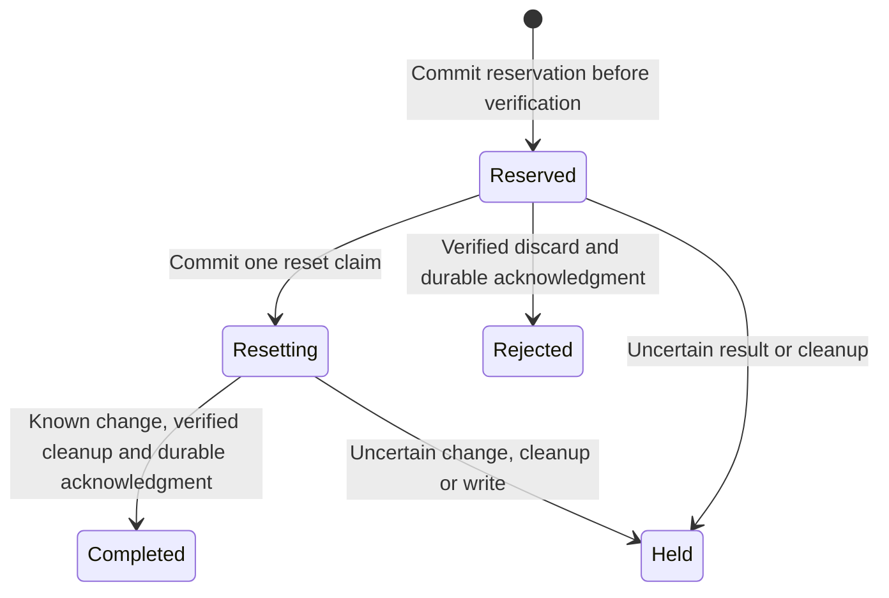

# Local durable recovery admission interface

15 October 2026. Authorized scope: local design, synthetic tests and disposable persistent state. No spending, hosted changes, real accounts or provider calls.

## Contract and ownership

The disconnected createDurableRecoveryAdmission factory wraps a **trusted, already verified recovery provider**. It does not authenticate a customer, choose rate limits, derive an email identifier, configure storage or mount an account route. The existing signed-purpose verifier remains required. Provider input must already be immutable and bound by the trusted server adapter to the admission context; browser input cannot select that context.

| Operation | Server-owned metadata | Required acknowledgment |
|---|---|---|
| reserve | Expected store ID, policy digest, new operation ID, opaque subject key, generation | Exact matching IDs and reserved, or an authoritative denied result |
| claimReset | Exact reservation IDs | Exact matching IDs and resetting, committed before password work |
| settle | Exact reservation IDs, completed/rejected/held outcome, cleanup verification | Exact matching IDs and that final state, committed before cleanup is reported successful |

Only metadata enters this storage interface. Email, code, password, JWT, provider response and browser nonce stay out of it. The subject key is server-supplied opaque metadata, not proof of identity; real derivation, canonicalization and retention remain production decisions.

A storage port must make decisions atomically and persist them before acknowledging. Missing state must never bootstrap a new store. It must reject replayed reset claims, release no counters, preserve unresolved work on restart and refuse changes inconsistent with the stored state. A timeout or unknown result cannot be represented as an authoritative denial.

## Lifecycle

A reserved record stays open while reset permission waits for the customer. Verification returning a capability does not complete the reservation. Before password change, reset claim acknowledgment, local cancellation/shutdown and expiry are checked. The wrapped provider still independently checks signed recovery purpose and current identity/session authority.

Only the existing reset-only owner should use the returned server capability. It waits for both password work and discard before reporting completion. Duplicate password submissions dispatch once; discard is idempotent. A failed/uncertain password result, cancellation during a change or uncertain cleanup retains a hold. Unknown storage acknowledgments produce a local hold and leave durable reserved/resetting evidence unresolved if settlement could not be confirmed. No automatic refund, retry, reseed or reconciliation is provided.

Exchange, reset-claim, password work and cleanup/storage steps have bounded waits. At most four underlying exchanges and 128 delivered capabilities are admitted locally. Timed-out underlying exchange work retains its slot until it settles. Cleanup uses a separate bounded signal so request cancellation does not skip it. These are existing engineering admission/deadline bounds, not newly selected customer guessing policies.

## Implementation and evidence

- apps/foundation/src/server/recovery-durable-admission.ts: port definitions, strict acknowledgment validation, reset-only lease wrapper and conservative hold handling. Only tests/harnesses call the new factory.
- tools/operations/local_recovery_abuse.py: the disposable journal adds an atomic resetting phase; only a reserved verification record can enter it. Further admission remains blocked until confirmed settlement.
- apps/foundation/tests/support/recovery-admission-store.py and recovery-admission-process.ts: test-only bridge. Each ledger operation starts a fresh Python process. Node probes use synthetic callbacks and can deliberately exit after reservation or reset claim.
- Three new foundation test files add **35 tests**. Eight additional journal cases add **8 operations tests**.

Fresh Node/Python processes completed three simulated reset/cleanup cycles, then refused the exhausted limit without provider work. Deliberate process exits during verification and password work left reserved/resetting records that blocked the next fresh process. Missing journal state stayed missing and refused provider dispatch. No fake code/password was present in stored records.

Signed composition tests connect the original identity verifier and token-recovery provider to the new interface, recovery owner, receiving-browser confirmation and reset-only delivery. Signed recovery succeeds only with confirmed cleanup. Signed ordinary OTP is refused without password work. Unconfirmed cleanup produces unconfirmed presentation and durable held state. No ordinary sign-in cookie is issued.

Additional tests cover shared counters, competing guards, metadata-only requests, malformed/mismatched acknowledgments, missing state, lost writes/claims, one-use reset, expiry after a slow claim, cancellation before/after reservation, late verification cleanup, ignored timeouts, cleanup timeout, malformed settlement and shutdown.

All **1,366 foundation tests across 133 files**, type checking/build, **253 operations tests** with ResourceWarning treated as an error, four encryption tests and 16 local Memory checks pass. The earlier 183-check database/photo restore drill is unchanged historical evidence and was not rerun.

## Remaining gates

The abstract interface cannot prove that a real backend is truthful or durable. The fixture bridge uses only synthetic identities, policy/clock values and callbacks. It is not a hosted database adapter or customer activation. No real production subject identifier, retention period, rate window or migration was chosen.

The local journal's checkpoint still cannot detect coordinated rollback of both files or authenticate against an administrator who rewrites them. Independent monotonic evidence, backend transactions/privileges, trusted clock/identity ownership, maintenance/expiry cleanup, recovery reconciliation and real fault/restore testing remain required. Old opaque browser/capability objects are not restored after restart; unresolved work blocks new attempts until independently reconciled.

Provider-purpose compatibility is unresolved, including OTP-only replies. Incoming email-link URL logging, exact trusted ingress, sender setup, real cross-device behavior and hosted acceptance remain open. The bounded interface does not undo an already completed remote password change or prove provider deletion. B03/B04 and all acceptance/phase checkboxes stay unchanged.

Exact next local action: review storage-adapter transaction/fencing and reconciliation design against this contract, with no actual deployment or permission changes. Do not mount a candidate or replace signed recovery proof before its existing business/security/provider gates are resolved. Project memory and the local Memory snapshot are updated; GitHub/hosted Memory, permanent backup runtime/credentials/ledgers/scheduler and spending are unchanged.
