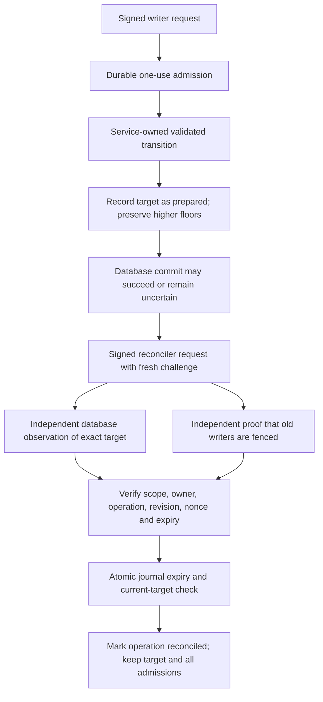

# Local authenticated witness service and restricted recovery contract

Sabine approved local preparation/tests on 15 October 2026, including split-commit recovery, with no new spending or hosted changes. The service is disconnected from application routes. It uses actual ephemeral Ed25519 signatures and a durable synthetic journal, with simulated transition and evidence issuers. No hosted service, real identity, credential or account grant was configured.

## Authentication and role boundaries

`apps/foundation/src/server/local-cvi-witness-service.ts` verifies a signed, exact-schema request before durable admission. A request binds authority, witness, store, immutable policy, principal/key identity, action, operation ID, expected revision, fresh challenge and deadline. Roles come from pinned service configuration; the request cannot select or override one.

All caller keys, the service reply key and the two recovery-proof issuer keys must be distinct. Unknown identities, wrong keys, extra fields, substituted scope and expired/future requests are refused before journal work. Replies are signed over server-constructed result envelopes and bind the original principal, challenge and whole request digest. The local reply verifier rejects transplanted acknowledgments.

| Principal | Permitted service action | Refused action |
| --- | --- | --- |
| Observer | Read current metadata and pending status | Advance, reconcile, arbitrary state writes |
| Writer | Read; request a validated advance for one operation and expected revision | Reconcile, reset, refund, delete or choose target state |
| Receipt signer | Read current metadata/pending status | Advance, reconcile or edit receipt history |
| Reconciler | Read; reconcile one recorded pending target using independent evidence | Choose a new target, lower floors, recreate delivery permission |
| Service authority signer | Sign constructed protocol replies through an injected callback | No arbitrary caller body or signing endpoint |
| Bootstrap/administrator | No runtime request action | Runtime initialization, replacement authority or role changes |

Read actions write only their bounded replay/admission record and observed clock, not history floors. The internal inspection port used by the service exposes its private journal to the service, not through the public read result. These are tested contract roles, not real PostgreSQL grants or demonstrated operator isolation.

## Durable admission and advance

`tools/operations/local_cvi_witness_service.py` persists admitted request IDs, challenges, immutable owners/roles/actions, deadlines and one-use tickets in an owner-only disposable journal. Each operation runs in a fresh Python process under a lock. There are at most 128 request records and 128 operation records, subject also to the existing private-file byte cap. Nothing is pruned or refunded. Those are fixture capacity bounds, not production retention policy.

A challenge cannot be replayed after restart. A newly signed challenge cannot repeat an admitted advance operation ID, even if the transition source failed before an advance. Ticket ownership/action and request expiry are checked inside the durable operation. Unknown or lost outcomes do not reset an admission.

Advance accepts no replacement metadata from the signed caller. A trusted, service-owned transition source supplies the validated current and target metadata. The journal checks exact current revision and metadata, fixed scope, nondecreasing epoch/time and no head fork at the same epoch. It durably records the target as `prepared` and blocks another advance until reconciliation. A signed `advanced` result acknowledges the witness update only, not database commit or permission to deliver speech.

The transition source remains simulated. The journal does not independently rerun the actual domain validator or carry all receipt/projection rows. Production must bind this source to the validated transaction intent and exact logical database digest.

## Split-commit recovery

Recovery evidence is fetched through two separate trusted service ports, not accepted as request-body assertions. Each issuer signs exact witness/store/policy, operation, original owner, current revision, target digest and the new recovery challenge. The database proof must state `target-committed`; the fencing proof must state `writers-fenced`. Issuer keys, signatures, freshness and all correlation fields must match.

Proof expiry is checked both by the service and inside the final journal update. A proof expiring between validation and commit leaves the operation pending. Reconciliation preserves the target metadata, records the original operation as reconciled and increments revision. It does not lower a floor, recreate an old ticket, refund a request, replay an acknowledgment or prove client delivery.

| Observed situation | Contract outcome |
| --- | --- |
| Database matches exact pending target and writers are independently fenced | Reconcile the recorded operation only |
| Database remains at old state or evidence is missing/unknown | Hold; no rollback of the witness |
| Database proof matches but fencing is unavailable | Hold |
| Wrong owner, operation, revision, scope, key, challenge or expired proof | Hold; admission remains spent |
| Journal commit succeeds but reply/signing fails | State remains durable; replay does not recreate permission |
| Journal write interrupted at pending/data/checkpoint stage | Hold after restart; no automatic repair |
| All journal/checkpoint history restored together | Negative test accepts old admission again; independent protection remains required |

This is a recovery decision contract, not an automated database repair tool. It cannot reconstruct a lost target transaction, fence real workers or release the earlier file-witness mismatch by itself. If the target cannot be independently established, operator recovery remains open and admission stays blocked.

## Local evidence

48 new foundation tests verify signed role restrictions, replay after service restart, distinct key requirements, operation reservation after source failure, competing advances, wrong/stale/reused evidence, pending/complete recovery, lost durable acknowledgments, interrupted writes, cancellation, signature/result substitution and atomic proof expiry. A negative coordinated-journal-restore test retains the rollback limitation. Proof issuers and writer fencing are simulations; real request and proof cryptography plus fresh-process journal persistence are exercised.

26 operations tests verify ticket ownership/roles, immutable scope, nondecreasing floors and time, expiry at commit, recovery correlation, permanent consumption, missing/corrupt state, clock bounds and refusal to rebootstrap. Review added exact result checks, distinct keys and atomic admission/proof expiry; it also rejects boolean revision substitution in the journal interface.

Full regression: 1,881 foundation tests across 152 files, 381 operations tests with ResourceWarning as error, TypeScript checking/build, four encryption checks and 16 local Memory checks. Earlier SQLite witness and PostgreSQL permission rehearsals remain distinct evidence. No actual PostgreSQL service mutation or claim was enabled.

## Remaining deployment requirements

- Independently administered witness storage, protected epoch/identity history and restore policy. Cryptographic authentication does not prevent an authorized storage operator from rolling back all state.
- Actual authenticated transport, service-owned clock, revocation/key lifecycle, least-privilege database functions and real principal-to-role mapping within separately approved hosted work.
- An integrated validated transition source and real database observation/fencing authorities. Fresh signed assertions are useful only if their issuers are truthful and independently protected.
- End-to-end transaction intent, receipt-claim and signer integration with crash recovery and permanent experiment admission. The earlier local file witness is not silently replaced or rebased.
- Production retention/capacity, privacy/ingress evidence and all provider/financial/live acceptance gates. No safe-audio-flush, provider-finality or customer recovery promise is established.

No provider calls, new spending, hosted changes, real credential storage, public push, hosted Memory publication or permanent backup runtime/ledger/scheduler changes occurred. Existing spending allocation remains $51 and phase/task completion counts are unchanged.

Exact next local action: compose the authenticated contract with disposable validated SQLite transaction intents and receipt claims, testing exact database-target observation and refusal when the target was never committed. Continue using simulated fencing and explicit independent-protection limits. Real backend provisioning and hosted activation retain separate authorization gates.
