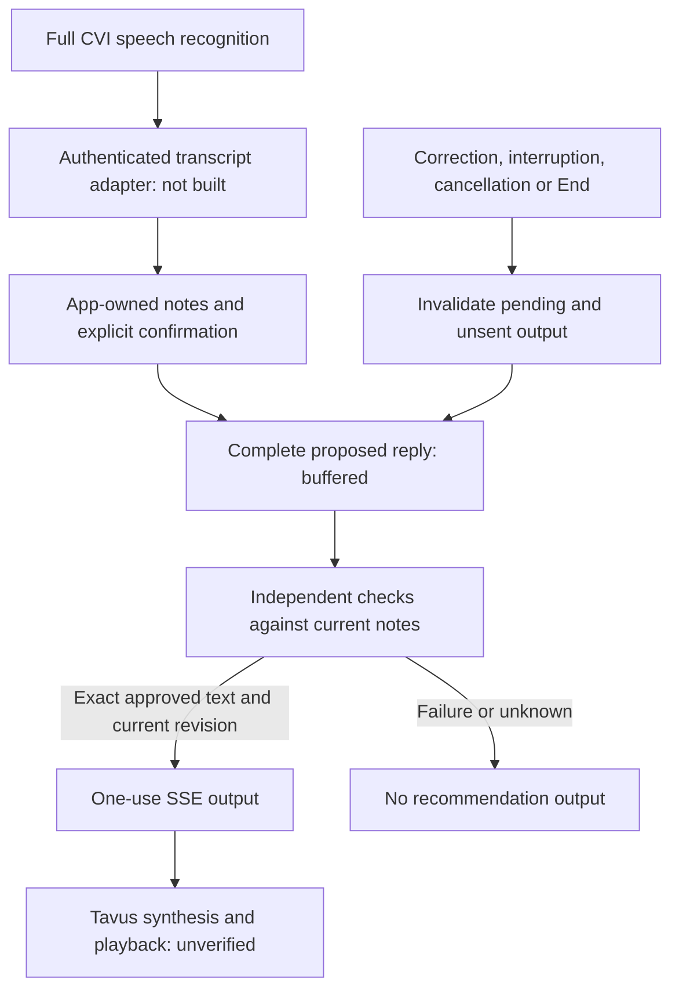

## Authenticated context follow-up, 16 October 2026

[The local notebook bridge](local-tavus-authenticated-notebook-context.md) now reuses StylingSession for seven-field draft/check context. Raw conversation input still cannot confirm notes. The original standalone fixture below remains historical evidence; real transcript and provider compatibility remain unverified.

# Local full-CVI styling experiment

Status: local preparation and simulated tests only, approved by Sabine on 15 October 2026. No live room, new spending, hosted change, credential use, microphone or provider request.

## Candidate architecture

Tavus documents custom LLM integration through a streaming `/chat/completions` endpoint: https://docs.tavus.io/sections/conversational-video-interface/pal/llm. Its tool-result behavior is not assumed to enforce every pre-speech check. This local candidate controls output at the custom response boundary instead. It is an experiment, not a change to the agreed production architecture.

## Implemented boundary

`apps/foundation/src/server/local-cvi-styling.ts` is disconnected from all application entry points. It has no HTTP listener, account context, provider SDK, fetch, database, microphone, credential, file access or media transport. Only tests import it.

- Seven notes fields are immutable snapshots: occasion, timing, color, coverage, budget, look type and wardrobe. Normalized synthetic note updates carry explicit confirmation state. The experiment does not infer confirmation from a customer's words.
- Duplicate, reordered, invalid and excess fixture updates are refused; history is capped at 128 updates. Real utterance authentication, revisions, final/partial ordering and extraction still need an adapter.
- A new request cancels previous pending work. Complete draft text is bounded and withheld from output while the independent injected checker runs.
- The checker must approve the exact text and exact snapshot revision. Wrong, extra, missing, rejected and throwing results emit no recommendation and no generated fallback.
- Corrections, interruptions and replacement requests invalidate pending or prepared-but-unsent output. End clears notes, cancels work and permanently closes that owner.
- Deadline and cancellation abort the injected work, ignore late results and return a fixed blocked state. Abort does not prove remote cancellation.
- A successful result offers a one-use SSE representation with JSON-encoded content, assistant role, terminal stop and DONE marker. It is a local wire fixture, not verified Tavus protocol acceptance.

The draft/check ports use simulated functions only. Six fixture compositions exercise the existing hard outfit validator, but they do not establish semantic model accuracy, source availability or complete production-validator integration. Unconfirmed notes remain explicit in snapshots; production policy must prevent them being treated as confirmed constraints. No free-form normal-chat bypass or unvalidated neutral fallback has been introduced.

## Evidence and limits

48 focused tests cover withheld output, seven fields, explicit confirmation, input bounds, stale drafts/checks, pre-send interruption, replacement, timeout, cancellation, malformed verdicts, SSE encoding, one-use output, End and no reopening. A negative test explicitly demonstrates that interruption cannot recall bytes already handed to a transport.

Regression evidence: all 1,419 foundation tests across 134 files, type checking/build and 16 local Memory checks pass. The initial sandbox run could not bind loopback ports (EPERM); the complete suite passes with local-port permission. Existing backup/operations tests are unchanged and were not rerun for this disconnected module.

Full-CVI still requires live verification of transcript delivery, callback authentication and consultation binding, request correlation/retries, interruption during downstream playback, greeting/filler/error fallback behavior, non-ElevenLabs synthesis, latency, privacy and cleanup. A passing finite test does not establish an absolute stale-audio guarantee. No room replacement or original inference continuation is simulated as a flush proof. Playback offset and final billing/deletion remain unproven.

Before any live experiment: inspect actual account features and permitted non-ElevenLabs voice, design the authenticated private endpoint and cancellation ownership, verify all response paths, then prepare a separately priced one-attempt test with hard limits for Sabine's financial/private activation decision. Existing held reservations and $51 experiment allocation are unchanged; there is no reusable allowance inferred here. Do not enable a production route or change hosting as part of local preparation.

## Next action

Prepare the disconnected authenticated request-envelope and transcript adapter contract using captured public fixture shapes, including mismatched conversation, duplicate request, retry, transcript correction and canceled response delivery. Do not claim full-CVI acceptance until live tests are separately authorized and observed. Support clarification remains useful but does not prevent local experimentation.
