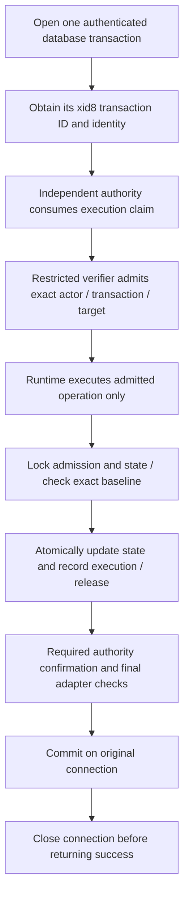

## Local renewal follow-up, 16 October 2026

Renewal is now prepared in the signed bridge and restricted full-state SQL path. The isolated PostgreSQL rehearsal passes 638 checks and preserves one history through six transitions, including renewal. Nineteen earlier direct gate cases are now twenty with the real SQLite renewal check. Final full run 16796 is pending; actual gate/PostgreSQL/owner composition and hosted acceptance remain open. See local-tavus-postgres-renewal.md. Earlier five-transition, unsupported-renewal and test-count descriptions below are historical.

# Local database permissions and transaction adapter contract

Sabine approved local preparation and tests on 16 October 2026, with no new spending or hosted changes. The SQL is an opt-in disposable PostgreSQL contract, not a migration for Supabase. It uses made-up identities and data, a cached PostgreSQL 17 image, no published ports, no network, bounded resources and temporary storage. The rehearsal removes its container on exit.

Follow-up: [local signed-authority database bridge](local-tavus-signed-database-bridge.md) now tests real execution-claim signatures against live local transaction observations. The complete PostgreSQL domain port and committed-target reconciliation remain open.

## Permission boundary

`tools/operations/sql/cvi-transaction-contract.sql` separates a non-login owner, verifier, rotator, fencer, writer, signer and observer. Runtime identities have one granted role and no superuser, role-creation, database-creation, replication or RLS-bypass privileges. The owner has no runtime membership. All four tables force RLS, with owner-only policies. Runtime roles cannot select or mutate the tables, truncate history, disable RLS, create objects in the private schema or assume the owner role.

| Role | Granted surface | Refused surface |
| --- | --- | --- |
| Verifier | Admit an exact, transaction-bound operation | Execute the mutation, raw tables |
| Rotator | Execute its own admitted activation | Admit approvals, execute another identity's operation |
| Fencer | Execute its own admitted retirement | Activate, change domain head |
| Writer | Execute its own admitted domain-head change while active | Rotate or retire a generation |
| Signer | Execute its own admitted one-use release while fenced | Read raw receipts, reactivate a generation |
| Observer | Read the limited metadata view | Read admissions/releases or execute mutations |
| Public/customer/service-role fixtures | No access to this private schema | Every metadata, admission and mutation route |

Mutation and admission functions use SECURITY DEFINER with a fixed search path and qualified table references. Default public function execution is revoked. `session_user`, not a caller-supplied role string or session setting, is compared to the admitted database identity. Multiple logical memberships or privileged login identities are refused at admission.

## Transaction-bound admission

The SQL admission binds operation ID, unique authority-claim hash, authenticated principal, action, transaction ID, exact prior/target snapshots, optional receipt-record hash and deadline. The execution function accepts only operation and claim identifiers. It takes its target from the verifier-owned admission, not from the runtime caller. Closed transition checks distinguish activation, fencing, active domain change and fenced release. Extra state fields and boolean-for-number substitutions are refused.

The execution function locks the admission and current state. Exact baseline comparison, state change, consumed admission, execution row and any unique release tombstone commit in one transaction. A returned SQL result is provisional until that connection commits. A duplicate release or stale baseline rolls back the entire transaction. Competing writes either serialize or hold at the bounded lock timeout.

Admission is committed through a separate verifier connection and survives runtime transaction rollback. Its transaction ID cannot be used by a replacement transaction. The independent authority claim must also stay spent. SQL rollback is not permission to issue a new admission or retry. A lost commit response stays unknown; the adapter never chooses a new connection or raw-write path.

## Required adapter ports

`tools/operations/local_cvi_database_adapter.py` requires a database transaction port and authority admission/confirmation port. There are no built-in credentials, default connections, local fallback or optional verifier. It captures methods, reserves each operation before external work, binds the exact database identity and transaction, copies values across the authority boundary, checks typed JSON equality, rejects mismatched results and checks time before commit and after its reply. It closes the transaction before returning success. Failure, missing evidence, unknown commit or failed close holds the instance and does not retry or refund.

The synchronous port is a contract for trusted adapter code. It is not a production driver or proof that an arbitrary injected port is honest. Real transport cancellation, statement timeouts, cryptographic verification and connection-pool identity handling remain mandatory integration work. The rehearsal driver supplies fixed local time for adapter tests; SQL uses the actual PostgreSQL clock for expiration tests.

## Test evidence and review fixes

- 287 real local PostgreSQL checks cover the permission matrix, function grants, full four-action sequence, rolled-back execution and replay through a new transaction, wrong identity/claim, duplicate release, malformed transitions, expiry, competing writes, stale baselines and role/RLS metadata.
- 28 adapter unit tests cover missing dependencies, authority outage, wrong bindings, exact JSON types, transaction substitution, method capture, provisional/unknown commit, expiration and connection-close failure.
- The full app run exposed a race-sensitive pre-existing witness test. It counted any fulfilled promise as an advance, although the service deliberately returns signed held refusals. The assertion now verifies authenticated outcomes, checks at most one actual advance and compares durable history. A deterministic signed-held case verifies that refusal consumes its request without preparing history. No service permission was weakened.
- Final regression: 1,956 foundation tests across 155 files; 462 operations tests with ResourceWarning as error; type checking, build, four encryption tests and 16 local Memory checks. The PostgreSQL harness was also corrected to wait for the final server, drain pipe output reliably and close all child pipes.

## Remaining production gates

The PostgreSQL verifier in this rehearsal simulates authority validation. It is not wired to the existing Ed25519 authority or the full mandatory SQLite adapter. The SQL state is deliberately a small permission/transaction model with generation, fence, owner, boot and domain head. It does not port the full domain validator, grant history, aggregate digest or original committed receipt payload. Its release hash represents a synthetic receipt reference; signing is not performed.

A production verifier must authenticate the live transaction identity and instance, verify the full exact intent and independent authority evidence, consume the durable execution claim, prevent re-admission after unknown outcomes, and obtain fresh reconciliation/fencing evidence. Transaction IDs alone are not a restore-proof authority, and the verifier must not accept arbitrary customer-supplied IDs. Superusers, table owners, backups/restores and an actor controlling both stores are outside this local runtime boundary.

SQL checks expiry during execution; it cannot promise a wall-clock deadline at COMMIT against a malicious holder that delays its transaction. The trusted adapter checks immediately before commit and after its reply, but a commit can still occur before an expired or lost reply is held. This does not prove delivery, recall of output, provider termination, deletion or final billing. No customer retention or lease-lifetime policy is changed by the fixture bounds.

Exact next local action: design and test the authenticated bridge from the existing signed execution claim to a live database transaction identity and a validated full-state intent, including unknown admission/commit outcomes. Independent administration, restore protection, real grants and all-writer coverage remain required. Hosted SQL, credentials, live calls and deployment remain gated. No public push or hosted Memory update occurred; allocation remains $51 and permanent backup runtime/ledgers/scheduling are unchanged.
