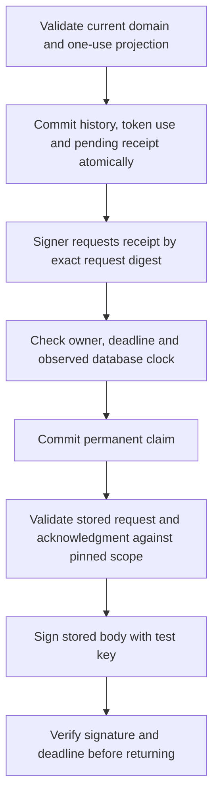

# Local committed-receipt-to-signer interface

Sabine approved local preparation and tests on 15 October 2026, including crash and replay protection, with no new spending or hosted changes. All databases and keys used here are disposable synthetic fixtures. The interface is disconnected from application routes and providers.

## Transaction and signing sequence

`tools/operations/local_cvi_receipts.py` adds a receipt outbox to an explicitly bootstrapped temporary SQLite fixture. The existing transaction helper optionally appends the receipt within its existing BEGIN IMMEDIATE transaction. The actual TypeScript domain validator still computes the transition while the lock is held. No caller-provided replacement result is stored. Invalid receipt context rolls back the whole transaction.

A receipt contains the original metadata request and a server-constructed committed acknowledgment. Its ID is the canonical request digest. A unique challenge prevents a new command from reusing an already committed challenge. The principal digest must match the test-owned actor configuration, and the domain input, store and immutable policy must match the committed operation. At most 128 receipts can be issued; no cleanup, refund or automatic reseeding is exposed. These bounds are fixture settings, not a production retention decision.

The claim operation uses a fresh process and an exclusive transaction. It checks receipt ownership, request digest, deadline and nondecreasing database/receipt time. It commits `pending` to `claimed` before returning any record to the signer. Missing, locked, expired, corrupt or previously claimed data produces no permission. A claim advances the observed database clock, so a later operation cannot return to an earlier time.

`apps/foundation/src/server/local-cvi-receipt-signer.ts` accepts only a receipt ID. It cannot accept a caller's result body for signing. Its trusted port must return an authoritative record only after durable claim. The signer captures its pinned authority/store/policy/principal/key, checks exact schemas, original request digest and challenge, projection and committed-result correlation, a supplied epoch floor and bounded deadlines. It clones the record before asynchronous signing and verifies the returned Ed25519 signature before releasing it. All unknown outcomes hold that signer without retry or fallback.

## Crash and replay behavior

| Point of failure | Durable state | Result |
| --- | --- | --- |
| Before history/receipt COMMIT | Old history, no receipt | No signature; caller remains uncertain |
| After history/receipt COMMIT, before reply | New history, pending receipt | Mutation cannot repeat; original receipt may be claimed once within its original deadline |
| Before claim COMMIT | Pending receipt | No record handed to signer |
| After claim COMMIT, before signing | Claimed receipt | Another signer refuses it |
| After cryptography, before delivery | Claimed receipt | No second signing permission |
| Invalid key, cancellation, timeout or lost signed delivery | Claimed receipt if claim committed | No success/refund/reclaim |

This is conservative one-use signing admission. It does not guarantee that a signature or response was delivered. It intentionally sacrifices another delivery attempt when a claim outcome is uncertain. There are no automatic retries, reclaim leases or stored signatures available for replay. Creating a new signer does not reset SQLite claim state.

## Local evidence

36 new foundation tests exercise real disposable SQLite databases and fresh Python processes. Cases cover atomic before/after-commit crashes, claim crashes, an actual Node signer exit after cryptography with no acknowledgment, competing claims, restart refusal, lost delivery, malformed scope/input, stale clocks, expired records, missing storage, request substitution, replayed challenges with a new command, minimum epoch, wrong signing keys and late cancellation. A composed test confirms that the existing pinned signed transaction client accepts the committed receipt acknowledgment without reapplying the mutation.

Final regression: 1,809 foundation tests across 150 files, 331 operations tests with ResourceWarning as error, TypeScript checking/build, four encryption checks and 16 local Memory checks. The earlier 111 PostgreSQL permission checks remain separate evidence and were not rerun or extended in this task.

## Boundaries and remaining gates

- The claim port is a trusted contract. Its honesty, actual principal authentication, exclusive signer grants and commit durability must be established by a real backend. A malicious port can fabricate or reissue records. Local validation cannot prove database provenance by itself.
- SQLite uses the same local authority as its receipt state. A negative test restores a whole database snapshot after signing and successfully obtains another permission. Independently protected receipt claims, epoch floors, identities and token history remain required. The supplied floor is not made independently durable here.
- Domain results are validated when the fixture commits. The signer checks stored schema and correlation; it does not independently recompute the domain transition from a current authoritative snapshot. A historical committed receipt is not proof of current credential authority or permission to deliver a recommendation.
- Hosted PostgreSQL mutations and receipt claims remain disabled. No Supabase migration, production grants, actual signer outbox deployment, transport authentication, private credentials or real signing keys were installed. Existing hosted-proposal SQL was unchanged.
- Pending receipt recovery does not grant a new client challenge, extend the original deadline, refund a reservation or resolve an uncertain consultation. Late signatures cannot revoke previously delivered audio.
- The 128-receipt bound, metadata schema and ASCII fixture canonicalization do not establish production capacity or retention. A complete deployment needs operational reconciliation, protected restore behavior and an agreed retention policy.
- No provider calls, hosted changes, extra spending, public GitHub push, hosted Memory publication or permanent backup/runtime changes occurred. The $51 allocation and real admission/activation gates remain unchanged.

Exact next local action: specify a separately protected claim/floor witness and test how receipt history is checked across restores, without pretending separate local folders establish independent hosting. Real PostgreSQL implementation, credential separation and hosted activation retain their separate authorization gates.
