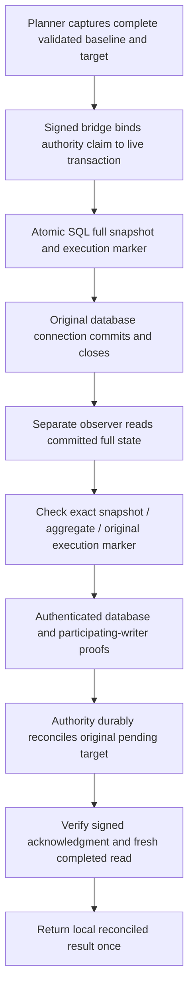

## Full-state reconciliation cancellation checks, 16 October 2026

Revalidated the existing local post-commit reconciliation under Sabine's approval. Added four cases for cancellation after durable reconciliation, cancellation after the final signed read, loss of that read, and a caller canceled before work starts. A completed authority transition stays recorded when acknowledgment is withheld. The one-use finalizer cannot retry, replay the database mutation or reconstruct a signing handoff. No production code or SQL was changed for this follow-up.

Verification: 31 focused foundation checks, 556 disposable PostgreSQL checks with networking disabled, 475 operations tests with ResourceWarning as error, TypeScript checking, build and four encryption checks pass. This test/documentation follow-up does not claim a fresh full foundation regression. All phase and launch acceptance gates remain open. This is the complete logical CVI fixture, not customer account or photo recovery. Independent restore floors, universal writer fencing, native domain enforcement and actual provider/device acceptance remain unresolved. Allocation remains $51. No spending, real credentials, provider calls, hosted changes or permanent backup runtime changes.

Exact next action: retain the separate uncommitted lifetime work for its own review. That work also needs per-operation absolute deadline checks before output; timer callbacks alone are insufficient. Do not claim the lifetime changes are complete or extend the eight-second native lease. Continue from /private/tmp/ai-stylist-recovered-20261014 and preserve the older checkout.

## Reconciliation revalidation, 16 October 2026

Rechecked the approved local full-state post-commit implementation. Added a regression case that alters each of the six logical sections while retaining the supplied reduced projection and execution markers; every altered target must be refused and authority must remain pending. Corrected outdated activation-only and separate-scenario descriptions in the original reconciliation documents. No production code or acceptance gate changed.

Current evidence: 27 focused reconciliation/continuous-state tests, 503 disposable PostgreSQL checks with networking disabled, 475 operations tests with ResourceWarning as error, TypeScript checking and 16 local Memory checks pass. The earlier 2,181-test full-suite result remains historical; it was not rerun for this test/documentation-only change. No spending, provider calls, real credentials, hosted publication or permanent backup runtime changes. Allocation remains $51.

Next local action: review documented Tavus request/transcript compatibility against the disabled adapter and record the consultation-lifetime/lease gap before any live proposal. Independent restore floors, universal writer fencing, native domain enforcement and real provider acceptance remain open. No action is required from Sabine for this local checkpoint.

## Follow-up evidence, 16 October 2026

The activation-only limitation recorded below was followed by all five typed targets and a continuous PostgreSQL sequence. See [typed coverage](local-tavus-typed-full-state-coverage.md), [continuous state/restore checks](local-tavus-continuous-state-rehearsal.md) and [startup admission](local-tavus-durable-startup-admission.md). These are local rehearsals; native domain enforcement, independent administration and universal fencing remain open. Earlier test counts below describe the original checkpoint.

# Local full-state reconciliation after database commit

Sabine approved local preparation and tests on 16 October 2026, with no new spending or hosted changes. This extends the disposable PostgreSQL rehearsal to persist the complete logical CVI fixture state and reconcile its original signed authority target after commit. It does not deploy a production database adapter or activate live styling.

Follow-up: [typed full-state coverage](local-tavus-typed-full-state-coverage.md) now includes domain commit, receipt claim, fencing and release targets as separate PostgreSQL scenarios. The continuous local sequence, competing connection, checkpoint restore and fresh-process inspection checks are also implemented. Production acceptance remains open.

## Complete logical state

`tools/operations/local_cvi_full_state.py` exports the existing model's complete logical rows: domain history and its payload, projections, committed receipts, writer gate, retained grants and release tombstones. An optional rollback-only planner capture records both the exact baseline and exact target while the actual existing validator and lease mutation run. Capture does not commit SQLite or change the original signed intent ID.

`apps/foundation/src/server/local-cvi-full-state-reconciliation.ts` validates the domain payload through the existing domain validator and reconstructs the original aggregate metadata from every exported section. Both snapshots must match the original signed intent metadata. A five-field projection, unchanged domain head or matching generation alone is insufficient. A changed grant token hash or receipt row changes the aggregate and cannot substitute for the exact target.

This is the complete logical CVI test model, not the customer account/wardrobe schema. PostgreSQL stores the complete export as JSONB; this is not a native SQL port of every domain mutation rule.

## Atomic PostgreSQL persistence

The unapplied `cvi-full-state-contract.sql` supplement adds forced-RLS full-state and full-admission tables owned by the non-login owner. Runtime roles cannot access those tables directly. The verifier admits the exact full baseline and target alongside the existing transaction-bound command. The full execution function locks the full baseline, invokes the existing restricted operation, and atomically updates the full snapshot and its operation marker in the same transaction as execution, consumed admission and release records.

The supplement revokes runtime access to the older reduced-state execution function. Full execution without a full admission fails. There is no reduced-state fallback. SQL trusts the restricted verifier to supply the validated target; the verifier's signed bridge pins the actual planner result.

A separate observer connection reads the full snapshot, reduced projection, operation ID, original transaction ID, claim hash, consumed status and the checked reduced-route privilege restriction through a view. All fields come from one PostgreSQL statement snapshot. The observer cannot see the writer's uncommitted target. Runtime admission/write roles cannot read or alter the protected full-state tables.

## Reconciliation and result release

Recovery proof sources check the exact snapshot and aggregate against the original signed target, as well as the projection, original operation/transaction/claim, consumed marker and restricted full-state route. The existing authority service verifies independently keyed database/fence proof signatures before reconciling. The local reconciler verifies the signed reconciliation acknowledgment and another fresh authority read with no pending operation and the same target/revision.

`ReconciledDatabaseAdapter` requires this finalization after the existing adapter has committed and closed. Missing finalization, a wrong receipt, expiry, backward clock or an uncertain result holds the one-use wrapper. It never reapplies the SQL mutation. Unknown commit does not automatically trigger reconciliation. A lost reconciliation response can leave the authority reconciled while no result is returned; it does not recreate permission or refund the claim.

## Evidence and review fixes

- 16 new foundation cases check full export/aggregate equivalence, committed target acceptance, reduced/missing/uncommitted state, changed grants/receipts, wrong execution markers, protected-route refusal and forged/expired post-commit replies.
- 13 new operations cases check required finalization, no success on unknown commit, no reapply after unknown reconciliation, wrong receipts, expiration, clock reversal and captured ports.
- The isolated PostgreSQL run passes 375 checks, including the prior permission matrix, full-state permissions and six reconciliation scenarios: success, an attempted pre-commit reconciliation, post-commit grant corruption, missing full admission, lost commit response and lost reconciliation response.
- Final regression: 1,996 foundation tests across 157 files; 475 operations tests with ResourceWarning as error; type checking, build, four encryption checks and 16 local Memory checks.
- Review added explicit original-transaction comparison, signature checks after reconciliation, command-expiry checking at finalization and monotonic wrapper time. Lost replies remain held even when the corresponding durable commit already happened.

## Remaining gates

The full signed local integration covers activation, domain commits, receipt claims, fencing and release, both separately and in one continuous PostgreSQL sequence. Fresh-process inspection is implemented as a read-only diagnostic. These checks do not establish production recovery or independently protected restore floors. No original signing handoff is reconstructed, and this module does not release recommendation audio, sign an application receipt or activate another consultation.

The authority, identity and recovery proof keys are distinct but colocated test keys. Independent service administration, protected transport and production connection-pool identity remain unproven. The fencing proof covers participating restricted fixture routes and the authority's pending-operation gate. It is not proof that every possible worker, administrator or previously issued production grant is fenced. PostgreSQL observation and authority reconciliation are separate operations; real all-writer fencing is needed to close their final-check gap.

SQL stores a verifier-validated logical export atomically. It does not independently run the complete TypeScript domain validator or recreate native production tables. Superusers, owners, coordinated restores of both stores, instance/transaction identity rollback, operator recovery and full production retention policies remain outside this rehearsal. Clocks are synthetic in the signing fixture and real in PostgreSQL expiry checks; production deadline mapping remains open. No deletion, provider termination, output recall or final-billing guarantee is implied.

Original next action, subsequently completed locally: extend full-state PostgreSQL coverage to all five transitions, a continuous sequence, competing writes and restore boundaries. Current follow-up is documented provider-interface compatibility and the consultation-lifetime/lease gap; the reconciliation rehearsal does not authorize live activation. Preserve independent administration, all-writer fencing, transport, privacy, financial and live-activation gates. No hosted changes, public push, real credentials, paid calls or permanent backup runtime/ledger/scheduler changes occurred. Allocation remains $51.
