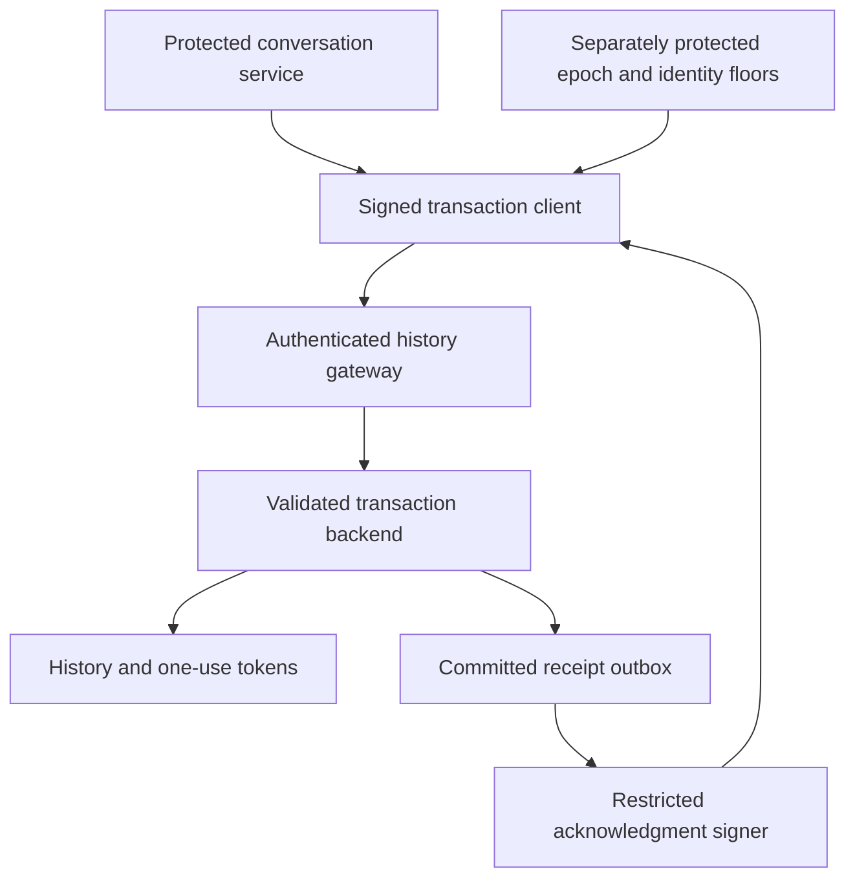

# Local Tavus hosted history adapter proposal

Sabine approved local preparation and tests on 15 October 2026, including permissions and signed acknowledgments, with no new spending or hosted changes. Nothing here is mounted in the application or applied to Supabase. This proposes boundaries within the existing Supabase and Render hosting choice, not a new hosting decision or approval to activate them.

## Proposed boundaries

The local gateway currently validates results from a supplied backend and signs them after commit. The proposed PostgreSQL receipt outbox and separate signer are not connected to that gateway. Authenticated transport, actual credential separation and independently protected floors remain unimplemented. The diagram describes the target boundary, not a deployed system.

## Implemented signing contract

`apps/foundation/src/server/local-cvi-hosted-proposal.ts` contains a disconnected port and gateway. Tests create ephemeral Ed25519 keys in memory. No real signing key, credential file, URL, HTTP client, provider SDK or hosted setting is supplied.

The client pins authority, store, immutable policy, principal digest and signing-key identity. Each exchange carries a fresh random challenge, deadline and canonical hash binding the whole request. Replies must have an exact envelope, valid pinned signature and matching scope, action, challenge and request hash. The existing transaction wrapper separately validates projection and commit semantics. Neither a signature alone nor a caller-supplied result can establish a valid domain transition.

The gateway captures the request before awaiting work, resolves its actor from trusted construction rather than incoming role fields, and signs only results it constructs after the transaction wrapper validates them. Projection capabilities stay private and are consumed once. Duplicate challenges, malformed input, mismatched principals and clock regressions are refused. Resource bounds are 128 exchanges/projections, 64 KiB canonical envelopes and bounded deadlines. These are fixture limits, not production retention or spending policy.

Cancellation, unknown outcomes, invalid signatures and lost acknowledgments release no success. A signing failure after a committed update does not undo that update or refund its reservation. Restart loses the gateway's private projection capabilities and refuses their reuse. This conservative refusal does not reconcile unfinished work or prove remote cancellation.

## Local PostgreSQL permissions

`tools/operations/sql/cvi-history-permissions-proposal.sql` is intentionally outside migrations. It is a rehearsal scaffold, not executable production business logic. Every mutation function raises `history activation unavailable`.

| Role | Allowed scaffold access | Refused access |
| --- | --- | --- |
| Observer | Read head metadata view | Mutation functions, raw tables, receipts |
| Writer | Read heads; invoke disabled reserve/consume | Rotation, direct writes, receipts |
| Rotator | Read heads; invoke disabled rotate | Reserve/consume, direct writes, receipts |
| Acknowledgment signer | Read committed-receipt view | History writes and mutation functions |
| anon/authenticated/service_role | None in this schema | Schema, tables, views and functions |

Roles are NOLOGIN, NOINHERIT and have no superuser, role creation or RLS bypass capability. Tables force RLS; owner policies allow reads only. SECURITY DEFINER functions have a fixed search path and a non-login owner. PUBLIC execution defaults are revoked. No application role can insert its own receipt or change a role grant. There are no login mappings or real account grants in the scaffold, and no account-specific row scope is implemented. A real hosted administrator or superuser remains outside these runtime-role protections.

The permission runner explicitly opts in using `--run-local-synthetic`. It uses the cached digest-pinned PostgreSQL 17 image with no network, published ports, host mounts or image pulls, temporary in-memory storage, synthetic roles only and container removal in finally. It passed 111 checks covering seven runtime roles, direct table writes, view access, function grants, escalation, forced RLS and empty state. Its first run stopped during schema setup before any checks; readiness was tightened to await the final TCP server and bounded setup diagnostics were added. The rerun passed. The initial failure's exact cause was not retained.

## Evidence and limits

- 30 gateway/signing tests cover forged scope, wrong keys, replay, principal substitution, cancellation, deadlines, captured request identity, clock regression, restart refusal and signing failure after commit.
- Four signed SQLite integration tests use actual disposable transactions. They verify commit before acknowledgment, persistence after signing failure, endpoint reservation/consumption before text, and refusal of tampered signatures after commit.
- The PostgreSQL permissions and SQLite domain transactions are separate rehearsals. No actual PostgreSQL domain mutation or receipt-to-signer integration is proven.
- Final regression: 1,773 foundation tests across 149 files, 331 operations tests with ResourceWarning as error, TypeScript checking/build, four encryption tests and 16 local Memory checks.

## Required before hosted activation

1. Implement and test actual PostgreSQL domain transitions, durable projection issuance/use, immutable policy, trusted mutation clock and atomic committed receipts. Reject replacement state, reset, refund and caller-selected roles.
2. Bind authenticated service principals to limited runtime roles and account/store scopes. Keep writer, rotator, signer and administrator credentials separate. Do not use a broad service key as proof of isolation.
3. Connect the signer to committed receipt records, binding result, operation, challenge, principal and request digest. Test crash/outbox recovery without recreating success or refunding uncertain work.
4. Protect epoch/identity floors and projection/token history independently of database snapshots. This local gateway's minimum epoch of zero is not rollback protection. Test coordinated restore and authority loss.
5. Verify actual Supabase permissions, Render ingress/privacy, logging, failover and transport authentication under separately authorized hosted work. No production architecture acceptance is implied here.
6. Preserve permanent experiment admission, provider compatibility, current-note ownership, privacy, spending and live-test gates. This proposal does not prove Tavus request compatibility, downstream buffer flushing or provider finality.

Exact next local action: design and test a durable committed-receipt-to-signer interface with crash/replay refusal and explicit principal binding. Real database mutation, credential provisioning, hosted deployment and another paid provider test require their existing separate authorization gates.
