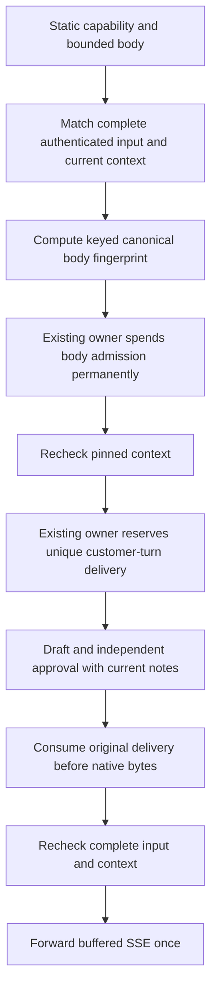

## Deadline follow-up, 16 October 2026

The native and outer HTTP operations now enforce absolute request expiry before upstream reads, reservation work and output, as well as canceling waits with timers. This closes a delayed-timer delivery gap. Startup RPC and initial writer duration are separately bounded, with the native eight-second maximum unchanged. See [lifetime limits](local-tavus-lifetime-separation.md). Continued consultation ownership and actual provider transport acceptance remain open.

# Local Tavus custom-LLM HTTP candidate

16 October 2026. Scope is disabled local preparation with simulated conversations. No listener, app route, PAL, account, provider call, real credentials, deployment or spending was activated. This is not verified live Tavus compatibility or launch acceptance. Allocation remains $51.

## Documented configuration and candidate profile

The [Tavus LLM guide](https://docs.tavus.io/sections/conversational-video-interface/pal/llm) documents a custom model/base URL/API key, SSE at `/chat/completions`, static extra headers, optional extra body values and disabling speculative inference. `localCviLlmConfiguration` returns only a partial full-pipeline configuration: logical model `local-simulation`, a `/cvi/v1` base, a static app capability header and speculation disabled. No face, voice, greeting or disclosure settings are selected. It is not a ready create-PAL request.

The gateway authenticates `X-AI-Stylist-Token` explicitly. It does not assume how Tavus encodes `api_key` in a standard authorization header, and requires no provider-generated request or conversation headers. The secret is injected by the server owner, never read from environment or request data. Returned configuration is server-only and must not be sent to a browser or logged.

The text-only request profile is a local candidate: `model`, `stream: true`, and bounded string messages with the last message from the user. Optional `temperature` and `top_p` must exactly equal the static configured values. Unknown fields, tools, multimodal content, invalid UTF-8, oversized bodies, browser credentials, query values and client-selected internal IDs are refused. This profile has not been observed in real Tavus traffic; native defaults may require a reviewed extension.

## Completed input and owner binding

The wrapper requires the actual factory-created startup owner, its exact notebook flow/binding and the factory-created transcript source bound to that notebook. A copied object, lower credential-only helper or other context cannot select a fallback. Startup registration is an in-memory composition check, not proof that an owner remains current: repeated signed checkpoint, current credential and application identity checks still run.

The latest complete customer utterance must match the last request message exactly. The source supplies its original session epoch and admitted input revision. The gateway checks those against current notes, input and native versions before spending and before sending bytes. Streaming `final` alone is insufficient. Raw payload participant IDs do not authenticate transport: Daily room/sender admission and turn correlation are still simulated.

## Two distinct replay guards

Matching only the body lets modified-body retries request another response for one turn. Matching only the current turn can misassign an old identical body to a later identical utterance. The candidate therefore uses both:

- A canonical body HMAC scoped to the owner credential. Journals store only a derived fingerprint, not transcript/message text or the HMAC key. Keying avoids an ordinary unkeyed content hash that an operator could test against guessed phrases without the credential.
- A body-independent delivery ID derived from the app-owned conversation, customer-turn ID/ordinal and session epoch. Its full digest is encoded in base 36 to fit the existing internal ID bound.

`spendAdmission` is available only through the existing owned endpoint. It requires replay storage and current-credential/native fences, reserves and permanently spends the body record, then confirms current authority again. It grants no output permission. The separate turn record still must reserve and consume normally. There is no direct journal-write port or unguarded execution fallback in the HTTP wrapper.

The writes are sequential, not a cross-store atomic transaction. An unknown result stays held without retry, refund or reconstructed permission. Successful delivery uses two journal records, so the existing 64-record limit permits at most 32 such deliveries, fewer after failures. No technical or financial limit was increased.

Within a credential scope, an identical canonical body stays refused even after a later identical utterance. The adapter cannot safely distinguish that from a retry. A genuinely new turn with changed request history can proceed. Credential rotation rejects old static tokens; fingerprints are scoped to their original credential. Real room/credential lifecycle binding, retries after rotation and independently protected restore floors remain unproven.

## Dialogue is useful data, not note authority

The complete bounded dialogue reaches both draft and independent check ports as immutable `untrusted-conversation` data. Incoming roles map to `customer`, `stylist` and `provider-context`, rather than being forwarded as privileged model instructions. The last customer message is checked against the protected internal request, and the input epoch/revision must match before model work.

This gives a future drafting model the customer's question and conversation history. It does not make that content an authenticated note edit or confirmation. The existing notebook projection, tentative extraction, newer touch edits and separate exact-text/context approval remain authoritative. Actual model prompting and semantic accuracy remain unverified; all model/extraction ports are simulated here.

## Cancellation and cleanup

The original endpoint keeps a weak, read-only consumption status tied to the original Request object. It is not an output permission, signing handoff or receipt recreated from disk. A clone or reconstructed Request has no such status. This lets the wrapper suppress an already-spent stale response without erasing newer notes. Unknown body/delivery outcomes still hold the owner.

Clear, End, observed expiry and identity-driven closure notify the transcript source to remove cached text. Input getters also observe local expiry and refuse an obsolete epoch/input version. Only bounded technical turn IDs remain in the local replay tracking until disposal. This adds no production retention policy or secure-erasure promise.

The operation remains active until its body is consumed, canceled or reaches its deadline. An abandoned response with unresolved delivery is held. Bytes already handed to a transport cannot be recalled, and this candidate proves no Daily/browser audio flush, provider deletion or final billing.

## Evidence scope

Focused tests cover static auth/profile validation, canonical retries, changed-body same-turn refusal, later identical utterances, context/source isolation, raw-route rejection, lost reserve/spend acknowledgments, inactive credentials, cancellation, stale prepared output, immutable dialogue and cleanup.

The signed integration uses actual local authority signatures, SQLite, credential and replay fixtures for two guarded HTTP exchanges. A fresh Python process also refuses the already-recorded body admission without changing its journal. Customer identity, Daily admission and extraction remain simulated. This is not a whole hosted restart/restore, real account or provider test. Final regression passes 2,280 foundation tests across 167 files, 475 operations tests with ResourceWarning as error, TypeScript checking/build, four encryption checks and 16 local Memory checks. The prior 503-check PostgreSQL baseline is unchanged and was not rerun in this turn.

## Remaining gates and next action

- Exact native body defaults, authentication delivery, request/event ordering, repeated messages, retry and cancellation behavior require an approved live trial.
- Real room/sender/customer-turn admission is not implemented. Static HTTP capability alone is not proof of those events. A microphone-only pilot must separately verify disabled perception/camera and greetings, disclosure and a voice compliant with the ElevenLabs exclusion; this fragment does not set those fields.
- The original eight-second native writer lease is still not an 85-second private trial or a production consultation lifetime. A bounded renewal/lifetime design must preserve fencing and spent history before activation. No time or spending allowance was extended.
- Native domain enforcement, universal writer coverage, independently protected restore floors, production clocks, hosted routing and model/device acceptance remain open.
- Source/local Memory updates do not authorize public publication of private support messages or security details.

Next local action: design and test bounded consultation ownership across writer-lease expiry, separating HTTP request deadlines from native leases while preserving old-owner fencing and both replay guards. Use synthetic data only. Keep all activation, privacy, source-account, financial and hosted gates unchanged.
