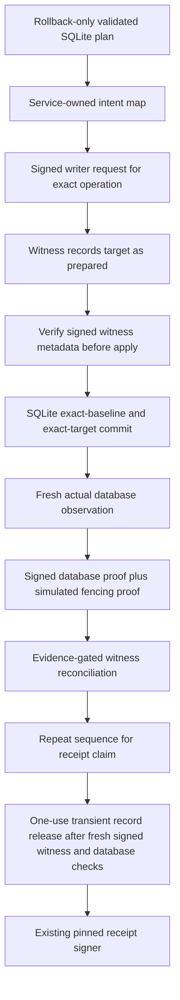

# Local authenticated witness, SQLite and receipt-claim integration

Sabine approved local integration tests on 15 October 2026, including refusal of uncommitted targets, with no new spending or hosted changes. This composition is test-only. It uses disposable SQLite databases, a separate synthetic witness-service journal, ephemeral signing keys and simulated writer fencing. It is not mounted in the application or configured in Supabase/Render.

## Validated transaction intents

`tools/operations/local_cvi_integration_intent.py` runs the existing SQLite transaction or receipt-claim logic inside a rollback-only transaction to plan an exact intent. Domain changes still invoke the actual TypeScript domain validator while the database lock is held. The planner returns only mode, actor/time, arguments, exact before/after metadata and a canonical intent digest. It does not return a claim record or a signing permission. Projection tokens are issued during explicit fixture setup before witness initialization; project issuance is not part of this integration's runtime protocol.

Preview never calls SQLite COMMIT. The original connection cleanup rolls all changes back. Invalid commands produce no intent, receipt or witness admission. Claim previews leave pending receipts pending even when the proposed aggregate digest differs at the same domain epoch/head.

Apply recomputes the intent digest and checks exact actor/time. Under one SQLite lock, it compares the current baseline, reruns the existing operation, and checks exact target metadata before committing. Comparison uses canonical JSON so booleans cannot substitute for numbers. A different baseline, altered command or mismatched target rolls back the complete mutation. Apply exposes only commit and claim fixture modes, not arbitrary SQL.

## Authenticated composition

`apps/foundation/tests/support/cvi-integrated-witness-fixture.ts` composes the existing authenticated service, durable service journal, actual SQLite domain transactions/receipt outbox and the existing receipt signer. The signed caller selects an operation ID and revision, not replacement metadata. A private service-owned map resolves the validated intent for the configured witness writer. A verified signed service response must match the intent target and pending operation before the fixture calls SQLite apply.

The database proof issuer now reads actual logical SQLite metadata in a fresh process. It signs `target-committed` only if the aggregate matches the recorded target digest; otherwise it signs `old-state`, which recovery refuses. The aggregate includes domain payload, policy, clock, projection tokens and receipt states. Matching only domain epoch/head is insufficient for a claim target.

Fencing remains a simulated assertion using a separate ephemeral key. This task does not implement worker leases, writer revocation, actual role grants or an independently administered proof issuer.

## Claim and signing behavior

After a reconciled domain commit, the fixture plans a claim, advances the witness, commits the actual SQLite claim and reconciles that exact target. Only the record returned by the actual committed claim is held transiently. Preview results cannot populate this record cache.

Record release deletes its one-use transient entry before checking a fresh signed witness read, no pending operation, the exact claim target and fresh actual database metadata. The existing signer then validates and signs that record. A failure, premature sign attempt, cancellation or loss of the transient record does not recreate permission. A process crash after the claim COMMIT can leave the record permanently claimed without a deliverable signature, even if the witness later reconciles correctly.

This transient release cache is a test-only handoff, not a new durable delivery service or retention policy. A fresh signer has no route to read an already claimed record back from SQLite.

## Tested outcomes

| Scenario | Local result |
| --- | --- |
| Valid domain commit, claim and reconciliation | Exactly one local signed receipt acknowledgment |
| Domain target planned but never committed | Recovery refused; witness stays prepared |
| Claim target planned but never committed | Refused even when domain epoch/head match |
| SQLite crash before COMMIT | Old metadata remains; target cannot reconcile |
| SQLite crash after COMMIT before reply | Exact target can reconcile; mutation cannot reapply |
| Claim crash after COMMIT before record handoff | Target can reconcile, but signing permission is not reconstructed |
| Baseline changes after advance | Apply rolls back; recovery refuses the different database state |
| Intent/actor/target altered | Refused without partial commit |
| Database committed but fencing absent or proof substituted | Recovery held |
| Signing while recovery is pending | Refused; transient handoff is burned conservatively |
| Database-only or witness-only restore | Signing refused by fresh exact-state comparison |
| Competing apply attempts | At most one mutation/receipt; nonblocking contention may hold both callers |

23 new foundation tests use fresh Python processes, actual SQLite transactions, the actual domain validator, actual request/proof/reply signatures and the existing signer. Full regression: 1,904 foundation tests across 153 files, 381 operations tests with ResourceWarning as error, TypeScript checking/build, four encryption checks and 16 local Memory checks. No UI/manual check is needed for this disconnected backend fixture; no live compatibility or phase completion is inferred.

## Limits preserved

- The intent map, database inspection identity and actor configuration are service-owned test fixtures. Direct import of low-level helpers bypasses the harness; real transport authentication and database grants remain unimplemented.
- Database and witness updates are not one atomic transaction. A witness-ahead state stays held if the target never committed. This integration does not reconstruct missing data, lower a floor, refund an admission or rebase the earlier file witness.
- Database observation, witness read and signing are separate steps. The last observation does not atomically freeze future writes. Simulated fencing cannot establish actual quiescence or eliminate the gap after the last check.
- Independent storage, identity/floor history and restore protection remain assumptions. Earlier negative tests showing coordinated rollback of all local authorities remain applicable; separate folders and valid signatures do not establish independence.
- A signed historical receipt is not proof of current consultation authority, client playback, provider cleanup or final billing. Current-note ownership and permanent experiment admission remain separate gates.
- Hosted PostgreSQL mutations, real credentials, production keys, provider calls, customer data and deployment remain disabled. No public GitHub push or hosted Memory publication occurred. Permanent backup runtime, ledgers and scheduler were untouched; the spending allocation remains $51.

Product/design scope and task/phase completion counts are unchanged. Exact next local action: specify and test a writer-lease/fencing contract that holds mutation and record release across observation/signing, with explicit restart and concurrent-change refusal. Preserve independent-protection and all hosted/provider/privacy/financial activation gates.
