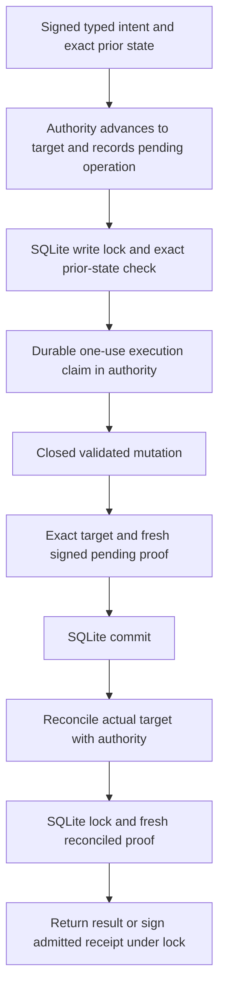

# Local authenticated monotonic lease and release authority

Sabine approved local preparation and tests on 16 October 2026, with a mandatory persistence adapter, no raw write fallback, no new spending and no hosted changes. This is a disconnected contract rehearsal with disposable SQLite databases and ephemeral signing keys. It does not activate Tavus or protect a production database.

Follow-up: [local database permissions and transaction adapter](local-tavus-database-transaction-contract.md) tests restricted PostgreSQL roles and transaction-bound admission. Its authority verifier remains simulated; full-state signed integration is still open.

## Authenticated ownership and exact state

The authority authenticates signed callers and distinguishes rotator, fencer, writer, signer, observer and reconciler. Typed operation ownership is checked before durable admission and again when resolving the trusted intent. Callers cannot select a replacement target. Intents bind the exact actor, time, arguments, prior state and target.

The compared aggregate includes domain history, projections and committed receipts, plus the writer gate, every retained grant and every release tombstone. Generation supplies the monotonic epoch floor; the history digest covers same-generation changes. Rolling back only a release or grant is therefore detectable even if domain history did not change.

| Role | Closed mutation |
| --- | --- |
| Rotator | Activate a fresh owner/boot-bound generation |
| Fencer | Retire the exact current generation |
| Writer | Apply the validated domain intent using its current lease |
| Signer | Permanently admit the original owned receipt record for release |
| Observer | Read signed current authority state |
| Reconciler | Reconcile the recorded target using actual database and fencing evidence |

No customer can choose these roles. The principal map, clock and keys are test configuration. Real transport authentication, grants and independent administration remain required.

## Mandatory execution protocol

The new TypeScript adapter requires authority and persistence ports, captures their methods, verifies signed responses and requires every protocol stage. Missing ports, unavailable authority, malformed evidence, stale proofs, cancellation and incomplete backend responses are held. There is no default writer, local-only fallback, raw mode, finish endpoint or automatic retry.

The Python backend independently verifies authority signatures with the pinned public key. It obtains fresh challenges while holding the SQLite write lock, compares exact snapshots before mutation and COMMIT, and requires reconciliation before returning success. Rollback-only planning invokes the actual domain validator without committing or exposing a claimed signing record. Preview activation uses one trusted token across planning and apply; backend proof challenges use independent random bytes.

## Replay gap found and fixed during review

An advance acknowledgment alone was insufficient while the authority operation remained prepared. After a committed SQL transaction was restored to its prior state, captured approval could otherwise be replayed directly at the backend.

The backend now permanently claims execution in the authority before writing. The claim is bound to the operation, revision, original owner, target digest and original advance-request hash. A deterministic internal execution marker is appended to the existing bounded durable request journal. It stays spent on SQL rollback, lost claim reply, cancellation, crash or a one-sided database restore. A fresh signed read cannot replace this claim. No recovery route resets or refunds it.

Release also commits its permanent spent receipt record before cryptography. Missing reconciliation, lost transient handoff, signing failure or lost response cannot reconstruct permission. Reconciliation observes the actual target; it does not repair missing transactions or invent a signing record.

## Evidence

- 28 foundation integration cases cover authenticated roles, actual SQLite/domain/claim/signing composition, missing ports, no raw fallback, method capture, forged/replayed evidence, cancellation, crashes, rollback and durable execution-claim replay refusal.
- 24 new mandatory-adapter operations cases cover closed commands, actual snapshots, clock/role/input guards, preview behavior, stages and failures. Three additional authority-service cases cover permanent execution claims, original ownership and lost replies.
- Final full regression: 1,955 foundation tests across 155 files; 434 operations tests with ResourceWarning as error; type checking, production build, four encryption tests and 16 local Memory checks.

## Limits and next action

The authority and SQLite commits are separate. Uncertain split outcomes stay held and may sacrifice availability. The test fencing proof covers participating mandatory routes; it is not evidence of real worker termination or universal SQL grants. Historical low-level helpers remain outside this new entry point for negative tests. A filesystem owner or separately authorized raw writer is outside this boundary.

A negative test confirms that coordinated restoration of both authority and database still defeats the local model. Real independent monotonic storage, restore administration, least-privilege database grants and all-writer coverage remain open. A later change after the final check cannot recall computed or delivered bytes. No provider cleanup, playback, final billing or production retention guarantee follows from this rehearsal. Fixture lifetime/capacity bounds do not set a customer policy.

Exact next local action: review the database-side grant/transaction adapter contract and independent authority persistence, restore and fencing coverage requirements. Hosted application, real credentials, deployment and live testing still require their existing approvals. No public push or hosted Memory publication occurred. The $51 experiment allocation, backup runtime, scheduler and permanent ledgers remain unchanged.
