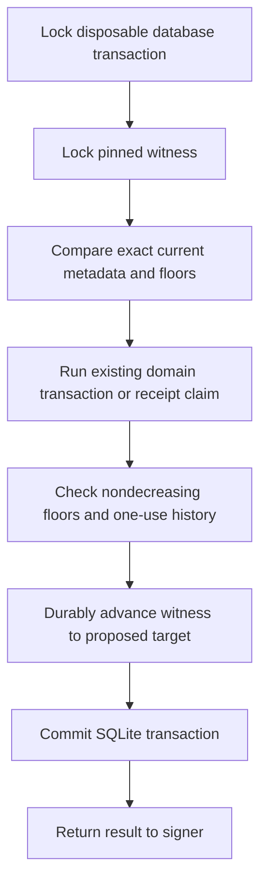

# Local receipt-claim and epoch-floor witness across restores

Follow-up: [authenticated service contract](local-tavus-authenticated-witness-service.md) adds signed roles and evidence-gated split-commit reconciliation. Its sources/fencing remain simulations; real storage independence and grants are still open.

Sabine approved local preparation/tests on 15 October 2026 with no new spending or hosted changes. This is a disconnected model using separate disposable SQLite and witness folders. The witness is assumed separately protected. Separate folders on one Mac do not establish that protection.

## What the witness covers

`tools/operations/local_cvi_receipt_witness.py` pins a witness ID, store ID and immutable policy digest. Its state contains a monotonic revision, domain epoch/head floor, observed database clock and digest of the exact logical database contents:

- Domain history payload, head, policy and observed time.
- Every issued/used projection token and its owner, head and lifetime.
- Every pending/claimed receipt, its immutable request/result record, owner and observed time.

The aggregate digest covers projection-only and claim-only changes even when domain epoch/head stay unchanged. It is not a hash of the SQLite file's physical layout. Records are ordered before hashing; the original JSON payload/record bytes are included. A semantically equivalent rewrite of those stored bytes is conservatively held.

## Protected operation sequence

Protected project, commit, claim and inspection operations use the same database-then-witness lock order. Missing, malformed, mismatched, stale or incomplete witness state holds admission. Protected test-bridge modes require a witness and do not silently choose the older unprotected fixture.

Before commit, the wrapper refuses lower epochs/clocks, a different domain head at the same epoch, deleted or modified receipt/projection identities, claimed-to-pending regression and used-to-issued regression. It increments the witness revision for every actual logical change. No-op commits leave it unchanged. Existing domain validation remains responsible for semantic transitions and limits; the witness wrapper is an internal test helper, not an authorized generic SQL API.

The witness advances before SQLite commit. This does not make the two stores atomic. A failure between those commits deliberately leaves a mismatch that blocks later operations. There is no automatic rebase, witness replacement, reset, refund or reconciliation. Bootstrap is explicit, only into an empty private witness directory, and is not available through protected runtime operations. A real initial witness cannot safely be inferred from an untrusted restored database.

## Restore and crash outcomes

| Scenario | Local protected result |
| --- | --- |
| Database restored before a claim, current witness retained | Refused, including when domain epoch is unchanged |
| Domain database restored below epoch floor | Refused before projection or claim |
| Projection table restored while epoch/head are unchanged | Refused |
| Witness restored while current database is retained | Refused |
| Missing/substituted/incomplete witness | Held without reseeding |
| Crash before witness advance | SQLite rolls back; neither store acknowledges the change |
| Crash after witness advance, before database commit | Mismatch; subsequent admission stays held |
| Crash after both commits, before reply | Durable state remains; a claimed receipt cannot be reclaimed |
| Witness write interrupted at pending/data/checkpoint stage | Pending marker blocks subsequent admission |
| Database and witness restored together | Negative test accepts old permission; outside the model's guarantee |

The existing signer is composed with a protected claim port. No record reaches its cryptography callback after a detected restore mismatch. A successful receipt remains a historical acknowledgment, not proof of current credential authority, client delivery or provider cleanup.

## Evidence

24 new foundation tests use actual disposable SQLite databases and fresh processes. They cover claims and epoch floors across database/witness restores, projection-only rollback, competing signers, required reference/identity, missing files, explicit-bootstrap refusal, clock rollback, three domain/claim commit boundaries and three interrupted witness file stages. The negative coordinated-restore test signs twice after restoring both authorities, preserving the independent-protection requirement.

24 new operations tests cover append-only receipt/token state, payload/identity preservation, epoch/head/time floors, witness substitution, damaged files, disk failure, revision bounds and no-op behavior. Full regression: 1,833 foundation tests across 151 files, 355 operations tests with ResourceWarning as error, TypeScript checking/build, four encryption tests and 16 local Memory checks. The earlier PostgreSQL permission rehearsal remains separate and was not rerun; its mutations/claims are still disabled.

## Production requirements still open

- An independently administered, authenticated witness with actual least-privilege grants, protected signing identity and monotonic history. Local files/checksums do not supply these properties.
- Protection against coordinated rollback of database, witness, identity and caller floors. A new witness ID or new caller must not silently bless restored history.
- Durable transactional behavior, failover, fencing and an explicit recovery/reconciliation contract for a witness ahead of the database. This rehearsal intentionally leaves uncertain state held.
- Real signer principal mapping, current credential authority, production metadata bounds and retention, and integration into permanent experiment admission.
- Existing provider, privacy, financial and live activation acceptance gates. No actual Tavus behavior, audio flushing, remote finality or hosted permission isolation is proven here.

No production keys, credentials, customer data, provider calls, hosted changes, new spending, public push or hosted Memory publication were involved. The permanent backup runtime, scheduler and ledgers were untouched. The $51 allocation and task/phase completion counts remain unchanged.

Exact next local action: review an authenticated witness service contract and least-privilege grant design against existing approved Supabase/Render hosting, with explicit refusal and operator recovery for split commits. A real backend choice, credential provisioning and hosted activation retain their separate authorization gates.
