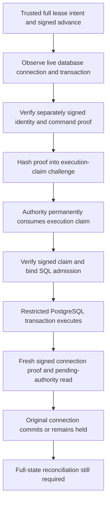

# Local signed-authority bridge to database transactions

Sabine approved local preparation and tests on 16 October 2026, with no new spending or hosted changes. This joins the existing signed execution-claim service to the local PostgreSQL transaction adapter using ephemeral keys and disposable data. It is not a production deployment or a completed full-state PostgreSQL port.

Follow-up: [local full-state post-commit reconciliation](local-tavus-full-state-reconciliation.md) persists the complete logical fixture export and verifies committed-state evidence for activation. Other typed operations, independent administration and universal fencing remain open.

## Signed binding

`apps/foundation/src/server/local-cvi-database-authority-bridge.ts` pins the authority key, a distinct database-observation key, the trusted database principal, the complete validated lease intent, its signed advance acknowledgment and an exact service-owned database command projection. Command and connection values are copied across boundaries. Missing dependencies, mismatched scope, invalid signatures and non-JSON values fail closed. No unsigned admission fallback is added.

A database observation binds the actual connection principal and transaction ID, exact command, authority operation, store, policy, random nonce and expiry. The observation service signs a digest of the observed binding. The bridge checks that signature against its separate pinned key. A request's claimed identity alone is insufficient.

The execution-claim challenge hashes that verified observation together with the operation and original advance-request hash. The existing authority signs its response over that challenge and request hash. The bridge verifies ownership, revision, original grant, target digest and status before producing the SQL admission's claim hash. This binds the signed one-use claim to the exact transaction without adding an unsigned field to the old authority protocol.

Before commit, confirmation requires another freshly signed observation of the same binding and a fresh authority read. A previous proof cannot answer the new nonce. The read must still show the same pending operation, target and revision. Confirmation is one-use and cannot move the claim to a replacement transaction. Cancellation and unknown results hold the bridge. A fresh bridge instance cannot refund a durable authority execution claim.

## Actual local PostgreSQL composition

The optional `--signed-authority-bridge` mode of `tools/operations/rehearse-cvi-transactions.py` starts a test-only Node worker. It uses the existing actual authenticated authority service, real Ed25519 signatures and durable execution markers. Private keys stay inside that worker. The Python driver queries `session_user` and `pg_current_xact_id()` on the live PostgreSQL connection for each observation, instead of accepting caller-supplied identity fields or a cached identity.

Only verified bridge output is sent through the restricted SQL verifier role into transaction-bound admission. The existing adapter still treats SQL results as provisional, requires confirmation, commits on the original connection and closes it before success. The driver never creates an alternate raw-write path on failure.

Seven signed scenarios cover success, forged database proof, forged claim response, lost claim response, replayed proof at confirmation, lost SQL-admission response and lost commit response. Claimed operations are retried through a fresh bridge and replacement transaction to verify refusal. The lost-commit case observes that SQL may have committed even though the adapter returns no success. Nothing resets or refunds the original authority claim.

Each scenario uses its own ephemeral authority journal. The disposable SQL fixture is reset by its test administrator between scenarios; this is test isolation, not an allowed production recovery operation. No real history, backup ledger or hosted database is reset.

## Evidence and review

- 24 new foundation cases verify the actual signed service: ownership and exact binding, observed connection substitution, key separation, bad/expired/replayed proof, claim/reply loss, confirmation, cancellation and captured methods.
- The combined isolated PostgreSQL run passes 340 checks, including the earlier permission matrix and seven signed bridge scenarios.
- Full regression: 1,980 foundation tests across 156 files; 462 operations tests with ResourceWarning as error; type checking, build, four encryption checks and 16 local Memory checks.
- Review added rejection of non-JSON canonicalization substitutions and another command-expiry check after claiming. These prevent returning admission after its command expires or accepting fields that disappear during hashing. Existing logical time fixtures and PostgreSQL wall-clock checks remain separate.

## Explicit remaining gates

The database identity signer and authority signer use different keys but are colocated in the local worker. This does not establish independently administered services, protected production transport, connection-pool isolation or a restore-proof database identity. A production observation service must authenticate the actual backend and instance; it cannot sign arbitrary caller-supplied transaction IDs.

The complete existing lease intent is validated by the existing rollback-only SQLite planner, and its metadata remains signed by the authority. The SQL command is a pinned five-field projection for the transaction-permission model. It does not persist the full domain, grant history, receipt payload or aggregate digest. The signed integration currently exercises activation. Other SQL actions retain their earlier local transaction tests, but their full signed projections are not yet integrated.

After successful SQL execution, the authority deliberately remains prepared/pending. The bridge verifies permission to attempt the transaction, not proof that the full signed target committed. It does not reconcile that state, return a committed authority receipt, enable another consultation, sign a recommendation or activate Tavus. An unknown admission or commit outcome stays held. Production reconciliation requires fresh committed full-state evidence and fencing coverage.

The clocks in the bridge fixture are synthetic; SQL expiration uses the actual local PostgreSQL clock. Production conversion of deadlines, transaction cancellation, expiry at the final check, all-writer fencing, independent restore protection and operator recovery remain open. SQL cannot enforce a malicious session's precise wall-clock COMMIT deadline. No output recall, provider deletion/termination or final billing guarantee follows from these tests.

Exact next local action: prepare the full-state PostgreSQL intent/projection contract and post-commit authority reconciliation, refusing reduced projections, uncommitted targets and unknown outcomes. Keep independent administration, transport, restore, privacy, spending and live-activation gates intact. No hosted changes, public push, real credentials, paid calls or backup-runtime/scheduler changes occurred. Experiment allocation remains $51.
