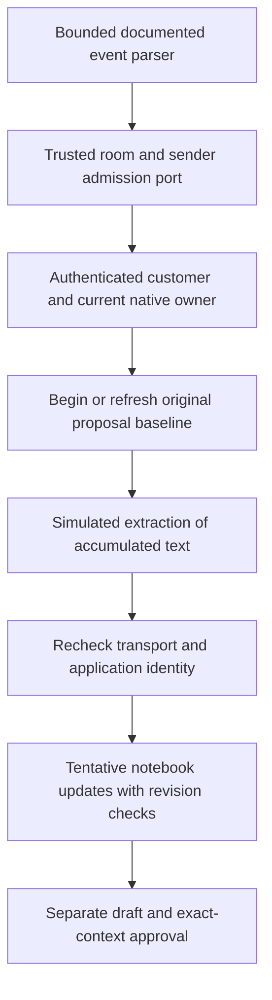

# Local Tavus wire compatibility, 16 October 2026

Scope: disabled local parsing and simulated transcript extraction into the existing authenticated notebook. No live room, SDK, listener, provider call, credentials, deployment, spending or production acceptance. Financial allocation remains $51.

## Public contract review

| Boundary | Documented surface | Local consequence |
| --- | --- | --- |
| Custom LLM | `layers.llm` configures a custom model, base URL and API key; the endpoint streams SSE at `/chat/completions` | Our fixed `local-simulation` request is a fixture, not verified native wire compatibility |
| Extra headers | `headers` supplies static custom headers | Do not assume Tavus generates our `X-Cvi-Request-Id` or supplies a dynamic room binding |
| Speculation | `speculative_inference` can be false | A later pilot can propose disabling speculative calls; no setting was applied |
| Extra body/query | Optional configuration can add fields or query values | Current exact request validation may reject native extras; no secret query or permissive fallback was added |

Source: [Tavus LLM guide](https://docs.tavus.io/sections/conversational-video-interface/pal/llm). These documented configuration options do not establish the exact incoming request body, retry identity, API-key header encoding or end-to-end correlation behavior for our endpoint.

[Interaction events](https://docs.tavus.io/sections/conversational-video-interface/interactions-protocols/overview) use Daily app messages. Sequence numbers order provider events, and turn indices group events. Neither payload fields nor display names authenticate the transport sender or application customer. The room and sender must be verified separately. No webhook authentication contract is inferred here.

[Complete utterances](https://docs.tavus.io/sections/event-schemas/conversation-utterance) carry `properties.role` and `speech`. Customer speech uses `user`; PAL output can have a legacy `replica` duplicate. A credited participant handle is optional. The documented inference identifier describes PAL inference, so the adapter does not treat it as a proven customer-turn key. Unattributed customer speech remains held by the app policy.

[Streaming utterances](https://docs.tavus.io/sections/event-schemas/conversation-utterance-streaming) carry accumulated `speech`, `content_index` and `final`. PAL interruption uses `is_interrupted`. Streaming text replaces the earlier accumulated text; it is not appended as a delta. The local adapter keeps streaming proposals provisional until the complete utterance closes the turn.

Child properties were inspected in the public pages' embedded schema. Their Markdown versions omitted those child definitions. These sources are public documentation evidence, not captured live Tavus traffic.

## Implemented local path

`local-cvi-transcript-adapter.ts` normalizes only text events and discards display/analysis fields. Unknown fields or malformed shapes are held for explicit review. It bounds text, payload size, turn history and unsettled operations. The extraction port is injected and simulated. No model/provider is selected or called.

The required admission port is trusted server integration, not an HTTP field or customer-controlled boolean. Its repeated check of the same delivery must be non-consuming and return stable correlation while authorization remains valid; it must not create rooms, retry paid work or spend another delivery reservation. It must bind the verified room/sender to the application request and provide a stable customer-turn ID plus monotonic customer-turn ordinal across streaming/full events. The fixture uses explicit mappings only. A real Daily admission/correlation implementation is still missing, and neither `turn_idx` nor `inference_id` is silently substituted for it.

PAL/replica output never becomes customer preferences. Duplicate or older sequences/content indices cannot overwrite the latest turn. A new customer turn supersedes unfinished work. Both transport admission and existing notebook identity/native-owner checks are repeated before applying proposals. Proposals cannot confirm facts or override newer touch edits. Raw transcript text has no authority to change budget meaning, ownership or session identity.

Native checkpoint inspections within this context are serialized because the local authority journal uses nonblocking exclusive read-admission locks. The queue holds at most eight unsettled inspections, rechecks identity after waiting and does not retry or release an unknown active read early. This covers this composed context, not every external writer or reader.

The notebook now holds draft output while the latest admitted proposal revision waits for extraction. Refreshing a chunk invalidates prepared output without resetting the original touch-edit baseline. Old extraction revisions cannot unpause the new revision. Only an authenticated input advances the admission ordering floor; an unauthorized caller cannot cancel a legitimate pending begin. Clear invalidates delayed begin calls, and a delayed older begin cannot supersede a newer admitted input. A failed or timed-out extraction leaves output held until a valid newer update or Clear/End.

## Live preflight gaps

- Native request authentication, body extras, retry/request identity and transcript-to-LLM ordering are unverified. The existing protected HTTP endpoint still requires proposed fixture headers and is not a drop-in Tavus endpoint.
- Real Daily room/sender authentication and customer-turn correlation are not implemented. The parser's normalized IDs are content metadata, not proof.
- The local native writer lease is capped at eight seconds. It is not the approved private trial's 85-second lifetime or a production consultation lifetime. Renewal, fencing, credential lifetime and deadlines need an explicit integrated design before activation; no time or spending limit was extended.
- No real extraction, semantic approval, speech playback, interruption, retention, phone or hosted acceptance is established. Independent restore floors, native domain rules and universal writer fencing remain open.
- Source and local Memory updates do not authorize publishing private support messages or security details.

## Evidence

Regression passes 2,226 foundation tests across 166 files, including 70 cases in the three affected files. TypeScript checking/build, 475 operations tests with ResourceWarning as error, four encryption checks and 16 local Memory checks also pass. The existing 503-check PostgreSQL baseline was not rerun because no SQL contract changed. Tests include documented event shapes, streaming replacement/full completion, tentative budgets, sender/customer refusal, out-of-order frames, delayed extraction, touch edits, Clear/End, revocation, timeouts and signed-owner protected SSE composition. Test admissions and extractors remain simulated.

The endpoint now refuses a known pending context before reserving delivery. If a transcript becomes pending during reservation, only a verified current-owner fence permits spending the original live reservation without output; unknown ownership stays held. This does not refund an attempt or reconstruct a handoff.

Next local action: design and test native HTTP compatibility using the documented static header configuration, preserving authenticated room binding and replay refusal without requiring undocumented dynamic provider headers. Real Daily admission/correlation, native lease lifetime and hosted activation remain separate gates.
