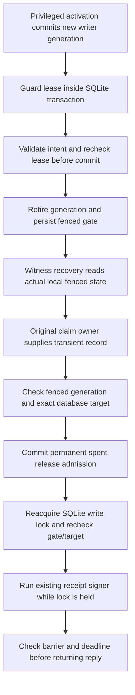

# Local writer leases, fencing and locked receipt release

Sabine approved local preparation/tests on 16 October 2026, including restarts and concurrent changes, with no new spending or hosted changes. This is a disconnected SQLite contract for participating writers, not production database grants or an independently administered authority.

Follow-up: [authenticated monotonic authority and mandatory adapter](local-tavus-monotonic-lease-authority.md) includes control tables in the authority digest and requires durable execution claims before participating writes. The earlier helper-bypass and coordinated-restore limits remain relevant.

## Lease and generation contract

`tools/operations/local_cvi_writer_lease.py` adds private control tables to new disposable test databases. Lease-control rows are separate from the earlier logical domain/receipt aggregate. A privileged fixture rotator must commit a fresh generation before admitting a restarted writer. The previous generation's grants are retired and preserved. Process exit alone does not revoke a lease.

A lease binds store, immutable policy, generation, owner digest, unique boot digest, issue/expiry time and a random token. SQLite stores only the token hash. The trusted domain actor must match the owner. Caller fields cannot stretch the stored expiry or change scope, boot or generation. These are synthetic capabilities, not newly provisioned production credentials.

The writer guard checks the lease inside the database transaction and again immediately before COMMIT. The existing validated intent still checks exact actor/time, baseline and target and invokes the actual TypeScript domain validator. Lease expiry or retirement at the final check rolls the entire mutation back. Nonblocking lock contention may hold either caller; no automatic retry or availability promise is introduced.

| Fixture role | Allowed operation | Refused operation |
| --- | --- | --- |
| Rotator | Activate a new generation from the exact previous generation | Reuse an old boot, lower/reset generation, erase grant history |
| Fencer | Retire the current generation and leave the gate fenced | Activate or obtain a new writer token |
| Participating writer | Apply a validated intent with its exact current lease | Commit with a retired, expired or substituted lease |
| Receipt-release owner | Supply its original transient committed-claim record to the signer path | Reconstruct a lost handoff through a new record-read endpoint |
| Signer | Admit one receipt release, then sign inside the fenced critical section | Write domain history, activate a writer or refund a release |

Roles and clock are test-owned configuration. They are not selected by a customer request, but no real authenticated principal mapping or SQL grants are implemented here. Fixture bounds are 128 retained grants/releases and a maximum 8,000 clock-unit lease. Production lifetime, capacity and retention policy remain undecided; the seven-day customer session decision is unchanged.

## Fencing and receipt release

The new test composition derives its fencing assertion from the actual local gate, rather than a preset successful Boolean. Its signed witness proof still depends on the assumption that every relevant writer participates. It does not certify real worker termination or cover another raw database client.

Receipt release first checks the exact fenced barrier, current database target and equality with the already-claimed receipt. It commits a permanent `spent` release record before cryptography. It then reacquires the SQLite write lock, repeats the barrier/target checks and runs the existing pinned receipt signer in a child Node process while that lock remains held. A privileged concurrent activation attempt is also blocked by that SQLite lock. The test key travels through stdin only and is never stored as a real credential.

The original transient handoff is consumed before attempting release. There is no public finish/resume or claimed-record retrieval method. A crash after durable admission, signature failure, expired reply or lost output does not recreate permission. Release rows survive generation changes and block fresh-process replay even if an adversarial original handler retained the record. Before-admission crash evidence is not durable; the owning fixture drops its transient record and does not retry. This does not establish an independently recorded attempt before the first admission commit.

The lock prevents participating database changes during the signing critical section. Once it is released, a later privileged activation may allow new changes; computed or delivered bytes cannot be recalled. This is a local history-acknowledgment boundary, not proof of current consultation authority, final client delivery or downstream media cancellation.

## Local evidence

23 new foundation tests cover guarded domain/claim/signing composition, startup generation changes, lease retirement and expiry during validation, owner/boot/token/policy substitution, actual gate-derived fencing, active-generation release refusal, concurrent activation under the signing lock, crashes around commit/admission/signing, expiry after cryptography, fresh-process record replay and preservation of releases across generation changes.

26 new operations tests cover roles, generation/boot history, expiry, scope, token hash, nondecreasing observed time, Boolean substitution, refusal to rebootstrap and nonrefunded grant capacity.

Two negative foundation tests remain explicit:

- A direct unguarded low-level helper bypasses the cooperative lease guard.
- Restoring the whole database can restore an old writer generation and token permission.

Full regression: 1,927 foundation tests across 154 files, 407 operations tests with ResourceWarning as error, TypeScript checking/build, four encryption checks and 16 local Memory checks. The previous dependency symlink pointed at a deleted temporary checkout; fixed-version dependencies were restored offline from the existing npm cache with scripts/audit/network disabled. No package or lockfile version changed. An imported unittest class initially duplicated 24 checks; using a module reference corrected discovery before final counts.

## Remaining authority and deployment gates

- Mandatory database-side enforcement and least-privilege grants are required to remove raw write bypasses. The earlier hosted PostgreSQL mutation/claim scaffold remains disabled and was not changed.
- Lease generations, retired boots, release tombstones and authority identities need independent restore protection. They are in the same SQLite file here and are not added to the earlier domain digest. Coordinated control-store rollback remains outside this contract's guarantee.
- The trusted clock, authenticated rotator/fencer/signer mapping, key lifecycle and durable startup authority must be established by a real backend. These tests do not rotate a real key or configure an account.
- A real writer-fencing proof issuer must establish coverage of all relevant writers; reading a cooperative local gate alone is insufficient. Provider quiescence, already buffered audio and the gap after output handoff remain separate.
- Current-note checks, permanent experiment admission, provider compatibility, privacy/financial limits and live activation acceptance remain open. Nothing here refunds an old reservation or authorizes another paid trial.

No provider calls, real credentials, hosted changes, new spending, public GitHub push, hosted Memory publication or permanent backup runtime/ledger/scheduler changes occurred. Spending allocation remains $51. Product/design scope and task/phase completion counts are unchanged.

Exact next local action: specify an authenticated monotonic authority contract for lease generations and release tombstones, plus a mandatory persistence-adapter boundary that refuses raw write fallback. Preserve all independent-protection, hosted/provider, privacy, financial and activation gates.
